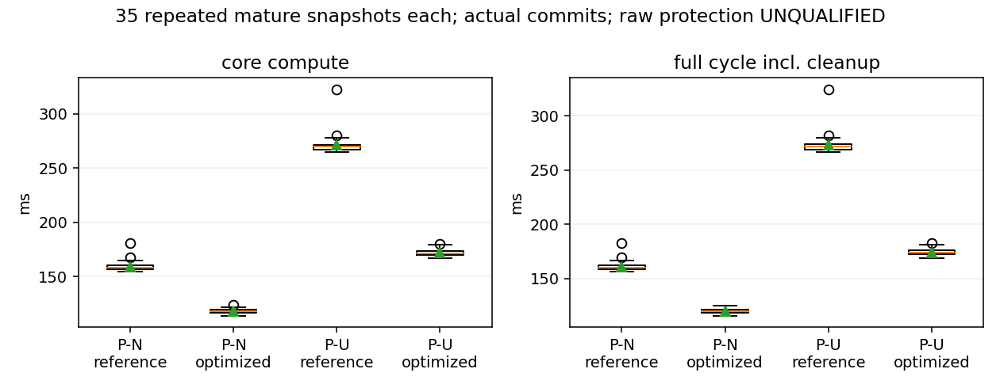

# FDE next: isolated research results

Baseline: `8fe833c`; clean working tree at start. Production configurations,
probability contracts and publication gates are unchanged. All new runs use
`formal_eligible=false`, `publication_protected=false`. No extra sensor is used.

| Stage | Work | Capability / guarantee |
|---|---|---|
| S1 | Complete fixed-model reference | Finite Gaussian oracle; raw nonlinear qualification pending |
| S2 | Functional work complete; Gaussian raw qualification gap | U1 correct commit + 4 epochs; finite-episode U2; raw empirical only |
| S3 | Complete limited exit B | New matched-power/bridge-domain attempt; no IMU recovery commit |
| S4 | Complete integrated entry and same-model benchmark | UWB research normal/recovery acceleration; not real time |

## S1

`research/gaussian_reference.hpp` provides an executable dense conditional
Gaussian reference, not an estimator backend. Cholesky joint whitening and SVD
solve expose reference mean, covariance, parity statistic and protection map.
For an accepted candidate, `||Z f|| <= sqrt(tau)+sqrt(chi2_quantile(1-tail))`
on its parity-noise event. The coordinate fault bound uses the residual-space
pseudoinverse slope. A separate three-coordinate noise event costs another
`tail`. Taking the union over **all** candidates and all outputs covers adaptive
selection without inferring shared failure events from matching IDs or Grams.
This bound is conditional on fixed A, covariance, C and covered fault spaces.
No range-union routine is called. Unresolved state rank or nearly singular
fault response refuses; a dangerous nullspace returns infinite PL. Exact harmlessness requires a literal zero raw fault column or an exact
raw state-column alias whose protection column is exactly zero. An exact
state alias with nonzero protection is dangerous. Other unresolved responses
refuse with infinite PL; small floating-point protection response is never
proof of zero. The full-rank numerical oracle is not interval certification
for arbitrary ill-conditioned inputs.

The research YAML fixes a 50-epoch horizon, 128-candidate cap, `tail=1e-9`,
`alpha=1e-6`, budget `4e-5`, seed 20261010 (confirmation 20261011) **before raw
stream evaluation**. Simultaneous union cost is `2*50*128*1e-9=1.28e-5`.
There is one categorical UWB episode (task probability .001), or nominal;
S1/S2 condition on no IMU fault. This is a synthetic task law, not a measured
hardware prior. All physical leaves must remain covered even for selection
candidates that remove a healthy row. The union proof is independent of the
prior because it bounds every included fault amplitude on the same noise event.
The separate prior-weighted miss-floor function rejects its over-budget test:
`3e-5+1e-7+1000*1e-4*.001=1.301e-4 > 4e-5`.

Sixteen deterministic checks pass (denominator 16, failures 0): correlated
covariance vs independent dense normal equations; cross-covariance omission;
principal-submatrix deletion vs incorrectly deleting mixed white rows; nonzero
shared noise map; finite, exactly harmless and dangerous nullspaces; unresolved
near-rank boundary; risk floors; and nonzero-lever rotation finite differences.
The finite snapshot has statistic .0238924, threshold 16.2662, PL xyz
`[2.26057,6.12974,0]`. It validates a finite bound, not this example's AL.
The exact harmless case protects a coordinate orthogonal to an undetectable
state/fault direction. No random coverage test is used to assert rare-event risk.

S1's positive is a **FROZEN_FACTOR_MODEL**. Joint covariance is an explicit
input and deletion is in raw coordinates. Raw PIM covariance, history mapping
and nonlinear remainder qualification are not inferred from this small model;
S2 must separately report its adapter's limits. GT never participates in this
reference calculation.

Reproduction (workspace already configured for ROS Noetic, Release):

```sh
cmake -S . -B /home/mint/ws_fusion_uwb/build/uwb_imu_pl
cmake --build /home/mint/ws_fusion_uwb/build/uwb_imu_pl --target fde_next_checks -j2
export LD_LIBRARY_PATH=/home/mint/ws_fusion_uwb/devel/.private/uwb_imu_pl/lib
BIN=/home/mint/ws_fusion_uwb/devel/.private/uwb_imu_pl/lib/uwb_imu_pl
"$BIN/fde_next_checks" config/fde_next.yaml
"$BIN/fde_research_contract_checks" config/fde_imu_order1.yaml
```

Machine: Intel Core Ultra 5 125H, 18 logical CPUs; single-thread reference.
Tested source is the S1 working tree derived from baseline (commit recorded by
next stage; no self-SHA amendment). No figures are needed for this oracle.

## S2

S1 commit: `b9a9bd3`. The shared `NoisyMotionScenario` in
`scenario_material.hpp` generates the configured smooth translation and body
rotation, true specific force and gyro, and ranges at `p_body+R*lever`.
Independent PRNG streams pre-generate untruncated ADC/range Gaussian noise.
ON/OFF reuse identical inputs. Initial error is configured once, with no
per-epoch truth reset. The 50 epochs cross fixed-lag exit at epoch 31.

`gaussian_window.hpp` differentiates actual reintegrated Combined factors for
each raw sample and axis, including the shared endpoint. It constructs
`J Q J^T` with cross-factor blocks. PIM is separately reintegrated with zero
accelerometer/gyro ADC covariances to retain only auxiliary bias/process
covariance; ADC noise is not added on top of its old marginal contribution.
Observed cross-block norm is about `1.30051e-8` in native residual units.
Candidate UWB replacements are checked as literal original raw-row subsets;
the retained covariance principal submatrix is selected before whitening.
The joint Gaussian statistic drives the research alarm and post test. Existing
estimator-weight Evidence supplies a conservative candidate-search heuristic,
not a calibrated probability or a merged failure event. The Gaussian PL still
covers **every** configured fault space for each evaluated candidate. The
existing rank-update solver and atomic transaction supply the actual estimate;
its different weighting is handled by transferring the reference PL to the
actual nonlinear committed tag mean. No range-union call is used.

Finite three-epoch UWB episodes have one shared amplitude across exact onset/stop
support. Their maps sum constituent raw/history single-epoch maps; they are
not persistent-to-window-end columns. The synthetic task law allows one
UWB episode, uniformly over onset 1–50, anchor and duration 1 or 3; events
continue naturally beyond the task cutoff. No carry-in exists at initialization.
This is a conditional research law, not a hardware event-rate estimate.

Two mechanism corrections were retained: a per-state, unit-specific numerical
recovery gate replaces the mixed-unit full-window norm **only in this runner**;
and research alarms/post statistics use the joint reference covariance.
Rotation/position numerical domains are .25 rad/.25 m; velocity and bias scales
are the original initial prior sigmas (.5 m/s, .1 m/s², .01 rad/s). These scales
are not full nonlinear remainder certificates. Candidate reference means must
pass the same domain. Incomplete V1 action census refuses selection rather than
throwing away the remainder of the stream. This is not top-K acceptance.

| Flow (seed) | Commits / total | Local available | Alarms | Exclusions | Correct fault epochs / injected | Other exclusions | Tag APE RMSE / P95 / max (m) | Increment RMSE (m) | SE3 translation / rotation RPE RMSE (m/rad) |
|---|---:|---:|---:|---:|---:|---:|---|---:|---|
| U0-uwb (20261010) | 50/50 | 49/50 | 1 | 1 | 0/0 | 1 | 0.068989 / 0.102512 / 0.165751 | 0.044544 | 0.044092 / 0.021015 |
| U1-uwb (20261010) | 50/50 | 49/50 | 2 | 2 | 1/1 | 1 | 0.069311 / 0.103407 / 0.165751 | 0.044323 | 0.043872 / 0.020596 |
| U2-uwb (20261010) | 50/50 | 49/50 | 4 | 4 | 3/3 | 1 | 0.069470 / 0.102929 / 0.165751 | 0.044449 | 0.043972 / 0.020919 |
| U3-uwb (20261010) | 50/50 | 0/50 | 1 | 0 | 0/0 | 0 | 0.367938 / 0.555703 / 0.582021 | 0.067223 | 0.066338 / 0.021042 |
| U0-off (20261010) | 50/50 | 0/50 | 1 | 0 | 0/0 | 0 | 0.069253 / 0.102512 / 0.165751 | 0.044547 | 0.044087 / 0.021030 |
| U1-off (20261010) | 50/50 | 0/50 | 31 | 0 | 0/1 | 0 | 0.086662 / 0.142114 / 0.226145 | 0.052472 | 0.051439 / 0.034269 |
| U1-confirm (20261011) | 50/50 | 49/50 | 1 | 1 | 1/1 | 0 | 0.064366 / 0.119656 / 0.208344 | 0.051613 | 0.050990 / 0.017671 |

OFF alarm counts are diagnostic Gaussian tests, with no FDE selection.
All commits, including best-effort and failed qualification, remain in the
50-output denominator. Timestamp-grid output proportion is 50/50, not a
real-time delivery proportion. Formal/protected output count is 0/50 in every
flow. ON/OFF APE uses all common 50 timestamps.

U1-uwb: at epoch 15, actual tag error 0.033196 m, served local HPL/VPL 0.877375/1.023034 m. Following four selected/local-available commits: 4/4 and 4/4. Timestamp detection/recovery delay at the injected U1 epoch is 0 epochs; computation/output delay remains nonzero and is measured in S4.
U2-uwb: at epoch 17, actual tag error 0.030933 m, served local HPL/VPL 0.985751/0.999054 m. Following four selected/local-available commits: 4/4 and 4/4. Timestamp detection/recovery delay at the injected U1 epoch is 0 epochs; computation/output delay remains nonzero and is measured in S4.
U1-confirm: at epoch 15, actual tag error 0.083711 m, served local HPL/VPL 0.873153/1.024232 m. Following four selected/local-available commits: 4/4 and 4/4. Timestamp detection/recovery delay at the injected U1 epoch is 0 epochs; computation/output delay remains nonzero and is measured in S4.

U2 removes the bad current lineage on each of its three contaminated epochs;
those rows never enter the backend, and the four epochs after stop run. This
is a functional finite-episode witness, not qualification of arbitrary
hardware persistent faults. U3 refuses all 50 local protection outputs because
coplanar ranges do not supply a global mirror-branch certificate.

**Guarantee limit:** the small fixed-model S1 theorem holds. The raw runner
outputs `LINEARIZATION_UNQUALIFIED`, with `raw_qualified=false`; its noise-to-
condensed-history transform, random linearization point and complete IMU/pose
nonlinear remainder are not certified. Initial prior centre error is configured,
not a calibrated stochastic prior. `1.28e-5` is the fixed-law union charge,
**not** a raw-stream HMI bound. The healthy epoch-31 false exclusion is a new
empirical counterexample to extending frozen false-alarm calibration to this
path. Functional U1 recovery is implemented; a strictly qualified raw Gaussian
closed loop remains a core gap. No formal risk closure or deployment protection
is claimed.

Five directly relevant existing transaction/PL tests pass (0/5 failures),
covering prepare/discard, one update, principal covariance, historical atomic
replacement and research-only PL. Sixteen mathematical checks still pass.
The development prefixes were discarded after the corrected model was frozen;
the table contains one final flow per requested case and one U1 confirmation.

Reproduction, after building `fde_next_runner` in the same build directory:

```sh
cmake --build /home/mint/ws_fusion_uwb/build/uwb_imu_pl --target fde_next_runner -j2
TMP=$(mktemp -d /tmp/fde-next-replay.XXXXXXXX)
for SPEC in U0:uwb U1:uwb U2:uwb U3:uwb U0:off U1:off; do
  SCENE=${SPEC%:*}; SCOPE=${SPEC#*:}
  "$BIN/fde_next_runner" config/fde_next.yaml "$TMP/$SCENE-$SCOPE.csv" "$SCENE" "$SCOPE"
done
"$BIN/fde_next_runner" config/fde_next.yaml "$TMP/U1-confirm.csv" U1 uwb 20261011
# Summarize/inspect transient output, then remove only this created TMP.
```

## S3

S2 commit: `f2b7790`. `imu_recovery_scope.hpp` defines one physical accel-x
raw episode with exact sample IDs/timestamps and a shared amplitude over all
affected factors. The original native IMU generator supplies action recipes;
new raw response maps replace interval surrogates. Both 50 and 500 ms supports
include the trailing shared sample contribution. When an affected interval
becomes condensed, its raw episode map is explicitly unqualified; an old
interval column or disappearance of a sample does not certify carry-in removal.
Incomplete support and unqualified historical modes forbid research selection.
Production interval contracts are unchanged.

Before actual episode trials, one healthy epoch-24 design snapshot screened
the configured 20 m/s² amplitude. Its complete fixed-law parity responses are:

| Raw duration | Lambda | Conditional miss | Target beta | Explicit affected factors | Motion in bridge box | Actual isolation |
|---|---:|---:|---:|---:|---|---|
| 50 ms | 8.04809 | .999984 | .001 | 2 | yes | 0/1 episode |
| 500 ms | 387.421 | 7.83524e-19 | .001 | 10 at epoch 24, plus carry factor 25 | yes | 0/1 episode |

The acceleration bound is derived before evaluation from
`||amplitude * frequency²||=.0284445 m/s²`; angular speed is .2 rad/s.
Both lie inside the existing 4 m/s² and 2 rad/s limits. This is not the old
5.4 m/s² out-of-domain trajectory. These power figures are **conditional
frozen-model predictions**, not empirical miss rates or hardware probabilities.
The bias/process auxiliary covariance, finite-amplitude/input-dependent noise
and random linearization remain unqualified for a raw probability guarantee.

| Flow | Commits / total | First alarm | Actual IMU exclusion commits | Post-fault four recovered outputs | Tag APE RMSE / P95 / max (m) | Current UWB-only local diagnostic finite | Full pipeline selected |
|---|---:|---|---:|---:|---|---:|---:|
| I1, seed 20261010 | 50/50 | epoch 24 | 0/50 (0/1 episode) | 0/4 | 0.085047 / 0.128544 / 0.165751 | 49/50 | 10/50 |
| I2, seed 20261010 | 50/50 | epoch 20 | 0/50 (0/1 episode) | 0/4 | 0.382898 / 0.574901 / 0.586891 | 18/50 | 10/50 |

The I1 brief episode is not detected at its injection: epoch-15 statistic
130.5339 < 183.4599. The later epoch-24 alarm is mixed with history/model
inconsistency and cannot be scored as correct timely isolation. I2 first
alarms at epoch 20: 235.4541 > 203.2736, 250 ms after the first affected epoch
(timestamp delay; wall computation is additional). No IMU exclusion commit
occurs. All 50 best-effort commits remain in each error denominator.

The correct-support I2 candidate at epoch 20 is generated automatically as
`imu_accel:0:interval:15|raw-accel-x-500ms` (action 22). It removes groups
15001,16001,17001,18001,19001,20001, covering every affected factor then
available. The actual exclusion solve yields maximum blocks
`rotation=.280861 rad, position=.394342 m, velocity=3.19672 m/s,
accel-bias=.0260087 m/s², gyro-bias=.00270694 rad/s`. It exceeds the frozen
research local recovery domain; this is an **excluded-candidate** result, not
an inference from the all-in step. At epoch 21 its respective first three
blocks are .368155/.439467/3.50529. By epoch 23 the matching onset is in the
condensed boundary and exact raw-history support is not available to certify
recovery. The gate failure indicates an unsuitable local reference/limited
recovery mechanism, not a proof that the native sensors can never recover.

Other numerically valid episode actions still require a full-state,
fault-independent bridge noise/remainder certificate. `gaussianCandidate`
refuses synthetic bridge rows as unqualified rather than inheriting deleted
IMU covariance. Only passing the acceleration box would omit initial velocity/
attitude uncertainty and gravity coupling. No risk-closing bridge or Gaussian
IMU-recovery positive is claimed. A bounded candidate relinearization with
qualified bridge/history propagation remains a precise implementation gap.

Capability output is usable: `HISTORY_RAW_EPISODE_UNQUALIFIED`,
`IMU_CANDIDATE_DOMAIN_OR_PROVENANCE_FAILED` and
`BRIDGE_GAUSSIAN_UNQUALIFIED` identify refusal. `current_tag_local_hpl/vpl`
is a separate UWB-only current-position diagnostic, transferred to the actual
committed tag, available only within its .25 m local position domain. It is
never injected back as independent velocity information or used for action
selection. It illustrates why an unresolved IMU event can coexist with
possible local current-position bounds. `future_state_status=UNPROTECTED`
never inherits stationary-yaw harmlessness or the previous epoch PL.
All raw coverage and future protection remain unqualified.

Twenty-eight deterministic checks pass (0/28 failures), including a new actual
two-factor raw support test, omitted-boundary-factor refusal, history coverage
refusal, joint ADC covariance, candidate-deletion negative and reproducible
noise inputs. The existing fault-independent bridge/box test also passes (1/1).
The two affected flow qualifications were rerun after fixing the condensed-
episode refusal; earlier output qualification counts were discarded.
This is S3 limited exit B: new legal-motion candidate development, screening
and actual excluded solves are complete; legal IMU recovery remains absent.

Reproduction:

```sh
cmake --build /home/mint/ws_fusion_uwb/build/uwb_imu_pl --target fde_next_runner fde_next_checks -j2
"$BIN/fde_next_checks" config/fde_next.yaml
"$BIN/fde_next_runner" config/fde_next.yaml "$TMP/screen.csv" screen imu-diagnostic 20261010 24
"$BIN/fde_next_runner" config/fde_next.yaml "$TMP/I1.csv" I1 imu-diagnostic
"$BIN/fde_next_runner" config/fde_next.yaml "$TMP/I2.csv" I2 imu-diagnostic
"$BIN/test_integrity_v2" --gtest_filter=Phase2NumericLayerPositive.ImuBridgeIsIndependentAndItsBoxMarginFinite
```


## S4

The single recommended entry is `tools/run_fde_next.py`. It builds only the
necessary targets on request, selects scope, sets library/thread environment,
runs checks/audit/bench/replay and automatically deletes temporary CSV, matrix
and log files. Defaults are the isolated YAML, seed 20261010, U0, scope `uwb`,
numeric `optimized`. `off` performs best-effort commits with FDE diagnostic
fields; `imu-diagnostic` exposes the S3 limited exit. `imu-supported` and
`joint-supported` reject at startup with an explicit unsupported-scope error.
No scope silently claims joint recovery. Every row identifies model, scope,
world-frame UWB tag protection point, timestamp, frozen union charge,
`raw_total_risk=UNKNOWN`, and false raw/formal/publication qualifications.
Ordinary streaming timing excludes final object destruction; benchmark
`end_to_end_ms` includes it. This is a nonprotected executable, without ROS
protected publication or hardware/deployment admission.

One current-code profiler investigation identified raw covariance assembly,
Gaussian decomposition and full candidate/proof work as costs. With the
existing immutable admission/arena machinery already applied to **both**
baselines, indicative exclusive normal phase times were prep19.639,
models3.592, raw-cov24.551, detector33.408, evidence35.569,
candidates47.957, final2.385 ms; alarm times21.785/3.747/26.336/33.953/
47.954/151.087/1.075 ms. These investigative values are not the paired timing
result. Reusing the existing seal/arena is not counted as a new optimization.

Exactly two structural directions remain: batch RHS/one-dimensional fault
projection operations under each immutable Gaussian root (with componentwise
roundoff guards and scalar fallback), and reuse for **identical raw retained
row vectors** within that same window/version/alpha/tail owner. Replacement
validation precedes cache lookup. The cache is destroyed each attempt;
proof/consumer/action identities and all physical leaves still pass through
selection. KEEP reuses its already-computed Gaussian reference. Near-rank,
AL and distinct-action tie boundaries use conservative reference fallback.
No fault, window, prior, event charge, rank/step threshold or candidate is
removed to obtain the timings.

The final normal/alarm numerical audit compared 234/260 matrices respectively:
raw A/covariance, protection/fault maps, actual candidate deltas/covariance
operators, Gaussian deltas/covariances/PL, recipes and proof census. Maximum
absolute differences were 4.93827e-13 and 4.99822e-13, with conservative upward
PL guards; final result fields, actual actions and commit bindings agreed.
Forty-three deterministic checks pass (0/43 failures), including malformed
covariance, exact cache ownership, replacement checks and tiny nonzero
undetectable protection response refusal. A safety review found an earlier
numerical null test could mistake a tiny response for exact harmlessness.
It was replaced by the structural witnesses described in S1; the first paired
140 timings were withdrawn. Only the final repaired four-process 140-attempt
measurements below are used. The directly affected IMU prefix was checked:
10 selected / 11 commits (first epoch unavailable), preserving S3 counts.

Both workloads create a fresh estimator for each attempt, nominally prewarm
to the same mature frozen input, then execute and actually commit the measured
epoch. P-N is U0 epoch14; P-U is the successful S2 U1 fault at epoch15.
This is a repeated mature-snapshot microbenchmark, not 35 consecutive online
epochs. Per-process input generation/initialization/prewarm are outside core
and full-attempt measurements but included in process wall time. No tests,
builds, profiler or numeric matrix dumps ran concurrently with the final pairs.

| Workload | Mode | Core mean / median / P95 / max ms | Full mean / median / P95 / max ms | Commit median ms | Cleanup median ms | Success / reject | Core >40 / full >50 | Gaussian decompositions | Process wall s |
|---|---|---|---|---:|---:|---|---|---:|---:|
| P-N | reference | 159.278 / 158.426 / 165.612 / 180.890 | 160.934 / 160.066 / 167.480 / 182.481 | .932 | .682 | 35/0 | 35/35 / 35/35 | 2 | 6.049 |
| P-N | optimized | 117.936 / 118.096 / 121.806 / 123.585 | 119.428 / 119.469 / 123.442 / 125.019 | .929 | .493 | 35/0 | 35/35 / 35/35 | 1 | 4.604 |
| P-U | reference | 271.232 / 269.638 / 278.749 / 322.498 | 273.429 / 271.814 / 280.781 / 324.623 | .846 | 1.266 | 35/0 | 35/35 / 35/35 | 4 | 10.043 |
| P-U | optimized | 172.044 / 171.583 / 177.066 / 180.063 | 174.141 / 173.708 / 179.196 / 182.238 | .842 | 1.206 | 35/0 | 35/35 / 35/35 | 2 | 6.568 |

Full mean decreases 25.8% / 36.3%; all 140 attempts exceed both deadlines.
There are 0/140 incomplete attempts, 0/140 numerical selections refused,
140/140 actual single-update commits, 35/35 correct U1 exclusions per mode,
and 0/140 protected publications. These successful research calculations do
not satisfy real-time protected availability. The synchronous harness has
zero modeled input-available-to-start scheduling delay; physical arrival,
queue and hardware latencies are unknown. Full time is modeled arrival-to-
finalized-output, conservatively including numerical/arena/estimator cleanup.
U1 alarms and recovers on its first injected epoch (zero timestamp delay;
wall compute is the P-U duration). S2 supplies its four subsequent epoch
results; I2's alarm delay is 250 ms and no IMU recovery exists. No asynchronous
queue or stale-PL publication mechanism is introduced. Thirty-five samples
per group establish neither P99/WCET nor rare-event risk.

| Workload | Raw rows / state cols | Hypotheses / actions | Numerical / post / PL | Proof entries | Winning action / removal | HPL / VPL m |
|---|---|---|---|---:|---|---|
| P-N, both modes | 277 / 165 | 224 / 1 | 1 / 1 / 1 | 224 | 1 / none | .8071197017 / 1.0405118430 |
| P-U, both modes | 285 / 165 | 240 / 4 | 3 / 3 / 3 | 240 | 2 / group15002 | .8773751859 / 1.0230335886 |

Both have configured window10, applicable fixed-lag history, the same finite
one-episode law/128 candidate cap, union charge1.28e-5 and unknown raw risk.
The alarm removes the actual pending corrupted UWB group and commits the
native candidate, not a KEEP-only or rejection surrogate. No IMU/joint
recovery performance claim is made.



One existing raw-cache engineering smoke uses 20 UWB batches and their
native IMU samples: 20/20 outputs and backend updates, 2.058 s process wall,
all `RAWDATA_UNQUALIFIED`. The adapter reads `imu.csv` and
`uwb_observations.csv`, preserving timestamps and rejecting asynchronous
within-batch observations. It ignores orientation/GT/refit files; configured
anchors/frame/lever/initial state remain unqualified. Natural-fault labels,
recording provenance and accuracy are unknown, so no TP or hardware claim is
made. Original user cache files are referenced without copying or deleting:
`/home/mint/ws_fusion_uwb/src/uwb-imu-fusion-ie/doc/ie_sprint/evidence/t07_review_fix_20260907T062126Z/cache/eb0b87b4c6effd68d2249b68ffe35da60fa6bd34c0604813f8521781d45cc9bd`.

Final necessary safety regression passes 9/9 transaction/covariance/bridge/
owner/arena tests, 5/5 prior-miss-floor/shared-event risk tests and 3/3
nonprotected/controller/watchdog publication tests, plus 43/43 new checks.
No old all-data campaign or seed matrix was rerun. The final test filters are
reproducible with the `$BIN`/library setup from S1:

```sh
"$BIN/test_integrity_v2" --gtest_filter='IntegrityV2Transaction.PrepareAndDiscardNeverMutateBackend:IntegrityV2Transaction.CommitIsOneAtomicBackendUpdateAndLedgerIsComplete:IntegrityV2Transaction.CorrelatedUwbExclusionUsesPrincipalCovariance:IntegrityV2Transaction.HistoricalUwbReplacementCommitsAtomically:IntegrityV2ProtectionLevel.RecomputesPostCandidateAndStaysResearchOnly:Phase2NumericLayerPositive.ImuBridgeIsIndependentAndItsBoxMarginFinite:P101IdentityIndexing.SealedCandidateIsBoundToItsExactOwner:P103ProofArena.ScopedCommittedStateDoesNotGrowLegacyRegistry:P104ProofOwnership.BatchArenaHighWaterTracksCapacityAndOnlyWinnerReachesMainArena'
"$BIN/test_p0_04_risk_oracle" --gtest_filter='P004RiskOracle.MissChannelIsChargedIntoTheSameTotal:P004RiskOracle.ZeroAllocationStillChargesPriorWeightedMiss:P004RiskOracle.AllocationCanFitWhileCompleteMissBoundExceedsBudget:P004RiskOracle.ReviewerExactMissBoundaryRemainsOverBudget:P004RiskOracle.UnverifiableSharedEventClaimsRemainSingletons'
"$BIN/test_publication_wiring" --gtest_filter='PublicationWiring.StatelessMonitorPathIsExplicitlyUnprotected:PublicationWiring.ControllerTriStateAndAtomicChain:PublicationWiring.WatchdogClauseSemanticsAreExplicit'
```

Reproduction from repository root (temporary numeric outputs self-clean):

```sh
python3 tools/run_fde_next.py check --build
python3 tools/run_fde_next.py run --scene U1 --scope uwb
python3 tools/run_fde_next.py run --scene U0 --scope off
python3 tools/run_fde_next.py run --scene I2 --scope imu-diagnostic
python3 tools/run_fde_next.py audit
python3 tools/run_fde_next.py bench --plot docs/fde_next/performance.png
python3 tools/run_fde_next.py replay --epochs 20 --cache /home/mint/ws_fusion_uwb/src/uwb-imu-fusion-ie/doc/ie_sprint/evidence/t07_review_fix_20260907T062126Z/cache/eb0b87b4c6effd68d2249b68ffe35da60fa6bd34c0604813f8521781d45cc9bd
```

Version: S1 `b9a9bd3`, S2 `f2b7790`, S3 `74ff18b`; final S4 is the commit
containing this section, based on `74ff18b`. Release build, GTSAM4.2a5,
Eigen3.3.7, Boost1.71, yaml-cpp0.6.2, Intel Core Ultra5 125H (18 logical CPUs).
TBB and Eigen numerical work are limited to one thread; OMP/BLAS/MKL=1.
Final measured source SHA256:
`gaussian_reference.hpp=24c8654ce2b0a9d917d8e7f3e324fc47caee43753d5cbb355a7a8b9508b45446`,
`gaussian_window.hpp=5511a1d5814c46e27201098c12eea4a1ba1141d38c777625ce07c7082c67ce0d`,
`fde_next_runner.cpp=c9e6e660bd7deb99161efddaa8c051b477b1538689cec67db9a1043347a2de39`.
Executable SHA256 `35c32dd9a0bfb30bc11d92dbfe0ef3f8379e45c0c7c03f19d711b9bf43f97285`;
loaded SDK library `1044b4606640698bd2c56ec8a93afbc6c9f453c4135636b8dec67bd0f1432bcf`,
GTSAM library `00d83aa618194aefc4b2011e1d29bd9aba107a8b5e0ee8e946eb2455351219da`.
Binary hashes identify this machine's measurement, not portable rebuild hashes.

## Delivery and remaining gaps

All four prescribed stages have actual code, targeted validation and local
stage commits. **Research delivery complete; UWB research function implemented;
full raw Gaussian closed-loop guarantee not established.** S1 is a usable
fixed conditional Gaussian numerical/risk reference. S2 has actual noisy,
moving, lever-arm UWB recovery and four-epoch follow-through. S3 is limited
exit B with new matched information/support and actual candidate-domain
failure evidence; no IMU recovery positive. S4 delivers the integrated
nonprotected entry and same-model finite PL/recovery performance improvement.

Remaining gaps are specific: (1) jointly propagate condensed raw noise and
fault maps through history; (2) qualify random linearization and nonlinear
IMU/pose/range remainders, configured initial-error law and final committed
center for a raw Gaussian total-risk proof; (3) bounded IMU candidate
relinearization plus fault-independent full-state bridge covariance/remainders
including velocity, attitude and gravity coupling; (4) meet the40/50 ms targets
on effective recovery work; (5) external anchor/lever/frame/noise/prior,
geometry and hardware qualification. Local synthetic Gaussian theory, raw
nonlinear observed error and hardware qualification are separate throughout.
The U0 false alarm/exclusion and S3 0/1 recovered episodes prevent any claim
of calibrated raw false-alarm or IMU recovery capability. No production
probability contract, risk/AL or protected release logic is replaced.

Only this results document, four conclusion figures, source/tests/config and
the single entry script are retained. Owned temporary outputs are deleted
after summary verification; historical files and user data are unchanged.

## HGIR gap closure: HANDOFF_WITH_CORE_GAPS

Local baseline verified: HEAD `98bfe92`, clean worktree, existing private Release
DSO/build workspace reused. No S1–S4 replay campaign or rollback. Owned cache
`.cache/fde-gap-closure/hgir-20261011/` is cleaned after final aggregation.

| Package | Work | Capability |
|---|---|---|
| H | Implemented/verified: actual-boundary audit, statistical adapter, finite raw-prefix consumer | Fixed-model dimensions/source/fault/cross history consistent; adaptive law still separate |
| G | New components plus quantified finite exit | Common event, nonlinear/domain/contraction mechanisms run; raw risk UNKNOWN |
| I | New recovery/bridge/recentering and real commits; full-state finite exit | I2 current-position functional recovery; future navigation/raw guarantee unclosed |
| R | Integrated, paired, regressed and continuously measured | Effective UWB outputs; small observed optimization gain; NOT_REALTIME |

H adds an opt-in sidecar capturing the actual boundary rows **before**
compression, identical frozen Values, weights, source-row/group/fault identity,
and boundary embedding. Existing window/transaction layouts are unchanged.
`statistical_history.hpp` eliminates old states after joint whitening, retaining
all residual dimensions, transforming A/z/B/J/covariance and future cross blocks
with one T. Three parameterized covariance cases pass mean/covariance/S/dof,
shared-source, cross-map and objective identities; the legacy 43 checks pass.

U0/20261010 prefix through32 reproduces the old single false exclusion at31.
Actual same-frozen-point boundary comparison:

| Epoch | Direct / adapted / legacy dof | S (all three) | Direct / legacy threshold | Mean difference norm | Protected covariance difference norm |
|---|---|---:|---|---:|---:|
| 30 | 240 / 240 / 169 | 254.411139 | 358.882 / 271.190 | 8.30e-13 | 2.04e-15 |
| 31 | 248 / 248 / 169 | 273.200991 | 368.599 / 271.190 | 1.45e-12 | 1.27e-14 |
| 32 | 247 / 247 / 168 | 263.563100 | 367.386 / 269.932 | 5.61e-13 | 4.17e-15 |

First divergence is Gaussian residual dimension: the optimization carrier
compresses realized `[fault,z]` rank, preserving objective energy but losing
independent noise dimensions. This defect is already present before fixed-lag
exit; epoch31 is its first threshold crossing in this prefix, not proof that
backend marginalization alone caused it. At31 the information-form factor count
becomes1; at32, after the old exclusion changes the graph, the information
constant offset is6.96168. Those are separate from same-model equivalence.
The direct oracle here uses the actual precompression **nominal weighted**
boundary, not yet a full raw ADC covariance oracle. It does not certify random
linearization, discarded marginal raw sources, or Gaussian law of old priors.
Production detector/probability/release behavior remains unchanged.

Reproduce H: build `fde_next_runner fde_next_checks` in the existing build,
set the private library path from S1, run checks, then
`FDE_NEXT_HISTORY_AUDIT=1 "$BIN/fde_next_runner" config/fde_next.yaml "$TMP/U0.csv" U0 uwb 20261010 32 optimized`.
Diagnostics compare30/31/32 in memory; CSV/logs are temporary. H stage saves the
adapter/audit. The subsequent raw-provenance consumer and R measurements are
reported below; production behavior is preserved.

G implements `raw_domain.hpp`: a single coordinate Gaussian event over all
3421 initialized/raw coordinates in50 epochs, risk1e-5, standardized radius
q=5.93586; it covers arbitrary adaptive references without assuming conditional
Gaussian noise at the fitted point. This is separate from the old1.28e-5 fixed
root charge. A new independent tangent-Gaussian initialization observation is
sampled once with the original prior sigmas and separate PRNG. The configured
initial-bias scene remains the default. The runner consumes the new law, domain,
range/Pose3 Expmap remainder, healthy discrete rotation/force integration
remainder (including gyro/force coupling), and full fixed-family charge guard.
None of those grants Combined-factor/bias-correction/history qualification.

A/B analytic bounds pass9 small-domain pose/range cases plus anchor-crossing
and rotation-chart refusals. The integration remainder is nonzero, grows with
integration duration, and rejects invalid input. A complete position covering
family costs more than the risk budget even before including attitude/bias
families; visited-candidate count is never used to qualify adaptive roots.
U0/U1/20261010 with noisy initialization each actually ran32 epochs:
32/32 initial-law and common-event applicability;0/32 range-domain validity;
30/32 selected local outputs each; U1 epoch15 correctly excluded its bad range.
At14 the initial/CV/physical propagated position radius is9.719m and tag radius
16.783m; at30 position17.352m and angular radius4.273rad cross the local chart.
Thus finite uniform Taylor domains fail, rather than setting missing terms zero.
The common-event approach needs certified measurement contraction and complete
Combined-factor/history source/derivative bounds; total raw risk remains UNKNOWN.
The predetermined-grid fallback has an executable complete-family budget guard,
but no accepted useful family. No near-exact range-union demo substitutes for G.

New consumer fields separate initial-law/common-event/range-domain validity and
raw qualification. To reproduce: `python3 tools/run_fde_next.py run --initial-law gaussian --scene U1 --epochs 32`
(the entry creates and cleans a temporary input-law overlay); U0 is analogous.
G status: `G_NEW_COMPONENTS_PARTIAL`; core guarantee remains open. The later
contraction and I/R integration below add evidence rather than upgrading risk.

I adds an actually executed fault-independent retained-factor recovery solver
and full-state mixed bridge propagation. It rebuilds initial Values from the
original observation and healthy prefix factors, not polluted backend Values;
excluded raw support and all neighboring affected groups come from generated
candidate semantics. Bridge optimization weights remain a numerical metric,
not random sensors. It solves two predefined reference rebuilds (8 GN iterations
maximum each), then reports terminal and cumulative changes. Prefix boundary
p/v/R/bias covariance is jointly obtained from the independently solved healthy
prefix; right-local position covariance and all cross terms are transformed to
world before F P F' propagation. The deterministic world-acceleration box already
includes force/gravity conversion; no suspect force/gyro readout enters it.
Constant bias drift is a generator assumption, not hardware evidence.

I2/20261010 original input ran through24. The automatically generated correct
support action22 at20 removed historical15–19 plus pending20 (five graph slots,
six IMU factors in total). New two-rebuild objective85.1307→76.7010; terminal
rotation/position/velocity steps1.31e-5rad/8.14e-6m/1.67e-6m/s, cumulative clean
initial-reference steps.04384rad/.14235m/.18211m/s. This is different from the old
polluted-reference .281/.394/3.197. Healthy retained-factor rank is243/315:
72 full-navigation directions lack Gaussian measurement information across the
six excluded intervals. The independent .3s bridge gives position SD
[.08700,.08970,.09144]m, velocity SD[.20404,.20394,.14523]m/s, attitude SD
[.05893,.05876,.10025]rad, with propagated cross terms. Its additional declared
box is rotation .6rad, position .18m, velocity1.2m/s: normalized rotation/velocity
domain ratio2.4, so the bridge cannot certify the existing local nonlinear model.
No box is converted into Gaussian covariance to conceal this failure.

A fixed semantic exclusion regression changes all excluded samples from +20 to
−20m/s², reconstructs both complete prefixes, executes both new recoveries, and
checks reference states/objective/boundary covariance agree to1e-10. Both make
only one actual nominal backend commit per input; candidate solves do not write
the backend. The bridge cross-covariance and deterministic box tests pass.
The original20–24 diagnostic had five alarms and no recovery commit. The next
increment reintegrates every retained PIM from actually observed raw samples at
the original observed bias, including post-onset factors. Existing kinematic
bridge metrics are excluded from Gaussian information rank. The healthy boundary
remains before the earliest bridge, preserving all joint boundary cross terms.

### H/G/I integration (latest research model)

H now has an actual finite raw-prefix consumer, `raw_prefix_history.hpp`. It
archives physical factor/measurement/source lineage in memory, fixes each old
state chart when it leaves the explicit window, and reconstructs retained raw
rows and source covariance after real commit recipes. This is a distinct
independent research reference, not a claim that a localization marginal prior
contains discarded raw noise. At one common prefix chart, dense and orthogonally
condensed references agree:30/31/32 dof240/248/255 in the diagnostic graph;
mean differences <=4.52e-12, covariance <=7.54e-15, PL <=9.07e-13. Historical
latent anchor episodes and raw ADC cross maps are transformed with the rows.
The old localization carrier remains untouched.

Actual new-reference U0/U1 prefixes each ran32 commits,31/32 selected; U0 has
zero alarms/exclusions, U1 one correct exclusion at15 and four available followup
outputs. U0 at32 has751 rows/dof256, S275.005 versus tau378.288; U1 after its
real range deletion has750 rows/dof255, S273.956 versus377.078. Thus dimension
and raw-history preservation removes the old spurious31 event in this sample;
no seed-specific detector threshold or production contract was changed.
`history_fixed_model_valid` means algebraic fixed-model history consistency;
it grants neither an adaptive Gaussian law nor raw qualification.

I now has an opt-in, narrow functional selector, `--position-functional`, for I2
only. It uses the two-rebuild independent candidate reference and the same fixed
per-unit correction scales; the terminal current-tag model uses the actual eight
current UWB measurements, no velocity observation/prior. Current-position post,
PL/AL and center transfer are evaluated in this separate research model. Native
strict selection and risk flags are unchanged. All declared IMU fault columns
have zero direct response in this UWB-only reference; the reference still depends
on the measurements, so its Gaussian interpretation remains conditional.
No full-state/history/raw qualification is inferred from position success.

A complete50-epoch I2 functional flow actually commits action22 at20, removing
15001–20001. Its declared physical support, rather than injected truth, determines
quarantine [.705,1.205)s. Epoch21–25 replace pending IMU with real generic bridge
and bias-continuity factors;25 retains the last corrupted boundary sample carry.
At26 nominal IMU resumes. Every following output builds a fresh same-time UWB
reference and transfers its bound to the actual committed tag; earlier PL is not
reused. There are50 backend commits,39 selected,6 correct IMU exclusions,31
current-position conditional outputs (20–50), no formal/protected outputs.
Sensor-time raw onset→alarm/exclusion is295ms (first affected batch→alarm250ms).
The20 exclusion service is1048.40ms; cumulative processing through20 is2602.77ms
in this offline functional run, not an arrival-to-output hardware measurement.

Post-commit evaluation only:20–25 tag/velocity/attitude RMSE
.12807m/.17304m/s/.09987rad, maxima .20034m/.20560m/s/.12138rad.
After IMU resumes,26–50 tag RMSE .07623m, velocity .65576m/s, attitude .65950rad;
maxima .12514m/1.57304m/s/1.60470rad. Current position recovers; navigation does
not. The bridge box already exceeds the old local domain at20 and grows through
quarantine. Gaussian information rank remains deficient, and G provides no
uniform full-state Combined-factor remainder. A stochastic bridge alternative
has no matched independent generator/process law; numerical bridge weights are
not such a law. No second fake velocity/bias measurement is introduced to repair
that rank. Full navigation/raw recovery remains a core gap with new evidence.

Reproduce: `python3 tools/run_fde_next.py history --history-reference`;
`python3 tools/run_fde_next.py recovery --position-functional --epochs 50`.
The source/test/config files and this document are permanent; run logs/matrices
were kept only in the owned cache until final aggregation. R measurements and
regression below complete the prescribed limited research work.

G additionally implements same-event squared-range-difference contraction with
all eight one-anchor exclusion branches. It never uses GT or picks a small box
as known healthy.24 fixed fault sign/amplitude cases enclose the tag in the
correct retained branch; coplanar rank failure refuses. In U1 with the original
independent noisy initialization, at14 the union tag radius contracts from the
propagated16.783m to4.869m, but its uniform range remainder is6.070m; at the actual
fault15 radius7.348m crosses an anchor, so it refuses. At30/31/32 radii are
4.930/4.976/4.899m with remainders6.161/6.445/6.067m. This addresses measurement
contraction with new executable evidence but remains unusable for the existing
local tag guarantee, and does not bound velocity/attitude/bias. The complete
fixed-grid alternative still exceeds budget even for position alone. A small
executable adaptive-root counterexample fits a column to the same noise:
fixed-model parity energy>0.1 becomes<1e-20 with just one visited fitted root.
This explicitly prevents interpreting the128 visited candidate cap as covering
all adaptive Gaussian models. Full raw risk remains UNKNOWN in both routes.

### R frozen baseline and applicable limits

`B-HGIR-correct` is source commit `a53de94`, model
`fde-hgir-finite-raw-prefix-v1`, UWB single-anchor/single or fixed-three-epoch
amplitude episode, same world tag/time,50-epoch contract. It is algebraically
consistent conditional Gaussian research, not a raw-qualified detector. Current
position I2 has a separate narrower model and is excluded from the UWB speed
comparison. H/G/I original saves are `5f1b3a6`, `1004ac0`, `8f17029` respectively;
initial actual HEAD was `98bfe92`. No S1–S4 rollback or redevelopment occurred.

| Quantity | Random law / dependence | Qualification consequence |
|---|---|---|
| Initial observation | Default configured bias; optional one independent tangent Gaussian observation | Only optional input law supplies initial noise evidence |
| ADC/range noise | Independent generator samples, complete50-horizon common coordinate event | Event failure <=1e-5 for its declared3421 coordinates |
| PIM bias/process auxiliary covariance | Numerical model retained, not silently removed or recharged as ADC | Full matched residual/process law and uniform chart bounds still missing |
| Reference/H/J/Sigma/whitener | Fit/reintegrate from noisy retained measurements at frozen charts | Data dependent; fixed-root Gaussian law cannot qualify raw risk |
| Actions/recentering/output | Generated/selected from the same input, at most two candidate reference rebuilds | Same-event uniform bound or complete predetermined family required |
| UWB fault | Unrestricted declared single-anchor episode amplitude; no test-amplitude prior | Full anchor branch/fault lineage retained; no GT healthy-branch selection |

A prospective raw HMI bound must include the common-event1e-5 plus valid
initial/domain/process/remainder/selection events on the same probability space.
Those remaining terms cannot currently be bounded by this implementation, so the
sum is UNKNOWN; neither old1.28e-5 root charge nor unused budget fills the gap.
`adaptive_event_valid` means applicability of the raw-coordinate event, not
calibration of the adaptive chi-square detector. Hardware qualification stays
false. `imu-supported`/`joint-supported` remain refused; the explicit I2
functional scope does not open them.

One current-version exclusive wall profile (reference normal14 / actual alarm15,
ms): preparation20.912/21.872, models3.611/3.760, raw-prefix noise/history40.490/
43.934, detector82.118/126.856, evidence/actions33.903/47.391, candidates9.091/
150.339, commit/final1.007/.874. These sequential stages are not added to worker
CPU totals. Old119.428/174.141ms snapshots remain historical small-model data;
they are not the new correctness baseline or a new speedup denominator.

R implements one structural direction: ADC source Gram assembly uses actual
shared timestamp/axis columns per pair of PIM blocks, preserving adjacent-sample
cross covariance. It retains the original FD Jacobian oracle; no source-ID-only
reuse at changed state/bias is allowed. Componentwise product/addition error
bounds and a units-normalized Gershgorin PSD witness guard the fast assembly;
unresolved cases use the original dense Gram, no covariance jitter. S4 numerical
cache/batched evidence/KEEP reuse and the existing ownership arena are enabled
in BOTH new reference/optimized baselines; their old gains are not recounted.
Near AL/tie scalar fallbacks retain complete prefix embedding. Deterministic
source-map/covariance tests and full normal/alarm audits pass before timing:
236/262 matrices, maximum discrepancy0/8.08e-28, all actual recipe/selection/
commit fields identical. Final continuous runs also compare every semantic field
for all35 measured epochs, not just the chosen snapshot.

Final current-model safety regression:9 transaction/covariance/bridge/ownership
checks,5 complete-risk/shared-event checks,3 unprotected-publication checks all
pass. The research check entry passes its existing Gaussian cases and new history,
adaptivity, domain/remainder, rank-refusal, shared-source assembly and independent
recovery tests. The frozen U1 confirmation seed20261011 runs50 commits with49
selected and one range exclusion (the confirmation summary retains counts, not
its support oracle); main-seed recovery/followup correctness is audited above;
tag APE RMSE/P95/max .064366/.119656/.208344m. No multi-seed tail inference.

### Final continuous measurement

Each of four sequential processes keeps one estimator,13 nominal prewarm epochs,
then35 consecutive measured epochs14–48, including U1 fault15, followup16–19 and
history exit31. Total140 measured epochs +52 prewarm =192 raw epochs; the50-epoch
law is unchanged. Input PRNG is separate from branches. No simultaneous build,
test or second performance process; debug/profile/matrix dumps are disabled.
Core includes ingestion/preparation through actual plan selection; commit/final
is measured separately; full includes record formatting and per-epoch temporary/
arena destruction. Final estimator destruction is outside each measured service
and listed separately. All35 semantic fields agree in each reference/optimized
pair; these are effective outputs, not timed rejections.

Numbers in each slash group: mean/median/P95/max ms, denominator35 per row.

| Scene/mode | Core | Full cycle | Commit median | Cleanup median | Selected / commits | Core>40 / full>50 |
|---|---|---|---:|---:|---|---|
| U0 reference | 2312.754/1743.945/6202.590/7035.415 | 2316.909/1749.025/6208.179/7042.891 | 1.782 | 2.460 | 35/35 / 35 | 35/35 / 35/35 |
| U0 optimized | 2281.997/1750.030/6114.523/6828.469 | 2286.327/1754.657/6120.625/6837.460 | 1.741 | 2.771 | 35/35 / 35 | 35/35 / 35/35 |
| U1 reference | 2318.683/1780.082/6243.139/7118.845 | 2323.062/1786.372/6250.266/7125.977 | 1.599 | 2.502 | 35/35 / 35 | 35/35 / 35/35 |
| U1 optimized | 2268.841/1756.690/6107.462/6876.108 | 2272.422/1762.110/6110.284/6880.809 | 1.661 | 1.810 | 35/35 / 35 | 35/35 / 35/35 |

Observed same-model full mean reductions1.32% U0 /2.18% U1, small relative to
full-prefix factorization/fault-family cost. U0 median is slightly worse. This
ordered35-point comparison establishes the observed cost, not a statistical
speedup certificate, P99 or WCET. The source assembly direction is retained in
explicit optimized research mode; no second optimization loop is undertaken.

| Scene/mode | Generation / init /13 prewarm / final teardown ms | Process s | Modeled max wait ms | Modeled max arrival→output ms |
|---|---|---:|---:|---:|
| U0 reference | 9.656/1.863/11.793/.808 | 81.127 | 72348.920 | 79391.811 |
| U0 optimized | 9.152/1.906/12.669/.930 | 80.054 | 71483.992 | 78321.452 |
| U1 reference | 8.795/1.554/11.270/.687 | 81.338 | 72664.806 | 79607.153 |
| U1 optimized | 10.153/1.606/11.267/.644 | 79.566 | 71131.862 | 77834.781 |

The queue numbers use FIFO single-service50ms arrivals and measured service,
not paced/hardware measurements. Queue is fully drained offline; at the last
modeled arrival the remaining drain time equals the last-column value. No
inputs dropped, unfinished or candidate outputs rejected in these140 measured
epochs. All140 violate both deadline targets. No nominal-fast asynchronous
protected path is claimed.

U1 actual action2 at15 removes group15002, correct in both modes. Raw range fault,
alarm and exclusion share timestamp750000000ns (sensor delay0 epochs); exclusion
full service390.232ms reference /389.227ms optimized. Following16–19 are4/4
selected and current-tag local-available;31 is selected without a false alarm.
The same transferred HPL/VPL at15 is .875772/1.022719m, at31 .756700/.884196m.
All formal/protected flags remain0. U0 has no alarm/exclusion in35 measured epochs.

Workload grows from337 rows/225 columns to1119/735 (U1 final1118 after deletion),
846→2886 raw ADC source columns,224→768 full historical fault modes,
1862→6384 actual sensitivity integrations per epoch. History/noise graph rebuilt
once per epoch, Gaussian decompositions1 for normal and at most2 for U1;
actions1→4, post/PL1→3. Dense source products1 versus27→95 small shared-support
products in optimized mode; covariance fallback0/35 in every measured process.
Candidate family coverage was not reduced to obtain this cost improvement.

Reproduce final entry: `python3 tools/run_fde_next.py check`;
`python3 tools/run_fde_next.py audit --history-reference`;
`python3 tools/run_fde_next.py stream`. The latter automatically selects the
finite-prefix model and performs exactly the four consecutive runs. Existing
private library path is set by the entry. Hardware/OS: Intel Core Ultra5 125H,
18 logical CPUs, Linux6.18.40.1 WSL2; Release GCC9/C++17, Eigen3, GTSAM4.2,
`-O3 -march=native`, TBB single worker and OMP/BLAS/MKL1. Measured numerical
source is `a53de94`; final R changes only documentation/summary output.
SHA256 runner `f326cd8b49c378c2093cddfcd259f028130be9e82395b959edb7f132d806a9e2`,
SDK DSO `9f0280990e4561634ae44089990595168e975c61d8ed8b317339ac413b9802de`,
GTSAM `00d83aa618194aefc4b2011e1d29bd9aba107a8b5e0ee8e946eb2455351219da`.
No binary, dataset, repository or evidence backup is made; no push.

### Limited exit and core gaps

Prescribed H/G/I/R development and applicable validation are delivered as
`HANDOFF_WITH_CORE_GAPS`, capability `NOT_REALTIME`, not all-function completion.
H is consistent within the finite independent prefix/reference contract. G's
common-event/remainder/contraction route has actual excessive/crossing domains,
and the complete fixed-family alternative exceeds budget. I's new independent
mixed bridge has deficient measurement rank and excessive rotation/velocity
boxes; two bounded rebuilds produce actual current-position recovery commits,
but no full-navigation certificate. A Gaussian-process bridge would require a
new matched process law; reinterpreting its numerical weights is refused. More
local iterations, visited-root charging, smaller unsupported domains or GT resets
cannot close these failures under the present contract. These are new finite
exit results, not an external hardware-prior blockage or repeated S3 conclusion.
The bounded routes and final R measurement are exhausted for this task; no
additional seed sweep/repeated timing is justified.

Core gaps retained: calibrated adaptive/nonlinear raw HMI (including complete
Combined-factor/bias/process and history operator remainder), full-navigation
IMU recovery and fault-qualified history after loss of the original boundary,
and40/50ms execution. Deployment additionally needs independent physical
noise/prior/anchor/lever/frame/process validation and hardware timing evidence.
None grants production probability, risk/AL, formal or protected publication.
Owned cache and this run's bytecode are cleaned after the summary is checked;
user files and the old four S1–S4 figures remain untouched. No new figure is
necessary for these tables. R validation/measurement savepoint is `556d214`; final receipt only records
that owned temporary artifacts were cleaned. All numerical source remains
`a53de94`; this final document change needs no repeated test or timing.
