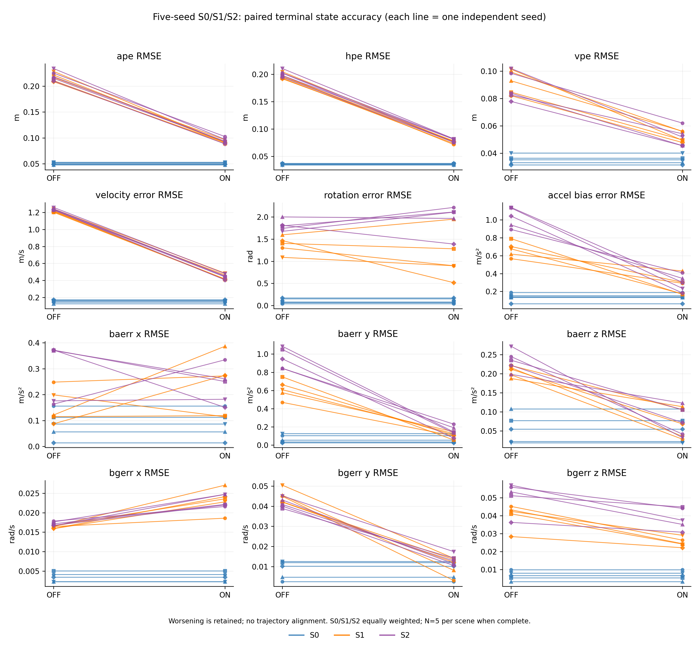
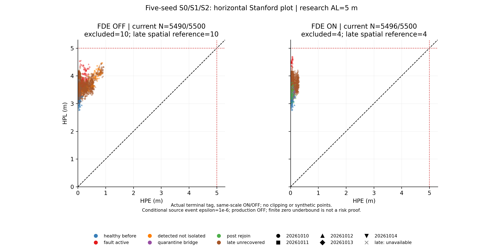
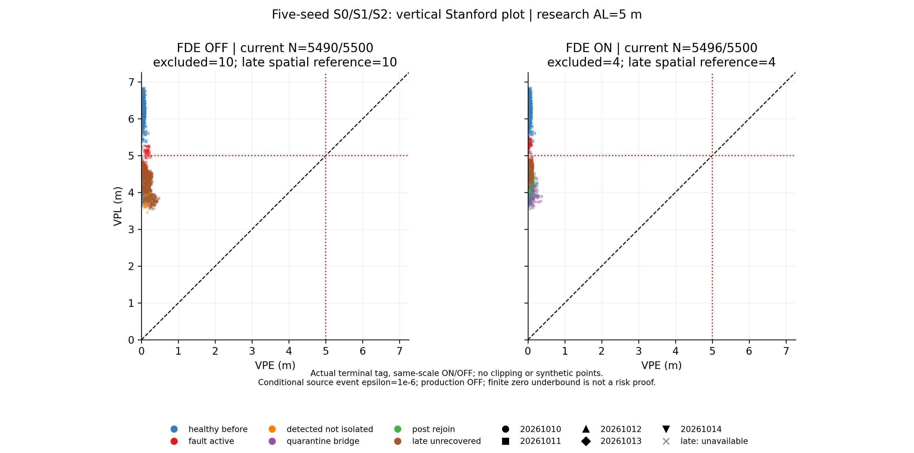

# SC6 Closure results

**W0 evaluated; W1–W3 remain IN PROGRESS. This is not a Closure completion award.**

Historical `SC6_RESULTS.md` and its strict A18 OPEN remain unchanged. Production publication stays OFF.

Entry HEAD `cf11f60ebd4cd2fa2d166fe56494c00e69fc4379`. Preregistration SHA256 `b78fbe7d702b8462489ad38a1f15ce7df03f9cce9a972e0ae1e7f12cdfb21534`.
Protocol: `config/sc6_closure.yaml`; matrix/scoring/plot source: `tools/sc6_closure.py`.
All runs below use the same actual Sc6Service and paced 200Hz/20Hz shell. FDE OFF retains nominal FGO, monitoring, raw PL and receiver gate.
Input audit contains hex-float raw observations, IDs, stamps, initial observation/draws, shared ADC births, RW draws, bias path and injections; pairs assert SHA256 and exact byte equality.
Timing uses nearest rank on every measurable admitted service (including abort and timeout); never-started latched refusals are counted separately.
Phase precedence: quarantine/bridge, detected active, active, late unrecovered, post rejoin, healthy before. Latest commenced IMU episode wins; UWB active/healthy scores are parallel labels, not added to the overall RMSE denominator.
GT scoring checks terminal tag=p+R*lever, world frame, independent SO(3) log/magnitude in [0,pi], velocity and bias errors. RPE is body relative pose at deltas 1/20, on common terminal indices.

|Run|scheduled/rows/attempted/committed/raw/timely|P50/P95/P99/max core ms|P50/P95/P99/max sink ms|core40/sink50|queue|
|---|---|---|---|---|---|
|P0-S0-20261010-30-30-off-audit|300/300/300/300/300/300|18.9081/21.86/24.9225/42.3547|19.111/22.0983/25.2402/42.5031|2/0|10|
|P0-S0-20261010-30-30-on-audit|300/300/300/300/300/300|20.825/25.9508/28.5278/30.3526|21.0266/26.2041/28.7371/30.5913|0/0|10|
|P0-S0-20261011-30-30-off-audit|300/300/300/300/300/300|19.0823/21.7088/23.0718/40.69|19.2243/21.8437/23.2034/40.8558|1/0|10|
|P0-S0-20261011-30-30-on-audit|300/300/300/300/300/300|18.8795/21.346/25.4151/41.0709|19.0361/21.5667/25.5306/41.2531|1/0|10|
|P0-S0-20261012-30-30-off-audit|300/300/300/300/300/300|18.7361/21.0851/21.7439/42.0938|18.8975/21.2245/21.9188/42.2742|1/0|10|
|P0-S0-20261012-30-30-on-audit|300/300/300/300/300/300|19.1572/21.4228/22.395/40.2636|19.3102/21.5789/22.515/40.4385|1/0|10|
|P0-S0-20261013-30-30-off-audit|300/300/300/300/300/300|18.893/20.9536/22.0991/39.8163|19.041/21.1199/22.2513/39.9917|0/0|10|
|P0-S0-20261013-30-30-on-audit|300/300/300/300/300/300|19.1354/22.0789/26.5572/43.1727|19.2802/22.2245/26.7082/43.3611|1/0|10|
|P0-S0-20261014-30-30-off-audit|300/300/300/300/300/299|19.1987/22.5603/31.3895/56.4738|19.3461/22.7075/42.6537/73.3596|3/1|14|
|P0-S0-20261014-30-30-on-audit|300/300/300/300/300/300|18.8578/21.0838/23.0921/40.7201|19.02/21.2943/23.2739/40.9185|1/0|10|
|P0-S1-20261010-30-30-off-audit|400/400/400/400/400/398|18.9999/21.4709/25.3037/54.6682|19.1369/21.6029/32.7906/57.3962|3/2|11|
|P0-S1-20261010-30-30-on-audit|400/400/400/400/400/400|18.9974/22.2722/24.5686/37.8056|19.1459/22.4165/24.7351/37.9862|0/0|10|
|P0-S1-20261011-30-30-off-audit|400/400/400/400/400/400|18.6694/21.0057/22.6026/32.7463|18.8201/21.1522/22.7381/32.9913|0/0|10|
|P0-S1-20261011-30-30-on-audit|400/400/400/400/400/400|19.1866/22.6173/24.3003/45.5262|19.3529/22.8007/24.4193/45.6887|1/0|10|
|P0-S1-20261012-30-30-off-audit|400/400/400/400/400/399|18.5743/20.8829/22.503/52.2564|18.7131/21.0222/22.6379/52.4981|1/1|10|
|P0-S1-20261012-30-30-on-audit|400/400/400/400/400/400|18.9055/22.0635/24.8391/42.3854|19.0584/22.1862/24.9647/42.5824|1/0|10|
|P0-S1-20261013-30-30-off-audit|400/400/400/400/400/396|18.9152/21.4568/42.194/58.1193|19.083/21.6872/45.736/73.3274|6/4|14|
|P0-S1-20261013-30-30-on-audit|400/400/400/400/400/400|19.565/22.1839/25.6881/44.9178|19.7042/22.3353/25.8882/45.1359|2/0|10|
|P0-S1-20261014-30-30-off-audit|400/400/400/400/400/400|19.2023/21.1507/22.3466/41.689|19.3679/21.3418/22.5382/41.8803|2/0|10|
|P0-S1-20261014-30-30-on-audit|400/400/400/400/400/399|19.4321/22.706/31.4543/53.0999|19.621/22.85/31.6717/53.2933|3/1|10|
|P0-S2-20261010-30-30-off-audit|400/400/400/400/400/399|20.3844/22.277/28.0044/52.2744|20.5407/22.476/28.1552/52.4299|3/1|10|
|P0-S2-20261010-30-30-on-audit|400/400/400/400/400/400|20.2003/23.6466/26.9906/44.1198|20.3505/23.8005/27.1164/44.3019|2/0|10|
|P0-S2-20261011-30-30-off-audit|400/400/400/400/400/400|20.3429/23.3002/25.4757/38.6755|20.5062/23.4528/25.6556/38.8131|0/0|10|
|P0-S2-20261011-30-30-on-audit|400/400/400/400/400/400|20.3335/23.1458/25.15/43.3155|20.4937/23.2922/25.3119/43.4513|1/0|10|
|P0-S2-20261012-30-30-off-audit|400/400/400/400/400/400|19.9979/22.7306/24.2313/46.2929|20.1541/22.8751/24.3629/46.4373|2/0|10|
|P0-S2-20261012-30-30-on-audit|400/400/400/400/400/399|20.2382/22.8688/25.0605/52.8018|20.4086/23.0019/25.2178/52.952|1/1|10|
|P0-S2-20261013-30-30-off-audit|400/400/400/400/400/400|19.533/21.8099/23.6957/46.395|19.6792/21.9395/23.8732/46.5897|2/0|10|
|P0-S2-20261013-30-30-on-audit|400/400/400/400/400/400|19.8097/22.5628/24.2825/42.9944|19.9719/22.7899/24.4185/43.2021|1/0|10|
|P0-S2-20261014-30-30-off-audit|400/400/400/400/400/399|19.8944/22.5257/24.0742/52.5664|20.0596/22.6848/24.2476/52.796|2/1|10|
|P0-S2-20261014-30-30-on-audit|400/400/400/400/400/398|20.0576/24.5078/32.1814/54.8094|20.1946/24.6334/34.3783/62.8258|3/2|12|
|P2-D1_A_E-20261010-30-30-off-audit|160/160/160/160/160/160|18.8252/21.5089/25.2413/42.937|18.9804/21.7213/25.3745/43.1728|1/0|10|
|P2-D1_A_E-20261010-30-30-on-audit|160/160/160/160/160/158|19.7155/24.5268/53.1045/57.5417|19.8891/25.1133/55.6839/63.3137|2/2|12|
|P2-D1_G_E-20261010-30-30-off-audit|160/160/160/160/160/160|19.8897/22.8527/24.9786/37.1908|20.0356/22.9681/25.1698/37.3518|0/0|10|
|P2-D1_G_E-20261010-30-30-on-audit|160/160/160/160/160/160|23.5989/29.9685/34.7992/38.1641|23.7435/30.0964/34.922/38.2829|0/0|10|

|Pair|scheduled/paired/missing|tag OFF/ON m; delta m;%|velocity OFF/ON m/s|SO3 OFF/ON rad|accel/gyro bias delta|
|---|---|---|---|---|---|
|P0-S0-20261010-30-30-on-audit|300/300/0|0.0500571/0.0500571; 0; 0%|0.146371/0.146371|0.0398358/0.0398358|0/0|
|P0-S0-20261011-30-30-on-audit|300/300/0|0.0516152/0.0516152; 0; 0%|0.15779/0.15779|0.0673882/0.0673882|0/0|
|P0-S0-20261012-30-30-on-audit|300/300/0|0.047816/0.047816; 0; 0%|0.125717/0.125717|0.153766/0.153766|0/0|
|P0-S0-20261013-30-30-on-audit|300/300/0|0.0487664/0.0487664; 0; 0%|0.174391/0.174391|0.175724/0.175724|0/0|
|P0-S0-20261014-30-30-on-audit|300/300/0|0.052909/0.052909; 0; 0%|0.16423/0.16423|0.0838898/0.0838898|0/0|
|P0-S1-20261010-30-30-on-audit|400/400/0|0.22139/0.090906; 0.130484; 58.9385%|1.21783/0.413064|1.30288/0.898931|0.274665/0.0334147|
|P0-S1-20261011-30-30-on-audit|400/400/0|0.210595/0.088837; 0.121758; 57.8161%|1.2017/0.412315|1.4038/1.28113|0.620887/0.0247638|
|P0-S1-20261012-30-30-on-audit|400/400/0|0.21672/0.0963038; 0.120417; 55.5631%|1.21629/0.465969|1.59638/1.94913|0.188641/0.0275348|
|P0-S1-20261013-30-30-on-audit|400/400/0|0.2085/0.0909973; 0.117503; 56.3562%|1.20807/0.418005|1.46632/0.517004|0.398267/0.0182572|
|P0-S1-20261014-30-30-on-audit|400/400/0|0.228276/0.0916229; 0.136653; 59.8631%|1.24079/0.486452|1.08815/0.898956|0.501597/0.0282486|
|P0-S2-20261010-30-30-on-audit|400/400/0|0.224942/0.102563; 0.122378; 54.4045%|1.23731/0.451546|1.74072/2.21514|0.484432/0.0207932|
|P0-S2-20261011-30-30-on-audit|400/400/0|0.214806/0.0931412; 0.121665; 56.6393%|1.22756/0.441987|1.79876/2.11121|0.836234/0.0144462|
|P0-S2-20261012-30-30-on-audit|400/400/0|0.21823/0.0933371; 0.124893; 57.2299%|1.24093/0.452322|2.0004/1.96533|0.596228/0.0263047|
|P0-S2-20261013-30-30-on-audit|400/400/0|0.20967/0.0884881; 0.121182; 57.7964%|1.23039/0.4068|1.81143/1.38833|0.857814/0.0172813|
|P0-S2-20261014-30-30-on-audit|400/400/0|0.233829/0.0971461; 0.136683; 58.4542%|1.2586/0.480834|1.67506/2.10807|0.897828/0.0264257|
|P2-D1_A_E-20261010-30-30-on-audit|160/160/0|0.301713/0.0869392; 0.214774; 71.1848%|1.77375/0.343843|1.58582/0.738977|0.710087/0.0690373|
|P2-D1_G_E-20261010-30-30-on-audit|160/160/0|0.132025/6.52855; -6.39652; -4844.94%|0.570892/232.909|0.240891/1.43728|-1.70025/-0.282793|

Seed is the statistical unit; descriptive seed bootstrap uses 10000 resamples, fixed bootstrap seed61020. No independent-frame inference. N<5 is incomplete.

|Scene/metric|N|delta mean/median/range|delta descriptive95 interval|mean %|
|---|---|---|---|---|
|S0/ape|5|0/0/[0,0]|[0.0, 0.0]|0|
|S0/hpe|5|0/0/[0,0]|[0.0, 0.0]|0|
|S0/vpe|5|0/0/[0,0]|[0.0, 0.0]|0|
|S0/velocity_error|5|0/0/[0,0]|[0.0, 0.0]|0|
|S0/rotation_error|5|0/0/[0,0]|[0.0, 0.0]|0|
|S0/accel_bias_error|5|0/0/[0,0]|[0.0, 0.0]|0|
|S0/gyro_bias_error|5|0/0/[0,0]|[0.0, 0.0]|0|
|S0/baerr_x|5|0/0/[0,0]|[0.0, 0.0]|0|
|S0/baerr_y|5|0/0/[0,0]|[0.0, 0.0]|0|
|S0/baerr_z|5|0/0/[0,0]|[0.0, 0.0]|0|
|S0/bgerr_x|5|0/0/[0,0]|[0.0, 0.0]|0|
|S0/bgerr_y|5|0/0/[0,0]|[0.0, 0.0]|0|
|S0/bgerr_z|5|0/0/[0,0]|[0.0, 0.0]|0|
|S1/ape|5|0.125363/0.121758/[0.117503,0.136653]|[0.11951927343433906, 0.1317177963229889]|57.7074|
|S1/hpe|5|0.120937/0.119226/[0.114303,0.127427]|[0.11657431020045997, 0.12529898958925817]|61.5058|
|S1/vpe|5|0.0402076/0.0367896/[0.0341308,0.0518678]|[0.03496479904532338, 0.04676521448372789]|43.4749|
|S1/velocity_error|5|0.777776/0.789389/[0.750324,0.804765]|[0.7597435793367585, 0.7958089301013265]|63.9309|
|S1/rotation_error|5|0.262475/0.189197/[-0.352751,0.949312]|[-0.09302145993739797, 0.6452662866111625]|19.9548|
|S1/accel_bias_error|5|0.396812/0.398267/[0.188641,0.620887]|[0.26497615551704995, 0.5286472606613601]|57.7481|
|S1/gyro_bias_error|5|0.0264438/0.0275348/[0.0182572,0.0334147]|[0.02196822343959638, 0.030508529565906845]|41.9411|
|S1/baerr_x|5|-0.0791003/-0.0239663/[-0.264985,0.0844219]|[-0.19718530307700805, 0.027461492614108157]|-80.7026|
|S1/baerr_y|5|0.505058/0.482467/[0.368032,0.692627]|[0.4150240119363942, 0.6085628666552558]|81.616|
|S1/baerr_z|5|0.136352/0.14339/[0.0739647,0.179956]|[0.10173473498455646, 0.16821932848583757]|65.7577|
|S1/bgerr_x|5|-0.00696286/-0.00697836/[-0.0106103,-0.00214863]|[-0.009157530815170192, -0.004304578774806738]|-42.8628|
|S1/bgerr_y|5|0.034784/0.0362994/[0.0286258,0.041846]|[0.0306688020945221, 0.03889922836225973]|77.2032|
|S1/bgerr_z|5|0.0148372/0.0168778/[0.00623633,0.0189015]|[0.01019256918613779, 0.01846345065044649]|35.9761|
|S2/ape|5|0.12536/0.122378/[0.121182,0.136683]|[0.1216141150647629, 0.1312246660491948]|56.9049|
|S2/hpe|5|0.122068/0.120614/[0.116516,0.128332]|[0.11825605672453363, 0.12596871357121317]|60.5841|
|S2/vpe|5|0.0370372/0.0363293/[0.0282755,0.0499949]|[0.03149216043958185, 0.04411415955982658]|41.5011|
|S2/velocity_error|5|0.792261/0.785766/[0.777763,0.82359]|[0.7815329999355101, 0.8084599427630531]|63.9568|
|S2/rotation_error|5|-0.152344/-0.312453/[-0.47442,0.423092]|[-0.4254623686602671, 0.1659856937681611]|-9.07302|
|S2/accel_bias_error|5|0.734507/0.836234/[0.484432,0.897828]|[0.5814677058821162, 0.8695038781950922]|70.5263|
|S2/gyro_bias_error|5|0.0210502/0.0207932/[0.0144462,0.0264257]|[0.01684966042732703, 0.02525079705531475]|30.788|
|S2/baerr_x|5|0.0548621/0.108935/[-0.170869,0.221236]|[-0.05947151460762985, 0.15867997878044582]|2.67766|
|S2/baerr_y|5|0.798523/0.870243/[0.612042,0.940465]|[0.6798125523172642, 0.9172331246810265]|83.1679|
|S2/baerr_z|5|0.159757/0.150121/[0.0753984,0.239705]|[0.10825975006400501, 0.20731329686314143]|66.4826|
|S2/bgerr_x|5|-0.00583202/-0.00523913/[-0.00807525,-0.00375927]|[-0.007262434705634405, -0.004553728780016563]|-34.0509|
|S2/bgerr_y|5|0.0282881/0.0280566/[0.0246175,0.0316351]|[0.02619670429165215, 0.03034320267879532]|68.0663|
|S2/bgerr_z|5|0.012259/0.0118409/[0.0054803,0.0195564]|[0.0070667714080037605, 0.01745119880118414]|23.3752|

Preregistered scene-equal aggregate (S0/S1/S2 each 1/3; no scenario selected by benefit):

|metric|equal-weight mean delta|equal-weight mean seed %|
|---|---|---|
|ape|0.0835743|38.2041|
|hpe|0.0810015|40.6966|
|vpe|0.0257483|28.3253|
|velocity_error|0.523346|42.6292|
|rotation_error|0.0367105|3.62727|
|accel_bias_error|0.377106|42.7581|
|gyro_bias_error|0.0158313|24.243|
|baerr_x|-0.0080794|-26.0083|
|baerr_y|0.434527|54.928|
|baerr_z|0.098703|44.0801|
|bgerr_x|-0.00426496|-25.6379|
|bgerr_y|0.021024|48.4232|
|bgerr_z|0.00903207|19.7838|

Stanford uses classic actual-output PE versus PL, not all-geometries Stanford–ESA enumeration. Region definitions follow the [ESA reference](https://gssc.esa.int/navipedia/index.php/The_Stanford_%E2%80%93_ESA_Integrity_Diagram:_Focusing_on_SBAS_Integrity).
Only same-stamp/version/source, finite, spatial-qualified and current receipts enter the colored plot. Late spatial-qualified points are gray and unavailable. Missing outputs are never fabricated.
MI/HMI below are counterfactual numerical candidates; operational HMI = NOT_QUALIFIED. Zero observed underbound does not establish epsilon=1e-6.

|Run/AL/axis|scheduled/current/plot-excluded/late|covered/underbound|nominal/MI/HMI/unavailable|spatial/timely AL admissible|
|---|---|---|---|---|
|P0-S0-20261010-30-30-off-audit/2/3/H|300/300/0/0|300/0|0/0/0/300|0/0|
|P0-S0-20261010-30-30-off-audit/2/3/V|300/300/0/0|300/0|0/0/0/300|0/0|
|P0-S0-20261010-30-30-off-audit/5/5/H|300/300/0/0|300/0|300/0/0/0|300/300|
|P0-S0-20261010-30-30-off-audit/5/5/V|300/300/0/0|300/0|0/0/0/300|0/0|
|P0-S0-20261010-30-30-off-audit/10/10/H|300/300/0/0|300/0|300/0/0/0|300/300|
|P0-S0-20261010-30-30-off-audit/10/10/V|300/300/0/0|300/0|300/0/0/0|300/300|
|P0-S0-20261010-30-30-on-audit/2/3/H|300/300/0/0|300/0|0/0/0/300|0/0|
|P0-S0-20261010-30-30-on-audit/2/3/V|300/300/0/0|300/0|0/0/0/300|0/0|
|P0-S0-20261010-30-30-on-audit/5/5/H|300/300/0/0|300/0|300/0/0/0|300/300|
|P0-S0-20261010-30-30-on-audit/5/5/V|300/300/0/0|300/0|0/0/0/300|0/0|
|P0-S0-20261010-30-30-on-audit/10/10/H|300/300/0/0|300/0|300/0/0/0|300/300|
|P0-S0-20261010-30-30-on-audit/10/10/V|300/300/0/0|300/0|300/0/0/0|300/300|
|P0-S0-20261011-30-30-off-audit/2/3/H|300/300/0/0|300/0|0/0/0/300|0/0|
|P0-S0-20261011-30-30-off-audit/2/3/V|300/300/0/0|300/0|0/0/0/300|0/0|
|P0-S0-20261011-30-30-off-audit/5/5/H|300/300/0/0|300/0|300/0/0/0|300/300|
|P0-S0-20261011-30-30-off-audit/5/5/V|300/300/0/0|300/0|0/0/0/300|0/0|
|P0-S0-20261011-30-30-off-audit/10/10/H|300/300/0/0|300/0|300/0/0/0|300/300|
|P0-S0-20261011-30-30-off-audit/10/10/V|300/300/0/0|300/0|300/0/0/0|300/300|
|P0-S0-20261011-30-30-on-audit/2/3/H|300/300/0/0|300/0|0/0/0/300|0/0|
|P0-S0-20261011-30-30-on-audit/2/3/V|300/300/0/0|300/0|0/0/0/300|0/0|
|P0-S0-20261011-30-30-on-audit/5/5/H|300/300/0/0|300/0|300/0/0/0|300/300|
|P0-S0-20261011-30-30-on-audit/5/5/V|300/300/0/0|300/0|0/0/0/300|0/0|
|P0-S0-20261011-30-30-on-audit/10/10/H|300/300/0/0|300/0|300/0/0/0|300/300|
|P0-S0-20261011-30-30-on-audit/10/10/V|300/300/0/0|300/0|300/0/0/0|300/300|
|P0-S0-20261012-30-30-off-audit/2/3/H|300/300/0/0|300/0|0/0/0/300|0/0|
|P0-S0-20261012-30-30-off-audit/2/3/V|300/300/0/0|300/0|0/0/0/300|0/0|
|P0-S0-20261012-30-30-off-audit/5/5/H|300/300/0/0|300/0|300/0/0/0|300/300|
|P0-S0-20261012-30-30-off-audit/5/5/V|300/300/0/0|300/0|0/0/0/300|0/0|
|P0-S0-20261012-30-30-off-audit/10/10/H|300/300/0/0|300/0|300/0/0/0|300/300|
|P0-S0-20261012-30-30-off-audit/10/10/V|300/300/0/0|300/0|300/0/0/0|300/300|
|P0-S0-20261012-30-30-on-audit/2/3/H|300/300/0/0|300/0|0/0/0/300|0/0|
|P0-S0-20261012-30-30-on-audit/2/3/V|300/300/0/0|300/0|0/0/0/300|0/0|
|P0-S0-20261012-30-30-on-audit/5/5/H|300/300/0/0|300/0|300/0/0/0|300/300|
|P0-S0-20261012-30-30-on-audit/5/5/V|300/300/0/0|300/0|0/0/0/300|0/0|
|P0-S0-20261012-30-30-on-audit/10/10/H|300/300/0/0|300/0|300/0/0/0|300/300|
|P0-S0-20261012-30-30-on-audit/10/10/V|300/300/0/0|300/0|300/0/0/0|300/300|
|P0-S0-20261013-30-30-off-audit/2/3/H|300/300/0/0|300/0|0/0/0/300|0/0|
|P0-S0-20261013-30-30-off-audit/2/3/V|300/300/0/0|300/0|0/0/0/300|0/0|
|P0-S0-20261013-30-30-off-audit/5/5/H|300/300/0/0|300/0|300/0/0/0|300/300|
|P0-S0-20261013-30-30-off-audit/5/5/V|300/300/0/0|300/0|0/0/0/300|0/0|
|P0-S0-20261013-30-30-off-audit/10/10/H|300/300/0/0|300/0|300/0/0/0|300/300|
|P0-S0-20261013-30-30-off-audit/10/10/V|300/300/0/0|300/0|300/0/0/0|300/300|
|P0-S0-20261013-30-30-on-audit/2/3/H|300/300/0/0|300/0|0/0/0/300|0/0|
|P0-S0-20261013-30-30-on-audit/2/3/V|300/300/0/0|300/0|0/0/0/300|0/0|
|P0-S0-20261013-30-30-on-audit/5/5/H|300/300/0/0|300/0|300/0/0/0|300/300|
|P0-S0-20261013-30-30-on-audit/5/5/V|300/300/0/0|300/0|0/0/0/300|0/0|
|P0-S0-20261013-30-30-on-audit/10/10/H|300/300/0/0|300/0|300/0/0/0|300/300|
|P0-S0-20261013-30-30-on-audit/10/10/V|300/300/0/0|300/0|300/0/0/0|300/300|
|P0-S0-20261014-30-30-off-audit/2/3/H|300/299/1/1|299/0|0/0/0/299|0/0|
|P0-S0-20261014-30-30-off-audit/2/3/V|300/299/1/1|299/0|0/0/0/299|0/0|
|P0-S0-20261014-30-30-off-audit/5/5/H|300/299/1/1|299/0|299/0/0/0|300/299|
|P0-S0-20261014-30-30-off-audit/5/5/V|300/299/1/1|299/0|0/0/0/299|0/0|
|P0-S0-20261014-30-30-off-audit/10/10/H|300/299/1/1|299/0|299/0/0/0|300/299|
|P0-S0-20261014-30-30-off-audit/10/10/V|300/299/1/1|299/0|299/0/0/0|300/299|
|P0-S0-20261014-30-30-on-audit/2/3/H|300/300/0/0|300/0|0/0/0/300|0/0|
|P0-S0-20261014-30-30-on-audit/2/3/V|300/300/0/0|300/0|0/0/0/300|0/0|
|P0-S0-20261014-30-30-on-audit/5/5/H|300/300/0/0|300/0|300/0/0/0|300/300|
|P0-S0-20261014-30-30-on-audit/5/5/V|300/300/0/0|300/0|0/0/0/300|0/0|
|P0-S0-20261014-30-30-on-audit/10/10/H|300/300/0/0|300/0|300/0/0/0|300/300|
|P0-S0-20261014-30-30-on-audit/10/10/V|300/300/0/0|300/0|300/0/0/0|300/300|
|P0-S1-20261010-30-30-off-audit/2/3/H|400/398/2/2|398/0|0/0/0/398|0/0|
|P0-S1-20261010-30-30-off-audit/2/3/V|400/398/2/2|398/0|0/0/0/398|0/0|
|P0-S1-20261010-30-30-off-audit/5/5/H|400/398/2/2|398/0|398/0/0/0|400/398|
|P0-S1-20261010-30-30-off-audit/5/5/V|400/398/2/2|398/0|395/0/0/3|397/395|
|P0-S1-20261010-30-30-off-audit/10/10/H|400/398/2/2|398/0|398/0/0/0|400/398|
|P0-S1-20261010-30-30-off-audit/10/10/V|400/398/2/2|398/0|398/0/0/0|400/398|
|P0-S1-20261010-30-30-on-audit/2/3/H|400/400/0/0|400/0|0/0/0/400|0/0|
|P0-S1-20261010-30-30-on-audit/2/3/V|400/400/0/0|400/0|0/0/0/400|0/0|
|P0-S1-20261010-30-30-on-audit/5/5/H|400/400/0/0|400/0|400/0/0/0|400/400|
|P0-S1-20261010-30-30-on-audit/5/5/V|400/400/0/0|400/0|397/0/0/3|397/397|
|P0-S1-20261010-30-30-on-audit/10/10/H|400/400/0/0|400/0|400/0/0/0|400/400|
|P0-S1-20261010-30-30-on-audit/10/10/V|400/400/0/0|400/0|400/0/0/0|400/400|
|P0-S1-20261011-30-30-off-audit/2/3/H|400/400/0/0|400/0|0/0/0/400|0/0|
|P0-S1-20261011-30-30-off-audit/2/3/V|400/400/0/0|400/0|0/0/0/400|0/0|
|P0-S1-20261011-30-30-off-audit/5/5/H|400/400/0/0|400/0|400/0/0/0|400/400|
|P0-S1-20261011-30-30-off-audit/5/5/V|400/400/0/0|400/0|397/0/0/3|397/397|
|P0-S1-20261011-30-30-off-audit/10/10/H|400/400/0/0|400/0|400/0/0/0|400/400|
|P0-S1-20261011-30-30-off-audit/10/10/V|400/400/0/0|400/0|400/0/0/0|400/400|
|P0-S1-20261011-30-30-on-audit/2/3/H|400/400/0/0|400/0|0/0/0/400|0/0|
|P0-S1-20261011-30-30-on-audit/2/3/V|400/400/0/0|400/0|0/0/0/400|0/0|
|P0-S1-20261011-30-30-on-audit/5/5/H|400/400/0/0|400/0|400/0/0/0|400/400|
|P0-S1-20261011-30-30-on-audit/5/5/V|400/400/0/0|400/0|397/0/0/3|397/397|
|P0-S1-20261011-30-30-on-audit/10/10/H|400/400/0/0|400/0|400/0/0/0|400/400|
|P0-S1-20261011-30-30-on-audit/10/10/V|400/400/0/0|400/0|400/0/0/0|400/400|
|P0-S1-20261012-30-30-off-audit/2/3/H|400/399/1/1|399/0|0/0/0/399|0/0|
|P0-S1-20261012-30-30-off-audit/2/3/V|400/399/1/1|399/0|0/0/0/399|0/0|
|P0-S1-20261012-30-30-off-audit/5/5/H|400/399/1/1|399/0|399/0/0/0|400/399|
|P0-S1-20261012-30-30-off-audit/5/5/V|400/399/1/1|399/0|397/0/0/2|398/397|
|P0-S1-20261012-30-30-off-audit/10/10/H|400/399/1/1|399/0|399/0/0/0|400/399|
|P0-S1-20261012-30-30-off-audit/10/10/V|400/399/1/1|399/0|399/0/0/0|400/399|
|P0-S1-20261012-30-30-on-audit/2/3/H|400/400/0/0|400/0|0/0/0/400|0/0|
|P0-S1-20261012-30-30-on-audit/2/3/V|400/400/0/0|400/0|0/0/0/400|0/0|
|P0-S1-20261012-30-30-on-audit/5/5/H|400/400/0/0|400/0|400/0/0/0|400/400|
|P0-S1-20261012-30-30-on-audit/5/5/V|400/400/0/0|400/0|397/0/0/3|397/397|
|P0-S1-20261012-30-30-on-audit/10/10/H|400/400/0/0|400/0|400/0/0/0|400/400|
|P0-S1-20261012-30-30-on-audit/10/10/V|400/400/0/0|400/0|400/0/0/0|400/400|
|P0-S1-20261013-30-30-off-audit/2/3/H|400/396/4/4|396/0|0/0/0/396|0/0|
|P0-S1-20261013-30-30-off-audit/2/3/V|400/396/4/4|396/0|0/0/0/396|0/0|
|P0-S1-20261013-30-30-off-audit/5/5/H|400/396/4/4|396/0|396/0/0/0|400/396|
|P0-S1-20261013-30-30-off-audit/5/5/V|400/396/4/4|396/0|393/0/0/3|397/393|
|P0-S1-20261013-30-30-off-audit/10/10/H|400/396/4/4|396/0|396/0/0/0|400/396|
|P0-S1-20261013-30-30-off-audit/10/10/V|400/396/4/4|396/0|396/0/0/0|400/396|
|P0-S1-20261013-30-30-on-audit/2/3/H|400/400/0/0|400/0|0/0/0/400|0/0|
|P0-S1-20261013-30-30-on-audit/2/3/V|400/400/0/0|400/0|0/0/0/400|0/0|
|P0-S1-20261013-30-30-on-audit/5/5/H|400/400/0/0|400/0|400/0/0/0|400/400|
|P0-S1-20261013-30-30-on-audit/5/5/V|400/400/0/0|400/0|397/0/0/3|397/397|
|P0-S1-20261013-30-30-on-audit/10/10/H|400/400/0/0|400/0|400/0/0/0|400/400|
|P0-S1-20261013-30-30-on-audit/10/10/V|400/400/0/0|400/0|400/0/0/0|400/400|
|P0-S1-20261014-30-30-off-audit/2/3/H|400/400/0/0|400/0|0/0/0/400|0/0|
|P0-S1-20261014-30-30-off-audit/2/3/V|400/400/0/0|400/0|0/0/0/400|0/0|
|P0-S1-20261014-30-30-off-audit/5/5/H|400/400/0/0|400/0|400/0/0/0|400/400|
|P0-S1-20261014-30-30-off-audit/5/5/V|400/400/0/0|400/0|397/0/0/3|397/397|
|P0-S1-20261014-30-30-off-audit/10/10/H|400/400/0/0|400/0|400/0/0/0|400/400|
|P0-S1-20261014-30-30-off-audit/10/10/V|400/400/0/0|400/0|400/0/0/0|400/400|
|P0-S1-20261014-30-30-on-audit/2/3/H|400/399/1/1|399/0|0/0/0/399|0/0|
|P0-S1-20261014-30-30-on-audit/2/3/V|400/399/1/1|399/0|0/0/0/399|0/0|
|P0-S1-20261014-30-30-on-audit/5/5/H|400/399/1/1|399/0|399/0/0/0|400/399|
|P0-S1-20261014-30-30-on-audit/5/5/V|400/399/1/1|399/0|396/0/0/3|397/396|
|P0-S1-20261014-30-30-on-audit/10/10/H|400/399/1/1|399/0|399/0/0/0|400/399|
|P0-S1-20261014-30-30-on-audit/10/10/V|400/399/1/1|399/0|399/0/0/0|400/399|
|P0-S2-20261010-30-30-off-audit/2/3/H|400/399/1/1|399/0|0/0/0/399|0/0|
|P0-S2-20261010-30-30-off-audit/2/3/V|400/399/1/1|399/0|0/0/0/399|0/0|
|P0-S2-20261010-30-30-off-audit/5/5/H|400/399/1/1|399/0|399/0/0/0|400/399|
|P0-S2-20261010-30-30-off-audit/5/5/V|400/399/1/1|399/0|397/0/0/2|398/397|
|P0-S2-20261010-30-30-off-audit/10/10/H|400/399/1/1|399/0|399/0/0/0|400/399|
|P0-S2-20261010-30-30-off-audit/10/10/V|400/399/1/1|399/0|399/0/0/0|400/399|
|P0-S2-20261010-30-30-on-audit/2/3/H|400/400/0/0|400/0|0/0/0/400|0/0|
|P0-S2-20261010-30-30-on-audit/2/3/V|400/400/0/0|400/0|0/0/0/400|0/0|
|P0-S2-20261010-30-30-on-audit/5/5/H|400/400/0/0|400/0|400/0/0/0|400/400|
|P0-S2-20261010-30-30-on-audit/5/5/V|400/400/0/0|400/0|397/0/0/3|397/397|
|P0-S2-20261010-30-30-on-audit/10/10/H|400/400/0/0|400/0|400/0/0/0|400/400|
|P0-S2-20261010-30-30-on-audit/10/10/V|400/400/0/0|400/0|400/0/0/0|400/400|
|P0-S2-20261011-30-30-off-audit/2/3/H|400/400/0/0|400/0|0/0/0/400|0/0|
|P0-S2-20261011-30-30-off-audit/2/3/V|400/400/0/0|400/0|0/0/0/400|0/0|
|P0-S2-20261011-30-30-off-audit/5/5/H|400/400/0/0|400/0|400/0/0/0|400/400|
|P0-S2-20261011-30-30-off-audit/5/5/V|400/400/0/0|400/0|398/0/0/2|398/398|
|P0-S2-20261011-30-30-off-audit/10/10/H|400/400/0/0|400/0|400/0/0/0|400/400|
|P0-S2-20261011-30-30-off-audit/10/10/V|400/400/0/0|400/0|400/0/0/0|400/400|
|P0-S2-20261011-30-30-on-audit/2/3/H|400/400/0/0|400/0|0/0/0/400|0/0|
|P0-S2-20261011-30-30-on-audit/2/3/V|400/400/0/0|400/0|0/0/0/400|0/0|
|P0-S2-20261011-30-30-on-audit/5/5/H|400/400/0/0|400/0|400/0/0/0|400/400|
|P0-S2-20261011-30-30-on-audit/5/5/V|400/400/0/0|400/0|398/0/0/2|398/398|
|P0-S2-20261011-30-30-on-audit/10/10/H|400/400/0/0|400/0|400/0/0/0|400/400|
|P0-S2-20261011-30-30-on-audit/10/10/V|400/400/0/0|400/0|400/0/0/0|400/400|
|P0-S2-20261012-30-30-off-audit/2/3/H|400/400/0/0|400/0|0/0/0/400|0/0|
|P0-S2-20261012-30-30-off-audit/2/3/V|400/400/0/0|400/0|0/0/0/400|0/0|
|P0-S2-20261012-30-30-off-audit/5/5/H|400/400/0/0|400/0|400/0/0/0|400/400|
|P0-S2-20261012-30-30-off-audit/5/5/V|400/400/0/0|400/0|398/0/0/2|398/398|
|P0-S2-20261012-30-30-off-audit/10/10/H|400/400/0/0|400/0|400/0/0/0|400/400|
|P0-S2-20261012-30-30-off-audit/10/10/V|400/400/0/0|400/0|400/0/0/0|400/400|
|P0-S2-20261012-30-30-on-audit/2/3/H|400/399/1/1|399/0|0/0/0/399|0/0|
|P0-S2-20261012-30-30-on-audit/2/3/V|400/399/1/1|399/0|0/0/0/399|0/0|
|P0-S2-20261012-30-30-on-audit/5/5/H|400/399/1/1|399/0|399/0/0/0|400/399|
|P0-S2-20261012-30-30-on-audit/5/5/V|400/399/1/1|399/0|396/0/0/3|397/396|
|P0-S2-20261012-30-30-on-audit/10/10/H|400/399/1/1|399/0|399/0/0/0|400/399|
|P0-S2-20261012-30-30-on-audit/10/10/V|400/399/1/1|399/0|399/0/0/0|400/399|
|P0-S2-20261013-30-30-off-audit/2/3/H|400/400/0/0|400/0|0/0/0/400|0/0|
|P0-S2-20261013-30-30-off-audit/2/3/V|400/400/0/0|400/0|0/0/0/400|0/0|
|P0-S2-20261013-30-30-off-audit/5/5/H|400/400/0/0|400/0|400/0/0/0|400/400|
|P0-S2-20261013-30-30-off-audit/5/5/V|400/400/0/0|400/0|398/0/0/2|398/398|
|P0-S2-20261013-30-30-off-audit/10/10/H|400/400/0/0|400/0|400/0/0/0|400/400|
|P0-S2-20261013-30-30-off-audit/10/10/V|400/400/0/0|400/0|400/0/0/0|400/400|
|P0-S2-20261013-30-30-on-audit/2/3/H|400/400/0/0|400/0|0/0/0/400|0/0|
|P0-S2-20261013-30-30-on-audit/2/3/V|400/400/0/0|400/0|0/0/0/400|0/0|
|P0-S2-20261013-30-30-on-audit/5/5/H|400/400/0/0|400/0|400/0/0/0|400/400|
|P0-S2-20261013-30-30-on-audit/5/5/V|400/400/0/0|400/0|397/0/0/3|397/397|
|P0-S2-20261013-30-30-on-audit/10/10/H|400/400/0/0|400/0|400/0/0/0|400/400|
|P0-S2-20261013-30-30-on-audit/10/10/V|400/400/0/0|400/0|400/0/0/0|400/400|
|P0-S2-20261014-30-30-off-audit/2/3/H|400/399/1/1|399/0|0/0/0/399|0/0|
|P0-S2-20261014-30-30-off-audit/2/3/V|400/399/1/1|399/0|0/0/0/399|0/0|
|P0-S2-20261014-30-30-off-audit/5/5/H|400/399/1/1|399/0|399/0/0/0|400/399|
|P0-S2-20261014-30-30-off-audit/5/5/V|400/399/1/1|399/0|398/0/0/1|399/398|
|P0-S2-20261014-30-30-off-audit/10/10/H|400/399/1/1|399/0|399/0/0/0|400/399|
|P0-S2-20261014-30-30-off-audit/10/10/V|400/399/1/1|399/0|399/0/0/0|400/399|
|P0-S2-20261014-30-30-on-audit/2/3/H|400/398/2/2|398/0|0/0/0/398|0/0|
|P0-S2-20261014-30-30-on-audit/2/3/V|400/398/2/2|398/0|0/0/0/398|0/0|
|P0-S2-20261014-30-30-on-audit/5/5/H|400/398/2/2|398/0|398/0/0/0|400/398|
|P0-S2-20261014-30-30-on-audit/5/5/V|400/398/2/2|398/0|395/0/0/3|397/395|
|P0-S2-20261014-30-30-on-audit/10/10/H|400/398/2/2|398/0|398/0/0/0|400/398|
|P0-S2-20261014-30-30-on-audit/10/10/V|400/398/2/2|398/0|398/0/0/0|400/398|
|P2-D1_A_E-20261010-30-30-off-audit/2/3/H|160/160/0/0|160/0|0/0/0/160|0/0|
|P2-D1_A_E-20261010-30-30-off-audit/2/3/V|160/160/0/0|160/0|0/0/0/160|0/0|
|P2-D1_A_E-20261010-30-30-off-audit/5/5/H|160/160/0/0|160/0|160/0/0/0|160/160|
|P2-D1_A_E-20261010-30-30-off-audit/5/5/V|160/160/0/0|160/0|160/0/0/0|160/160|
|P2-D1_A_E-20261010-30-30-off-audit/10/10/H|160/160/0/0|160/0|160/0/0/0|160/160|
|P2-D1_A_E-20261010-30-30-off-audit/10/10/V|160/160/0/0|160/0|160/0/0/0|160/160|
|P2-D1_A_E-20261010-30-30-on-audit/2/3/H|160/158/2/2|158/0|0/0/0/158|0/0|
|P2-D1_A_E-20261010-30-30-on-audit/2/3/V|160/158/2/2|158/0|0/0/0/158|0/0|
|P2-D1_A_E-20261010-30-30-on-audit/5/5/H|160/158/2/2|158/0|158/0/0/0|160/158|
|P2-D1_A_E-20261010-30-30-on-audit/5/5/V|160/158/2/2|158/0|158/0/0/0|160/158|
|P2-D1_A_E-20261010-30-30-on-audit/10/10/H|160/158/2/2|158/0|158/0/0/0|160/158|
|P2-D1_A_E-20261010-30-30-on-audit/10/10/V|160/158/2/2|158/0|158/0/0/0|160/158|
|P2-D1_G_E-20261010-30-30-off-audit/2/3/H|160/160/0/0|160/0|0/0/0/160|0/0|
|P2-D1_G_E-20261010-30-30-off-audit/2/3/V|160/160/0/0|160/0|0/0/0/160|0/0|
|P2-D1_G_E-20261010-30-30-off-audit/5/5/H|160/160/0/0|160/0|160/0/0/0|160/160|
|P2-D1_G_E-20261010-30-30-off-audit/5/5/V|160/160/0/0|160/0|160/0/0/0|160/160|
|P2-D1_G_E-20261010-30-30-off-audit/10/10/H|160/160/0/0|160/0|160/0/0/0|160/160|
|P2-D1_G_E-20261010-30-30-off-audit/10/10/V|160/160/0/0|160/0|160/0/0/0|160/160|
|P2-D1_G_E-20261010-30-30-on-audit/2/3/H|160/160/0/0|160/0|0/0/0/160|0/0|
|P2-D1_G_E-20261010-30-30-on-audit/2/3/V|160/160/0/0|160/0|0/0/0/160|0/0|
|P2-D1_G_E-20261010-30-30-on-audit/5/5/H|160/160/0/0|160/0|90/0/0/70|90/90|
|P2-D1_G_E-20261010-30-30-on-audit/5/5/V|160/160/0/0|160/0|108/0/0/52|108/108|
|P2-D1_G_E-20261010-30-30-on-audit/10/10/H|160/160/0/0|160/0|138/0/0/22|138/138|
|P2-D1_G_E-20261010-30-30-on-audit/10/10/V|160/160/0/0|160/0|144/0/0/16|144/144|

TTD/TTI/TTR below are respectively source-stamp and actual steady-clock action/commit latencies from registered onset, not an operator-hold latency.

|Run/episode axis|onset/duration/amplitude|FD/bridge/prior/rejoin|source TTD/TTI/TTR ms|wall TTD/TTI/TTR ms|rejoin4; UWB isolation|
|---|---|---|---|---|---|---|
|P0-S1-20261010-30-30-off-audit/0|61/500/20.0|61/None/None/None|0/NA/NA|46.8178/NA/NA|[]; []|
|P0-S1-20261010-30-30-off-audit/3|261/500/1.0|None/None/None/None|NA/NA/NA|NA/NA/NA|[]; []|
|P0-S1-20261010-30-30-on-audit/0|61/500/20.0|61/61/61/80|0/45/995|46.7695/68.6659/1014.2|[80, 81, 82, 83]; [58, 59, 60]|
|P0-S1-20261010-30-30-on-audit/3|261/500/1.0|None/None/None/None|NA/NA/NA|NA/NA/NA|[]; [264, 265, 266]|
|P0-S1-20261011-30-30-off-audit/0|61/500/20.0|61/None/None/None|0/NA/NA|46.7529/NA/NA|[]; []|
|P0-S1-20261011-30-30-off-audit/3|261/500/1.0|None/None/None/None|NA/NA/NA|NA/NA/NA|[]; []|
|P0-S1-20261011-30-30-on-audit/0|61/500/20.0|61/61/61/80|0/45/995|46.7347/66.9043/1013.61|[80, 81, 82, 83]; [58, 59, 60]|
|P0-S1-20261011-30-30-on-audit/3|261/500/1.0|None/None/None/None|NA/NA/NA|NA/NA/NA|[]; [264, 265, 266]|
|P0-S1-20261012-30-30-off-audit/0|61/500/20.0|61/None/None/None|0/NA/NA|46.7641/NA/NA|[]; []|
|P0-S1-20261012-30-30-off-audit/3|261/500/1.0|None/None/None/None|NA/NA/NA|NA/NA/NA|[]; []|
|P0-S1-20261012-30-30-on-audit/0|61/500/20.0|61/61/61/80|0/45/995|47.9363/69.4647/1016.01|[80, 81, 82, 83]; [58, 59, 60]|
|P0-S1-20261012-30-30-on-audit/3|261/500/1.0|None/None/None/None|NA/NA/NA|NA/NA/NA|[]; [264, 265, 266]|
|P0-S1-20261013-30-30-off-audit/0|61/500/20.0|61/None/None/None|0/NA/NA|46.8548/NA/NA|[]; []|
|P0-S1-20261013-30-30-off-audit/3|261/500/1.0|None/None/None/None|NA/NA/NA|NA/NA/NA|[]; []|
|P0-S1-20261013-30-30-on-audit/0|61/500/20.0|61/61/61/80|0/45/995|46.9376/68.7762/1015.93|[80, 81, 82, 83]; [58, 59, 60]|
|P0-S1-20261013-30-30-on-audit/3|261/500/1.0|None/None/None/None|NA/NA/NA|NA/NA/NA|[]; [264, 265, 266]|
|P0-S1-20261014-30-30-off-audit/0|61/500/20.0|61/None/None/None|0/NA/NA|47.0861/NA/NA|[]; []|
|P0-S1-20261014-30-30-off-audit/3|261/500/1.0|None/None/None/None|NA/NA/NA|NA/NA/NA|[]; []|
|P0-S1-20261014-30-30-on-audit/0|61/500/20.0|61/61/61/80|0/45/995|46.8036/66.4047/1014.12|[80, 81, 82, 83]; [58, 59, 60]|
|P0-S1-20261014-30-30-on-audit/3|261/500/1.0|None/None/None/None|NA/NA/NA|NA/NA/NA|[]; [264, 265, 266]|
|P0-S2-20261010-30-30-off-audit/0|61/500/20.0|61/None/None/None|0/NA/NA|48.3654/NA/NA|[]; []|
|P0-S2-20261010-30-30-off-audit/3|261/500/1.0|None/None/None/None|NA/NA/NA|NA/NA/NA|[]; []|
|P0-S2-20261010-30-30-on-audit/0|61/500/20.0|61/61/61/80|0/45/995|47.6187/68.4404/1016.76|[80, 81, 82, 83]; [61, 62, 63]|
|P0-S2-20261010-30-30-on-audit/3|261/500/1.0|None/None/None/None|NA/NA/NA|NA/NA/NA|[]; [261, 262, 263]|
|P0-S2-20261011-30-30-off-audit/0|61/500/20.0|61/None/None/None|0/NA/NA|47.7689/NA/NA|[]; []|
|P0-S2-20261011-30-30-off-audit/3|261/500/1.0|None/None/None/None|NA/NA/NA|NA/NA/NA|[]; []|
|P0-S2-20261011-30-30-on-audit/0|61/500/20.0|61/61/61/80|0/45/995|47.6556/68.85/1013.72|[80, 81, 82, 83]; [61, 62, 63]|
|P0-S2-20261011-30-30-on-audit/3|261/500/1.0|None/None/None/None|NA/NA/NA|NA/NA/NA|[]; [261, 262, 263]|
|P0-S2-20261012-30-30-off-audit/0|61/500/20.0|61/None/None/None|0/NA/NA|47.7094/NA/NA|[]; []|
|P0-S2-20261012-30-30-off-audit/3|261/500/1.0|None/None/None/None|NA/NA/NA|NA/NA/NA|[]; []|
|P0-S2-20261012-30-30-on-audit/0|61/500/20.0|61/61/61/80|0/45/995|47.7965/69.9877/1019.23|[80, 81, 82, 83]; [61, 62, 63]|
|P0-S2-20261012-30-30-on-audit/3|261/500/1.0|None/None/None/None|NA/NA/NA|NA/NA/NA|[]; [261, 262, 263]|
|P0-S2-20261013-30-30-off-audit/0|61/500/20.0|61/None/None/None|0/NA/NA|48.3673/NA/NA|[]; []|
|P0-S2-20261013-30-30-off-audit/3|261/500/1.0|None/None/None/None|NA/NA/NA|NA/NA/NA|[]; []|
|P0-S2-20261013-30-30-on-audit/0|61/500/20.0|61/61/61/80|0/45/995|48.1367/70.5916/1015.81|[80, 81, 82, 83]; [61, 62, 63]|
|P0-S2-20261013-30-30-on-audit/3|261/500/1.0|None/None/None/None|NA/NA/NA|NA/NA/NA|[]; [261, 262, 263]|
|P0-S2-20261014-30-30-off-audit/0|61/500/20.0|61/None/None/None|0/NA/NA|47.9007/NA/NA|[]; []|
|P0-S2-20261014-30-30-off-audit/3|261/500/1.0|None/None/None/None|NA/NA/NA|NA/NA/NA|[]; []|
|P0-S2-20261014-30-30-on-audit/0|61/500/20.0|61/61/61/80|0/45/995|47.6992/69.6583/1014.84|[80, 81, 82, 83]; [61, 62, 63]|
|P0-S2-20261014-30-30-on-audit/3|261/500/1.0|None/None/None/None|NA/NA/NA|NA/NA/NA|[]; [261, 262, 263]|
|P2-D1_A_E-20261010-30-30-off-audit/0|61/500/20.0|61/None/None/None|0/NA/NA|46.7732/NA/NA|[]; []|
|P2-D1_A_E-20261010-30-30-on-audit/0|61/500/20.0|61/61/61/80|0/45/995|47.3779/68.6625/1014.42|[80, 81, 82, 83]; [61, 62, 63]|
|P2-D1_G_E-20261010-30-30-off-audit/3|61/500/1.0|None/None/None/None|NA/NA/NA|NA/NA/NA|[]; []|
|P2-D1_G_E-20261010-30-30-on-audit/3|61/500/1.0|None/None/None/None|NA/NA/NA|NA/NA/NA|[]; [61, 62, 63]|

Complete run and unique-phase metrics (n/RMSE/P95/max), paired differences and frozen identities

**P0-S0-20261010-30-30-off-audit**

ELF `ba9f4b6e929b95cb5c9da7405fffced6278c79be191d9cb9c78cdc7b45b55510`; input `e7c00c83c7b38d8b7db0e00681c00d1ad5d7512191edf26754c3ecb7210e49c8`; trace `7a2c88b3ca45e74d67a6f80b157bb807fcf7dba06488682ccce79ad8b81b8777`; rc=0; false healthy UWB exclusion epochs=0.

|metric|all n/RMSE/P95/max|healthy_before|fault_active|detected_not_isolated|quarantine_bridge|post_rejoin|late_unrecovered|
|---|---|---|---|---|---|---|---|
|ape|300/0.0500571/0.0838865/0.138667|300/0.0500571/0.0838865/0.138667|0/NA/NA/NA|0/NA/NA/NA|0/NA/NA/NA|0/NA/NA/NA|0/NA/NA/NA|
|hpe|300/0.0355781/0.0613762/0.0885208|300/0.0355781/0.0613762/0.0885208|0/NA/NA/NA|0/NA/NA/NA|0/NA/NA/NA|0/NA/NA/NA|0/NA/NA/NA|
|vpe|300/0.0352123/0.0684815/0.120204|300/0.0352123/0.0684815/0.120204|0/NA/NA/NA|0/NA/NA/NA|0/NA/NA/NA|0/NA/NA/NA|0/NA/NA/NA|
|velocity_error|300/0.146371/0.258363/0.868359|300/0.146371/0.258363/0.868359|0/NA/NA/NA|0/NA/NA/NA|0/NA/NA/NA|0/NA/NA/NA|0/NA/NA/NA|
|rotation_error|300/0.0398358/0.0847229/0.0932769|300/0.0398358/0.0847229/0.0932769|0/NA/NA/NA|0/NA/NA/NA|0/NA/NA/NA|0/NA/NA/NA|0/NA/NA/NA|
|accel_bias_error|300/0.18859/0.210574/0.217695|300/0.18859/0.210574/0.217695|0/NA/NA/NA|0/NA/NA/NA|0/NA/NA/NA|0/NA/NA/NA|0/NA/NA/NA|
|gyro_bias_error|300/0.0109565/0.0179772/0.020057|300/0.0109565/0.0179772/0.020057|0/NA/NA/NA|0/NA/NA/NA|0/NA/NA/NA|0/NA/NA/NA|0/NA/NA/NA|
|baerr_x|300/0.155567/0.16873/0.178856|300/0.155567/0.16873/0.178856|0/NA/NA/NA|0/NA/NA/NA|0/NA/NA/NA|0/NA/NA/NA|0/NA/NA/NA|
|baerr_y|300/0.104284/0.134073/0.151998|300/0.104284/0.134073/0.151998|0/NA/NA/NA|0/NA/NA/NA|0/NA/NA/NA|0/NA/NA/NA|0/NA/NA/NA|
|baerr_z|300/0.0221374/0.0364146/0.0584803|300/0.0221374/0.0364146/0.0584803|0/NA/NA/NA|0/NA/NA/NA|0/NA/NA/NA|0/NA/NA/NA|0/NA/NA/NA|
|bgerr_x|300/0.00412408/0.008674/0.0102789|300/0.00412408/0.008674/0.0102789|0/NA/NA/NA|0/NA/NA/NA|0/NA/NA/NA|0/NA/NA/NA|0/NA/NA/NA|
|bgerr_y|300/0.00254808/0.00553454/0.0106778|300/0.00254808/0.00553454/0.0106778|0/NA/NA/NA|0/NA/NA/NA|0/NA/NA/NA|0/NA/NA/NA|0/NA/NA/NA|
|bgerr_z|300/0.00982565/0.0148253/0.015359|300/0.00982565/0.0148253/0.015359|0/NA/NA/NA|0/NA/NA/NA|0/NA/NA/NA|0/NA/NA/NA|0/NA/NA/NA|
|rpe1_translation|299/0.0268376/0.0449114/0.108567|299/0.0268376/0.0449114/0.108567|0/NA/NA/NA|0/NA/NA/NA|0/NA/NA/NA|0/NA/NA/NA|0/NA/NA/NA|
|rpe1_rotation|299/0.0114104/0.0219057/0.0558021|299/0.0114104/0.0219057/0.0558021|0/NA/NA/NA|0/NA/NA/NA|0/NA/NA/NA|0/NA/NA/NA|0/NA/NA/NA|
|rpe20_translation|280/0.0760964/0.121072/0.173615|280/0.0760964/0.121072/0.173615|0/NA/NA/NA|0/NA/NA/NA|0/NA/NA/NA|0/NA/NA/NA|0/NA/NA/NA|
|rpe20_rotation|280/0.0367416/0.065957/0.118884|280/0.0367416/0.065957/0.118884|0/NA/NA/NA|0/NA/NA/NA|0/NA/NA/NA|0/NA/NA/NA|0/NA/NA/NA|

|Parallel UWB label/metric|n/RMSE/P95/max|
|---|---|
|fault_active/ape|0/NA/NA/NA|
|fault_active/hpe|0/NA/NA/NA|
|fault_active/vpe|0/NA/NA/NA|
|fault_active/velocity_error|0/NA/NA/NA|
|fault_active/rotation_error|0/NA/NA/NA|
|fault_active/accel_bias_error|0/NA/NA/NA|
|fault_active/gyro_bias_error|0/NA/NA/NA|
|fault_active/baerr_x|0/NA/NA/NA|
|fault_active/baerr_y|0/NA/NA/NA|
|fault_active/baerr_z|0/NA/NA/NA|
|fault_active/bgerr_x|0/NA/NA/NA|
|fault_active/bgerr_y|0/NA/NA/NA|
|fault_active/bgerr_z|0/NA/NA/NA|
|fault_active/rpe1_translation|0/NA/NA/NA|
|fault_active/rpe1_rotation|0/NA/NA/NA|
|fault_active/rpe20_translation|0/NA/NA/NA|
|fault_active/rpe20_rotation|0/NA/NA/NA|
|healthy/ape|300/0.0500571/0.0838865/0.138667|
|healthy/hpe|300/0.0355781/0.0613762/0.0885208|
|healthy/vpe|300/0.0352123/0.0684815/0.120204|
|healthy/velocity_error|300/0.146371/0.258363/0.868359|
|healthy/rotation_error|300/0.0398358/0.0847229/0.0932769|
|healthy/accel_bias_error|300/0.18859/0.210574/0.217695|
|healthy/gyro_bias_error|300/0.0109565/0.0179772/0.020057|
|healthy/baerr_x|300/0.155567/0.16873/0.178856|
|healthy/baerr_y|300/0.104284/0.134073/0.151998|
|healthy/baerr_z|300/0.0221374/0.0364146/0.0584803|
|healthy/bgerr_x|300/0.00412408/0.008674/0.0102789|
|healthy/bgerr_y|300/0.00254808/0.00553454/0.0106778|
|healthy/bgerr_z|300/0.00982565/0.0148253/0.015359|
|healthy/rpe1_translation|299/0.0268376/0.0449114/0.108567|
|healthy/rpe1_rotation|299/0.0114104/0.0219057/0.0558021|
|healthy/rpe20_translation|280/0.0760964/0.121072/0.173615|
|healthy/rpe20_rotation|280/0.0367416/0.065957/0.118884|
**P0-S0-20261010-30-30-on-audit**

ELF `ba9f4b6e929b95cb5c9da7405fffced6278c79be191d9cb9c78cdc7b45b55510`; input `e7c00c83c7b38d8b7db0e00681c00d1ad5d7512191edf26754c3ecb7210e49c8`; trace `378b435740c9a849b4232ce1929bbdafde66a923fed0cbc3ac65093d882a5fe3`; rc=0; false healthy UWB exclusion epochs=0.

|metric|all n/RMSE/P95/max|healthy_before|fault_active|detected_not_isolated|quarantine_bridge|post_rejoin|late_unrecovered|
|---|---|---|---|---|---|---|---|
|ape|300/0.0500571/0.0838865/0.138667|300/0.0500571/0.0838865/0.138667|0/NA/NA/NA|0/NA/NA/NA|0/NA/NA/NA|0/NA/NA/NA|0/NA/NA/NA|
|hpe|300/0.0355781/0.0613762/0.0885208|300/0.0355781/0.0613762/0.0885208|0/NA/NA/NA|0/NA/NA/NA|0/NA/NA/NA|0/NA/NA/NA|0/NA/NA/NA|
|vpe|300/0.0352123/0.0684815/0.120204|300/0.0352123/0.0684815/0.120204|0/NA/NA/NA|0/NA/NA/NA|0/NA/NA/NA|0/NA/NA/NA|0/NA/NA/NA|
|velocity_error|300/0.146371/0.258363/0.868359|300/0.146371/0.258363/0.868359|0/NA/NA/NA|0/NA/NA/NA|0/NA/NA/NA|0/NA/NA/NA|0/NA/NA/NA|
|rotation_error|300/0.0398358/0.0847229/0.0932769|300/0.0398358/0.0847229/0.0932769|0/NA/NA/NA|0/NA/NA/NA|0/NA/NA/NA|0/NA/NA/NA|0/NA/NA/NA|
|accel_bias_error|300/0.18859/0.210574/0.217695|300/0.18859/0.210574/0.217695|0/NA/NA/NA|0/NA/NA/NA|0/NA/NA/NA|0/NA/NA/NA|0/NA/NA/NA|
|gyro_bias_error|300/0.0109565/0.0179772/0.020057|300/0.0109565/0.0179772/0.020057|0/NA/NA/NA|0/NA/NA/NA|0/NA/NA/NA|0/NA/NA/NA|0/NA/NA/NA|
|baerr_x|300/0.155567/0.16873/0.178856|300/0.155567/0.16873/0.178856|0/NA/NA/NA|0/NA/NA/NA|0/NA/NA/NA|0/NA/NA/NA|0/NA/NA/NA|
|baerr_y|300/0.104284/0.134073/0.151998|300/0.104284/0.134073/0.151998|0/NA/NA/NA|0/NA/NA/NA|0/NA/NA/NA|0/NA/NA/NA|0/NA/NA/NA|
|baerr_z|300/0.0221374/0.0364146/0.0584803|300/0.0221374/0.0364146/0.0584803|0/NA/NA/NA|0/NA/NA/NA|0/NA/NA/NA|0/NA/NA/NA|0/NA/NA/NA|
|bgerr_x|300/0.00412408/0.008674/0.0102789|300/0.00412408/0.008674/0.0102789|0/NA/NA/NA|0/NA/NA/NA|0/NA/NA/NA|0/NA/NA/NA|0/NA/NA/NA|
|bgerr_y|300/0.00254808/0.00553454/0.0106778|300/0.00254808/0.00553454/0.0106778|0/NA/NA/NA|0/NA/NA/NA|0/NA/NA/NA|0/NA/NA/NA|0/NA/NA/NA|
|bgerr_z|300/0.00982565/0.0148253/0.015359|300/0.00982565/0.0148253/0.015359|0/NA/NA/NA|0/NA/NA/NA|0/NA/NA/NA|0/NA/NA/NA|0/NA/NA/NA|
|rpe1_translation|299/0.0268376/0.0449114/0.108567|299/0.0268376/0.0449114/0.108567|0/NA/NA/NA|0/NA/NA/NA|0/NA/NA/NA|0/NA/NA/NA|0/NA/NA/NA|
|rpe1_rotation|299/0.0114104/0.0219057/0.0558021|299/0.0114104/0.0219057/0.0558021|0/NA/NA/NA|0/NA/NA/NA|0/NA/NA/NA|0/NA/NA/NA|0/NA/NA/NA|
|rpe20_translation|280/0.0760964/0.121072/0.173615|280/0.0760964/0.121072/0.173615|0/NA/NA/NA|0/NA/NA/NA|0/NA/NA/NA|0/NA/NA/NA|0/NA/NA/NA|
|rpe20_rotation|280/0.0367416/0.065957/0.118884|280/0.0367416/0.065957/0.118884|0/NA/NA/NA|0/NA/NA/NA|0/NA/NA/NA|0/NA/NA/NA|0/NA/NA/NA|

|Parallel UWB label/metric|n/RMSE/P95/max|
|---|---|
|fault_active/ape|0/NA/NA/NA|
|fault_active/hpe|0/NA/NA/NA|
|fault_active/vpe|0/NA/NA/NA|
|fault_active/velocity_error|0/NA/NA/NA|
|fault_active/rotation_error|0/NA/NA/NA|
|fault_active/accel_bias_error|0/NA/NA/NA|
|fault_active/gyro_bias_error|0/NA/NA/NA|
|fault_active/baerr_x|0/NA/NA/NA|
|fault_active/baerr_y|0/NA/NA/NA|
|fault_active/baerr_z|0/NA/NA/NA|
|fault_active/bgerr_x|0/NA/NA/NA|
|fault_active/bgerr_y|0/NA/NA/NA|
|fault_active/bgerr_z|0/NA/NA/NA|
|fault_active/rpe1_translation|0/NA/NA/NA|
|fault_active/rpe1_rotation|0/NA/NA/NA|
|fault_active/rpe20_translation|0/NA/NA/NA|
|fault_active/rpe20_rotation|0/NA/NA/NA|
|healthy/ape|300/0.0500571/0.0838865/0.138667|
|healthy/hpe|300/0.0355781/0.0613762/0.0885208|
|healthy/vpe|300/0.0352123/0.0684815/0.120204|
|healthy/velocity_error|300/0.146371/0.258363/0.868359|
|healthy/rotation_error|300/0.0398358/0.0847229/0.0932769|
|healthy/accel_bias_error|300/0.18859/0.210574/0.217695|
|healthy/gyro_bias_error|300/0.0109565/0.0179772/0.020057|
|healthy/baerr_x|300/0.155567/0.16873/0.178856|
|healthy/baerr_y|300/0.104284/0.134073/0.151998|
|healthy/baerr_z|300/0.0221374/0.0364146/0.0584803|
|healthy/bgerr_x|300/0.00412408/0.008674/0.0102789|
|healthy/bgerr_y|300/0.00254808/0.00553454/0.0106778|
|healthy/bgerr_z|300/0.00982565/0.0148253/0.015359|
|healthy/rpe1_translation|299/0.0268376/0.0449114/0.108567|
|healthy/rpe1_rotation|299/0.0114104/0.0219057/0.0558021|
|healthy/rpe20_translation|280/0.0760964/0.121072/0.173615|
|healthy/rpe20_rotation|280/0.0367416/0.065957/0.118884|
**P0-S0-20261011-30-30-off-audit**

ELF `ba9f4b6e929b95cb5c9da7405fffced6278c79be191d9cb9c78cdc7b45b55510`; input `76029c03c3f23ccfdb7529fbea0690a238ee2add0526c668fdecba593148d741`; trace `e87ab2826d0893881a6e8ebd3f35a396fa264e2147019311ef414bdb11b60cfd`; rc=0; false healthy UWB exclusion epochs=0.

|metric|all n/RMSE/P95/max|healthy_before|fault_active|detected_not_isolated|quarantine_bridge|post_rejoin|late_unrecovered|
|---|---|---|---|---|---|---|---|
|ape|300/0.0516152/0.0839286/0.183954|300/0.0516152/0.0839286/0.183954|0/NA/NA/NA|0/NA/NA/NA|0/NA/NA/NA|0/NA/NA/NA|0/NA/NA/NA|
|hpe|300/0.0365954/0.0618413/0.0808338|300/0.0365954/0.0618413/0.0808338|0/NA/NA/NA|0/NA/NA/NA|0/NA/NA/NA|0/NA/NA/NA|0/NA/NA/NA|
|vpe|300/0.0363992/0.0648507/0.182077|300/0.0363992/0.0648507/0.182077|0/NA/NA/NA|0/NA/NA/NA|0/NA/NA/NA|0/NA/NA/NA|0/NA/NA/NA|
|velocity_error|300/0.15779/0.242094/1.03896|300/0.15779/0.242094/1.03896|0/NA/NA/NA|0/NA/NA/NA|0/NA/NA/NA|0/NA/NA/NA|0/NA/NA/NA|
|rotation_error|300/0.0673882/0.127214/0.140611|300/0.0673882/0.127214/0.140611|0/NA/NA/NA|0/NA/NA/NA|0/NA/NA/NA|0/NA/NA/NA|0/NA/NA/NA|
|accel_bias_error|300/0.140596/0.218211/0.232652|300/0.140596/0.218211/0.232652|0/NA/NA/NA|0/NA/NA/NA|0/NA/NA/NA|0/NA/NA/NA|0/NA/NA/NA|
|gyro_bias_error|300/0.0140124/0.0278839/0.0292369|300/0.0140124/0.0278839/0.0292369|0/NA/NA/NA|0/NA/NA/NA|0/NA/NA/NA|0/NA/NA/NA|0/NA/NA/NA|
|baerr_x|300/0.112494/0.125041/0.131712|300/0.112494/0.125041/0.131712|0/NA/NA/NA|0/NA/NA/NA|0/NA/NA/NA|0/NA/NA/NA|0/NA/NA/NA|
|baerr_y|300/0.0351227/0.0699107/0.0829331|300/0.0351227/0.0699107/0.0829331|0/NA/NA/NA|0/NA/NA/NA|0/NA/NA/NA|0/NA/NA/NA|0/NA/NA/NA|
|baerr_z|300/0.0766728/0.174727/0.19662|300/0.0766728/0.174727/0.19662|0/NA/NA/NA|0/NA/NA/NA|0/NA/NA/NA|0/NA/NA/NA|0/NA/NA/NA|
|bgerr_x|300/0.00502895/0.01178/0.0133281|300/0.00502895/0.01178/0.0133281|0/NA/NA/NA|0/NA/NA/NA|0/NA/NA/NA|0/NA/NA/NA|0/NA/NA/NA|
|bgerr_y|300/0.0119634/0.0242662/0.0267832|300/0.0119634/0.0242662/0.0267832|0/NA/NA/NA|0/NA/NA/NA|0/NA/NA/NA|0/NA/NA/NA|0/NA/NA/NA|
|bgerr_z|300/0.00528524/0.00755175/0.00825791|300/0.00528524/0.00755175/0.00825791|0/NA/NA/NA|0/NA/NA/NA|0/NA/NA/NA|0/NA/NA/NA|0/NA/NA/NA|
|rpe1_translation|299/0.0281019/0.0454323/0.135844|299/0.0281019/0.0454323/0.135844|0/NA/NA/NA|0/NA/NA/NA|0/NA/NA/NA|0/NA/NA/NA|0/NA/NA/NA|
|rpe1_rotation|299/0.0106135/0.0207884/0.0713587|299/0.0106135/0.0207884/0.0713587|0/NA/NA/NA|0/NA/NA/NA|0/NA/NA/NA|0/NA/NA/NA|0/NA/NA/NA|
|rpe20_translation|280/0.0742934/0.122347/0.198921|280/0.0742934/0.122347/0.198921|0/NA/NA/NA|0/NA/NA/NA|0/NA/NA/NA|0/NA/NA/NA|0/NA/NA/NA|
|rpe20_rotation|280/0.0400062/0.0818005/0.133251|280/0.0400062/0.0818005/0.133251|0/NA/NA/NA|0/NA/NA/NA|0/NA/NA/NA|0/NA/NA/NA|0/NA/NA/NA|

|Parallel UWB label/metric|n/RMSE/P95/max|
|---|---|
|fault_active/ape|0/NA/NA/NA|
|fault_active/hpe|0/NA/NA/NA|
|fault_active/vpe|0/NA/NA/NA|
|fault_active/velocity_error|0/NA/NA/NA|
|fault_active/rotation_error|0/NA/NA/NA|
|fault_active/accel_bias_error|0/NA/NA/NA|
|fault_active/gyro_bias_error|0/NA/NA/NA|
|fault_active/baerr_x|0/NA/NA/NA|
|fault_active/baerr_y|0/NA/NA/NA|
|fault_active/baerr_z|0/NA/NA/NA|
|fault_active/bgerr_x|0/NA/NA/NA|
|fault_active/bgerr_y|0/NA/NA/NA|
|fault_active/bgerr_z|0/NA/NA/NA|
|fault_active/rpe1_translation|0/NA/NA/NA|
|fault_active/rpe1_rotation|0/NA/NA/NA|
|fault_active/rpe20_translation|0/NA/NA/NA|
|fault_active/rpe20_rotation|0/NA/NA/NA|
|healthy/ape|300/0.0516152/0.0839286/0.183954|
|healthy/hpe|300/0.0365954/0.0618413/0.0808338|
|healthy/vpe|300/0.0363992/0.0648507/0.182077|
|healthy/velocity_error|300/0.15779/0.242094/1.03896|
|healthy/rotation_error|300/0.0673882/0.127214/0.140611|
|healthy/accel_bias_error|300/0.140596/0.218211/0.232652|
|healthy/gyro_bias_error|300/0.0140124/0.0278839/0.0292369|
|healthy/baerr_x|300/0.112494/0.125041/0.131712|
|healthy/baerr_y|300/0.0351227/0.0699107/0.0829331|
|healthy/baerr_z|300/0.0766728/0.174727/0.19662|
|healthy/bgerr_x|300/0.00502895/0.01178/0.0133281|
|healthy/bgerr_y|300/0.0119634/0.0242662/0.0267832|
|healthy/bgerr_z|300/0.00528524/0.00755175/0.00825791|
|healthy/rpe1_translation|299/0.0281019/0.0454323/0.135844|
|healthy/rpe1_rotation|299/0.0106135/0.0207884/0.0713587|
|healthy/rpe20_translation|280/0.0742934/0.122347/0.198921|
|healthy/rpe20_rotation|280/0.0400062/0.0818005/0.133251|
**P0-S0-20261011-30-30-on-audit**

ELF `ba9f4b6e929b95cb5c9da7405fffced6278c79be191d9cb9c78cdc7b45b55510`; input `76029c03c3f23ccfdb7529fbea0690a238ee2add0526c668fdecba593148d741`; trace `a41b59032aff6683611414a37ee2605df9a0b59fd6ab39153c6d9f3bb44ad1bd`; rc=0; false healthy UWB exclusion epochs=0.

|metric|all n/RMSE/P95/max|healthy_before|fault_active|detected_not_isolated|quarantine_bridge|post_rejoin|late_unrecovered|
|---|---|---|---|---|---|---|---|
|ape|300/0.0516152/0.0839286/0.183954|300/0.0516152/0.0839286/0.183954|0/NA/NA/NA|0/NA/NA/NA|0/NA/NA/NA|0/NA/NA/NA|0/NA/NA/NA|
|hpe|300/0.0365954/0.0618413/0.0808338|300/0.0365954/0.0618413/0.0808338|0/NA/NA/NA|0/NA/NA/NA|0/NA/NA/NA|0/NA/NA/NA|0/NA/NA/NA|
|vpe|300/0.0363992/0.0648507/0.182077|300/0.0363992/0.0648507/0.182077|0/NA/NA/NA|0/NA/NA/NA|0/NA/NA/NA|0/NA/NA/NA|0/NA/NA/NA|
|velocity_error|300/0.15779/0.242094/1.03896|300/0.15779/0.242094/1.03896|0/NA/NA/NA|0/NA/NA/NA|0/NA/NA/NA|0/NA/NA/NA|0/NA/NA/NA|
|rotation_error|300/0.0673882/0.127214/0.140611|300/0.0673882/0.127214/0.140611|0/NA/NA/NA|0/NA/NA/NA|0/NA/NA/NA|0/NA/NA/NA|0/NA/NA/NA|
|accel_bias_error|300/0.140596/0.218211/0.232652|300/0.140596/0.218211/0.232652|0/NA/NA/NA|0/NA/NA/NA|0/NA/NA/NA|0/NA/NA/NA|0/NA/NA/NA|
|gyro_bias_error|300/0.0140124/0.0278839/0.0292369|300/0.0140124/0.0278839/0.0292369|0/NA/NA/NA|0/NA/NA/NA|0/NA/NA/NA|0/NA/NA/NA|0/NA/NA/NA|
|baerr_x|300/0.112494/0.125041/0.131712|300/0.112494/0.125041/0.131712|0/NA/NA/NA|0/NA/NA/NA|0/NA/NA/NA|0/NA/NA/NA|0/NA/NA/NA|
|baerr_y|300/0.0351227/0.0699107/0.0829331|300/0.0351227/0.0699107/0.0829331|0/NA/NA/NA|0/NA/NA/NA|0/NA/NA/NA|0/NA/NA/NA|0/NA/NA/NA|
|baerr_z|300/0.0766728/0.174727/0.19662|300/0.0766728/0.174727/0.19662|0/NA/NA/NA|0/NA/NA/NA|0/NA/NA/NA|0/NA/NA/NA|0/NA/NA/NA|
|bgerr_x|300/0.00502895/0.01178/0.0133281|300/0.00502895/0.01178/0.0133281|0/NA/NA/NA|0/NA/NA/NA|0/NA/NA/NA|0/NA/NA/NA|0/NA/NA/NA|
|bgerr_y|300/0.0119634/0.0242662/0.0267832|300/0.0119634/0.0242662/0.0267832|0/NA/NA/NA|0/NA/NA/NA|0/NA/NA/NA|0/NA/NA/NA|0/NA/NA/NA|
|bgerr_z|300/0.00528524/0.00755175/0.00825791|300/0.00528524/0.00755175/0.00825791|0/NA/NA/NA|0/NA/NA/NA|0/NA/NA/NA|0/NA/NA/NA|0/NA/NA/NA|
|rpe1_translation|299/0.0281019/0.0454323/0.135844|299/0.0281019/0.0454323/0.135844|0/NA/NA/NA|0/NA/NA/NA|0/NA/NA/NA|0/NA/NA/NA|0/NA/NA/NA|
|rpe1_rotation|299/0.0106135/0.0207884/0.0713587|299/0.0106135/0.0207884/0.0713587|0/NA/NA/NA|0/NA/NA/NA|0/NA/NA/NA|0/NA/NA/NA|0/NA/NA/NA|
|rpe20_translation|280/0.0742934/0.122347/0.198921|280/0.0742934/0.122347/0.198921|0/NA/NA/NA|0/NA/NA/NA|0/NA/NA/NA|0/NA/NA/NA|0/NA/NA/NA|
|rpe20_rotation|280/0.0400062/0.0818005/0.133251|280/0.0400062/0.0818005/0.133251|0/NA/NA/NA|0/NA/NA/NA|0/NA/NA/NA|0/NA/NA/NA|0/NA/NA/NA|

|Parallel UWB label/metric|n/RMSE/P95/max|
|---|---|
|fault_active/ape|0/NA/NA/NA|
|fault_active/hpe|0/NA/NA/NA|
|fault_active/vpe|0/NA/NA/NA|
|fault_active/velocity_error|0/NA/NA/NA|
|fault_active/rotation_error|0/NA/NA/NA|
|fault_active/accel_bias_error|0/NA/NA/NA|
|fault_active/gyro_bias_error|0/NA/NA/NA|
|fault_active/baerr_x|0/NA/NA/NA|
|fault_active/baerr_y|0/NA/NA/NA|
|fault_active/baerr_z|0/NA/NA/NA|
|fault_active/bgerr_x|0/NA/NA/NA|
|fault_active/bgerr_y|0/NA/NA/NA|
|fault_active/bgerr_z|0/NA/NA/NA|
|fault_active/rpe1_translation|0/NA/NA/NA|
|fault_active/rpe1_rotation|0/NA/NA/NA|
|fault_active/rpe20_translation|0/NA/NA/NA|
|fault_active/rpe20_rotation|0/NA/NA/NA|
|healthy/ape|300/0.0516152/0.0839286/0.183954|
|healthy/hpe|300/0.0365954/0.0618413/0.0808338|
|healthy/vpe|300/0.0363992/0.0648507/0.182077|
|healthy/velocity_error|300/0.15779/0.242094/1.03896|
|healthy/rotation_error|300/0.0673882/0.127214/0.140611|
|healthy/accel_bias_error|300/0.140596/0.218211/0.232652|
|healthy/gyro_bias_error|300/0.0140124/0.0278839/0.0292369|
|healthy/baerr_x|300/0.112494/0.125041/0.131712|
|healthy/baerr_y|300/0.0351227/0.0699107/0.0829331|
|healthy/baerr_z|300/0.0766728/0.174727/0.19662|
|healthy/bgerr_x|300/0.00502895/0.01178/0.0133281|
|healthy/bgerr_y|300/0.0119634/0.0242662/0.0267832|
|healthy/bgerr_z|300/0.00528524/0.00755175/0.00825791|
|healthy/rpe1_translation|299/0.0281019/0.0454323/0.135844|
|healthy/rpe1_rotation|299/0.0106135/0.0207884/0.0713587|
|healthy/rpe20_translation|280/0.0742934/0.122347/0.198921|
|healthy/rpe20_rotation|280/0.0400062/0.0818005/0.133251|
**P0-S0-20261012-30-30-off-audit**

ELF `ba9f4b6e929b95cb5c9da7405fffced6278c79be191d9cb9c78cdc7b45b55510`; input `916864530d64dcb2e3041cc64ea385c54371cc22fcefe0e46741e138722f9b77`; trace `7e9956721060e14ddc5956896df658db174570e57da3d8f149ff79778310ad45`; rc=0; false healthy UWB exclusion epochs=0.

|metric|all n/RMSE/P95/max|healthy_before|fault_active|detected_not_isolated|quarantine_bridge|post_rejoin|late_unrecovered|
|---|---|---|---|---|---|---|---|
|ape|300/0.047816/0.0759486/0.118763|300/0.047816/0.0759486/0.118763|0/NA/NA/NA|0/NA/NA/NA|0/NA/NA/NA|0/NA/NA/NA|0/NA/NA/NA|
|hpe|300/0.0344825/0.0564074/0.0882633|300/0.0344825/0.0564074/0.0882633|0/NA/NA/NA|0/NA/NA/NA|0/NA/NA/NA|0/NA/NA/NA|0/NA/NA/NA|
|vpe|300/0.0331259/0.0621816/0.106006|300/0.0331259/0.0621816/0.106006|0/NA/NA/NA|0/NA/NA/NA|0/NA/NA/NA|0/NA/NA/NA|0/NA/NA/NA|
|velocity_error|300/0.125717/0.226697/0.424803|300/0.125717/0.226697/0.424803|0/NA/NA/NA|0/NA/NA/NA|0/NA/NA/NA|0/NA/NA/NA|0/NA/NA/NA|
|rotation_error|300/0.153766/0.241393/0.250103|300/0.153766/0.241393/0.250103|0/NA/NA/NA|0/NA/NA/NA|0/NA/NA/NA|0/NA/NA/NA|0/NA/NA/NA|
|accel_bias_error|300/0.133557/0.244419/0.267517|300/0.133557/0.244419/0.267517|0/NA/NA/NA|0/NA/NA/NA|0/NA/NA/NA|0/NA/NA/NA|0/NA/NA/NA|
|gyro_bias_error|300/0.00618972/0.0129859/0.0139374|300/0.00618972/0.0129859/0.0139374|0/NA/NA/NA|0/NA/NA/NA|0/NA/NA/NA|0/NA/NA/NA|0/NA/NA/NA|
|baerr_x|300/0.0566621/0.0816026/0.0908053|300/0.0566621/0.0816026/0.0908053|0/NA/NA/NA|0/NA/NA/NA|0/NA/NA/NA|0/NA/NA/NA|0/NA/NA/NA|
|baerr_y|300/0.0555721/0.0784825/0.0898279|300/0.0555721/0.0784825/0.0898279|0/NA/NA/NA|0/NA/NA/NA|0/NA/NA/NA|0/NA/NA/NA|0/NA/NA/NA|
|baerr_z|300/0.107418/0.238365/0.26348|300/0.107418/0.238365/0.26348|0/NA/NA/NA|0/NA/NA/NA|0/NA/NA/NA|0/NA/NA/NA|0/NA/NA/NA|
|bgerr_x|300/0.00227258/0.00345196/0.00610069|300/0.00227258/0.00345196/0.00610069|0/NA/NA/NA|0/NA/NA/NA|0/NA/NA/NA|0/NA/NA/NA|0/NA/NA/NA|
|bgerr_y|300/0.0047612/0.0119424/0.0125897|300/0.0047612/0.0119424/0.0125897|0/NA/NA/NA|0/NA/NA/NA|0/NA/NA/NA|0/NA/NA/NA|0/NA/NA/NA|
|bgerr_z|300/0.00323713/0.00565429/0.00732261|300/0.00323713/0.00565429/0.00732261|0/NA/NA/NA|0/NA/NA/NA|0/NA/NA/NA|0/NA/NA/NA|0/NA/NA/NA|
|rpe1_translation|299/0.0265902/0.0464631/0.0770041|299/0.0265902/0.0464631/0.0770041|0/NA/NA/NA|0/NA/NA/NA|0/NA/NA/NA|0/NA/NA/NA|0/NA/NA/NA|
|rpe1_rotation|299/0.0113945/0.0225974/0.0534813|299/0.0113945/0.0225974/0.0534813|0/NA/NA/NA|0/NA/NA/NA|0/NA/NA/NA|0/NA/NA/NA|0/NA/NA/NA|
|rpe20_translation|280/0.0701293/0.111989/0.144683|280/0.0701293/0.111989/0.144683|0/NA/NA/NA|0/NA/NA/NA|0/NA/NA/NA|0/NA/NA/NA|0/NA/NA/NA|
|rpe20_rotation|280/0.0449027/0.0938751/0.127526|280/0.0449027/0.0938751/0.127526|0/NA/NA/NA|0/NA/NA/NA|0/NA/NA/NA|0/NA/NA/NA|0/NA/NA/NA|

|Parallel UWB label/metric|n/RMSE/P95/max|
|---|---|
|fault_active/ape|0/NA/NA/NA|
|fault_active/hpe|0/NA/NA/NA|
|fault_active/vpe|0/NA/NA/NA|
|fault_active/velocity_error|0/NA/NA/NA|
|fault_active/rotation_error|0/NA/NA/NA|
|fault_active/accel_bias_error|0/NA/NA/NA|
|fault_active/gyro_bias_error|0/NA/NA/NA|
|fault_active/baerr_x|0/NA/NA/NA|
|fault_active/baerr_y|0/NA/NA/NA|
|fault_active/baerr_z|0/NA/NA/NA|
|fault_active/bgerr_x|0/NA/NA/NA|
|fault_active/bgerr_y|0/NA/NA/NA|
|fault_active/bgerr_z|0/NA/NA/NA|
|fault_active/rpe1_translation|0/NA/NA/NA|
|fault_active/rpe1_rotation|0/NA/NA/NA|
|fault_active/rpe20_translation|0/NA/NA/NA|
|fault_active/rpe20_rotation|0/NA/NA/NA|
|healthy/ape|300/0.047816/0.0759486/0.118763|
|healthy/hpe|300/0.0344825/0.0564074/0.0882633|
|healthy/vpe|300/0.0331259/0.0621816/0.106006|
|healthy/velocity_error|300/0.125717/0.226697/0.424803|
|healthy/rotation_error|300/0.153766/0.241393/0.250103|
|healthy/accel_bias_error|300/0.133557/0.244419/0.267517|
|healthy/gyro_bias_error|300/0.00618972/0.0129859/0.0139374|
|healthy/baerr_x|300/0.0566621/0.0816026/0.0908053|
|healthy/baerr_y|300/0.0555721/0.0784825/0.0898279|
|healthy/baerr_z|300/0.107418/0.238365/0.26348|
|healthy/bgerr_x|300/0.00227258/0.00345196/0.00610069|
|healthy/bgerr_y|300/0.0047612/0.0119424/0.0125897|
|healthy/bgerr_z|300/0.00323713/0.00565429/0.00732261|
|healthy/rpe1_translation|299/0.0265902/0.0464631/0.0770041|
|healthy/rpe1_rotation|299/0.0113945/0.0225974/0.0534813|
|healthy/rpe20_translation|280/0.0701293/0.111989/0.144683|
|healthy/rpe20_rotation|280/0.0449027/0.0938751/0.127526|
**P0-S0-20261012-30-30-on-audit**

ELF `ba9f4b6e929b95cb5c9da7405fffced6278c79be191d9cb9c78cdc7b45b55510`; input `916864530d64dcb2e3041cc64ea385c54371cc22fcefe0e46741e138722f9b77`; trace `c3f6fa420acf800b7d42a626f471fcbb220b9f9fecfb78f85a7dce2fc8532cb9`; rc=0; false healthy UWB exclusion epochs=0.

|metric|all n/RMSE/P95/max|healthy_before|fault_active|detected_not_isolated|quarantine_bridge|post_rejoin|late_unrecovered|
|---|---|---|---|---|---|---|---|
|ape|300/0.047816/0.0759486/0.118763|300/0.047816/0.0759486/0.118763|0/NA/NA/NA|0/NA/NA/NA|0/NA/NA/NA|0/NA/NA/NA|0/NA/NA/NA|
|hpe|300/0.0344825/0.0564074/0.0882633|300/0.0344825/0.0564074/0.0882633|0/NA/NA/NA|0/NA/NA/NA|0/NA/NA/NA|0/NA/NA/NA|0/NA/NA/NA|
|vpe|300/0.0331259/0.0621816/0.106006|300/0.0331259/0.0621816/0.106006|0/NA/NA/NA|0/NA/NA/NA|0/NA/NA/NA|0/NA/NA/NA|0/NA/NA/NA|
|velocity_error|300/0.125717/0.226697/0.424803|300/0.125717/0.226697/0.424803|0/NA/NA/NA|0/NA/NA/NA|0/NA/NA/NA|0/NA/NA/NA|0/NA/NA/NA|
|rotation_error|300/0.153766/0.241393/0.250103|300/0.153766/0.241393/0.250103|0/NA/NA/NA|0/NA/NA/NA|0/NA/NA/NA|0/NA/NA/NA|0/NA/NA/NA|
|accel_bias_error|300/0.133557/0.244419/0.267517|300/0.133557/0.244419/0.267517|0/NA/NA/NA|0/NA/NA/NA|0/NA/NA/NA|0/NA/NA/NA|0/NA/NA/NA|
|gyro_bias_error|300/0.00618972/0.0129859/0.0139374|300/0.00618972/0.0129859/0.0139374|0/NA/NA/NA|0/NA/NA/NA|0/NA/NA/NA|0/NA/NA/NA|0/NA/NA/NA|
|baerr_x|300/0.0566621/0.0816026/0.0908053|300/0.0566621/0.0816026/0.0908053|0/NA/NA/NA|0/NA/NA/NA|0/NA/NA/NA|0/NA/NA/NA|0/NA/NA/NA|
|baerr_y|300/0.0555721/0.0784825/0.0898279|300/0.0555721/0.0784825/0.0898279|0/NA/NA/NA|0/NA/NA/NA|0/NA/NA/NA|0/NA/NA/NA|0/NA/NA/NA|
|baerr_z|300/0.107418/0.238365/0.26348|300/0.107418/0.238365/0.26348|0/NA/NA/NA|0/NA/NA/NA|0/NA/NA/NA|0/NA/NA/NA|0/NA/NA/NA|
|bgerr_x|300/0.00227258/0.00345196/0.00610069|300/0.00227258/0.00345196/0.00610069|0/NA/NA/NA|0/NA/NA/NA|0/NA/NA/NA|0/NA/NA/NA|0/NA/NA/NA|
|bgerr_y|300/0.0047612/0.0119424/0.0125897|300/0.0047612/0.0119424/0.0125897|0/NA/NA/NA|0/NA/NA/NA|0/NA/NA/NA|0/NA/NA/NA|0/NA/NA/NA|
|bgerr_z|300/0.00323713/0.00565429/0.00732261|300/0.00323713/0.00565429/0.00732261|0/NA/NA/NA|0/NA/NA/NA|0/NA/NA/NA|0/NA/NA/NA|0/NA/NA/NA|
|rpe1_translation|299/0.0265902/0.0464631/0.0770041|299/0.0265902/0.0464631/0.0770041|0/NA/NA/NA|0/NA/NA/NA|0/NA/NA/NA|0/NA/NA/NA|0/NA/NA/NA|
|rpe1_rotation|299/0.0113945/0.0225974/0.0534813|299/0.0113945/0.0225974/0.0534813|0/NA/NA/NA|0/NA/NA/NA|0/NA/NA/NA|0/NA/NA/NA|0/NA/NA/NA|
|rpe20_translation|280/0.0701293/0.111989/0.144683|280/0.0701293/0.111989/0.144683|0/NA/NA/NA|0/NA/NA/NA|0/NA/NA/NA|0/NA/NA/NA|0/NA/NA/NA|
|rpe20_rotation|280/0.0449027/0.0938751/0.127526|280/0.0449027/0.0938751/0.127526|0/NA/NA/NA|0/NA/NA/NA|0/NA/NA/NA|0/NA/NA/NA|0/NA/NA/NA|

|Parallel UWB label/metric|n/RMSE/P95/max|
|---|---|
|fault_active/ape|0/NA/NA/NA|
|fault_active/hpe|0/NA/NA/NA|
|fault_active/vpe|0/NA/NA/NA|
|fault_active/velocity_error|0/NA/NA/NA|
|fault_active/rotation_error|0/NA/NA/NA|
|fault_active/accel_bias_error|0/NA/NA/NA|
|fault_active/gyro_bias_error|0/NA/NA/NA|
|fault_active/baerr_x|0/NA/NA/NA|
|fault_active/baerr_y|0/NA/NA/NA|
|fault_active/baerr_z|0/NA/NA/NA|
|fault_active/bgerr_x|0/NA/NA/NA|
|fault_active/bgerr_y|0/NA/NA/NA|
|fault_active/bgerr_z|0/NA/NA/NA|
|fault_active/rpe1_translation|0/NA/NA/NA|
|fault_active/rpe1_rotation|0/NA/NA/NA|
|fault_active/rpe20_translation|0/NA/NA/NA|
|fault_active/rpe20_rotation|0/NA/NA/NA|
|healthy/ape|300/0.047816/0.0759486/0.118763|
|healthy/hpe|300/0.0344825/0.0564074/0.0882633|
|healthy/vpe|300/0.0331259/0.0621816/0.106006|
|healthy/velocity_error|300/0.125717/0.226697/0.424803|
|healthy/rotation_error|300/0.153766/0.241393/0.250103|
|healthy/accel_bias_error|300/0.133557/0.244419/0.267517|
|healthy/gyro_bias_error|300/0.00618972/0.0129859/0.0139374|
|healthy/baerr_x|300/0.0566621/0.0816026/0.0908053|
|healthy/baerr_y|300/0.0555721/0.0784825/0.0898279|
|healthy/baerr_z|300/0.107418/0.238365/0.26348|
|healthy/bgerr_x|300/0.00227258/0.00345196/0.00610069|
|healthy/bgerr_y|300/0.0047612/0.0119424/0.0125897|
|healthy/bgerr_z|300/0.00323713/0.00565429/0.00732261|
|healthy/rpe1_translation|299/0.0265902/0.0464631/0.0770041|
|healthy/rpe1_rotation|299/0.0113945/0.0225974/0.0534813|
|healthy/rpe20_translation|280/0.0701293/0.111989/0.144683|
|healthy/rpe20_rotation|280/0.0449027/0.0938751/0.127526|
**P0-S0-20261013-30-30-off-audit**

ELF `ba9f4b6e929b95cb5c9da7405fffced6278c79be191d9cb9c78cdc7b45b55510`; input `82cac6781aa3e3e564b42a669a1f3698fd4cbd451ead7eb0fe3a1ad7edf98a87`; trace `a812959e1bd254a18bbb76106ce921871ff9706b43b3ae17dfabd6710a312278`; rc=0; false healthy UWB exclusion epochs=0.

|metric|all n/RMSE/P95/max|healthy_before|fault_active|detected_not_isolated|quarantine_bridge|post_rejoin|late_unrecovered|
|---|---|---|---|---|---|---|---|
|ape|300/0.0487664/0.0830036/0.123378|300/0.0487664/0.0830036/0.123378|0/NA/NA/NA|0/NA/NA/NA|0/NA/NA/NA|0/NA/NA/NA|0/NA/NA/NA|
|hpe|300/0.0372615/0.0656136/0.123235|300/0.0372615/0.0656136/0.123235|0/NA/NA/NA|0/NA/NA/NA|0/NA/NA/NA|0/NA/NA/NA|0/NA/NA/NA|
|vpe|300/0.0314602/0.0640412/0.0848589|300/0.0314602/0.0640412/0.0848589|0/NA/NA/NA|0/NA/NA/NA|0/NA/NA/NA|0/NA/NA/NA|0/NA/NA/NA|
|velocity_error|300/0.174391/0.235059/1.04679|300/0.174391/0.235059/1.04679|0/NA/NA/NA|0/NA/NA/NA|0/NA/NA/NA|0/NA/NA/NA|0/NA/NA/NA|
|rotation_error|300/0.175724/0.243949/0.357898|300/0.175724/0.243949/0.357898|0/NA/NA/NA|0/NA/NA/NA|0/NA/NA/NA|0/NA/NA/NA|0/NA/NA/NA|
|accel_bias_error|300/0.0624614/0.137901/0.146129|300/0.0624614/0.137901/0.146129|0/NA/NA/NA|0/NA/NA/NA|0/NA/NA/NA|0/NA/NA/NA|0/NA/NA/NA|
|gyro_bias_error|300/0.0126696/0.0206825/0.0237545|300/0.0126696/0.0206825/0.0237545|0/NA/NA/NA|0/NA/NA/NA|0/NA/NA/NA|0/NA/NA/NA|0/NA/NA/NA|
|baerr_x|300/0.0143561/0.0288354/0.0400221|300/0.0143561/0.0288354/0.0400221|0/NA/NA/NA|0/NA/NA/NA|0/NA/NA/NA|0/NA/NA/NA|0/NA/NA/NA|
|baerr_y|300/0.0265317/0.0481442/0.0567245|300/0.0265317/0.0481442/0.0567245|0/NA/NA/NA|0/NA/NA/NA|0/NA/NA/NA|0/NA/NA/NA|0/NA/NA/NA|
|baerr_z|300/0.0546936/0.132058/0.139656|300/0.0546936/0.132058/0.139656|0/NA/NA/NA|0/NA/NA/NA|0/NA/NA/NA|0/NA/NA/NA|0/NA/NA/NA|
|bgerr_x|300/0.00339721/0.00730994/0.00781636|300/0.00339721/0.00730994/0.00781636|0/NA/NA/NA|0/NA/NA/NA|0/NA/NA/NA|0/NA/NA/NA|0/NA/NA/NA|
|bgerr_y|300/0.0102407/0.0182307/0.0223259|300/0.0102407/0.0182307/0.0223259|0/NA/NA/NA|0/NA/NA/NA|0/NA/NA/NA|0/NA/NA/NA|0/NA/NA/NA|
|bgerr_z|300/0.00664127/0.00827564/0.00993773|300/0.00664127/0.00827564/0.00993773|0/NA/NA/NA|0/NA/NA/NA|0/NA/NA/NA|0/NA/NA/NA|0/NA/NA/NA|
|rpe1_translation|299/0.0266328/0.0441285/0.102072|299/0.0266328/0.0441285/0.102072|0/NA/NA/NA|0/NA/NA/NA|0/NA/NA/NA|0/NA/NA/NA|0/NA/NA/NA|
|rpe1_rotation|299/0.0126192/0.021339/0.0784906|299/0.0126192/0.021339/0.0784906|0/NA/NA/NA|0/NA/NA/NA|0/NA/NA/NA|0/NA/NA/NA|0/NA/NA/NA|
|rpe20_translation|280/0.0684802/0.105701/0.189152|280/0.0684802/0.105701/0.189152|0/NA/NA/NA|0/NA/NA/NA|0/NA/NA/NA|0/NA/NA/NA|0/NA/NA/NA|
|rpe20_rotation|280/0.0508106/0.084948/0.252072|280/0.0508106/0.084948/0.252072|0/NA/NA/NA|0/NA/NA/NA|0/NA/NA/NA|0/NA/NA/NA|0/NA/NA/NA|

|Parallel UWB label/metric|n/RMSE/P95/max|
|---|---|
|fault_active/ape|0/NA/NA/NA|
|fault_active/hpe|0/NA/NA/NA|
|fault_active/vpe|0/NA/NA/NA|
|fault_active/velocity_error|0/NA/NA/NA|
|fault_active/rotation_error|0/NA/NA/NA|
|fault_active/accel_bias_error|0/NA/NA/NA|
|fault_active/gyro_bias_error|0/NA/NA/NA|
|fault_active/baerr_x|0/NA/NA/NA|
|fault_active/baerr_y|0/NA/NA/NA|
|fault_active/baerr_z|0/NA/NA/NA|
|fault_active/bgerr_x|0/NA/NA/NA|
|fault_active/bgerr_y|0/NA/NA/NA|
|fault_active/bgerr_z|0/NA/NA/NA|
|fault_active/rpe1_translation|0/NA/NA/NA|
|fault_active/rpe1_rotation|0/NA/NA/NA|
|fault_active/rpe20_translation|0/NA/NA/NA|
|fault_active/rpe20_rotation|0/NA/NA/NA|
|healthy/ape|300/0.0487664/0.0830036/0.123378|
|healthy/hpe|300/0.0372615/0.0656136/0.123235|
|healthy/vpe|300/0.0314602/0.0640412/0.0848589|
|healthy/velocity_error|300/0.174391/0.235059/1.04679|
|healthy/rotation_error|300/0.175724/0.243949/0.357898|
|healthy/accel_bias_error|300/0.0624614/0.137901/0.146129|
|healthy/gyro_bias_error|300/0.0126696/0.0206825/0.0237545|
|healthy/baerr_x|300/0.0143561/0.0288354/0.0400221|
|healthy/baerr_y|300/0.0265317/0.0481442/0.0567245|
|healthy/baerr_z|300/0.0546936/0.132058/0.139656|
|healthy/bgerr_x|300/0.00339721/0.00730994/0.00781636|
|healthy/bgerr_y|300/0.0102407/0.0182307/0.0223259|
|healthy/bgerr_z|300/0.00664127/0.00827564/0.00993773|
|healthy/rpe1_translation|299/0.0266328/0.0441285/0.102072|
|healthy/rpe1_rotation|299/0.0126192/0.021339/0.0784906|
|healthy/rpe20_translation|280/0.0684802/0.105701/0.189152|
|healthy/rpe20_rotation|280/0.0508106/0.084948/0.252072|
**P0-S0-20261013-30-30-on-audit**

ELF `ba9f4b6e929b95cb5c9da7405fffced6278c79be191d9cb9c78cdc7b45b55510`; input `82cac6781aa3e3e564b42a669a1f3698fd4cbd451ead7eb0fe3a1ad7edf98a87`; trace `861f4c4599c3243ba2baaf47733d97991834929b680200253cfd8fe306d445ee`; rc=0; false healthy UWB exclusion epochs=0.

|metric|all n/RMSE/P95/max|healthy_before|fault_active|detected_not_isolated|quarantine_bridge|post_rejoin|late_unrecovered|
|---|---|---|---|---|---|---|---|
|ape|300/0.0487664/0.0830036/0.123378|300/0.0487664/0.0830036/0.123378|0/NA/NA/NA|0/NA/NA/NA|0/NA/NA/NA|0/NA/NA/NA|0/NA/NA/NA|
|hpe|300/0.0372615/0.0656136/0.123235|300/0.0372615/0.0656136/0.123235|0/NA/NA/NA|0/NA/NA/NA|0/NA/NA/NA|0/NA/NA/NA|0/NA/NA/NA|
|vpe|300/0.0314602/0.0640412/0.0848589|300/0.0314602/0.0640412/0.0848589|0/NA/NA/NA|0/NA/NA/NA|0/NA/NA/NA|0/NA/NA/NA|0/NA/NA/NA|
|velocity_error|300/0.174391/0.235059/1.04679|300/0.174391/0.235059/1.04679|0/NA/NA/NA|0/NA/NA/NA|0/NA/NA/NA|0/NA/NA/NA|0/NA/NA/NA|
|rotation_error|300/0.175724/0.243949/0.357898|300/0.175724/0.243949/0.357898|0/NA/NA/NA|0/NA/NA/NA|0/NA/NA/NA|0/NA/NA/NA|0/NA/NA/NA|
|accel_bias_error|300/0.0624614/0.137901/0.146129|300/0.0624614/0.137901/0.146129|0/NA/NA/NA|0/NA/NA/NA|0/NA/NA/NA|0/NA/NA/NA|0/NA/NA/NA|
|gyro_bias_error|300/0.0126696/0.0206825/0.0237545|300/0.0126696/0.0206825/0.0237545|0/NA/NA/NA|0/NA/NA/NA|0/NA/NA/NA|0/NA/NA/NA|0/NA/NA/NA|
|baerr_x|300/0.0143561/0.0288354/0.0400221|300/0.0143561/0.0288354/0.0400221|0/NA/NA/NA|0/NA/NA/NA|0/NA/NA/NA|0/NA/NA/NA|0/NA/NA/NA|
|baerr_y|300/0.0265317/0.0481442/0.0567245|300/0.0265317/0.0481442/0.0567245|0/NA/NA/NA|0/NA/NA/NA|0/NA/NA/NA|0/NA/NA/NA|0/NA/NA/NA|
|baerr_z|300/0.0546936/0.132058/0.139656|300/0.0546936/0.132058/0.139656|0/NA/NA/NA|0/NA/NA/NA|0/NA/NA/NA|0/NA/NA/NA|0/NA/NA/NA|
|bgerr_x|300/0.00339721/0.00730994/0.00781636|300/0.00339721/0.00730994/0.00781636|0/NA/NA/NA|0/NA/NA/NA|0/NA/NA/NA|0/NA/NA/NA|0/NA/NA/NA|
|bgerr_y|300/0.0102407/0.0182307/0.0223259|300/0.0102407/0.0182307/0.0223259|0/NA/NA/NA|0/NA/NA/NA|0/NA/NA/NA|0/NA/NA/NA|0/NA/NA/NA|
|bgerr_z|300/0.00664127/0.00827564/0.00993773|300/0.00664127/0.00827564/0.00993773|0/NA/NA/NA|0/NA/NA/NA|0/NA/NA/NA|0/NA/NA/NA|0/NA/NA/NA|
|rpe1_translation|299/0.0266328/0.0441285/0.102072|299/0.0266328/0.0441285/0.102072|0/NA/NA/NA|0/NA/NA/NA|0/NA/NA/NA|0/NA/NA/NA|0/NA/NA/NA|
|rpe1_rotation|299/0.0126192/0.021339/0.0784906|299/0.0126192/0.021339/0.0784906|0/NA/NA/NA|0/NA/NA/NA|0/NA/NA/NA|0/NA/NA/NA|0/NA/NA/NA|
|rpe20_translation|280/0.0684802/0.105701/0.189152|280/0.0684802/0.105701/0.189152|0/NA/NA/NA|0/NA/NA/NA|0/NA/NA/NA|0/NA/NA/NA|0/NA/NA/NA|
|rpe20_rotation|280/0.0508106/0.084948/0.252072|280/0.0508106/0.084948/0.252072|0/NA/NA/NA|0/NA/NA/NA|0/NA/NA/NA|0/NA/NA/NA|0/NA/NA/NA|

|Parallel UWB label/metric|n/RMSE/P95/max|
|---|---|
|fault_active/ape|0/NA/NA/NA|
|fault_active/hpe|0/NA/NA/NA|
|fault_active/vpe|0/NA/NA/NA|
|fault_active/velocity_error|0/NA/NA/NA|
|fault_active/rotation_error|0/NA/NA/NA|
|fault_active/accel_bias_error|0/NA/NA/NA|
|fault_active/gyro_bias_error|0/NA/NA/NA|
|fault_active/baerr_x|0/NA/NA/NA|
|fault_active/baerr_y|0/NA/NA/NA|
|fault_active/baerr_z|0/NA/NA/NA|
|fault_active/bgerr_x|0/NA/NA/NA|
|fault_active/bgerr_y|0/NA/NA/NA|
|fault_active/bgerr_z|0/NA/NA/NA|
|fault_active/rpe1_translation|0/NA/NA/NA|
|fault_active/rpe1_rotation|0/NA/NA/NA|
|fault_active/rpe20_translation|0/NA/NA/NA|
|fault_active/rpe20_rotation|0/NA/NA/NA|
|healthy/ape|300/0.0487664/0.0830036/0.123378|
|healthy/hpe|300/0.0372615/0.0656136/0.123235|
|healthy/vpe|300/0.0314602/0.0640412/0.0848589|
|healthy/velocity_error|300/0.174391/0.235059/1.04679|
|healthy/rotation_error|300/0.175724/0.243949/0.357898|
|healthy/accel_bias_error|300/0.0624614/0.137901/0.146129|
|healthy/gyro_bias_error|300/0.0126696/0.0206825/0.0237545|
|healthy/baerr_x|300/0.0143561/0.0288354/0.0400221|
|healthy/baerr_y|300/0.0265317/0.0481442/0.0567245|
|healthy/baerr_z|300/0.0546936/0.132058/0.139656|
|healthy/bgerr_x|300/0.00339721/0.00730994/0.00781636|
|healthy/bgerr_y|300/0.0102407/0.0182307/0.0223259|
|healthy/bgerr_z|300/0.00664127/0.00827564/0.00993773|
|healthy/rpe1_translation|299/0.0266328/0.0441285/0.102072|
|healthy/rpe1_rotation|299/0.0126192/0.021339/0.0784906|
|healthy/rpe20_translation|280/0.0684802/0.105701/0.189152|
|healthy/rpe20_rotation|280/0.0508106/0.084948/0.252072|
**P0-S0-20261014-30-30-off-audit**

ELF `ba9f4b6e929b95cb5c9da7405fffced6278c79be191d9cb9c78cdc7b45b55510`; input `719f9525b053381c956d39c9e5f101c1d4edf895aab6afe2c1dba6477dda6ae6`; trace `fdba47cf4e152ce3b1a2df04193a7f654558e198a3a7cd0653ed7fc8e353d495`; rc=0; false healthy UWB exclusion epochs=0.

|metric|all n/RMSE/P95/max|healthy_before|fault_active|detected_not_isolated|quarantine_bridge|post_rejoin|late_unrecovered|
|---|---|---|---|---|---|---|---|
|ape|300/0.052909/0.0912942/0.144375|300/0.052909/0.0912942/0.144375|0/NA/NA/NA|0/NA/NA/NA|0/NA/NA/NA|0/NA/NA/NA|0/NA/NA/NA|
|hpe|300/0.0344115/0.0588015/0.0740165|300/0.0344115/0.0588015/0.0740165|0/NA/NA/NA|0/NA/NA/NA|0/NA/NA/NA|0/NA/NA/NA|0/NA/NA/NA|
|vpe|300/0.0401897/0.0851285/0.137171|300/0.0401897/0.0851285/0.137171|0/NA/NA/NA|0/NA/NA/NA|0/NA/NA/NA|0/NA/NA/NA|0/NA/NA/NA|
|velocity_error|300/0.16423/0.234071/1.09816|300/0.16423/0.234071/1.09816|0/NA/NA/NA|0/NA/NA/NA|0/NA/NA/NA|0/NA/NA/NA|0/NA/NA/NA|
|rotation_error|300/0.0838898/0.15002/0.252305|300/0.0838898/0.15002/0.252305|0/NA/NA/NA|0/NA/NA/NA|0/NA/NA/NA|0/NA/NA/NA|0/NA/NA/NA|
|accel_bias_error|300/0.154631/0.1836/0.188695|300/0.154631/0.1836/0.188695|0/NA/NA/NA|0/NA/NA/NA|0/NA/NA/NA|0/NA/NA/NA|0/NA/NA/NA|
|gyro_bias_error|300/0.0150367/0.0214447/0.0224471|300/0.0150367/0.0214447/0.0224471|0/NA/NA/NA|0/NA/NA/NA|0/NA/NA/NA|0/NA/NA/NA|0/NA/NA/NA|
|baerr_x|300/0.0866186/0.100691/0.102506|300/0.0866186/0.100691/0.102506|0/NA/NA/NA|0/NA/NA/NA|0/NA/NA/NA|0/NA/NA/NA|0/NA/NA/NA|
|baerr_y|300/0.126709/0.163758/0.173536|300/0.126709/0.163758/0.173536|0/NA/NA/NA|0/NA/NA/NA|0/NA/NA/NA|0/NA/NA/NA|0/NA/NA/NA|
|baerr_z|300/0.0187815/0.0335513/0.0470664|300/0.0187815/0.0335513/0.0470664|0/NA/NA/NA|0/NA/NA/NA|0/NA/NA/NA|0/NA/NA/NA|0/NA/NA/NA|
|bgerr_x|300/0.00228372/0.00458481/0.00500794|300/0.00228372/0.00458481/0.00500794|0/NA/NA/NA|0/NA/NA/NA|0/NA/NA/NA|0/NA/NA/NA|0/NA/NA/NA|
|bgerr_y|300/0.0125069/0.0204983/0.021808|300/0.0125069/0.0204983/0.021808|0/NA/NA/NA|0/NA/NA/NA|0/NA/NA/NA|0/NA/NA/NA|0/NA/NA/NA|
|bgerr_z|300/0.00802912/0.0120666/0.0145003|300/0.00802912/0.0120666/0.0145003|0/NA/NA/NA|0/NA/NA/NA|0/NA/NA/NA|0/NA/NA/NA|0/NA/NA/NA|
|rpe1_translation|299/0.0283571/0.0418313/0.215162|299/0.0283571/0.0418313/0.215162|0/NA/NA/NA|0/NA/NA/NA|0/NA/NA/NA|0/NA/NA/NA|0/NA/NA/NA|
|rpe1_rotation|299/0.0113077/0.0196732/0.0998858|299/0.0113077/0.0196732/0.0998858|0/NA/NA/NA|0/NA/NA/NA|0/NA/NA/NA|0/NA/NA/NA|0/NA/NA/NA|
|rpe20_translation|280/0.0749714/0.120542/0.165895|280/0.0749714/0.120542/0.165895|0/NA/NA/NA|0/NA/NA/NA|0/NA/NA/NA|0/NA/NA/NA|0/NA/NA/NA|
|rpe20_rotation|280/0.0522982/0.0973138/0.204625|280/0.0522982/0.0973138/0.204625|0/NA/NA/NA|0/NA/NA/NA|0/NA/NA/NA|0/NA/NA/NA|0/NA/NA/NA|

|Parallel UWB label/metric|n/RMSE/P95/max|
|---|---|
|fault_active/ape|0/NA/NA/NA|
|fault_active/hpe|0/NA/NA/NA|
|fault_active/vpe|0/NA/NA/NA|
|fault_active/velocity_error|0/NA/NA/NA|
|fault_active/rotation_error|0/NA/NA/NA|
|fault_active/accel_bias_error|0/NA/NA/NA|
|fault_active/gyro_bias_error|0/NA/NA/NA|
|fault_active/baerr_x|0/NA/NA/NA|
|fault_active/baerr_y|0/NA/NA/NA|
|fault_active/baerr_z|0/NA/NA/NA|
|fault_active/bgerr_x|0/NA/NA/NA|
|fault_active/bgerr_y|0/NA/NA/NA|
|fault_active/bgerr_z|0/NA/NA/NA|
|fault_active/rpe1_translation|0/NA/NA/NA|
|fault_active/rpe1_rotation|0/NA/NA/NA|
|fault_active/rpe20_translation|0/NA/NA/NA|
|fault_active/rpe20_rotation|0/NA/NA/NA|
|healthy/ape|300/0.052909/0.0912942/0.144375|
|healthy/hpe|300/0.0344115/0.0588015/0.0740165|
|healthy/vpe|300/0.0401897/0.0851285/0.137171|
|healthy/velocity_error|300/0.16423/0.234071/1.09816|
|healthy/rotation_error|300/0.0838898/0.15002/0.252305|
|healthy/accel_bias_error|300/0.154631/0.1836/0.188695|
|healthy/gyro_bias_error|300/0.0150367/0.0214447/0.0224471|
|healthy/baerr_x|300/0.0866186/0.100691/0.102506|
|healthy/baerr_y|300/0.126709/0.163758/0.173536|
|healthy/baerr_z|300/0.0187815/0.0335513/0.0470664|
|healthy/bgerr_x|300/0.00228372/0.00458481/0.00500794|
|healthy/bgerr_y|300/0.0125069/0.0204983/0.021808|
|healthy/bgerr_z|300/0.00802912/0.0120666/0.0145003|
|healthy/rpe1_translation|299/0.0283571/0.0418313/0.215162|
|healthy/rpe1_rotation|299/0.0113077/0.0196732/0.0998858|
|healthy/rpe20_translation|280/0.0749714/0.120542/0.165895|
|healthy/rpe20_rotation|280/0.0522982/0.0973138/0.204625|
**P0-S0-20261014-30-30-on-audit**

ELF `ba9f4b6e929b95cb5c9da7405fffced6278c79be191d9cb9c78cdc7b45b55510`; input `719f9525b053381c956d39c9e5f101c1d4edf895aab6afe2c1dba6477dda6ae6`; trace `f2048e3c2b6a5dcf9279e4f86c07cf28557ded8792bd6ee88d5bcf27104463ce`; rc=0; false healthy UWB exclusion epochs=0.

|metric|all n/RMSE/P95/max|healthy_before|fault_active|detected_not_isolated|quarantine_bridge|post_rejoin|late_unrecovered|
|---|---|---|---|---|---|---|---|
|ape|300/0.052909/0.0912942/0.144375|300/0.052909/0.0912942/0.144375|0/NA/NA/NA|0/NA/NA/NA|0/NA/NA/NA|0/NA/NA/NA|0/NA/NA/NA|
|hpe|300/0.0344115/0.0588015/0.0740165|300/0.0344115/0.0588015/0.0740165|0/NA/NA/NA|0/NA/NA/NA|0/NA/NA/NA|0/NA/NA/NA|0/NA/NA/NA|
|vpe|300/0.0401897/0.0851285/0.137171|300/0.0401897/0.0851285/0.137171|0/NA/NA/NA|0/NA/NA/NA|0/NA/NA/NA|0/NA/NA/NA|0/NA/NA/NA|
|velocity_error|300/0.16423/0.234071/1.09816|300/0.16423/0.234071/1.09816|0/NA/NA/NA|0/NA/NA/NA|0/NA/NA/NA|0/NA/NA/NA|0/NA/NA/NA|
|rotation_error|300/0.0838898/0.15002/0.252305|300/0.0838898/0.15002/0.252305|0/NA/NA/NA|0/NA/NA/NA|0/NA/NA/NA|0/NA/NA/NA|0/NA/NA/NA|
|accel_bias_error|300/0.154631/0.1836/0.188695|300/0.154631/0.1836/0.188695|0/NA/NA/NA|0/NA/NA/NA|0/NA/NA/NA|0/NA/NA/NA|0/NA/NA/NA|
|gyro_bias_error|300/0.0150367/0.0214447/0.0224471|300/0.0150367/0.0214447/0.0224471|0/NA/NA/NA|0/NA/NA/NA|0/NA/NA/NA|0/NA/NA/NA|0/NA/NA/NA|
|baerr_x|300/0.0866186/0.100691/0.102506|300/0.0866186/0.100691/0.102506|0/NA/NA/NA|0/NA/NA/NA|0/NA/NA/NA|0/NA/NA/NA|0/NA/NA/NA|
|baerr_y|300/0.126709/0.163758/0.173536|300/0.126709/0.163758/0.173536|0/NA/NA/NA|0/NA/NA/NA|0/NA/NA/NA|0/NA/NA/NA|0/NA/NA/NA|
|baerr_z|300/0.0187815/0.0335513/0.0470664|300/0.0187815/0.0335513/0.0470664|0/NA/NA/NA|0/NA/NA/NA|0/NA/NA/NA|0/NA/NA/NA|0/NA/NA/NA|
|bgerr_x|300/0.00228372/0.00458481/0.00500794|300/0.00228372/0.00458481/0.00500794|0/NA/NA/NA|0/NA/NA/NA|0/NA/NA/NA|0/NA/NA/NA|0/NA/NA/NA|
|bgerr_y|300/0.0125069/0.0204983/0.021808|300/0.0125069/0.0204983/0.021808|0/NA/NA/NA|0/NA/NA/NA|0/NA/NA/NA|0/NA/NA/NA|0/NA/NA/NA|
|bgerr_z|300/0.00802912/0.0120666/0.0145003|300/0.00802912/0.0120666/0.0145003|0/NA/NA/NA|0/NA/NA/NA|0/NA/NA/NA|0/NA/NA/NA|0/NA/NA/NA|
|rpe1_translation|299/0.0283571/0.0418313/0.215162|299/0.0283571/0.0418313/0.215162|0/NA/NA/NA|0/NA/NA/NA|0/NA/NA/NA|0/NA/NA/NA|0/NA/NA/NA|
|rpe1_rotation|299/0.0113077/0.0196732/0.0998858|299/0.0113077/0.0196732/0.0998858|0/NA/NA/NA|0/NA/NA/NA|0/NA/NA/NA|0/NA/NA/NA|0/NA/NA/NA|
|rpe20_translation|280/0.0749714/0.120542/0.165895|280/0.0749714/0.120542/0.165895|0/NA/NA/NA|0/NA/NA/NA|0/NA/NA/NA|0/NA/NA/NA|0/NA/NA/NA|
|rpe20_rotation|280/0.0522982/0.0973138/0.204625|280/0.0522982/0.0973138/0.204625|0/NA/NA/NA|0/NA/NA/NA|0/NA/NA/NA|0/NA/NA/NA|0/NA/NA/NA|

|Parallel UWB label/metric|n/RMSE/P95/max|
|---|---|
|fault_active/ape|0/NA/NA/NA|
|fault_active/hpe|0/NA/NA/NA|
|fault_active/vpe|0/NA/NA/NA|
|fault_active/velocity_error|0/NA/NA/NA|
|fault_active/rotation_error|0/NA/NA/NA|
|fault_active/accel_bias_error|0/NA/NA/NA|
|fault_active/gyro_bias_error|0/NA/NA/NA|
|fault_active/baerr_x|0/NA/NA/NA|
|fault_active/baerr_y|0/NA/NA/NA|
|fault_active/baerr_z|0/NA/NA/NA|
|fault_active/bgerr_x|0/NA/NA/NA|
|fault_active/bgerr_y|0/NA/NA/NA|
|fault_active/bgerr_z|0/NA/NA/NA|
|fault_active/rpe1_translation|0/NA/NA/NA|
|fault_active/rpe1_rotation|0/NA/NA/NA|
|fault_active/rpe20_translation|0/NA/NA/NA|
|fault_active/rpe20_rotation|0/NA/NA/NA|
|healthy/ape|300/0.052909/0.0912942/0.144375|
|healthy/hpe|300/0.0344115/0.0588015/0.0740165|
|healthy/vpe|300/0.0401897/0.0851285/0.137171|
|healthy/velocity_error|300/0.16423/0.234071/1.09816|
|healthy/rotation_error|300/0.0838898/0.15002/0.252305|
|healthy/accel_bias_error|300/0.154631/0.1836/0.188695|
|healthy/gyro_bias_error|300/0.0150367/0.0214447/0.0224471|
|healthy/baerr_x|300/0.0866186/0.100691/0.102506|
|healthy/baerr_y|300/0.126709/0.163758/0.173536|
|healthy/baerr_z|300/0.0187815/0.0335513/0.0470664|
|healthy/bgerr_x|300/0.00228372/0.00458481/0.00500794|
|healthy/bgerr_y|300/0.0125069/0.0204983/0.021808|
|healthy/bgerr_z|300/0.00802912/0.0120666/0.0145003|
|healthy/rpe1_translation|299/0.0283571/0.0418313/0.215162|
|healthy/rpe1_rotation|299/0.0113077/0.0196732/0.0998858|
|healthy/rpe20_translation|280/0.0749714/0.120542/0.165895|
|healthy/rpe20_rotation|280/0.0522982/0.0973138/0.204625|
**P0-S1-20261010-30-30-off-audit**

ELF `ba9f4b6e929b95cb5c9da7405fffced6278c79be191d9cb9c78cdc7b45b55510`; input `469cd318277a83b7f5ea5f31a73c1d77dcd39ee5c2d3e36fa00c4a9a91fad497`; trace `605fcc414561424a04da2ff401a85a55a42722849bbc8eed07b5df384d2837b3`; rc=0; false healthy UWB exclusion epochs=0.

|metric|all n/RMSE/P95/max|healthy_before|fault_active|detected_not_isolated|quarantine_bridge|post_rejoin|late_unrecovered|
|---|---|---|---|---|---|---|---|
|ape|400/0.22139/0.535801/0.930872|60/0.103487/0.126832/0.438048|10/0.228571/0.391615/0.391615|10/0.585454/0.86035/0.86035|0/NA/NA/NA|0/NA/NA/NA|320/0.216599/0.535801/0.930872|
|hpe|400/0.19788/0.480468/0.912333|60/0.0758649/0.106278/0.404753|10/0.190479/0.34696/0.34696|10/0.571725/0.852209/0.852209|0/NA/NA/NA|0/NA/NA/NA|320/0.191097/0.472513/0.912333|
|vpe|400/0.0992823/0.204245/0.464596|60/0.0703851/0.118797/0.167515|10/0.126342/0.196097/0.196097|10/0.126041/0.187484/0.187484|0/NA/NA/NA|0/NA/NA/NA|320/0.101966/0.246089/0.464596|
|velocity_error|400/1.21783/3.10004/6.35517|60/0.273486/0.511435/1.08696|10/0.519327/0.848697/0.848697|10/4.65598/6.35517/6.35517|0/NA/NA/NA|0/NA/NA/NA|320/1.07424/2.88697/5.61423|
|rotation_error|400/1.30288/1.64009/1.68919|60/0.0439654/0.0821147/0.0930151|10/1.63087/1.68919/1.68919|10/0.5672/1.0094/1.0094|0/NA/NA/NA|0/NA/NA/NA|320/1.42419/1.64024/1.65365|
|accel_bias_error|400/0.566375/0.836656/0.844316|60/0.212526/0.224901/0.241133|10/0.474789/0.518599/0.518599|10/0.192135/0.246597/0.246597|0/NA/NA/NA|0/NA/NA/NA|320/0.619927/0.837917/0.844316|
|gyro_bias_error|400/0.0658284/0.13292/0.202495|60/0.0182791/0.0181915/0.0390068|10/0.0559994/0.0614025/0.0614025|10/0.0455033/0.0837906/0.0837906|0/NA/NA/NA|0/NA/NA/NA|320/0.0720512/0.15268/0.202495|
|baerr_x|400/0.248076/0.4029/0.440898|60/0.166405/0.176616/0.177132|10/0.194984/0.228329/0.228329|10/0.11327/0.157124/0.157124|0/NA/NA/NA|0/NA/NA/NA|320/0.264851/0.415734/0.440898|
|baerr_y|400/0.469528/0.739789/0.747634|60/0.12441/0.142403/0.147369|10/0.404017/0.435039/0.435039|10/0.12574/0.161644/0.161644|0/NA/NA/NA|0/NA/NA/NA|320/0.516792/0.741562/0.747634|
|baerr_z|400/0.196932/0.365196/0.375532|60/0.0447081/0.0762284/0.112158|10/0.155486/0.165986/0.165986|10/0.0909694/0.109819/0.109819|0/NA/NA/NA|0/NA/NA/NA|320/0.217/0.366495/0.375532|
|bgerr_x|400/0.0164383/0.0295721/0.0301999|60/0.00858728/0.010051/0.0156674|10/0.00562699/0.00824054/0.00824054|10/0.0071195/0.0110588/0.0110588|0/NA/NA/NA|0/NA/NA/NA|320/0.0179268/0.0296527/0.0301999|
|bgerr_y|400/0.0449551/0.132888/0.201154|60/0.00600983/0.00552254/0.0275055|10/0.00298757/0.00441987/0.00441987|10/0.0419348/0.0825484/0.0825484|0/NA/NA/NA|0/NA/NA/NA|320/0.0496407/0.152594/0.201154|
|bgerr_z|400/0.0451907/0.0718251/0.0735107|60/0.0149755/0.0151317/0.0227929|10/0.0556358/0.0613549/0.0613549|10/0.0161659/0.0195803/0.0195803|0/NA/NA/NA|0/NA/NA/NA|320/0.049049/0.0720334/0.0735107|
|rpe1_translation|399/0.0442617/0.104358/0.19482|59/0.0534264/0.145135/0.170791|9/0.10149/0.19482/0.19482|9/0.101441/0.146471/0.146471|0/NA/NA/NA|0/NA/NA/NA|318/0.0358545/0.0651933/0.135401|
|rpe1_rotation|399/0.028572/0.0674433/0.180056|59/0.0186151/0.0421905/0.0452283|9/0.0590718/0.0783838/0.0783838|9/0.12144/0.180056/0.180056|0/NA/NA/NA|0/NA/NA/NA|318/0.0201813/0.039336/0.107258|
|rpe20_translation|380/0.405664/0.866989/1.48815|40/0.16367/0.244897/0.512196|0/NA/NA/NA|0/NA/NA/NA|0/NA/NA/NA|0/NA/NA/NA|290/0.379904/0.562171/1.48815|
|rpe20_rotation|380/0.339947/0.76249/1.37111|40/0.0545653/0.083739/0.0952445|0/NA/NA/NA|0/NA/NA/NA|0/NA/NA/NA|0/NA/NA/NA|290/0.205077/0.503766/0.606097|

|Parallel UWB label/metric|n/RMSE/P95/max|
|---|---|
|fault_active/ape|6/0.308535/0.438048/0.438048|
|fault_active/hpe|6/0.279724/0.404753/0.404753|
|fault_active/vpe|6/0.130184/0.181608/0.181608|
|fault_active/velocity_error|6/0.698025/1.08696/1.08696|
|fault_active/rotation_error|6/1.17638/1.68919/1.68919|
|fault_active/accel_bias_error|6/0.384408/0.518599/0.518599|
|fault_active/gyro_bias_error|6/0.0476111/0.0614025/0.0614025|
|fault_active/baerr_x|6/0.186338/0.228329/0.228329|
|fault_active/baerr_y|6/0.31022/0.435039/0.435039|
|fault_active/baerr_z|6/0.129659/0.165986/0.165986|
|fault_active/bgerr_x|6/0.00987808/0.0156674/0.0156674|
|fault_active/bgerr_y|6/0.0157197/0.0275055/0.0275055|
|fault_active/bgerr_z|6/0.0438421/0.0613549/0.0613549|
|fault_active/rpe1_translation|4/0.141243/0.147838/0.147838|
|fault_active/rpe1_rotation|4/0.0409094/0.0548299/0.0548299|
|fault_active/rpe20_translation|0/NA/NA/NA|
|fault_active/rpe20_rotation|0/NA/NA/NA|
|healthy/ape|394/0.219796/0.543144/0.930872|
|healthy/hpe|394/0.19637/0.488443/0.912333|
|healthy/vpe|394/0.0987369/0.222074/0.464596|
|healthy/velocity_error|394/1.22404/3.13319/6.35517|
|healthy/rotation_error|394/1.30471/1.63859/1.66229|
|healthy/accel_bias_error|394/0.568696/0.836821/0.844316|
|healthy/gyro_bias_error|394/0.066067/0.135882/0.202495|
|healthy/baerr_x|394/0.248898/0.411875/0.440898|
|healthy/baerr_y|394/0.471538/0.740125/0.747634|
|healthy/baerr_z|394/0.19778/0.365237/0.375532|
|healthy/bgerr_x|394/0.016518/0.0295721/0.0301999|
|healthy/bgerr_y|394/0.0452546/0.135638/0.201154|
|healthy/bgerr_z|394/0.0452109/0.07187/0.0735107|
|healthy/rpe1_translation|391/0.040092/0.0815073/0.152258|
|healthy/rpe1_rotation|391/0.0281434/0.0638568/0.180056|
|healthy/rpe20_translation|368/0.405692/0.868566/1.48815|
|healthy/rpe20_rotation|368/0.321464/0.618487/1.36088|
**P0-S1-20261010-30-30-on-audit**

ELF `ba9f4b6e929b95cb5c9da7405fffced6278c79be191d9cb9c78cdc7b45b55510`; input `469cd318277a83b7f5ea5f31a73c1d77dcd39ee5c2d3e36fa00c4a9a91fad497`; trace `50846aeff4e13530a3fab13b75fd752f9e07739935c45cdd2f6ad86e32a5689b`; rc=0; false healthy UWB exclusion epochs=2.

|metric|all n/RMSE/P95/max|healthy_before|fault_active|detected_not_isolated|quarantine_bridge|post_rejoin|late_unrecovered|
|---|---|---|---|---|---|---|---|
|ape|400/0.090906/0.191896/0.374792|60/0.0736366/0.118229/0.126832|10/0.0898396/0.126062/0.126062|0/NA/NA/NA|19/0.146222/0.374792/0.374792|181/0.0585015/0.103236/0.20265|130/0.120058/0.285846/0.311578|
|hpe|400/0.0716728/0.172863/0.28136|60/0.0348998/0.0536057/0.106278|10/0.0610771/0.0941236/0.0941236|0/NA/NA/NA|19/0.0731614/0.113224/0.113224|181/0.0433798/0.0645142/0.190214|130/0.107493/0.263667/0.28136|
|vpe|400/0.0559187/0.110204/0.369871|60/0.064841/0.112718/0.124554|10/0.0658844/0.0838588/0.0838588|0/NA/NA/NA|19/0.126603/0.369871/0.369871|181/0.0392508/0.0758208/0.119293|130/0.053472/0.114222/0.140567|
|velocity_error|400/0.413064/1.05623/1.80102|60/0.198824/0.321334/0.511435|10/0.412181/0.800703/0.800703|0/NA/NA/NA|19/0.330602/0.64407/0.64407|181/0.283051/0.466965/1.80102|130/0.605106/1.46661/1.62272|
|rotation_error|400/0.898931/1.58558/1.84156|60/0.0414503/0.0741785/0.0858032|10/1.24715/1.35027/1.35027|0/NA/NA/NA|19/0.202326/0.383626/0.383626|181/1.16999/1.68089/1.84156|130/0.673857/1.37704/1.4395|
|accel_bias_error|400/0.29171/0.544875/0.638128|60/0.211171/0.218832/0.227849|10/0.109463/0.120454/0.120454|0/NA/NA/NA|19/0.211529/0.212196/0.212196|181/0.1464/0.217212/0.224362|130/0.451603/0.562741/0.638128|
|gyro_bias_error|400/0.0324137/0.0655299/0.0694316|60/0.0170892/0.0180054/0.0181915|10/0.00523886/0.0079486/0.0079486|0/NA/NA/NA|19/0.0168623/0.0169246/0.0169246|181/0.0122033/0.016929/0.0196908|130/0.053357/0.0677116/0.0694316|
|baerr_x|400/0.272042/0.539083/0.630735|60/0.166344/0.176616/0.177132|10/0.0642133/0.0841712/0.0841712|0/NA/NA/NA|19/0.174919/0.175415/0.175415|181/0.0926303/0.174472/0.180427|130/0.445205/0.558645/0.630735|
|baerr_y|400/0.101496/0.136437/0.159619|60/0.123725/0.140212/0.147369|10/0.088414/0.100874/0.100874|0/NA/NA/NA|19/0.118839/0.120225/0.120225|181/0.109481/0.135268/0.14661|130/0.0726512/0.134204/0.159619|
|baerr_z|400/0.0280347/0.053798/0.0865104|60/0.04019/0.0734274/0.0865104|10/0.00646242/0.0131952/0.0131952|0/NA/NA/NA|19/0.00502556/0.00559899/0.00559899|181/0.0294403/0.0531217/0.072397|130/0.0214273/0.0438756/0.0487224|
|bgerr_x|400/0.0185869/0.0361755/0.0377561|60/0.00808972/0.00946741/0.0101253|10/0.00451749/0.00598541/0.00598541|0/NA/NA/NA|19/0.00790008/0.0079722/0.0079722|181/0.00770535/0.0117417/0.0128904|130/0.0306502/0.0373148/0.0377561|
|bgerr_y|400/0.0031091/0.00576841/0.00767411|60/0.00356657/0.00504032/0.00552254|10/0.00170385/0.00244308/0.00244308|0/NA/NA/NA|19/0.00323689/0.00329895/0.00329895|181/0.00350963/0.00650946/0.00767411|130/0.00222883/0.00437691/0.00509096|
|bgerr_z|400/0.0263725/0.0544566/0.0582491|60/0.0146246/0.0149637/0.0151317|10/0.00203344/0.00462455/0.00462455|0/NA/NA/NA|19/0.0145412/0.0145799/0.0145799|181/0.00878807/0.0146231/0.0167296|130/0.0436185/0.0570245/0.0582491|
|rpe1_translation|399/0.0700081/0.163451/0.478253|59/0.0415507/0.0764131/0.152258|9/0.035339/0.0520519/0.0520519|0/NA/NA/NA|18/0.209116/0.478253/0.478253|180/0.0709115/0.163451/0.354048|129/0.0292986/0.0536563/0.0634755|
|rpe1_rotation|399/0.206519/0.329322/1.84127|59/0.0169056/0.0421905/0.0452283|9/0.0624267/0.088759/0.088759|0/NA/NA/NA|18/0.0514867/0.169561/0.169561|180/0.303493/0.713216/1.84127|129/0.0483805/0.104961/0.233545|
|rpe20_translation|380/0.269598/0.569196/0.705376|40/0.125393/0.19908/0.230929|0/NA/NA/NA|0/NA/NA/NA|0/NA/NA/NA|161/0.334146/0.608859/0.705376|110/0.132117/0.267257/0.432367|
|rpe20_rotation|380/0.582106/1.21339/2.9163|40/0.0507388/0.0828435/0.0863827|0/NA/NA/NA|0/NA/NA/NA|0/NA/NA/NA|161/0.807871/2.16599/2.9163|110/0.355108/0.943412/0.989043|

|Parallel UWB label/metric|n/RMSE/P95/max|
|---|---|
|fault_active/ape|6/0.0654309/0.101716/0.101716|
|fault_active/hpe|6/0.0376231/0.0596722/0.0596722|
|fault_active/vpe|6/0.0535322/0.0823735/0.0823735|
|fault_active/velocity_error|6/0.190267/0.322795/0.322795|
|fault_active/rotation_error|6/0.898194/1.32258/1.32258|
|fault_active/accel_bias_error|6/0.163882/0.207195/0.207195|
|fault_active/gyro_bias_error|6/0.0115498/0.0162018/0.0162018|
|fault_active/baerr_x|6/0.118971/0.159164/0.159164|
|fault_active/baerr_y|6/0.111576/0.130563/0.130563|
|fault_active/baerr_z|6/0.0159412/0.026485/0.026485|
|fault_active/bgerr_x|6/0.00413986/0.00512981/0.00512981|
|fault_active/bgerr_y|6/0.00353407/0.00546481/0.00546481|
|fault_active/bgerr_z|6/0.0101868/0.0146466/0.0146466|
|fault_active/rpe1_translation|4/0.0203794/0.0279608/0.0279608|
|fault_active/rpe1_rotation|4/0.0463403/0.0653686/0.0653686|
|fault_active/rpe20_translation|0/NA/NA/NA|
|fault_active/rpe20_rotation|0/NA/NA/NA|
|healthy/ape|394/0.091239/0.197686/0.374792|
|healthy/hpe|394/0.0720671/0.173019/0.28136|
|healthy/vpe|394/0.0559543/0.110398/0.369871|
|healthy/velocity_error|394/0.415535/1.09355/1.80102|
|healthy/rotation_error|394/0.898942/1.5913/1.84156|
|healthy/accel_bias_error|394/0.293226/0.546178/0.638128|
|healthy/gyro_bias_error|394/0.0326285/0.0655336/0.0694316|
|healthy/baerr_x|394/0.273713/0.541045/0.630735|
|healthy/baerr_y|394/0.101335/0.137115/0.159619|
|healthy/baerr_z|394/0.0281787/0.0543409/0.0865104|
|healthy/bgerr_x|394/0.0187209/0.0361921/0.0377561|
|healthy/bgerr_y|394/0.00310218/0.00581801/0.00767411|
|healthy/bgerr_z|394/0.0265428/0.0544768/0.0582491|
|healthy/rpe1_translation|391/0.0700553/0.156581/0.478253|
|healthy/rpe1_rotation|391/0.208471/0.329322/1.84127|
|healthy/rpe20_translation|368/0.267621/0.564687/0.705376|
|healthy/rpe20_rotation|368/0.589716/1.28162/2.9163|
**P0-S1-20261011-30-30-off-audit**

ELF `ba9f4b6e929b95cb5c9da7405fffced6278c79be191d9cb9c78cdc7b45b55510`; input `55a37b26cafcf35772b19e74eb2a424b94afdeea7636129eccd8b59575e86785`; trace `7ec1983d7465ee7e402f4cb29726e72fe00174cc83029d0b085054e140f4e39d`; rc=0; false healthy UWB exclusion epochs=0.

|metric|all n/RMSE/P95/max|healthy_before|fault_active|detected_not_isolated|quarantine_bridge|post_rejoin|late_unrecovered|
|---|---|---|---|---|---|---|---|
|ape|400/0.210595/0.528716/0.851463|60/0.0918624/0.0955586/0.424374|10/0.211892/0.368837/0.368837|10/0.563376/0.792089/0.792089|0/NA/NA/NA|0/NA/NA/NA|320/0.206237/0.520817/0.851463|
|hpe|400/0.192862/0.488665/0.839355|60/0.0729572/0.0657665/0.366741|10/0.161546/0.301804/0.301804|10/0.558614/0.792063/0.792063|0/NA/NA/NA|0/NA/NA/NA|320/0.186894/0.484534/0.839355|
|vpe|400/0.0845836/0.196467/0.324471|60/0.0558206/0.0767003/0.213529|10/0.137118/0.212026/0.212026|10/0.0730933/0.168838/0.168838|0/NA/NA/NA|0/NA/NA/NA|320/0.0872024/0.196964/0.324471|
|velocity_error|400/1.2017/3.00324/6.298|60/0.277029/0.507842/0.992342|10/0.502183/0.811045/0.811045|10/4.71467/6.298/6.298|0/NA/NA/NA|0/NA/NA/NA|320/1.04318/2.80085/5.50207|
|rotation_error|400/1.4038/1.77111/1.79023|60/0.0642943/0.107615/0.149037|10/1.75551/1.79023/1.79023|10/0.556239/1.00791/1.00791|0/NA/NA/NA|0/NA/NA/NA|320/1.53511/1.77111/1.78721|
|accel_bias_error|400/0.789591/1.20913/1.21646|60/0.198797/0.232451/0.247093|10/0.693531/0.718909/0.718909|10/0.251901/0.416176/0.416176|0/NA/NA/NA|0/NA/NA/NA|320/0.868846/1.21072/1.21646|
|gyro_bias_error|400/0.0611341/0.120398/0.185756|60/0.0270852/0.0280848/0.0385679|10/0.0538594/0.0573066/0.0573066|10/0.0367465/0.0717504/0.0717504|0/NA/NA/NA|0/NA/NA/NA|320/0.0663424/0.139701/0.185756|
|baerr_x|400/0.114898/0.240536/0.322362|60/0.113734/0.126039/0.141664|10/0.0498271/0.0633501/0.0633501|10/0.208413/0.303116/0.303116|0/NA/NA/NA|0/NA/NA/NA|320/0.112434/0.244441/0.322362|
|baerr_y|400/0.749195/1.12927/1.13694|60/0.0647762/0.0819178/0.0830303|10/0.677001/0.701981/0.701981|10/0.138668/0.28356/0.28356|0/NA/NA/NA|0/NA/NA/NA|320/0.828195/1.1299/1.13694|
|baerr_z|400/0.221267/0.409404/0.431542|60/0.149628/0.193255/0.209708|10/0.142029/0.153881/0.153881|10/0.0280953/0.0423093/0.0423093|0/NA/NA/NA|0/NA/NA/NA|320/0.237373/0.411137/0.431542|
|bgerr_x|400/0.016587/0.0276592/0.0280687|60/0.0105459/0.0123495/0.0132871|10/0.00838503/0.0110116/0.0110116|10/0.0101265/0.0162312/0.0162312|0/NA/NA/NA|0/NA/NA/NA|320/0.0178229/0.027716/0.0280687|
|bgerr_y|400/0.0421516/0.120159/0.184992|60/0.0237153/0.0249551/0.0351419|10/0.00721474/0.00821417/0.00821417|10/0.0342819/0.0701892/0.0701892|0/NA/NA/NA|0/NA/NA/NA|320/0.0455757/0.139637/0.184992|
|bgerr_z|400/0.0410547/0.0648874/0.0677671|60/0.00774444/0.00807949/0.015051|10/0.0527112/0.0564542/0.0564542|10/0.00851541/0.0112316/0.0112316|0/NA/NA/NA|0/NA/NA/NA|320/0.0447942/0.0652282/0.0677671|
|rpe1_translation|399/0.0424161/0.0908817/0.163559|59/0.0490034/0.133/0.16002|9/0.0951882/0.163559/0.163559|9/0.10358/0.157112/0.157112|0/NA/NA/NA|0/NA/NA/NA|318/0.0349044/0.0718408/0.114879|
|rpe1_rotation|399/0.0297292/0.0607205/0.215846|59/0.0258165/0.0568113/0.0733762|9/0.0615143/0.118313/0.118313|9/0.134717/0.215846/0.215846|0/NA/NA/NA|0/NA/NA/NA|318/0.0179888/0.0388158/0.0866082|
|rpe20_translation|380/0.394105/0.760629/1.34464|40/0.136259/0.238421/0.494226|0/NA/NA/NA|0/NA/NA/NA|0/NA/NA/NA|0/NA/NA/NA|290/0.378162/0.628613/1.34464|
|rpe20_rotation|380/0.348728/0.785121/1.451|40/0.0634379/0.101507/0.109707|0/NA/NA/NA|0/NA/NA/NA|0/NA/NA/NA|0/NA/NA/NA|290/0.204244/0.484726/0.612761|

|Parallel UWB label/metric|n/RMSE/P95/max|
|---|---|
|fault_active/ape|6/0.294437/0.424374/0.424374|
|fault_active/hpe|6/0.248305/0.366741/0.366741|
|fault_active/vpe|6/0.158233/0.213529/0.213529|
|fault_active/velocity_error|6/0.652345/0.992342/0.992342|
|fault_active/rotation_error|6/1.22938/1.74316/1.74316|
|fault_active/accel_bias_error|6/0.50714/0.718909/0.718909|
|fault_active/gyro_bias_error|6/0.0444121/0.0537986/0.0537986|
|fault_active/baerr_x|6/0.0991091/0.141664/0.141664|
|fault_active/baerr_y|6/0.485811/0.701981/0.701981|
|fault_active/baerr_z|6/0.106567/0.153881/0.153881|
|fault_active/bgerr_x|6/0.00617069/0.00857572/0.00857572|
|fault_active/bgerr_y|6/0.022531/0.0351419/0.0351419|
|fault_active/bgerr_z|6/0.0377718/0.053262/0.053262|
|fault_active/rpe1_translation|4/0.141945/0.155313/0.155313|
|fault_active/rpe1_rotation|4/0.0513183/0.0733762/0.0733762|
|fault_active/rpe20_translation|0/NA/NA/NA|
|fault_active/rpe20_rotation|0/NA/NA/NA|
|healthy/ape|394/0.209058/0.5379/0.851463|
|healthy/hpe|394/0.191894/0.494667/0.839355|
|healthy/vpe|394/0.0829581/0.19099/0.324471|
|healthy/velocity_error|394/1.20814/3.02243/6.298|
|healthy/rotation_error|394/1.40629/1.77135/1.79023|
|healthy/accel_bias_error|394/0.793115/1.20917/1.21646|
|healthy/gyro_bias_error|394/0.0613535/0.123534/0.185756|
|healthy/baerr_x|394/0.115121/0.244441/0.322362|
|healthy/baerr_y|394/0.752494/1.12938/1.13694|
|healthy/baerr_z|394/0.222557/0.409687/0.431542|
|healthy/bgerr_x|394/0.0166954/0.0276654/0.0280687|
|healthy/bgerr_y|394/0.0423803/0.122879/0.184992|
|healthy/bgerr_z|394/0.0411027/0.065051/0.0677671|
|healthy/rpe1_translation|391/0.0385398/0.0804469/0.157112|
|healthy/rpe1_rotation|391/0.0291686/0.0568113/0.215846|
|healthy/rpe20_translation|368/0.394469/0.776663/1.34464|
|healthy/rpe20_rotation|368/0.329711/0.663532/1.451|
**P0-S1-20261011-30-30-on-audit**

ELF `ba9f4b6e929b95cb5c9da7405fffced6278c79be191d9cb9c78cdc7b45b55510`; input `55a37b26cafcf35772b19e74eb2a424b94afdeea7636129eccd8b59575e86785`; trace `6506f8613f51c65302832d67527cdd0bb75f859432f8c66511ebc87dd931c368`; rc=0; false healthy UWB exclusion epochs=2.

|metric|all n/RMSE/P95/max|healthy_before|fault_active|detected_not_isolated|quarantine_bridge|post_rejoin|late_unrecovered|
|---|---|---|---|---|---|---|---|
|ape|400/0.088837/0.188412/0.290341|60/0.0574987/0.0836967/0.0955586|10/0.118257/0.196342/0.196342|0/NA/NA/NA|19/0.121737/0.220356/0.220356|181/0.0660687/0.115114/0.139075|130/0.115922/0.244137/0.290341|
|hpe|400/0.0736357/0.149845/0.287011|60/0.0368335/0.0575114/0.0657665|10/0.0915251/0.148166/0.148166|0/NA/NA/NA|19/0.0813182/0.135541/0.135541|181/0.0467642/0.0768051/0.11624|130/0.10678/0.235263/0.287011|
|vpe|400/0.0496972/0.100138/0.184426|60/0.044152/0.0726665/0.077998|10/0.0748861/0.128829/0.128829|0/NA/NA/NA|19/0.090594/0.184426/0.184426|181/0.046671/0.100138/0.138171|130/0.045123/0.0844811/0.115852|
|velocity_error|400/0.412315/1.04156/1.52913|60/0.215074/0.370931/0.522618|10/0.573966/1.00217/1.00217|0/NA/NA/NA|19/0.254179/0.445093/0.445093|181/0.313857/0.667131/1.52913|130/0.574286/1.40255/1.51072|
|rotation_error|400/1.28113/2.14768/2.74679|60/0.0590189/0.097055/0.109322|10/1.25524/1.29438/1.29438|0/NA/NA/NA|19/0.144879/0.239589/0.239589|181/1.64848/2.20335/2.74679|130/1.06802/1.34636/1.4486|
|accel_bias_error|400/0.168704/0.241767/0.343245|60/0.198891/0.232451/0.247093|10/0.0681384/0.0860942/0.0860942|0/NA/NA/NA|19/0.236287/0.237027/0.237027|181/0.148328/0.236099/0.247244|130/0.173682/0.314529/0.343245|
|gyro_bias_error|400/0.0363702/0.0710915/0.0729849|60/0.0262249/0.0280327/0.028768|10/0.00312269/0.00615303/0.00615303|0/NA/NA/NA|19/0.0274473/0.0275272/0.0275272|181/0.0147224/0.0275117/0.0309559|130/0.0577934/0.0721357/0.0729849|
|baerr_x|400/0.118683/0.217542/0.324664|60/0.11305/0.124135/0.126039|10/0.0498152/0.0710549/0.0710549|0/NA/NA/NA|19/0.101929/0.102455/0.102455|181/0.0876519/0.122509/0.141058|130/0.158226/0.296755/0.324664|
|baerr_y|400/0.0565687/0.0863838/0.0920404|60/0.0650668/0.0819178/0.0830303|10/0.0326208/0.0376432/0.0376432|0/NA/NA/NA|19/0.0866894/0.0876584/0.0876584|181/0.0533513/0.0864589/0.0920404|130/0.0524309/0.0766855/0.0834355|
|baerr_z|400/0.105713/0.194856/0.209708|60/0.150146/0.193255/0.209708|10/0.0331237/0.0393431/0.0393431|0/NA/NA/NA|19/0.194748/0.195361/0.195361|181/0.107107/0.194371/0.206785|130/0.0487939/0.0745849/0.0803291|
|bgerr_x|400/0.0235653/0.0472839/0.0482622|60/0.0105443/0.0123495/0.0132871|10/0.00216997/0.004421/0.004421|0/NA/NA/NA|19/0.0113399/0.0114038/0.0114038|181/0.00657924/0.0122291/0.0156608|130/0.0397234/0.047964/0.0482622|
|bgerr_y|400/0.0135258/0.0241482/0.0278493|60/0.0228852/0.0244631/0.0249551|10/0.000826798/0.00126036/0.00126036|0/NA/NA/NA|19/0.0240216/0.024107/0.024107|181/0.0126801/0.0240634/0.0278493|130/0.00359742/0.00475189/0.00510744|
|bgerr_z|400/0.0241769/0.0528665/0.0548535|60/0.00726833/0.00779116/0.00807949|10/0.00208778/0.0042356/0.0042356|0/NA/NA/NA|19/0.00690805/0.00695758/0.00695758|181/0.00356041/0.00691809/0.0090106|130/0.0418233/0.0539467/0.0548535|
|rpe1_translation|399/0.0764965/0.204244/0.377962|59/0.0373697/0.063433/0.133|9/0.0196801/0.0364593/0.0364593|0/NA/NA/NA|18/0.185063/0.356854/0.356854|180/0.0911186/0.227168/0.377962|129/0.0273148/0.0446003/0.0547833|
|rpe1_rotation|399/0.274853/0.703056/2.17335|59/0.0220494/0.0500794/0.0729374|9/0.0504757/0.0551768/0.0551768|0/NA/NA/NA|18/0.0368068/0.0770006/0.0770006|180/0.406986/1.02643/2.17335|129/0.0369286/0.0906369/0.185132|
|rpe20_translation|380/0.290328/0.652404/0.806029|40/0.0870743/0.118555/0.162783|0/NA/NA/NA|0/NA/NA/NA|0/NA/NA/NA|161/0.365637/0.754065/0.806029|110/0.239987/0.515487/0.564959|
|rpe20_rotation|380/0.536/1.30337/2.99172|40/0.0589959/0.100681/0.106755|0/NA/NA/NA|0/NA/NA/NA|0/NA/NA/NA|161/0.758375/1.85662/2.99172|110/0.170507/0.382159/0.441607|

|Parallel UWB label/metric|n/RMSE/P95/max|
|---|---|
|fault_active/ape|6/0.0724845/0.114331/0.114331|
|fault_active/hpe|6/0.0547931/0.0813602/0.0813602|
|fault_active/vpe|6/0.0474523/0.0803243/0.0803243|
|fault_active/velocity_error|6/0.293892/0.491764/0.491764|
|fault_active/rotation_error|6/0.891338/1.26324/1.26324|
|fault_active/accel_bias_error|6/0.111077/0.14334/0.14334|
|fault_active/gyro_bias_error|6/0.0116569/0.0170555/0.0170555|
|fault_active/baerr_x|6/0.0933845/0.124135/0.124135|
|fault_active/baerr_y|6/0.0342013/0.0364026/0.0364026|
|fault_active/baerr_z|6/0.0494744/0.0638021/0.0638021|
|fault_active/bgerr_x|6/0.00373096/0.00544609/0.00544609|
|fault_active/bgerr_y|6/0.0100758/0.0149172/0.0149172|
|fault_active/bgerr_z|6/0.00452117/0.00675909/0.00675909|
|fault_active/rpe1_translation|4/0.0193025/0.0234542/0.0234542|
|fault_active/rpe1_rotation|4/0.0332812/0.046734/0.046734|
|fault_active/rpe20_translation|0/NA/NA/NA|
|fault_active/rpe20_rotation|0/NA/NA/NA|
|healthy/ape|394/0.0890629/0.189408/0.290341|
|healthy/hpe|394/0.0738855/0.150701/0.287011|
|healthy/vpe|394/0.0497306/0.102478/0.184426|
|healthy/velocity_error|394/0.413857/1.04925/1.52913|
|healthy/rotation_error|394/1.28615/2.15013/2.74679|
|healthy/accel_bias_error|394/0.16943/0.243511/0.343245|
|healthy/gyro_bias_error|394/0.0366179/0.0710977/0.0729849|
|healthy/baerr_x|394/0.119026/0.217752/0.324664|
|healthy/baerr_y|394/0.0568414/0.0864589/0.0920404|
|healthy/baerr_z|394/0.10634/0.194862/0.209708|
|healthy/bgerr_x|394/0.0237396/0.0472872/0.0482622|
|healthy/bgerr_y|394/0.0135716/0.0241516/0.0278493|
|healthy/bgerr_z|394/0.0243539/0.0529896/0.0548535|
|healthy/rpe1_translation|391/0.0767832/0.204244/0.377962|
|healthy/rpe1_rotation|391/0.277583/0.703056/2.17335|
|healthy/rpe20_translation|368/0.292642/0.683162/0.806029|
|healthy/rpe20_rotation|368/0.544019/1.30913/2.99172|
**P0-S1-20261012-30-30-off-audit**

ELF `ba9f4b6e929b95cb5c9da7405fffced6278c79be191d9cb9c78cdc7b45b55510`; input `6370bef664ddb1e9c576f26ca57601cd91308a9e8b8d722194df399786ebe90e`; trace `925bbdc58b397297bdccc9669086f9a012ffdeccc8e7168f33d2aa91fc5e4d4e`; rc=0; false healthy UWB exclusion epochs=0.

|metric|all n/RMSE/P95/max|healthy_before|fault_active|detected_not_isolated|quarantine_bridge|post_rejoin|late_unrecovered|
|---|---|---|---|---|---|---|---|
|ape|400/0.21672/0.529836/0.902612|60/0.102607/0.175606/0.455928|10/0.23819/0.392505/0.392505|10/0.570019/0.822797/0.822797|0/NA/NA/NA|0/NA/NA/NA|320/0.211681/0.513111/0.902612|
|hpe|400/0.195819/0.480781/0.8835|60/0.0814077/0.138995/0.410626|10/0.16923/0.301011/0.301011|10/0.564243/0.81834/0.81834|0/NA/NA/NA|0/NA/NA/NA|320/0.189327/0.461664/0.8835|
|vpe|400/0.0928578/0.216063/0.349889|60/0.0624575/0.09373/0.247469|10/0.167618/0.251897/0.251897|10/0.0809401/0.159639/0.159639|0/NA/NA/NA|0/NA/NA/NA|320/0.0946788/0.22394/0.349889|
|velocity_error|400/1.21629/3.02144/6.40506|60/0.295099/0.593615/1.01888|10/0.599442/0.962008/0.962008|10/4.68718/6.40506/6.40506|0/NA/NA/NA|0/NA/NA/NA|320/1.06541/2.77573/5.61377|
|rotation_error|400/1.59638/2.0109/2.0645|60/0.156476/0.192525/0.274352|10/1.99653/2.0645/2.0645|10/0.781389/1.3125/1.3125|0/NA/NA/NA|0/NA/NA/NA|320/1.74279/2.01121/2.02059|
|accel_bias_error|400/0.617299/0.948074/0.962467|60/0.208896/0.252027/0.26697|10/0.568283/0.599146/0.599146|10/0.126553/0.180421/0.180421|0/NA/NA/NA|0/NA/NA/NA|320/0.676423/0.952001/0.962467|
|gyro_bias_error|400/0.0648857/0.134658/0.201548|60/0.0124104/0.0132785/0.0274127|10/0.0558569/0.0619431/0.0619431|10/0.0464531/0.0865347/0.0865347|0/NA/NA/NA|0/NA/NA/NA|320/0.0711961/0.158801/0.201548|
|baerr_x|400/0.121317/0.218052/0.233948|60/0.0164934/0.0241176/0.0522311|10/0.0215553/0.0369745/0.0369745|10/0.0841814/0.122615/0.122615|0/NA/NA/NA|0/NA/NA/NA|320/0.134575/0.219368/0.233948|
|baerr_y|400/0.575578/0.882164/0.895072|60/0.059114/0.0809506/0.107616|10/0.554234/0.583187/0.583187|10/0.0842744/0.129758/0.129758|0/NA/NA/NA|0/NA/NA/NA|320/0.635324/0.883637/0.895072|
|baerr_z|400/0.187216/0.339195/0.355582|60/0.199677/0.24703/0.263532|10/0.123716/0.136071/0.136071|10/0.0427443/0.0656924/0.0656924|0/NA/NA/NA|0/NA/NA/NA|320/0.189212/0.341309/0.355582|
|bgerr_x|400/0.0164667/0.0297495/0.0302693|60/0.00450033/0.00603813/0.0200183|10/0.00707433/0.00921864/0.00921864|10/0.00819316/0.0128525/0.0128525|0/NA/NA/NA|0/NA/NA/NA|320/0.0182067/0.0298113/0.0302693|
|bgerr_y|400/0.0454404/0.134651/0.200222|60/0.0104893/0.0122159/0.0129996|10/0.00408486/0.00561795/0.00561795|10/0.0441477/0.0852872/0.0852872|0/NA/NA/NA|0/NA/NA/NA|320/0.0499898/0.158431/0.200222|
|bgerr_z|400/0.0432918/0.0707445/0.0732175|60/0.00487228/0.00540849/0.0136121|10/0.0552563/0.0617467/0.0617467|10/0.0119054/0.0141227/0.0141227|0/NA/NA/NA|0/NA/NA/NA|320/0.047312/0.0713556/0.0732175|
|rpe1_translation|399/0.0460917/0.0904383/0.23748|59/0.0594141/0.173946/0.23748|9/0.0990481/0.186774/0.186774|9/0.115005/0.165758/0.165758|0/NA/NA/NA|0/NA/NA/NA|318/0.0361965/0.0746597/0.115721|
|rpe1_rotation|399/0.030864/0.0641966/0.195885|59/0.025763/0.055231/0.0969333|9/0.0618802/0.0853095/0.0853095|9/0.14362/0.195885/0.195885|0/NA/NA/NA|0/NA/NA/NA|318/0.0183054/0.0393864/0.087846|
|rpe20_translation|380/0.419652/0.805787/1.46407|40/0.147585/0.275684/0.521693|0/NA/NA/NA|0/NA/NA/NA|0/NA/NA/NA|0/NA/NA/NA|290/0.406203/0.714543/1.46407|
|rpe20_rotation|380/0.370411/0.906679/1.51887|40/0.0725864/0.129126/0.143239|0/NA/NA/NA|0/NA/NA/NA|0/NA/NA/NA|0/NA/NA/NA|290/0.208241/0.521468/0.597847|

|Parallel UWB label/metric|n/RMSE/P95/max|
|---|---|
|fault_active/ape|6/0.316257/0.455928/0.455928|
|fault_active/hpe|6/0.263748/0.410626/0.410626|
|fault_active/vpe|6/0.174516/0.251897/0.251897|
|fault_active/velocity_error|6/0.673667/1.01888/1.01888|
|fault_active/rotation_error|6/1.44235/2.0645/2.0645|
|fault_active/accel_bias_error|6/0.418508/0.599146/0.599146|
|fault_active/gyro_bias_error|6/0.0440365/0.0619431/0.0619431|
|fault_active/baerr_x|6/0.032438/0.0522311/0.0522311|
|fault_active/baerr_y|6/0.406188/0.583187/0.583187|
|fault_active/baerr_z|6/0.0954364/0.136071/0.136071|
|fault_active/bgerr_x|6/0.0116248/0.0200183/0.0200183|
|fault_active/bgerr_y|6/0.00665857/0.0129996/0.0129996|
|fault_active/bgerr_z|6/0.0419492/0.0617467/0.0617467|
|fault_active/rpe1_translation|4/0.147598/0.173946/0.173946|
|fault_active/rpe1_rotation|4/0.0688239/0.0969333/0.0969333|
|fault_active/rpe20_translation|0/NA/NA/NA|
|fault_active/rpe20_rotation|0/NA/NA/NA|
|healthy/ape|394/0.214848/0.530846/0.902612|
|healthy/hpe|394/0.194602/0.489189/0.8835|
|healthy/vpe|394/0.0910499/0.216063/0.349889|
|healthy/velocity_error|394/1.2227/3.15069/6.40506|
|healthy/rotation_error|394/1.59861/2.01063/2.05237|
|healthy/accel_bias_error|394/0.619834/0.9495/0.962467|
|healthy/gyro_bias_error|394/0.0651517/0.140194/0.201548|
|healthy/baerr_x|394/0.122172/0.218191/0.233948|
|healthy/baerr_y|394/0.577774/0.882219/0.895072|
|healthy/baerr_z|394/0.188268/0.339356/0.355582|
|healthy/bgerr_x|394/0.0165295/0.0297743/0.0302693|
|healthy/bgerr_y|394/0.0457777/0.139507/0.200222|
|healthy/bgerr_z|394/0.0433119/0.0708006/0.0732175|
|healthy/rpe1_translation|391/0.041799/0.0864909/0.23748|
|healthy/rpe1_rotation|391/0.0298997/0.0620046/0.195885|
|healthy/rpe20_translation|368/0.419678/0.818494/1.46407|
|healthy/rpe20_rotation|368/0.349963/0.705444/1.48541|
**P0-S1-20261012-30-30-on-audit**

ELF `ba9f4b6e929b95cb5c9da7405fffced6278c79be191d9cb9c78cdc7b45b55510`; input `6370bef664ddb1e9c576f26ca57601cd91308a9e8b8d722194df399786ebe90e`; trace `06aa451b83f5c71735647d18d9d21c1ef782896e89147e4b054157da99e19c62`; rc=0; false healthy UWB exclusion epochs=2.

|metric|all n/RMSE/P95/max|healthy_before|fault_active|detected_not_isolated|quarantine_bridge|post_rejoin|late_unrecovered|
|---|---|---|---|---|---|---|---|
|ape|400/0.0963038/0.225607/0.290849|60/0.0698917/0.0952082/0.283832|10/0.0506243/0.0796141/0.0796141|0/NA/NA/NA|19/0.13096/0.25463/0.25463|181/0.0601986/0.10965/0.176079|130/0.136135/0.262468/0.290849|
|hpe|400/0.0782992/0.209207/0.281479|60/0.045539/0.0753005/0.138995|10/0.0480206/0.0770804/0.0770804|0/NA/NA/NA|19/0.0650786/0.122533/0.122533|181/0.0419405/0.070066/0.11727|130/0.121084/0.258165/0.281479|
|vpe|400/0.0560682/0.0955871/0.247469|60/0.0530193/0.0770222/0.247469|10/0.0160262/0.0271927/0.0271927|0/NA/NA/NA|19/0.113646/0.246126/0.246126|181/0.0431841/0.0844781/0.160879|130/0.0622213/0.091822/0.102344|
|velocity_error|400/0.465969/1.12044/2.64607|60/0.240392/0.404194/0.694619|10/0.385077/0.726907/0.726907|0/NA/NA/NA|19/0.257637/0.474487/0.474487|181/0.376783/0.658844/2.64607|130/0.65011/1.50426/1.64495|
|rotation_error|400/1.94913/2.76506/2.97843|60/0.152636/0.1827/0.195225|10/2.02008/2.12844/2.12844|0/NA/NA/NA|19/0.432788/0.531853/0.531853|181/2.05669/2.83401/2.97843|130/2.33413/2.52408/2.82158|
|accel_bias_error|400/0.428658/0.836977/1.03795|60/0.209281/0.252027/0.26697|10/0.135595/0.14525/0.14525|0/NA/NA/NA|19/0.228021/0.228503/0.228503|181/0.166351/0.228349/0.231678|130/0.705422/0.930639/1.03795|
|gyro_bias_error|400/0.0373509/0.0800339/0.0820705|60/0.0116213/0.0131865/0.0132785|10/0.0130631/0.0148393/0.0148393|0/NA/NA/NA|19/0.0135111/0.0135502/0.0135502|181/0.0164479/0.0231303/0.0255655|130/0.0617559/0.0817332/0.0820705|
|baerr_x|400/0.386302/0.793408/1.00079|60/0.0147042/0.0241176/0.0305652|10/0.117587/0.130108/0.130108|0/NA/NA/NA|19/0.0205663/0.0215657/0.0215657|181/0.0740128/0.11587/0.119879|130/0.671055/0.888304/1.00079|
|baerr_y|400/0.147284/0.264654/0.280788|60/0.0578884/0.0809506/0.0874974|10/0.0669023/0.0747683/0.0747683|0/NA/NA/NA|19/0.0514437/0.0517033/0.0517033|181/0.118884/0.165999/0.186838|130/0.211638/0.275245/0.280788|
|baerr_z|400/0.113251/0.235983/0.263532|60/0.200577/0.24703/0.263532|10/0.00913895/0.0117095/0.0117095|0/NA/NA/NA|19/0.221188/0.221564/0.221564|181/0.0897854/0.221471/0.225556|130/0.0501495/0.0783502/0.0845071|
|bgerr_x|400/0.027077/0.0576601/0.0588001|60/0.0029565/0.00433076/0.00603813|10/0.000866097/0.00163975/0.00163975|0/NA/NA/NA|19/0.00340308/0.00344717/0.00344717|181/0.00315425/0.00508283/0.00584931|130/0.0472891/0.058239/0.0588001|
|bgerr_y|400/0.00818804/0.0134195/0.017257|60/0.0104363/0.0122116/0.0122965|10/0.00101976/0.00136263/0.00136263|0/NA/NA/NA|19/0.0125629/0.0125953/0.0125953|181/0.00902447/0.0156582/0.017257|130/0.00441384/0.00723084/0.00851209|
|bgerr_z|400/0.0243902/0.0545972/0.05785|60/0.00417092/0.00498539/0.00540849|10/0.0129944/0.0147419/0.0147419|0/NA/NA/NA|19/0.00362534/0.00367227/0.00367227|181/0.0133844/0.0187231/0.0196678|130/0.0394721/0.057157/0.05785|
|rpe1_translation|399/0.0773086/0.208216/0.397549|59/0.047213/0.0673554/0.23748|9/0.0416118/0.0960725/0.0960725|0/NA/NA/NA|18/0.159122/0.28694/0.28694|180/0.0908965/0.219974/0.397549|129/0.0359881/0.0642483/0.104342|
|rpe1_rotation|399/0.244794/0.525513/1.77734|59/0.0196151/0.0489407/0.0531018|9/0.0881117/0.174458/0.174458|0/NA/NA/NA|18/0.080408/0.265912/0.265912|180/0.355433/0.914899/1.77734|129/0.0783175/0.18862/0.394254|
|rpe20_translation|380/0.373748/0.795876/0.928927|40/0.102837/0.152431/0.275684|0/NA/NA/NA|0/NA/NA/NA|0/NA/NA/NA|161/0.443996/0.868935/0.928927|110/0.313568/0.720222/0.76643|
|rpe20_rotation|380/0.674514/1.46995/3.07814|40/0.066294/0.122541/0.138794|0/NA/NA/NA|0/NA/NA/NA|0/NA/NA/NA|161/0.932627/2.50363/3.07814|110/0.407665/1.05638/1.39949|

|Parallel UWB label/metric|n/RMSE/P95/max|
|---|---|
|fault_active/ape|6/0.0425169/0.0543907/0.0543907|
|fault_active/hpe|6/0.0415764/0.0542997/0.0542997|
|fault_active/vpe|6/0.0088933/0.014626/0.014626|
|fault_active/velocity_error|6/0.158387/0.233434/0.233434|
|fault_active/rotation_error|6/1.43018/2.12844/2.12844|
|fault_active/accel_bias_error|6/0.131237/0.14277/0.14277|
|fault_active/gyro_bias_error|6/0.0118338/0.0148393/0.0148393|
|fault_active/baerr_x|6/0.0846457/0.123146/0.123146|
|fault_active/baerr_y|6/0.0761294/0.0874974/0.0874974|
|fault_active/baerr_z|6/0.0652894/0.0953699/0.0953699|
|fault_active/bgerr_x|6/0.00148616/0.00215912/0.00215912|
|fault_active/bgerr_y|6/0.00549939/0.00835392/0.00835392|
|fault_active/bgerr_z|6/0.0103724/0.0147419/0.0147419|
|fault_active/rpe1_translation|4/0.0232975/0.0274771/0.0274771|
|fault_active/rpe1_rotation|4/0.0912217/0.174458/0.174458|
|fault_active/rpe20_translation|0/NA/NA/NA|
|fault_active/rpe20_rotation|0/NA/NA/NA|
|healthy/ape|394/0.0968923/0.230901/0.290849|
|healthy/hpe|394/0.0787261/0.214228/0.281479|
|healthy/vpe|394/0.0564829/0.0978418/0.247469|
|healthy/velocity_error|394/0.469096/1.14527/2.64607|
|healthy/rotation_error|394/1.95597/2.77569/2.97843|
|healthy/accel_bias_error|394/0.431606/0.838594/1.03795|
|healthy/gyro_bias_error|394/0.0376059/0.0801374/0.0820705|
|healthy/baerr_x|394/0.389092/0.794048/1.00079|
|healthy/baerr_y|394/0.148103/0.26505/0.280788|
|healthy/baerr_z|394/0.113825/0.236379/0.263532|
|healthy/bgerr_x|394/0.0272818/0.057836/0.0588001|
|healthy/bgerr_y|394/0.00822219/0.0136279/0.017257|
|healthy/bgerr_z|394/0.0245419/0.0546626/0.05785|
|healthy/rpe1_translation|391/0.0769786/0.204089/0.397549|
|healthy/rpe1_rotation|391/0.246975/0.525513/1.77734|
|healthy/rpe20_translation|368/0.373083/0.801581/0.928927|
|healthy/rpe20_rotation|368/0.681663/1.66726/3.07814|
**P0-S1-20261013-30-30-off-audit**

ELF `ba9f4b6e929b95cb5c9da7405fffced6278c79be191d9cb9c78cdc7b45b55510`; input `6e3a378d0257d7a7a0168bfce427845c92b70018e91df37c24f7744f1bd4efe0`; trace `2495ff56a8385d59d1d4d17a54f392dd0f3e8b8fa05359aa95802b4a068d0e9a`; rc=0; false healthy UWB exclusion epochs=0.

|metric|all n/RMSE/P95/max|healthy_before|fault_active|detected_not_isolated|quarantine_bridge|post_rejoin|late_unrecovered|
|---|---|---|---|---|---|---|---|
|ape|400/0.2085/0.530726/0.856779|60/0.100133/0.15009/0.416053|10/0.226477/0.375208/0.375208|10/0.546506/0.833199/0.833199|0/NA/NA/NA|0/NA/NA/NA|320/0.203775/0.530726/0.856779|
|hpe|400/0.191714/0.479996/0.851543|60/0.070323/0.11799/0.356752|10/0.167627/0.293997/0.293997|10/0.538155/0.833179/0.833179|0/NA/NA/NA|0/NA/NA/NA|320/0.187315/0.476862/0.851543|
|vpe|400/0.0819643/0.183154/0.282552|60/0.0712826/0.14171/0.268251|10/0.152292/0.233124/0.233124|10/0.0951739/0.183948/0.183948|0/NA/NA/NA|0/NA/NA/NA|320/0.0802317/0.181043/0.282552|
|velocity_error|400/1.20807/3.0672/6.47326|60/0.356456/0.733974/1.04971|10/0.524746/0.791306/0.791306|10/4.71215/6.47326/6.47326|0/NA/NA/NA|0/NA/NA/NA|320/1.04784/2.77831/5.59621|
|rotation_error|400/1.46632/1.81429/1.90178|60/0.248771/0.335366/0.353044|10/1.82824/1.90178/1.90178|10/0.821114/1.34547/1.34547|0/NA/NA/NA|0/NA/NA/NA|320/1.59702/1.81307/1.84978|
|accel_bias_error|400/0.701328/1.08828/1.099|60/0.125002/0.174059/0.185836|10/0.633995/0.674061/0.674061|10/0.140687/0.279088/0.279088|0/NA/NA/NA|0/NA/NA/NA|320/0.773768/1.0907/1.099|
|gyro_bias_error|400/0.0531701/0.117384/0.190315|60/0.018706/0.0207717/0.0315547|10/0.0418041/0.0478545/0.0478545|10/0.0347761/0.0666844/0.0666844|0/NA/NA/NA|0/NA/NA/NA|320/0.0581017/0.142863/0.190315|
|baerr_x|400/0.0872216/0.151352/0.28024|60/0.0216015/0.0382202/0.0397551|10/0.0291568/0.0411028/0.0411028|10/0.0980009/0.185081/0.185081|0/NA/NA/NA|0/NA/NA/NA|320/0.0953694/0.200892/0.28024|
|baerr_y|400/0.66294/1.01564/1.02103|60/0.015525/0.0246464/0.0361315|10/0.615644/0.654399/0.654399|10/0.0991736/0.207063/0.207063|0/NA/NA/NA|0/NA/NA/NA|320/0.732915/1.01674/1.02103|
|baerr_z|400/0.211576/0.396357/0.410555|60/0.122139/0.172669/0.184371|10/0.148601/0.161617/0.161617|10/0.018798/0.0344335/0.0344335|0/NA/NA/NA|0/NA/NA/NA|320/0.229036/0.398146/0.410555|
|bgerr_x|400/0.0159353/0.0294637/0.0301993|60/0.00673893/0.00782818/0.00928052|10/0.00508882/0.00738296/0.00738296|10/0.0123867/0.0185768/0.0185768|0/NA/NA/NA|0/NA/NA/NA|320/0.0174154/0.0295875/0.0301993|
|bgerr_y|400/0.0420604/0.116291/0.186585|60/0.0162839/0.0182596/0.0301546|10/0.00798909/0.00914014/0.00914014|10/0.0323555/0.0649681/0.0649681|0/NA/NA/NA|0/NA/NA/NA|320/0.0461186/0.141702/0.186585|
|bgerr_z|400/0.0283557/0.0451843/0.0473666|60/0.00627171/0.00722432/0.00754713|10/0.0407169/0.0473666/0.0473666|10/0.00301136/0.00571601/0.00571601|0/NA/NA/NA|0/NA/NA/NA|320/0.0307504/0.0456002/0.0467594|
|rpe1_translation|399/0.0459447/0.0948184/0.33909|59/0.063096/0.140759/0.33909|9/0.0962933/0.177713/0.177713|9/0.113665/0.174101/0.174101|0/NA/NA/NA|0/NA/NA/NA|318/0.0352039/0.0703525/0.112882|
|rpe1_rotation|399/0.0316151/0.0653729/0.280978|59/0.0223571/0.0457575/0.0860029|9/0.0623787/0.0887126/0.0887126|9/0.151293/0.280978/0.280978|0/NA/NA/NA|0/NA/NA/NA|318/0.0184769/0.0371548/0.138884|
|rpe20_translation|380/0.401149/0.728504/1.43808|40/0.176758/0.313578/0.451112|0/NA/NA/NA|0/NA/NA/NA|0/NA/NA/NA|0/NA/NA/NA|290/0.386845/0.646687/1.43808|
|rpe20_rotation|380/0.365031/0.874639/1.52403|40/0.106223/0.192097/0.216156|0/NA/NA/NA|0/NA/NA/NA|0/NA/NA/NA|0/NA/NA/NA|290/0.206784/0.5416/0.573949|

|Parallel UWB label/metric|n/RMSE/P95/max|
|---|---|
|fault_active/ape|6/0.291733/0.416053/0.416053|
|fault_active/hpe|6/0.240017/0.356752/0.356752|
|fault_active/vpe|6/0.16583/0.233124/0.233124|
|fault_active/velocity_error|6/0.613992/0.942891/0.942891|
|fault_active/rotation_error|6/1.32846/1.90178/1.90178|
|fault_active/accel_bias_error|6/0.45938/0.674061/0.674061|
|fault_active/gyro_bias_error|6/0.0367715/0.0478545/0.0478545|
|fault_active/baerr_x|6/0.0110647/0.0233261/0.0233261|
|fault_active/baerr_y|6/0.445416/0.654399/0.654399|
|fault_active/baerr_z|6/0.111857/0.161617/0.161617|
|fault_active/bgerr_x|6/0.00547128/0.00928052/0.00928052|
|fault_active/bgerr_y|6/0.0183725/0.0301546/0.0301546|
|fault_active/bgerr_z|6/0.0313792/0.0473666/0.0473666|
|fault_active/rpe1_translation|4/0.145357/0.177713/0.177713|
|fault_active/rpe1_rotation|4/0.0409409/0.0528327/0.0528327|
|fault_active/rpe20_translation|0/NA/NA/NA|
|fault_active/rpe20_rotation|0/NA/NA/NA|
|healthy/ape|394/0.206974/0.532157/0.856779|
|healthy/hpe|394/0.190884/0.507069/0.851543|
|healthy/vpe|394/0.0800105/0.181173/0.282552|
|healthy/velocity_error|394/1.21487/3.07754/6.47326|
|healthy/rotation_error|394/1.46832/1.81394/1.85121|
|healthy/accel_bias_error|394/0.704371/1.08854/1.099|
|healthy/gyro_bias_error|394/0.0533809/0.125701/0.190315|
|healthy/baerr_x|394/0.0878726/0.157809/0.28024|
|healthy/baerr_y|394/0.665703/1.01584/1.02103|
|healthy/baerr_z|394/0.212734/0.397022/0.410555|
|healthy/bgerr_x|394/0.016042/0.0294699/0.0301993|
|healthy/bgerr_y|394/0.0423188/0.124945/0.186585|
|healthy/bgerr_z|394/0.0283071/0.0451843/0.0467594|
|healthy/rpe1_translation|391/0.0424572/0.0856142/0.33909|
|healthy/rpe1_rotation|391/0.0312284/0.0596784/0.280978|
|healthy/rpe20_translation|368/0.401937/0.771421/1.43808|
|healthy/rpe20_rotation|368/0.344305/0.740959/1.52403|
**P0-S1-20261013-30-30-on-audit**

ELF `ba9f4b6e929b95cb5c9da7405fffced6278c79be191d9cb9c78cdc7b45b55510`; input `6e3a378d0257d7a7a0168bfce427845c92b70018e91df37c24f7744f1bd4efe0`; trace `dc0e33bcdf02addaa7aed66be905897289aa15030c9925f1f01917dd7cb34fb6`; rc=0; false healthy UWB exclusion epochs=2.

|metric|all n/RMSE/P95/max|healthy_before|fault_active|detected_not_isolated|quarantine_bridge|post_rejoin|late_unrecovered|
|---|---|---|---|---|---|---|---|
|ape|400/0.0909973/0.2051/0.305515|60/0.0741426/0.102679/0.305515|10/0.0718681/0.124037/0.124037|0/NA/NA/NA|19/0.124676/0.24243/0.24243|181/0.0489785/0.0792554/0.100174|130/0.130124/0.27275/0.302718|
|hpe|400/0.077411/0.18473/0.291529|60/0.0414181/0.0621186/0.146223|10/0.0545214/0.105419/0.105419|0/NA/NA/NA|19/0.0808251/0.149554/0.149554|181/0.0368622/0.0706838/0.0977601|130/0.120711/0.265638/0.291529|
|vpe|400/0.0478336/0.0867419/0.268251|60/0.0614953/0.094738/0.268251|10/0.0468235/0.0681316/0.0681316|0/NA/NA/NA|19/0.0949285/0.232162/0.232162|181/0.0322502/0.0589404/0.0713235|130/0.0485898/0.091695/0.0999657|
|velocity_error|400/0.418005/1.04971/1.6776|60/0.320746/0.624284/1.04971|10/0.470614/0.905038/0.905038|0/NA/NA/NA|19/0.251786/0.402295/0.402295|181/0.189911/0.362547/1.31235|130/0.643137/1.48272/1.6776|
|rotation_error|400/0.517004/1.13553/1.54101|60/0.250269/0.335366/0.353044|10/0.301162/0.499209/0.499209|0/NA/NA/NA|19/0.295941/0.350748/0.350748|181/0.648089/1.20201/1.54101|130/0.434695/1.09857/1.1599|
|accel_bias_error|400/0.303061/0.717327/0.879174|60/0.124987/0.174059/0.185836|10/0.029343/0.0370205/0.0370205|0/NA/NA/NA|19/0.130249/0.130725/0.130725|181/0.0718337/0.130327/0.134297|130/0.515424/0.774974/0.879174|
|gyro_bias_error|400/0.0349129/0.0727498/0.0761383|60/0.0181008/0.0207537/0.0207719|10/0.00484555/0.00730155/0.00730155|0/NA/NA/NA|19/0.020335/0.020412/0.020412|181/0.0158826/0.0233607/0.0252046|130/0.0564431/0.0754813/0.0761383|
|baerr_x|400/0.274409/0.66728/0.818386|60/0.0215797/0.0382202/0.0397551|10/0.00961495/0.0145389/0.0145389|0/NA/NA/NA|19/0.0314346/0.031916/0.031916|181/0.0194437/0.0335728/0.0355021|130/0.480417/0.728125/0.818386|
|baerr_y|400/0.109069/0.252898/0.310946|60/0.0145202/0.0228504/0.0248223|10/0.0268165/0.035532/0.035532|0/NA/NA/NA|19/0.0260609/0.0269204/0.0269204|181/0.0442987/0.0827754/0.0906912|130/0.183355/0.261384/0.310946|
|baerr_z|400/0.0681866/0.138642/0.184371|60/0.122251/0.172669/0.184371|10/0.00703144/0.010392/0.010392|0/NA/NA/NA|19/0.123683/0.124188/0.124188|181/0.0531003/0.123331/0.12654|130/0.0352518/0.0729029/0.0814668|
|bgerr_x|400/0.0241181/0.0528093/0.0554075|60/0.00681513/0.00784234/0.00836062|10/0.00112647/0.00243939/0.00243939|0/NA/NA/NA|19/0.00767646/0.00774413/0.00774413|181/0.00479446/0.00766598/0.0113881|130/0.041565/0.0548699/0.0554075|
|bgerr_y|400/0.012164/0.0193581/0.0239654|60/0.0154764/0.0182355/0.0182596|10/0.00242303/0.00294786/0.00294786|0/NA/NA/NA|19/0.0177971/0.0178581/0.0178581|181/0.0139634/0.0217633/0.0239654|130/0.00514879/0.00707604/0.00748821|
|bgerr_z|400/0.0221194/0.0500271/0.0524402|60/0.00645561/0.00742238/0.00755907|10/0.00404219/0.00639975/0.00639975|0/NA/NA/NA|19/0.00615195/0.00618534/0.00618534|181/0.00585591/0.00746375/0.00809318|130/0.0378374/0.0516059/0.0524402|
|rpe1_translation|399/0.0680576/0.153412/0.344542|59/0.0551165/0.0691086/0.33909|9/0.0250566/0.0397633/0.0397633|0/NA/NA/NA|18/0.170741/0.242246/0.242246|180/0.0662358/0.144637/0.344542|129/0.048399/0.131754/0.16785|
|rpe1_rotation|399/0.209697/0.555251/1.42487|59/0.0209374/0.0436503/0.0860029|9/0.0597851/0.086717/0.086717|0/NA/NA/NA|18/0.0324976/0.0964171/0.0964171|180/0.274387/0.677177/1.42487|129/0.17223/0.541824/0.706831|
|rpe20_translation|380/0.19347/0.425235/0.602075|40/0.151404/0.206285/0.313578|0/NA/NA/NA|0/NA/NA/NA|0/NA/NA/NA|161/0.239569/0.452405/0.602075|110/0.111135/0.178006/0.217153|
|rpe20_rotation|380/0.468541/1.05229/2.50322|40/0.104186/0.192097/0.216156|0/NA/NA/NA|0/NA/NA/NA|0/NA/NA/NA|161/0.487686/0.972736/2.50322|110/0.464847/1.08375/1.27851|

|Parallel UWB label/metric|n/RMSE/P95/max|
|---|---|
|fault_active/ape|6/0.0528061/0.0592311/0.0592311|
|fault_active/hpe|6/0.0414114/0.0557137/0.0557137|
|fault_active/vpe|6/0.0327656/0.0574545/0.0574545|
|fault_active/velocity_error|6/0.200379/0.359953/0.359953|
|fault_active/rotation_error|6/0.230975/0.288579/0.288579|
|fault_active/accel_bias_error|6/0.0394671/0.0473201/0.0473201|
|fault_active/gyro_bias_error|6/0.0113334/0.0160702/0.0160702|
|fault_active/baerr_x|6/0.00596062/0.0127703/0.0127703|
|fault_active/baerr_y|6/0.0237233/0.035532/0.035532|
|fault_active/baerr_z|6/0.030973/0.0453465/0.0453465|
|fault_active/bgerr_x|6/0.00570126/0.00836062/0.00836062|
|fault_active/bgerr_y|6/0.0078273/0.0114547/0.0114547|
|fault_active/bgerr_z|6/0.00588853/0.00755907/0.00755907|
|fault_active/rpe1_translation|4/0.0252938/0.0375376/0.0375376|
|fault_active/rpe1_rotation|4/0.0398507/0.0610191/0.0610191|
|fault_active/rpe20_translation|0/NA/NA/NA|
|fault_active/rpe20_rotation|0/NA/NA/NA|
|healthy/ape|394/0.0914557/0.206597/0.305515|
|healthy/hpe|394/0.0778306/0.195281/0.291529|
|healthy/vpe|394/0.0480265/0.087205/0.268251|
|healthy/velocity_error|394/0.420449/1.06009/1.6776|
|healthy/rotation_error|394/0.520146/1.13934/1.54101|
|healthy/accel_bias_error|394/0.305321/0.722593/0.879174|
|healthy/gyro_bias_error|394/0.0351499/0.0728102/0.0761383|
|healthy/baerr_x|394/0.27649/0.672702/0.818386|
|healthy/baerr_y|394/0.109857/0.255051/0.310946|
|healthy/baerr_z|394/0.0685975/0.139291/0.184371|
|healthy/bgerr_x|394/0.0242909/0.0528935/0.0554075|
|healthy/bgerr_y|394/0.0122181/0.0194191/0.0239654|
|healthy/bgerr_z|394/0.0222753/0.0504194/0.0524402|
|healthy/rpe1_translation|391/0.0683168/0.153412/0.344542|
|healthy/rpe1_rotation|391/0.211748/0.555251/1.42487|
|healthy/rpe20_translation|368/0.193031/0.426625/0.602075|
|healthy/rpe20_rotation|368/0.464745/1.04332/2.50322|
**P0-S1-20261014-30-30-off-audit**

ELF `ba9f4b6e929b95cb5c9da7405fffced6278c79be191d9cb9c78cdc7b45b55510`; input `9a44d0188bfd8eb78702a197363ac208cb545818d551cb35b58c22a828d7f68a`; trace `87c759872919c24a6243ea48c8956c90c5d4a4d2be85f367a76dc7f1809e102c`; rc=0; false healthy UWB exclusion epochs=0.

|metric|all n/RMSE/P95/max|healthy_before|fault_active|detected_not_isolated|quarantine_bridge|post_rejoin|late_unrecovered|
|---|---|---|---|---|---|---|---|
|ape|400/0.228276/0.585184/0.918786|60/0.0984187/0.11661/0.443446|10/0.187174/0.340043/0.340043|10/0.588214/0.851809/0.851809|0/NA/NA/NA|0/NA/NA/NA|320/0.226746/0.572336/0.918786|
|hpe|400/0.204559/0.533285/0.895094|60/0.0807544/0.107853/0.368006|10/0.144717/0.281373/0.281373|10/0.57813/0.8463/0.8463|0/NA/NA/NA|0/NA/NA/NA|320/0.199958/0.524369/0.895094|
|vpe|400/0.101319/0.229469/0.39472|60/0.056258/0.112939/0.247419|10/0.118706/0.190941/0.190941|10/0.108447/0.19514/0.19514|0/NA/NA/NA|0/NA/NA/NA|320/0.106915/0.247454/0.39472|
|velocity_error|400/1.24079/3.20871/6.30293|60/0.399139/0.901316/1.07986|10/0.517648/0.993993/0.993993|10/4.6398/6.30293/6.30293|0/NA/NA/NA|0/NA/NA/NA|320/1.10158/2.87952/5.44288|
|rotation_error|400/1.08815/1.40567/1.4261|60/0.142353/0.24779/0.281928|10/1.34244/1.3743/1.3743|10/0.331727/0.724392/0.724392|0/NA/NA/NA|0/NA/NA/NA|320/1.19019/1.40895/1.4261|
|accel_bias_error|400/0.675422/1.00756/1.01637|60/0.169437/0.174005/0.216662|10/0.556645/0.594067/0.594067|10/0.222789/0.318841/0.318841|0/NA/NA/NA|0/NA/NA/NA|320/0.74406/1.01178/1.01637|
|gyro_bias_error|400/0.0677996/0.151165/0.218942|60/0.0202062/0.0228397/0.0233625|10/0.049416/0.0505854/0.0505854|10/0.0536917/0.101502/0.101502|0/NA/NA/NA|0/NA/NA/NA|320/0.0741824/0.170303/0.218942|
|baerr_x|400/0.198749/0.34394/0.379399|60/0.0859594/0.091844/0.107647|10/0.133147/0.166053/0.166053|10/0.142811/0.186905/0.186905|0/NA/NA/NA|0/NA/NA/NA|320/0.216333/0.34785/0.379399|
|baerr_y|400/0.608497/0.924295/0.967539|60/0.138996/0.150277/0.153415|10/0.516121/0.544224/0.544224|10/0.151391/0.257311/0.257311|0/NA/NA/NA|0/NA/NA/NA|320/0.670949/0.92516/0.967539|
|baerr_z|400/0.215463/0.41229/0.424928|60/0.044721/0.0588072/0.148378|10/0.160452/0.170769/0.170769|10/0.0795046/0.11131/0.11131|0/NA/NA/NA|0/NA/NA/NA|320/0.238019/0.413844/0.424928|
|bgerr_x|400/0.0158902/0.0281065/0.0284113|60/0.00404317/0.00500793/0.00776548|10/0.00731277/0.0100934/0.0100934|10/0.00642994/0.0109697/0.0109697|0/NA/NA/NA|0/NA/NA/NA|320/0.0175953/0.0281388/0.0284113|
|bgerr_y|400/0.0504441/0.150777/0.217251|60/0.0187799/0.0217875/0.0224247|10/0.000395415/0.000919926/0.000919926|10/0.0528322/0.100932/0.100932|0/NA/NA/NA|0/NA/NA/NA|320/0.0550218/0.170152/0.217251|
|bgerr_z|400/0.0424227/0.0684332/0.069297|60/0.0062654/0.00683361/0.014459|10/0.0488703/0.0496073/0.0496073|10/0.0070862/0.012213/0.012213|0/NA/NA/NA|0/NA/NA/NA|320/0.0465408/0.068519/0.069297|
|rpe1_translation|399/0.0426588/0.0925362/0.183818|59/0.0514208/0.165518/0.183818|9/0.0900556/0.167219/0.167219|9/0.102441/0.136656/0.136656|0/NA/NA/NA|0/NA/NA/NA|318/0.0348799/0.0665302/0.133687|
|rpe1_rotation|399/0.0261173/0.0498746/0.175894|59/0.0230777/0.0510045/0.0720138|9/0.0501044/0.0649886/0.0649886|9/0.112768/0.175894/0.175894|0/NA/NA/NA|0/NA/NA/NA|318/0.0165057/0.0349874/0.0844655|
|rpe20_translation|380/0.388584/0.839685/1.49185|40/0.125249/0.177264/0.446713|0/NA/NA/NA|0/NA/NA/NA|0/NA/NA/NA|0/NA/NA/NA|290/0.362371/0.528918/1.49185|
|rpe20_rotation|380/0.324018/0.721889/1.2983|40/0.139664/0.245586/0.277437|0/NA/NA/NA|0/NA/NA/NA|0/NA/NA/NA|0/NA/NA/NA|290/0.206357/0.497859/0.610899|

|Parallel UWB label/metric|n/RMSE/P95/max|
|---|---|
|fault_active/ape|6/0.301012/0.443446/0.443446|
|fault_active/hpe|6/0.249908/0.368006/0.368006|
|fault_active/vpe|6/0.167792/0.247419/0.247419|
|fault_active/velocity_error|6/0.605375/0.965872/0.965872|
|fault_active/rotation_error|6/0.943295/1.3338/1.3338|
|fault_active/accel_bias_error|6/0.429523/0.594067/0.594067|
|fault_active/gyro_bias_error|6/0.0362317/0.0486685/0.0486685|
|fault_active/baerr_x|6/0.127606/0.166053/0.166053|
|fault_active/baerr_y|6/0.383412/0.544224/0.544224|
|fault_active/baerr_z|6/0.145608/0.170769/0.170769|
|fault_active/bgerr_x|6/0.00603845/0.00776548/0.00776548|
|fault_active/bgerr_y|6/0.0054244/0.0104466/0.0104466|
|fault_active/bgerr_z|6/0.0353107/0.0484101/0.0484101|
|fault_active/rpe1_translation|4/0.133773/0.175482/0.175482|
|fault_active/rpe1_rotation|4/0.0340149/0.0488384/0.0488384|
|fault_active/rpe20_translation|0/NA/NA/NA|
|fault_active/rpe20_rotation|0/NA/NA/NA|
|healthy/ape|394/0.226988/0.585472/0.918786|
|healthy/hpe|394/0.20379/0.53421/0.895094|
|healthy/vpe|394/0.099966/0.229469/0.39472|
|healthy/velocity_error|394/1.24797/3.30017/6.30293|
|healthy/rotation_error|394/1.09021/1.40736/1.4261|
|healthy/accel_bias_error|394/0.678478/1.00781/1.01637|
|healthy/gyro_bias_error|394/0.0681674/0.153837/0.218942|
|healthy/baerr_x|394/0.199637/0.345273/0.379399|
|healthy/baerr_y|394/0.611285/0.924472/0.967539|
|healthy/baerr_z|394/0.216352/0.413151/0.424928|
|healthy/bgerr_x|394/0.0159934/0.0281107/0.0284113|
|healthy/bgerr_y|394/0.0508223/0.153804/0.217251|
|healthy/bgerr_z|394/0.0425218/0.0684427/0.069297|
|healthy/rpe1_translation|391/0.0386613/0.0808919/0.165518|
|healthy/rpe1_rotation|391/0.0257192/0.0489033/0.175894|
|healthy/rpe20_translation|368/0.389498/0.879507/1.49185|
|healthy/rpe20_rotation|368/0.307104/0.609457/1.28356|
**P0-S1-20261014-30-30-on-audit**

ELF `ba9f4b6e929b95cb5c9da7405fffced6278c79be191d9cb9c78cdc7b45b55510`; input `9a44d0188bfd8eb78702a197363ac208cb545818d551cb35b58c22a828d7f68a`; trace `ede96b02ecab5ffe52da3516ffc5f04873ae9b57266214ce233a0277a1d7f9a8`; rc=0; false healthy UWB exclusion epochs=2.

|metric|all n/RMSE/P95/max|healthy_before|fault_active|detected_not_isolated|quarantine_bridge|post_rejoin|late_unrecovered|
|---|---|---|---|---|---|---|---|
|ape|400/0.0916229/0.198045/0.291883|60/0.0630358/0.106398/0.11661|10/0.110026/0.167105/0.167105|0/NA/NA/NA|19/0.137039/0.291883/0.291883|181/0.065675/0.109901/0.219635|130/0.119645/0.238758/0.260287|
|hpe|400/0.0771316/0.189298/0.253605|60/0.0502363/0.082653/0.107853|10/0.0774473/0.109721/0.109721|0/NA/NA/NA|19/0.0883972/0.166824/0.166824|181/0.0517688/0.0859677/0.199055|130/0.108655/0.238703/0.253605|
|vpe|400/0.0494516/0.0928256/0.281074|60/0.0380765/0.084679/0.112939|10/0.0781507/0.126037/0.126037|0/NA/NA/NA|19/0.104717/0.281074/0.281074|181/0.040413/0.0743881/0.116946|130/0.0500893/0.0977174/0.127517|
|velocity_error|400/0.486452/1.26327/2.94287|60/0.361057/0.791903/1.07986|10/0.440901/0.805122/0.805122|0/NA/NA/NA|19/0.292466/0.53392/0.53392|181/0.427889/0.808421/2.94287|130/0.620943/1.43445/1.54807|
|rotation_error|400/0.898956/1.53947/1.97555|60/0.141616/0.24779/0.281928|10/0.910571/1.02677/1.02677|0/NA/NA/NA|19/0.24631/0.635592/0.635592|181/0.897075/1.23065/1.97555|130/1.13321/1.57927/1.71575|
|accel_bias_error|400/0.173825/0.233291/0.572764|60/0.167581/0.172379/0.174005|10/0.155703/0.164478/0.164478|0/NA/NA/NA|19/0.173573/0.174578/0.174578|181/0.188802/0.225859/0.241139|130/0.155271/0.390694/0.572764|
|gyro_bias_error|400/0.0395511/0.0788555/0.082979|60/0.0201135/0.0228397/0.0233625|10/0.0100872/0.0117814/0.0117814|0/NA/NA/NA|19/0.021067/0.0211203/0.0211203|181/0.0220077/0.035892/0.0387707|130/0.0622851/0.0817799/0.082979|
|baerr_x|400/0.114327/0.210844/0.538827|60/0.0852365/0.0907261/0.091844|10/0.124436/0.133166/0.133166|0/NA/NA/NA|19/0.0725332/0.0730039/0.0730039|181/0.0991094/0.125706/0.159883|130/0.145699/0.368638/0.538827|
|baerr_y|400/0.12603/0.171625/0.192524|60/0.139468/0.150277/0.153415|10/0.092914/0.099462/0.099462|0/NA/NA/NA|19/0.15575/0.156864/0.156864|181/0.154163/0.176824/0.192524|130/0.0509474/0.133075/0.188393|
|baerr_z|400/0.0355067/0.0735565/0.109196|60/0.0369692/0.0538112/0.0588072|10/0.0112191/0.0137716/0.0137716|0/NA/NA/NA|19/0.0246657/0.0250267/0.0250267|181/0.0453586/0.0889182/0.109196|130/0.0168888/0.039277/0.0483406|
|bgerr_x|400/0.0227843/0.0423099/0.0441269|60/0.00378933/0.0049975/0.00500836|10/0.00832003/0.0102981/0.0102981|0/NA/NA/NA|19/0.00495977/0.00507033/0.00507033|181/0.0167301/0.0283942/0.0302813|130/0.0345263/0.0436027/0.0441269|
|bgerr_y|400/0.0141446/0.0216302/0.0268319|60/0.0188887/0.0217875/0.0224247|10/0.0053296/0.00585634/0.00585634|0/NA/NA/NA|19/0.0199101/0.0199905/0.0199905|181/0.0138024/0.0232085/0.0268319|130/0.0112057/0.0127153/0.0137849|
|bgerr_z|400/0.0290704/0.0657113/0.0691133|60/0.00578013/0.00673492/0.00727309|10/0.00203098/0.00358376/0.00358376|0/NA/NA/NA|19/0.00477563/0.0048551/0.0048551|181/0.00373315/0.0051896/0.00598015|130/0.0506142/0.0680933/0.0691133|
|rpe1_translation|399/0.0845645/0.198348/0.477284|59/0.0379084/0.070337/0.165518|9/0.0267235/0.0391892/0.0391892|0/NA/NA/NA|18/0.209584/0.363114/0.363114|180/0.0979487/0.215086/0.477284|129/0.0391163/0.0780264/0.12789|
|rpe1_rotation|399/0.347699/0.752299/2.76295|59/0.0213811/0.0510045/0.0720138|9/0.0514661/0.0656313/0.0656313|0/NA/NA/NA|18/0.0889364/0.230268/0.230268|180/0.509432/1.23381/2.76295|129/0.0994173/0.320404/0.4954|
|rpe20_translation|380/0.237673/0.46933/0.65536|40/0.0846919/0.159969/0.168854|0/NA/NA/NA|0/NA/NA/NA|0/NA/NA/NA|161/0.241476/0.439433/0.510862|110/0.215108/0.487586/0.533539|
|rpe20_rotation|380/0.584942/1.40389/3.02046|40/0.138224/0.245586/0.277437|0/NA/NA/NA|0/NA/NA/NA|0/NA/NA/NA|161/0.722069/2.03328/3.02046|110/0.271625/0.5748/0.687496|

|Parallel UWB label/metric|n/RMSE/P95/max|
|---|---|
|fault_active/ape|6/0.0780509/0.101653/0.101653|
|fault_active/hpe|6/0.0481614/0.0693139/0.0693139|
|fault_active/vpe|6/0.06142/0.0809296/0.0809296|
|fault_active/velocity_error|6/0.201788/0.328188/0.328188|
|fault_active/rotation_error|6/0.648939/0.933406/0.933406|
|fault_active/accel_bias_error|6/0.165801/0.17237/0.17237|
|fault_active/gyro_bias_error|6/0.01216/0.0144623/0.0144623|
|fault_active/baerr_x|6/0.111319/0.133166/0.133166|
|fault_active/baerr_y|6/0.11738/0.139224/0.139224|
|fault_active/baerr_z|6/0.0363339/0.0538112/0.0538112|
|fault_active/bgerr_x|6/0.00629719/0.00927936/0.00927936|
|fault_active/bgerr_y|6/0.00908502/0.0124737/0.0124737|
|fault_active/bgerr_z|6/0.00506697/0.00727309/0.00727309|
|fault_active/rpe1_translation|4/0.0304362/0.043488/0.043488|
|fault_active/rpe1_rotation|4/0.0361909/0.0559676/0.0559676|
|fault_active/rpe20_translation|0/NA/NA/NA|
|fault_active/rpe20_rotation|0/NA/NA/NA|
|healthy/ape|394/0.091814/0.200312/0.291883|
|healthy/hpe|394/0.0774891/0.194161/0.253605|
|healthy/vpe|394/0.0492469/0.0969541/0.281074|
|healthy/velocity_error|394/0.489509/1.30566/2.94287|
|healthy/rotation_error|394/0.902227/1.54275/1.97555|
|healthy/accel_bias_error|394/0.173944/0.238774/0.572764|
|healthy/gyro_bias_error|394/0.0398228/0.0788631/0.082979|
|healthy/baerr_x|394/0.114372/0.214459/0.538827|
|healthy/baerr_y|394/0.126157/0.171653/0.192524|
|healthy/baerr_z|394/0.035494/0.0740167/0.109196|
|healthy/bgerr_x|394/0.022944/0.0423932/0.0441269|
|healthy/bgerr_y|394/0.0142078/0.0216413/0.0268319|
|healthy/bgerr_z|394/0.0292843/0.0659529/0.0691133|
|healthy/rpe1_translation|391/0.0848876/0.198348/0.477284|
|healthy/rpe1_rotation|391/0.351177/0.752299/2.76295|
|healthy/rpe20_translation|368/0.23571/0.457959/0.65536|
|healthy/rpe20_rotation|368/0.587596/1.49041/3.02046|
**P0-S2-20261010-30-30-off-audit**

ELF `ba9f4b6e929b95cb5c9da7405fffced6278c79be191d9cb9c78cdc7b45b55510`; input `1733d32e0d2c9d886c2ea937c3071741e948bee833ce832f5a6abdd770a44435`; trace `7d04432a483fe237d1ec669ba543ba8bfddcdf45b949bde47a4957298723b3ec`; rc=0; false healthy UWB exclusion epochs=0.

|metric|all n/RMSE/P95/max|healthy_before|fault_active|detected_not_isolated|quarantine_bridge|post_rejoin|late_unrecovered|
|---|---|---|---|---|---|---|---|
|ape|400/0.224942/0.545181/0.938873|60/0.0757681/0.12607/0.13134|10/0.294396/0.445004/0.445004|10/0.647493/0.885868/0.885868|0/NA/NA/NA|0/NA/NA/NA|320/0.215319/0.504281/0.938873|
|hpe|400/0.202304/0.474529/0.91865|60/0.0349504/0.0540171/0.106404|10/0.270182/0.420226/0.420226|10/0.629121/0.873077/0.873077|0/NA/NA/NA|0/NA/NA/NA|320/0.190473/0.448656/0.91865|
|vpe|400/0.0983451/0.19382/0.394365|60/0.0672255/0.120641/0.126832|10/0.116921/0.154694/0.154694|10/0.153143/0.252145/0.252145|0/NA/NA/NA|0/NA/NA/NA|320/0.10041/0.229471/0.394365|
|velocity_error|400/1.23731/3.00337/6.55796|60/0.20183/0.324521/0.512063|10/0.781504/1.03166/1.03166|10/4.90467/6.55796/6.55796|0/NA/NA/NA|0/NA/NA/NA|320/1.06546/2.71114/5.75692|
|rotation_error|400/1.74072/2.24241/2.26624|60/0.0420384/0.0741468/0.0857975|10/2.12817/2.26624/2.26624|10/0.512303/1.08424/1.08424|0/NA/NA/NA|0/NA/NA/NA|320/1.90724/2.24315/2.2533|
|accel_bias_error|400/0.892338/1.35669/1.36944|60/0.210621/0.220127/0.226768|10/0.818092/0.834548/0.834548|10/0.221321/0.293286/0.293286|0/NA/NA/NA|0/NA/NA/NA|320/0.982126/1.35806/1.36944|
|gyro_bias_error|400/0.0715566/0.125453/0.187302|60/0.0171078/0.0180435/0.0182231|10/0.0580785/0.0669021/0.0669021|10/0.0445294/0.084587/0.084587|0/NA/NA/NA|0/NA/NA/NA|320/0.0786014/0.142726/0.187302|
|baerr_x|400/0.163193/0.215383/0.40095|60/0.165145/0.176678/0.177137|10/0.164769/0.174727/0.174727|10/0.11433/0.169936/0.169936|0/NA/NA/NA|0/NA/NA/NA|320/0.164072/0.242551/0.40095|
|baerr_y|400/0.84245/1.25669/1.26265|60/0.123799/0.140438/0.147714|10/0.786542/0.802879/0.802879|10/0.151472/0.192821/0.192821|0/NA/NA/NA|0/NA/NA/NA|320/0.929639/1.25792/1.26265|
|baerr_z|400/0.244773/0.472254/0.490556|60/0.0419774/0.0777278/0.0931673|10/0.153223/0.16071/0.16071|10/0.113877/0.159907/0.159907|0/NA/NA/NA|0/NA/NA/NA|320/0.270967/0.474417/0.490556|
|bgerr_x|400/0.0178386/0.0327687/0.0334716|60/0.00810994/0.00944229/0.0100863|10/0.00979755/0.0107933/0.0107933|10/0.00814723/0.014513/0.014513|0/NA/NA/NA|0/NA/NA/NA|320/0.0195029/0.0329035/0.0334716|
|bgerr_y|400/0.0408808/0.118404/0.18602|60/0.0036098/0.00504706/0.00559836|10/0.0098811/0.0121341/0.0121341|10/0.040955/0.0825135/0.0825135|0/NA/NA/NA|0/NA/NA/NA|320/0.0450682/0.140306/0.18602|
|bgerr_z|400/0.0559543/0.0942542/0.0956372|60/0.0146244/0.0149683/0.015125|10/0.056387/0.065634/0.065634|10/0.0154652/0.0186103/0.0186103|0/NA/NA/NA|0/NA/NA/NA|320/0.0613732/0.0944449/0.0956372|
|rpe1_translation|399/0.053877/0.0972316/0.200268|59/0.0415088/0.0767571/0.15267|9/0.0884996/0.142953/0.142953|9/0.148958/0.200268/0.200268|0/NA/NA/NA|0/NA/NA/NA|318/0.0468411/0.0818862/0.151438|
|rpe1_rotation|399/0.0348276/0.0659899/0.226631|59/0.0168254/0.0427074/0.0461795|9/0.0711638/0.0888824/0.0888824|9/0.161264/0.226631/0.226631|0/NA/NA/NA|0/NA/NA/NA|318/0.0217895/0.034896/0.165015|
|rpe20_translation|380/0.674535/1.08272/1.21979|40/0.134349/0.211634/0.244448|0/NA/NA/NA|0/NA/NA/NA|0/NA/NA/NA|0/NA/NA/NA|290/0.702372/1.10086/1.21979|
|rpe20_rotation|380/0.42762/0.969529/1.84293|40/0.0515939/0.0846785/0.087337|0/NA/NA/NA|0/NA/NA/NA|0/NA/NA/NA|0/NA/NA/NA|290/0.224052/0.583002/0.611074|

|Parallel UWB label/metric|n/RMSE/P95/max|
|---|---|
|fault_active/ape|6/0.383404/0.579101/0.579101|
|fault_active/hpe|6/0.349074/0.521326/0.521326|
|fault_active/vpe|6/0.158576/0.252145/0.252145|
|fault_active/velocity_error|6/1.99605/3.61492/3.61492|
|fault_active/rotation_error|6/1.58896/2.26624/2.26624|
|fault_active/accel_bias_error|6/0.612793/0.834548/0.834548|
|fault_active/gyro_bias_error|6/0.0504696/0.0669021/0.0669021|
|fault_active/baerr_x|6/0.158001/0.170347/0.170347|
|fault_active/baerr_y|6/0.575285/0.802879/0.802879|
|fault_active/baerr_z|6/0.139996/0.16071/0.16071|
|fault_active/bgerr_x|6/0.0113906/0.014513/0.014513|
|fault_active/bgerr_y|6/0.0138294/0.0204524/0.0204524|
|fault_active/bgerr_z|6/0.0471824/0.065634/0.065634|
|fault_active/rpe1_translation|4/0.16537/0.200268/0.200268|
|fault_active/rpe1_rotation|4/0.0491113/0.0582246/0.0582246|
|fault_active/rpe20_translation|0/NA/NA/NA|
|fault_active/rpe20_rotation|0/NA/NA/NA|
|healthy/ape|394/0.221655/0.545181/0.938873|
|healthy/hpe|394/0.199235/0.474529/0.91865|
|healthy/vpe|394/0.0971396/0.19382/0.394365|
|healthy/velocity_error|394/1.22212/3.00337/6.55796|
|healthy/rotation_error|394/1.74293/2.24241/2.2533|
|healthy/accel_bias_error|394/0.895921/1.3569/1.36944|
|healthy/gyro_bias_error|394/0.0718298/0.128785/0.187302|
|healthy/baerr_x|394/0.163271/0.216605/0.40095|
|healthy/baerr_y|394/0.845866/1.2568/1.26265|
|healthy/baerr_z|394/0.246024/0.473469/0.490556|
|healthy/bgerr_x|394/0.0179189/0.0327718/0.0334716|
|healthy/bgerr_y|394/0.0411556/0.126597/0.18602|
|healthy/bgerr_z|394/0.0560773/0.0942984/0.0956372|
|healthy/rpe1_translation|391/0.0501359/0.0855911/0.181351|
|healthy/rpe1_rotation|391/0.0342923/0.0601968/0.226631|
|healthy/rpe20_translation|368/0.674354/1.08272/1.21979|
|healthy/rpe20_rotation|368/0.39994/0.768447/1.82643|
**P0-S2-20261010-30-30-on-audit**

ELF `ba9f4b6e929b95cb5c9da7405fffced6278c79be191d9cb9c78cdc7b45b55510`; input `1733d32e0d2c9d886c2ea937c3071741e948bee833ce832f5a6abdd770a44435`; trace `3c736a47c0bc91b081fef258f1c7cc2614582cc06bddede50ebc11d8ec698127`; rc=0; false healthy UWB exclusion epochs=4.

|metric|all n/RMSE/P95/max|healthy_before|fault_active|detected_not_isolated|quarantine_bridge|post_rejoin|late_unrecovered|
|---|---|---|---|---|---|---|---|
|ape|400/0.102563/0.215544/0.353054|60/0.0757681/0.12607/0.13134|10/0.105574/0.134911/0.134911|0/NA/NA/NA|19/0.150604/0.353054/0.353054|181/0.0634437/0.10205/0.214193|130/0.141212/0.300133/0.312605|
|hpe|400/0.0816901/0.173828/0.302173|60/0.0349504/0.0540171/0.106404|10/0.0763043/0.10455/0.10455|0/NA/NA/NA|19/0.0790767/0.145909/0.145909|181/0.0443691/0.0765104/0.132274|130/0.125963/0.275531/0.302173|
|vpe|400/0.0620157/0.114982/0.340992|60/0.0672255/0.120641/0.126832|10/0.0729624/0.091455/0.091455|0/NA/NA/NA|19/0.128173/0.340992/0.340992|181/0.0453485/0.0871566/0.211068|130/0.0638283/0.11508/0.132849|
|velocity_error|400/0.451546/1.12856/2.15675|60/0.20183/0.324521/0.512063|10/0.525622/0.903706/0.903706|0/NA/NA/NA|19/0.331768/0.581439/0.581439|181/0.333878/0.542658/2.15675|130/0.644996/1.51363/1.61489|
|rotation_error|400/2.21514/2.99299/3.12756|60/0.0420384/0.0741468/0.0857975|10/2.59569/2.70103/2.70103|0/NA/NA/NA|19/0.159785/0.255657/0.255657|181/2.13792/2.45438/2.48566|130/2.86554/3.03885/3.12756|
|accel_bias_error|400/0.407906/0.754412/0.939296|60/0.210621/0.220127/0.226768|10/0.179838/0.18574/0.18574|0/NA/NA/NA|19/0.209784/0.210446/0.210446|181/0.20256/0.229561/0.248838|130/0.652257/0.816381/0.939296|
|gyro_bias_error|400/0.0507633/0.0974732/0.102085|60/0.0171078/0.0180435/0.0182231|10/0.0319844/0.0353625/0.0353625|0/NA/NA/NA|19/0.016934/0.0169967/0.0169967|181/0.0233912/0.0321809/0.0345624|130/0.0831354/0.100663/0.102085|
|baerr_x|400/0.334062/0.647806/0.839428|60/0.165145/0.176678/0.177137|10/0.0749666/0.102149/0.102149|0/NA/NA/NA|19/0.173777/0.174282/0.174282|181/0.0915917/0.17275/0.174644|130/0.560592/0.723747/0.839428|
|baerr_y|400/0.230408/0.385831/0.429661|60/0.123799/0.140438/0.147714|10/0.163092/0.177898/0.177898|0/NA/NA/NA|19/0.117192/0.118581/0.118581|181/0.174358/0.214183/0.230367|130/0.331502/0.390788/0.429661|
|baerr_z|400/0.0412552/0.0769396/0.103047|60/0.0419774/0.0777278/0.0931673|10/0.0110897/0.0202498/0.0202498|0/NA/NA/NA|19/0.00877483/0.00934426/0.00934426|181/0.0473398/0.0824586/0.103047|130/0.0358144/0.0589253/0.0615538|
|bgerr_x|400/0.0215979/0.0430112/0.0444053|60/0.00810994/0.00944229/0.0100863|10/0.00139157/0.00319242/0.00319242|0/NA/NA/NA|19/0.00790755/0.00797932/0.00797932|181/0.00852463/0.0129423/0.0149441|130/0.0359787/0.0439168/0.0444053|
|bgerr_y|400/0.0128243/0.0281639/0.0314771|60/0.0036098/0.00504706/0.00559836|10/0.00220965/0.00292713/0.00292713|0/NA/NA/NA|19/0.00333931/0.00340086/0.00340086|181/0.0171673/0.0294988/0.0314771|130/0.00936372/0.0130463/0.0133179|
|bgerr_z|400/0.0441133/0.0874094/0.0918595|60/0.0146244/0.0149683/0.015125|10/0.0318776/0.0352266/0.0352266|0/NA/NA/NA|19/0.0145973/0.0146362/0.0146362|181/0.0134075/0.0260747/0.0287846|130/0.0743596/0.0903383/0.0918595|
|rpe1_translation|399/0.0876691/0.205465/0.471834|59/0.0415088/0.0767571/0.15267|9/0.0447494/0.0657419/0.0657419|0/NA/NA/NA|18/0.212441/0.471834/0.471834|180/0.0994373/0.271589/0.374285|129/0.0484782/0.069777/0.0892295|
|rpe1_rotation|399/0.259503/0.599129/1.54048|59/0.0168254/0.0427074/0.0461795|9/0.0646173/0.100452/0.100452|0/NA/NA/NA|18/0.0344834/0.0819267/0.0819267|180/0.383677/1.22606/1.54048|129/0.045002/0.115323/0.171717|
|rpe20_translation|380/0.65092/0.928941/1.05138|40/0.134349/0.211634/0.244448|0/NA/NA/NA|0/NA/NA/NA|0/NA/NA/NA|161/0.686373/0.915849/1.05138|110/0.788078/0.944571/0.97879|
|rpe20_rotation|380/0.668963/1.84935/3.11742|40/0.0515939/0.0846785/0.087337|0/NA/NA/NA|0/NA/NA/NA|0/NA/NA/NA|161/0.947339/2.64176/3.11742|110/0.28164/0.738022/0.871285|

|Parallel UWB label/metric|n/RMSE/P95/max|
|---|---|
|fault_active/ape|6/0.183921/0.353054/0.353054|
|fault_active/hpe|6/0.0780556/0.130424/0.130424|
|fault_active/vpe|6/0.166536/0.340992/0.340992|
|fault_active/velocity_error|6/0.363322/0.581439/0.581439|
|fault_active/rotation_error|6/1.78111/2.53333/2.53333|
|fault_active/accel_bias_error|6/0.195325/0.209681/0.209681|
|fault_active/gyro_bias_error|6/0.023824/0.0291774/0.0291774|
|fault_active/baerr_x|6/0.129782/0.174282/0.174282|
|fault_active/baerr_y|6/0.14547/0.177898/0.177898|
|fault_active/baerr_z|6/0.0121272/0.0202498/0.0202498|
|fault_active/bgerr_x|6/0.00563194/0.00797932/0.00797932|
|fault_active/bgerr_y|6/0.00256524/0.00340086/0.00340086|
|fault_active/bgerr_z|6/0.0230062/0.0291315/0.0291315|
|fault_active/rpe1_translation|4/0.204421/0.354997/0.354997|
|fault_active/rpe1_rotation|4/0.0525794/0.0676231/0.0676231|
|fault_active/rpe20_translation|0/NA/NA/NA|
|fault_active/rpe20_rotation|0/NA/NA/NA|
|healthy/ape|394/0.100818/0.215544/0.312605|
|healthy/hpe|394/0.0817442/0.176593/0.302173|
|healthy/vpe|394/0.0590099/0.114558/0.259882|
|healthy/velocity_error|394/0.452757/1.13747/2.15675|
|healthy/rotation_error|394/2.22109/2.99803/3.12756|
|healthy/accel_bias_error|394/0.410293/0.75448/0.939296|
|healthy/gyro_bias_error|394/0.0510638/0.0982404/0.102085|
|healthy/baerr_x|394/0.336215/0.648151/0.839428|
|healthy/baerr_y|394/0.231461/0.385996/0.429661|
|healthy/baerr_z|394/0.0415412/0.0777278/0.103047|
|healthy/bgerr_x|394/0.0217506/0.0430335/0.0444053|
|healthy/bgerr_y|394/0.0129177/0.0283969/0.0314771|
|healthy/bgerr_z|394/0.0443572/0.0878967/0.0918595|
|healthy/rpe1_translation|391/0.0820057/0.198259/0.374285|
|healthy/rpe1_rotation|391/0.262026/0.599129/1.54048|
|healthy/rpe20_translation|368/0.654166/0.936592/1.05138|
|healthy/rpe20_rotation|368/0.675696/2.06954/3.11742|
**P0-S2-20261011-30-30-off-audit**

ELF `ba9f4b6e929b95cb5c9da7405fffced6278c79be191d9cb9c78cdc7b45b55510`; input `6b1fe2adcadff7d2fd31a0bf25e6db6c2dd1eb151f2534739ca12ebbe3c2eecf`; trace `b3f6b55a5854c7bec05e3cda68eb3f7866bc5e273821cbfc0e9d667673ea39a2`; rc=0; false healthy UWB exclusion epochs=0.

|metric|all n/RMSE/P95/max|healthy_before|fault_active|detected_not_isolated|quarantine_bridge|post_rejoin|late_unrecovered|
|---|---|---|---|---|---|---|---|
|ape|400/0.214806/0.528732/0.831198|60/0.0572457/0.0850131/0.0951303|10/0.264196/0.412183/0.412183|10/0.623589/0.803031/0.803031|0/NA/NA/NA|0/NA/NA/NA|320/0.206711/0.496383/0.831198|
|hpe|400/0.197786/0.491321/0.824368|60/0.0370808/0.0570988/0.0666225|10/0.229342/0.360965/0.360965|10/0.619047/0.802198/0.802198|0/NA/NA/NA|0/NA/NA/NA|320/0.187142/0.469078/0.824368|
|vpe|400/0.0837979/0.167752/0.260796|60/0.0436129/0.0726144/0.0776077|10/0.131155/0.198997/0.198997|10/0.0751242/0.132321/0.132321|0/NA/NA/NA|0/NA/NA/NA|320/0.0877899/0.169483/0.260796|
|velocity_error|400/1.22756/2.9114/6.4846|60/0.213491/0.367793/0.512392|10/0.708938/0.968482/0.968482|10/4.95893/6.4846/6.4846|0/NA/NA/NA|0/NA/NA/NA|320/1.04447/2.70046/5.63834|
|rotation_error|400/1.79876/2.26331/2.28115|60/0.0587517/0.0970563/0.107644|10/2.18429/2.2743/2.2743|10/0.5458/1.13427/1.13427|0/NA/NA/NA|0/NA/NA/NA|320/1.97113/2.2685/2.28115|
|accel_bias_error|400/1.13866/1.67069/1.68404|60/0.200288/0.231058/0.24506|10/1.08612/1.10117/1.10117|10/0.280928/0.557943/0.557943|0/NA/NA/NA|0/NA/NA/NA|320/1.25453/1.67661/1.68404|
|gyro_bias_error|400/0.0664781/0.114845/0.169692|60/0.0262761/0.0280427/0.0288201|10/0.0572586/0.0637037/0.0637037|10/0.0369971/0.0702906/0.0702906|0/NA/NA/NA|0/NA/NA/NA|320/0.0724534/0.128939/0.169692|
|baerr_x|400/0.371504/0.525362/0.740903|60/0.114334/0.128713/0.129861|10/0.442952/0.450152/0.450152|10/0.234976/0.3937/0.3937|0/NA/NA/NA|0/NA/NA/NA|320/0.402755/0.564223/0.740903|
|baerr_y|400/1.05034/1.52074/1.53681|60/0.0654162/0.0818815/0.0830322|10/0.985519/1.00873/1.00873|10/0.151373/0.390291/0.390291|0/NA/NA/NA|0/NA/NA/NA|320/1.16067/1.52339/1.53681|
|baerr_z|400/0.23522/0.462376/0.477074|60/0.150877/0.192191/0.208336|10/0.110462/0.123297/0.123297|10/0.0281647/0.0630348/0.0630348|0/NA/NA/NA|0/NA/NA/NA|320/0.253942/0.464467/0.477074|
|bgerr_x|400/0.0171279/0.0306605/0.031089|60/0.0105607/0.0124694/0.0133148|10/0.0122065/0.0132262/0.0132262|10/0.00333268/0.00647013/0.00647013|0/NA/NA/NA|0/NA/NA/NA|320/0.0184605/0.0307491/0.031089|
|bgerr_y|400/0.0388495/0.107422/0.168425|60/0.0229301/0.0245189/0.0251254|10/0.0131958/0.0151097/0.0151097|10/0.0352175/0.0685223/0.0685223|0/NA/NA/NA|0/NA/NA/NA|320/0.0417591/0.12448/0.168425|
|bgerr_z|400/0.0511536/0.0851972/0.0867183|60/0.00728812/0.00784592/0.00820249|10/0.0543638/0.0616235/0.0616235|10/0.0108354/0.0154008/0.0154008|0/NA/NA/NA|0/NA/NA/NA|320/0.0562573/0.0854185/0.0867183|
|rpe1_translation|399/0.0522985/0.0919824/0.185333|59/0.0373361/0.0622165/0.134687|9/0.0787052/0.136487/0.136487|9/0.142642/0.184517/0.184517|0/NA/NA/NA|0/NA/NA/NA|318/0.0465929/0.0784869/0.122362|
|rpe1_rotation|399/0.0353027/0.0711151/0.282037|59/0.021876/0.048852/0.0718203|9/0.0717863/0.10272/0.10272|9/0.171264/0.282037/0.282037|0/NA/NA/NA|0/NA/NA/NA|318/0.0201564/0.0372173/0.119026|
|rpe20_translation|380/0.676887/1.0806/1.28683|40/0.0872603/0.13162/0.171256|0/NA/NA/NA|0/NA/NA/NA|0/NA/NA/NA|0/NA/NA/NA|290/0.714826/1.11839/1.28683|
|rpe20_rotation|380/0.429625/0.956279/1.91403|40/0.0603975/0.101896/0.107638|0/NA/NA/NA|0/NA/NA/NA|0/NA/NA/NA|0/NA/NA/NA|290/0.213311/0.535118/0.624594|

|Parallel UWB label/metric|n/RMSE/P95/max|
|---|---|
|fault_active/ape|6/0.347025/0.527099/0.527099|
|fault_active/hpe|6/0.318072/0.51022/0.51022|
|fault_active/vpe|6/0.138768/0.198997/0.198997|
|fault_active/velocity_error|6/1.9556/3.63783/3.63783|
|fault_active/rotation_error|6/1.58565/2.2743/2.2743|
|fault_active/accel_bias_error|6/0.78114/1.10117/1.10117|
|fault_active/gyro_bias_error|6/0.0479225/0.0636233/0.0636233|
|fault_active/baerr_x|6/0.322019/0.445959/0.445959|
|fault_active/baerr_y|6/0.706416/1.00873/1.00873|
|fault_active/baerr_z|6/0.0863701/0.123297/0.123297|
|fault_active/bgerr_x|6/0.0091035/0.0130455/0.0130455|
|fault_active/bgerr_y|6/0.0212362/0.0318037/0.0318037|
|fault_active/bgerr_z|6/0.0419847/0.0616235/0.0616235|
|fault_active/rpe1_translation|4/0.151794/0.184517/0.184517|
|fault_active/rpe1_rotation|4/0.0619319/0.0935632/0.0935632|
|fault_active/rpe20_translation|0/NA/NA/NA|
|fault_active/rpe20_rotation|0/NA/NA/NA|
|healthy/ape|394/0.212156/0.531389/0.831198|
|healthy/hpe|394/0.195383/0.491321/0.824368|
|healthy/vpe|394/0.0826788/0.167752/0.260796|
|healthy/velocity_error|394/1.2131/2.9114/6.4846|
|healthy/rotation_error|394/1.80181/2.26331/2.28115|
|healthy/accel_bias_error|394/1.14324/1.67324/1.68404|
|healthy/gyro_bias_error|394/0.0667208/0.115271/0.169692|
|healthy/baerr_x|394/0.372207/0.527908/0.740903|
|healthy/baerr_y|394/1.05471/1.52107/1.53681|
|healthy/baerr_z|394/0.236765/0.462504/0.477074|
|healthy/bgerr_x|394/0.0172212/0.0306729/0.031089|
|healthy/bgerr_y|394/0.0390564/0.11344/0.168425|
|healthy/bgerr_z|394/0.0512806/0.085246/0.0867183|
|healthy/rpe1_translation|391/0.0488213/0.0834171/0.181858|
|healthy/rpe1_rotation|391/0.0347624/0.0600643/0.282037|
|healthy/rpe20_translation|368/0.677644/1.0806/1.28683|
|healthy/rpe20_rotation|368/0.400996/0.780344/1.88995|
**P0-S2-20261011-30-30-on-audit**

ELF `ba9f4b6e929b95cb5c9da7405fffced6278c79be191d9cb9c78cdc7b45b55510`; input `6b1fe2adcadff7d2fd31a0bf25e6db6c2dd1eb151f2534739ca12ebbe3c2eecf`; trace `e69d78e6b8cb09bf602ee80e82c1401974f07ecb6b8aa7f3c01554ab497d8e9d`; rc=0; false healthy UWB exclusion epochs=4.

|metric|all n/RMSE/P95/max|healthy_before|fault_active|detected_not_isolated|quarantine_bridge|post_rejoin|late_unrecovered|
|---|---|---|---|---|---|---|---|
|ape|400/0.0931412/0.213033/0.286391|60/0.0572457/0.0850131/0.0951303|10/0.0752214/0.135555/0.135555|0/NA/NA/NA|19/0.13142/0.233511/0.233511|181/0.0664089/0.116826/0.145305|130/0.12681/0.266512/0.286391|
|hpe|400/0.0812702/0.204762/0.286242|60/0.0370808/0.0570988/0.0666225|10/0.0470178/0.0810824/0.0810824|0/NA/NA/NA|19/0.0907784/0.163589/0.163589|181/0.0465699/0.0825802/0.122554|130/0.123669/0.265945/0.286242|
|vpe|400/0.0455021/0.0998417/0.19868|60/0.0436129/0.0726144/0.0776077|10/0.0587161/0.108631/0.108631|0/NA/NA/NA|19/0.0950295/0.19868/0.19868|181/0.0473433/0.103456/0.131123|130/0.0280525/0.055056/0.103365|
|velocity_error|400/0.441987/1.10797/1.6017|60/0.213491/0.367793/0.512392|10/0.479269/0.885737/0.885737|0/NA/NA/NA|19/0.264817/0.413272/0.413272|181/0.318718/0.684986/1.56985|130/0.640856/1.52458/1.6017|
|rotation_error|400/2.11121/2.92287/3.12431|60/0.0587517/0.0970563/0.107644|10/2.188/2.21774/2.21774|0/NA/NA/NA|19/0.175983/0.308835/0.308835|181/2.12129/2.58756/2.8376|130/2.65987/2.99153/3.12431|
|accel_bias_error|400/0.30243/0.495278/0.756661|60/0.200288/0.231058/0.24506|10/0.159313/0.170388/0.170388|0/NA/NA/NA|19/0.239639/0.240385/0.240385|181/0.189946/0.246673/0.270471|130/0.449815/0.628598/0.756661|
|gyro_bias_error|400/0.0520319/0.0987072/0.101301|60/0.0262761/0.0280427/0.0288201|10/0.0248632/0.0255483/0.0255483|0/NA/NA/NA|19/0.027522/0.0276028/0.0276028|181/0.0230169/0.0279482/0.0309036|130/0.0843545/0.100631/0.101301|
|baerr_x|400/0.250508/0.427375/0.684599|60/0.114334/0.128713/0.129861|10/0.139564/0.15121/0.15121|0/NA/NA/NA|19/0.101635/0.102158/0.102158|181/0.142681/0.169829/0.192563|130/0.394594/0.572805/0.684599|
|baerr_y|400/0.132842/0.24897/0.320734|60/0.0654162/0.0818815/0.0830322|10/0.0626093/0.0677657/0.0677657|0/NA/NA/NA|19/0.088122/0.0890963/0.0890963|181/0.0605778/0.0877181/0.0931314|130/0.213956/0.261813/0.320734|
|baerr_z|400/0.105179/0.198437/0.214792|60/0.150877/0.192191/0.208336|10/0.0445255/0.0495533/0.0495533|0/NA/NA/NA|19/0.198323/0.198936/0.198936|181/0.109782/0.198832/0.214792|130/0.0291779/0.0419064/0.0478637|
|bgerr_x|400/0.0221334/0.0429825/0.0442792|60/0.0105607/0.0124694/0.0133148|10/0.00122952/0.00189257/0.00189257|0/NA/NA/NA|19/0.0113542/0.0114182/0.0114182|181/0.0134382/0.0206721/0.0218111|130/0.0344308/0.043872/0.0442792|
|bgerr_y|400/0.0142321/0.0241544/0.0275706|60/0.0229301/0.0245189/0.0251254|10/0.00518258/0.00541381/0.00541381|0/NA/NA/NA|19/0.0240824/0.0241687/0.0241687|181/0.0133152/0.0241344/0.0275706|130/0.00684741/0.00924527/0.0094642|
|bgerr_z|400/0.0448875/0.0886699/0.0910668|60/0.00728812/0.00784592/0.00820249|10/0.024286/0.024955/0.024955|0/NA/NA/NA|19/0.00696996/0.00701959/0.00701959|181/0.013111/0.0250355/0.0283982|130/0.0767028/0.0904534/0.0910668|
|rpe1_translation|399/0.0864241/0.212637/0.409756|59/0.0373361/0.0622165/0.134687|9/0.0292502/0.0440278/0.0440278|0/NA/NA/NA|18/0.19079/0.359361/0.359361|180/0.0999803/0.253525/0.409756|129/0.0548113/0.0869284/0.213896|
|rpe1_rotation|399/0.274577/0.659004/1.79026|59/0.021876/0.048852/0.0718203|9/0.0484946/0.0514976/0.0514976|0/NA/NA/NA|18/0.0467122/0.09636/0.09636|180/0.393414/0.979686/1.79026|129/0.126398/0.293005/0.743415|
|rpe20_translation|380/0.6578/0.962496/1.28565|40/0.0872603/0.13162/0.171256|0/NA/NA/NA|0/NA/NA/NA|0/NA/NA/NA|161/0.725009/1.00633/1.28565|110/0.75851/0.951804/1.00723|
|rpe20_rotation|380/0.738432/2.15082/3.08295|40/0.0603975/0.101896/0.107638|0/NA/NA/NA|0/NA/NA/NA|0/NA/NA/NA|161/0.98391/2.56664/3.08295|110/0.356712/0.729943/1.44398|

|Parallel UWB label/metric|n/RMSE/P95/max|
|---|---|
|fault_active/ape|6/0.0919888/0.144026/0.144026|
|fault_active/hpe|6/0.048674/0.089933/0.089933|
|fault_active/vpe|6/0.0780562/0.136406/0.136406|
|fault_active/velocity_error|6/0.214623/0.335711/0.335711|
|fault_active/rotation_error|6/1.54856/2.19372/2.19372|
|fault_active/accel_bias_error|6/0.20146/0.239113/0.239113|
|fault_active/gyro_bias_error|6/0.0261726/0.0274445/0.0274445|
|fault_active/baerr_x|6/0.119365/0.136522/0.136522|
|fault_active/baerr_y|6/0.0765173/0.0876531/0.0876531|
|fault_active/baerr_z|6/0.143119/0.198026/0.198026|
|fault_active/bgerr_x|6/0.00811135/0.0113827/0.0113827|
|fault_active/bgerr_y|6/0.0173411/0.0240015/0.0240015|
|fault_active/bgerr_z|6/0.0178465/0.0244919/0.0244919|
|fault_active/rpe1_translation|4/0.0987284/0.166102/0.166102|
|fault_active/rpe1_rotation|4/0.0398743/0.0493386/0.0493386|
|fault_active/rpe20_translation|0/NA/NA/NA|
|fault_active/rpe20_rotation|0/NA/NA/NA|
|healthy/ape|394/0.0931586/0.213129/0.286391|
|healthy/hpe|394/0.0816661/0.210176/0.286242|
|healthy/vpe|394/0.044824/0.099308/0.19868|
|healthy/velocity_error|394/0.444551/1.14044/1.6017|
|healthy/rotation_error|394/2.11862/2.92868/3.12431|
|healthy/accel_bias_error|394/0.303708/0.4954/0.756661|
|healthy/gyro_bias_error|394/0.052327/0.0988926/0.101301|
|healthy/baerr_x|394/0.251978/0.428366/0.684599|
|healthy/baerr_y|394/0.133516/0.248983/0.320734|
|healthy/baerr_z|394/0.104495/0.198453/0.214792|
|healthy/bgerr_x|394/0.0222788/0.0431274/0.0442792|
|healthy/bgerr_y|394/0.0141795/0.0241628/0.0275706|
|healthy/bgerr_z|394/0.0451743/0.0888522/0.0910668|
|healthy/rpe1_translation|391/0.0853584/0.209085/0.409756|
|healthy/rpe1_rotation|391/0.277293/0.659004/1.79026|
|healthy/rpe20_translation|368/0.661984/0.968997/1.28565|
|healthy/rpe20_rotation|368/0.734678/2.20475/3.08295|
**P0-S2-20261012-30-30-off-audit**

ELF `ba9f4b6e929b95cb5c9da7405fffced6278c79be191d9cb9c78cdc7b45b55510`; input `6395d184861f417cca083229fcbdd5446fcfc5888a96295fa7fdde09dd1dc95d`; trace `acdb95f51748d5296382ea5e3a6bc0990ef61575f3609dec4efd3922d5916990`; rc=0; false healthy UWB exclusion epochs=0.

|metric|all n/RMSE/P95/max|healthy_before|fault_active|detected_not_isolated|quarantine_bridge|post_rejoin|late_unrecovered|
|---|---|---|---|---|---|---|---|
|ape|400/0.21823/0.544547/0.889482|60/0.0701078/0.0957054/0.283978|10/0.281858/0.420067/0.420067|10/0.61889/0.817759/0.817759|0/NA/NA/NA|0/NA/NA/NA|320/0.210135/0.509555/0.889482|
|hpe|400/0.202041/0.502694/0.878173|60/0.0451062/0.0753929/0.138973|10/0.246478/0.380932/0.380932|10/0.612777/0.813247/0.813247|0/NA/NA/NA|0/NA/NA/NA|320/0.192383/0.454212/0.878173|
|vpe|400/0.0824856/0.178015/0.272716|60/0.0536707/0.0772425/0.247649|10/0.136721/0.184933/0.184933|10/0.0867662/0.150066/0.150066|0/NA/NA/NA|0/NA/NA/NA|320/0.08453/0.186979/0.272716|
|velocity_error|400/1.24093/3.08836/6.56437|60/0.240813/0.404664/0.69341|10/0.762344/1.0616/1.0616|10/4.9252/6.56437/6.56437|0/NA/NA/NA|0/NA/NA/NA|320/1.06668/2.67802/5.79683|
|rotation_error|400/2.0004/2.52261/2.56751|60/0.152223/0.180085/0.195582|10/2.37362/2.4873/2.4873|10/0.785329/1.4886/1.4886|0/NA/NA/NA|0/NA/NA/NA|320/2.19142/2.52397/2.56751|
|accel_bias_error|400/0.942377/1.37473/1.38664|60/0.20949/0.251951/0.264733|10/0.960278/0.967775/0.967775|10/0.184049/0.367753/0.367753|0/NA/NA/NA|0/NA/NA/NA|320/1.03537/1.37744/1.38664|
|gyro_bias_error|400/0.0707582/0.131354/0.193144|60/0.011618/0.013186/0.0135678|10/0.0532908/0.0618751/0.0618751|10/0.0466953/0.0886191/0.0886191|0/NA/NA/NA|0/NA/NA/NA|320/0.0779501/0.15198/0.193144|
|baerr_x|400/0.369973/0.520023/0.713531|60/0.0172579/0.0296819/0.037434|10/0.471025/0.483144/0.483144|10/0.137418/0.280166/0.280166|0/NA/NA/NA|0/NA/NA/NA|320/0.404377/0.54187/0.713531|
|baerr_y|400/0.843791/1.21648/1.22634|60/0.0563469/0.0779168/0.0846475|10/0.832408/0.842979/0.842979|10/0.117919/0.234552/0.234552|0/NA/NA/NA|0/NA/NA/NA|320/0.931287/1.21804/1.22634|
|baerr_z|400/0.198019/0.384022/0.397066|60/0.20103/0.247091/0.261368|10/0.0858287/0.0947012/0.0947012|10/0.0329423/0.0682947/0.0682947|0/NA/NA/NA|0/NA/NA/NA|320/0.202911/0.385039/0.397066|
|bgerr_x|400/0.0176265/0.0330365/0.0336111|60/0.00305654/0.00427164/0.00651438|10/0.0102483/0.0108008/0.0108008|10/0.00912446/0.01586/0.01586|0/NA/NA/NA|0/NA/NA/NA|320/0.0195123/0.0330908/0.0336111|
|bgerr_y|400/0.0430883/0.12941/0.192289|60/0.0103973/0.0122107/0.0122954|10/0.0100889/0.012544/0.012544|10/0.0437079/0.0858729/0.0858729|0/NA/NA/NA|0/NA/NA/NA|320/0.0473033/0.149067/0.192289|
|bgerr_z|400/0.0532863/0.0909794/0.093337|60/0.00418725/0.00529506/0.00562245|10/0.0513137/0.0605863/0.0605863|10/0.013668/0.021517/0.021517|0/NA/NA/NA|0/NA/NA/NA|320/0.0588037/0.0914566/0.093337|
|rpe1_translation|399/0.0559464/0.0861105/0.234239|59/0.0470008/0.0658869/0.234239|9/0.080518/0.128679/0.128679|9/0.162293/0.209542/0.209542|0/NA/NA/NA|0/NA/NA/NA|318/0.0481147/0.0776041/0.100892|
|rpe1_rotation|399/0.035819/0.0651802/0.282879|59/0.0196318/0.0494007/0.0534281|9/0.0669917/0.0790925/0.0790925|9/0.18842/0.282879/0.282879|0/NA/NA/NA|0/NA/NA/NA|318/0.0182534/0.035223/0.108566|
|rpe20_translation|380/0.716639/1.09824/1.31811|40/0.101568/0.162199/0.242275|0/NA/NA/NA|0/NA/NA/NA|0/NA/NA/NA|0/NA/NA/NA|290/0.759447/1.15711/1.31811|
|rpe20_rotation|380/0.446847/1.06796/1.97291|40/0.069681/0.125104/0.142929|0/NA/NA/NA|0/NA/NA/NA|0/NA/NA/NA|0/NA/NA/NA|290/0.217166/0.56135/0.596566|

|Parallel UWB label/metric|n/RMSE/P95/max|
|---|---|
|fault_active/ape|6/0.365615/0.545768/0.545768|
|fault_active/hpe|6/0.341662/0.524731/0.524731|
|fault_active/vpe|6/0.130158/0.177051/0.177051|
|fault_active/velocity_error|6/1.92237/3.53951/3.53951|
|fault_active/rotation_error|6/1.73591/2.4873/2.4873|
|fault_active/accel_bias_error|6/0.683491/0.964515/0.964515|
|fault_active/gyro_bias_error|6/0.0431201/0.0618751/0.0618751|
|fault_active/baerr_x|6/0.328839/0.469439/0.469439|
|fault_active/baerr_y|6/0.594897/0.842411/0.842411|
|fault_active/baerr_z|6/0.0715711/0.0947012/0.0947012|
|fault_active/bgerr_x|6/0.0118815/0.01586/0.01586|
|fault_active/bgerr_y|6/0.00772618/0.00916449/0.00916449|
|fault_active/bgerr_z|6/0.0407244/0.0605863/0.0605863|
|fault_active/rpe1_translation|4/0.149821/0.180559/0.180559|
|fault_active/rpe1_rotation|4/0.0605339/0.0804307/0.0804307|
|fault_active/rpe20_translation|0/NA/NA/NA|
|fault_active/rpe20_rotation|0/NA/NA/NA|
|healthy/ape|394/0.215207/0.544547/0.889482|
|healthy/hpe|394/0.199159/0.502694/0.878173|
|healthy/vpe|394/0.0815445/0.181557/0.272716|
|healthy/velocity_error|394/1.22764/3.08836/6.56437|
|healthy/rotation_error|394/2.00416/2.52261/2.56751|
|healthy/accel_bias_error|394/0.945772/1.37504/1.38664|
|healthy/gyro_bias_error|394/0.0710961/0.136017/0.193144|
|healthy/baerr_x|394/0.370564/0.520181/0.713531|
|healthy/baerr_y|394/0.847016/1.21672/1.22634|
|healthy/baerr_z|394/0.199325/0.384263/0.397066|
|healthy/bgerr_x|394/0.0176995/0.0330398/0.0336111|
|healthy/bgerr_y|394/0.0434047/0.130743/0.192289|
|healthy/bgerr_z|394/0.0534548/0.0911521/0.093337|
|healthy/rpe1_translation|391/0.0528735/0.0810897/0.234239|
|healthy/rpe1_rotation|391/0.0352163/0.059599/0.282879|
|healthy/rpe20_translation|368/0.718059/1.12073/1.31811|
|healthy/rpe20_rotation|368/0.415857/0.856372/1.913|
**P0-S2-20261012-30-30-on-audit**

ELF `ba9f4b6e929b95cb5c9da7405fffced6278c79be191d9cb9c78cdc7b45b55510`; input `6395d184861f417cca083229fcbdd5446fcfc5888a96295fa7fdde09dd1dc95d`; trace `a54624b681a490ff40b50288070afd1648993111cb9f7e83bc89c15b9ca874e9`; rc=0; false healthy UWB exclusion epochs=4.

|metric|all n/RMSE/P95/max|healthy_before|fault_active|detected_not_isolated|quarantine_bridge|post_rejoin|late_unrecovered|
|---|---|---|---|---|---|---|---|
|ape|400/0.0933371/0.204715/0.283978|60/0.0701078/0.0957054/0.283978|10/0.0720306/0.130886/0.130886|0/NA/NA/NA|19/0.131017/0.258825/0.258825|181/0.0638686/0.111133/0.192225|130/0.126292/0.250912/0.268191|
|hpe|400/0.0759808/0.193003/0.257005|60/0.0451062/0.0753929/0.138973|10/0.0645733/0.122737/0.122737|0/NA/NA/NA|19/0.0668293/0.122929/0.122929|181/0.0455331/0.079052/0.101903|130/0.11386/0.240977/0.257005|
|vpe|400/0.0542101/0.0946183/0.250267|60/0.0536707/0.0772425/0.247649|10/0.031917/0.0454607/0.0454607|0/NA/NA/NA|19/0.112692/0.250267/0.250267|181/0.0447876/0.0843841/0.168096|130/0.0546396/0.0892499/0.113949|
|velocity_error|400/0.452322/1.09952/2.58598|60/0.240813/0.404664/0.69341|10/0.475029/0.933437/0.933437|0/NA/NA/NA|19/0.256383/0.508392/0.508392|181/0.373256/0.659484/2.58598|130/0.617914/1.46472/1.48981|
|rotation_error|400/1.96533/2.76253/2.91627|60/0.152223/0.180085/0.195582|10/2.53235/2.57697/2.57697|0/NA/NA/NA|19/0.266809/0.296411/0.296411|181/2.43748/2.78957/2.91627|130/1.76016/2.45813/2.60546|
|accel_bias_error|400/0.346149/0.608995/0.715471|60/0.20949/0.251951/0.264733|10/0.157347/0.175201/0.175201|0/NA/NA/NA|19/0.228521/0.229014/0.229014|181/0.224142/0.255284/0.28|130/0.518588/0.629904/0.715471|
|gyro_bias_error|400/0.0444535/0.0876071/0.0914813|60/0.011618/0.013186/0.0135678|10/0.0195071/0.0219514/0.0219514|0/NA/NA/NA|19/0.0134355/0.0134747/0.0134747|181/0.0206293/0.0304867/0.0321145|130/0.0732794/0.0896772/0.0914813|
|baerr_x|400/0.261038/0.506719/0.617034|60/0.0172579/0.0296819/0.037434|10/0.115126/0.126853/0.126853|0/NA/NA/NA|19/0.0220438/0.0230457/0.0230457|181/0.130976/0.161664/0.171565|130/0.429595/0.528309/0.617034|
|baerr_y|400/0.191422/0.337815/0.362085|60/0.0563469/0.0779168/0.0846475|10/0.100481/0.112156/0.112156|0/NA/NA/NA|19/0.0504401/0.0507026/0.0507026|181/0.140135/0.1731/0.179655|130/0.287733/0.34232/0.362085|
|baerr_z|400/0.12262/0.235487/0.261368|60/0.20103/0.247091/0.261368|10/0.0375205/0.0449959/0.0449959|0/NA/NA/NA|19/0.221793/0.222176/0.222176|181/0.115961/0.222241/0.226441|130/0.0398944/0.0604387/0.0658018|
|bgerr_x|400/0.0247074/0.0469925/0.0485711|60/0.00305654/0.00427164/0.00651438|10/0.00292144/0.00417956/0.00417956|0/NA/NA/NA|19/0.00345217/0.00349614/0.00349614|181/0.0129882/0.0230509/0.0260758|130/0.0404567/0.0478655/0.0485711|
|bgerr_y|400/0.0114532/0.0202407/0.0234917|60/0.0103973/0.0122107/0.0122954|10/0.00245106/0.00294369/0.00294369|0/NA/NA/NA|19/0.0124522/0.0124852/0.0124852|181/0.0141175/0.0209533/0.0234917|130/0.00728749/0.00908987/0.00949008|
|bgerr_z|400/0.0351352/0.0736693/0.0771535|60/0.00418725/0.00529506/0.00562245|10/0.0191307/0.0213478/0.0213478|0/NA/NA/NA|19/0.0036794/0.00372434/0.00372434|181/0.00758734/0.0141801/0.0191317|130/0.0606632/0.0754966/0.0771535|
|rpe1_translation|399/0.0843747/0.213393/0.436354|59/0.0470008/0.0658869/0.234239|9/0.0432317/0.0579363/0.0579363|0/NA/NA/NA|18/0.15996/0.311024/0.311024|180/0.102722/0.240115/0.436354|129/0.0391106/0.0539632/0.0816752|
|rpe1_rotation|399/0.267648/0.561301/2.16444|59/0.0196318/0.0494007/0.0534281|9/0.0570819/0.0866574/0.0866574|0/NA/NA/NA|18/0.0422203/0.0901918/0.0901918|180/0.395717/0.979699/2.16444|129/0.033235/0.0740187/0.150495|
|rpe20_translation|380/0.601803/0.930125/0.974194|40/0.101568/0.162199/0.242275|0/NA/NA/NA|0/NA/NA/NA|0/NA/NA/NA|161/0.710323/0.95425/0.974194|110/0.605039/0.739614/0.745249|
|rpe20_rotation|380/0.582117/1.25638/3.09137|40/0.069681/0.125104/0.142929|0/NA/NA/NA|0/NA/NA/NA|0/NA/NA/NA|161/0.82895/2.25564/3.09137|110/0.246144/0.548888/0.595826|

|Parallel UWB label/metric|n/RMSE/P95/max|
|---|---|
|fault_active/ape|6/0.114003/0.222169/0.222169|
|fault_active/hpe|6/0.0508024/0.0844303/0.0844303|
|fault_active/vpe|6/0.102058/0.205501/0.205501|
|fault_active/velocity_error|6/0.245324/0.508392/0.508392|
|fault_active/rotation_error|6/1.82512/2.57697/2.57697|
|fault_active/accel_bias_error|6/0.202092/0.228564/0.228564|
|fault_active/gyro_bias_error|6/0.0161947/0.0187516/0.0187516|
|fault_active/baerr_x|6/0.089509/0.126853/0.126853|
|fault_active/baerr_y|6/0.0854659/0.112156/0.112156|
|fault_active/baerr_z|6/0.159765/0.221916/0.221916|
|fault_active/bgerr_x|6/0.0030079/0.00345638/0.00345638|
|fault_active/bgerr_y|6/0.0089149/0.0124346/0.0124346|
|fault_active/bgerr_z|6/0.0131812/0.0184368/0.0184368|
|fault_active/rpe1_translation|4/0.181767/0.311024/0.311024|
|fault_active/rpe1_rotation|4/0.0681221/0.0901918/0.0901918|
|fault_active/rpe20_translation|0/NA/NA/NA|
|fault_active/rpe20_rotation|0/NA/NA/NA|
|healthy/ape|394/0.0929869/0.204715/0.283978|
|healthy/hpe|394/0.0763/0.195625/0.257005|
|healthy/vpe|394/0.0531495/0.0922327/0.250267|
|healthy/velocity_error|394/0.454747/1.1682/2.58598|
|healthy/rotation_error|394/1.96739/2.76258/2.91627|
|healthy/accel_bias_error|394/0.347882/0.611953/0.715471|
|healthy/gyro_bias_error|394/0.0447461/0.0878165/0.0914813|
|healthy/baerr_x|394/0.262786/0.508226/0.617034|
|healthy/baerr_y|394/0.192585/0.338105/0.362085|
|healthy/baerr_z|394/0.121967/0.236036/0.261368|
|healthy/bgerr_x|394/0.0248921/0.0469955/0.0485711|
|healthy/bgerr_y|394/0.0114875/0.0202459/0.0234917|
|healthy/bgerr_z|394/0.0353643/0.0737939/0.0771535|
|healthy/rpe1_translation|391/0.0821314/0.198063/0.436354|
|healthy/rpe1_rotation|391/0.270217/0.561301/2.16444|
|healthy/rpe20_translation|368/0.604445/0.931379/0.974194|
|healthy/rpe20_rotation|368/0.589219/1.43413/3.09137|
**P0-S2-20261013-30-30-off-audit**

ELF `ba9f4b6e929b95cb5c9da7405fffced6278c79be191d9cb9c78cdc7b45b55510`; input `893bfd58d9152f57f4fb8ead89c5f2946f6efb672a6c583e2bff7084e800b704`; trace `8b6624b2cc450617e131e0fa09a66c37d876aa1eaf5906abbe085260b380d91c`; rc=0; false healthy UWB exclusion epochs=0.

|metric|all n/RMSE/P95/max|healthy_before|fault_active|detected_not_isolated|quarantine_bridge|post_rejoin|late_unrecovered|
|---|---|---|---|---|---|---|---|
|ape|400/0.20967/0.525149/0.856517|60/0.0746798/0.103577/0.305511|10/0.266974/0.412609/0.412609|10/0.599622/0.836565/0.836565|0/NA/NA/NA|0/NA/NA/NA|320/0.201104/0.497472/0.856517|
|hpe|400/0.194693/0.494678/0.852866|60/0.0400702/0.0608719/0.14615|10/0.231757/0.366524/0.366524|10/0.58986/0.836453/0.836453|0/NA/NA/NA|0/NA/NA/NA|320/0.18582/0.473114/0.852866|
|vpe|400/0.0778199/0.160048/0.268285|60/0.0630195/0.0970645/0.268285|10/0.132529/0.18949/0.18949|10/0.107757/0.191295/0.191295|0/NA/NA/NA|0/NA/NA/NA|320/0.0768995/0.159186/0.211564|
|velocity_error|400/1.23039/2.9734/6.64049|60/0.318492/0.606729/1.04974|10/0.699047/0.953823/0.953823|10/4.93061/6.64049/6.64049|0/NA/NA/NA|0/NA/NA/NA|320/1.04801/2.63533/5.73943|
|rotation_error|400/1.81143/2.24025/2.29787|60/0.253514/0.335484/0.35301|10/2.19534/2.29787/2.29787|10/0.739196/1.40902/1.40902|0/NA/NA/NA|0/NA/NA/NA|320/1.98036/2.23956/2.25564|
|accel_bias_error|400/1.04162/1.52916/1.55123|60/0.125005/0.173869/0.18512|10/1.00079/1.01821/1.01821|10/0.187354/0.421747/0.421747|0/NA/NA/NA|0/NA/NA/NA|320/1.1493/1.53108/1.55123|
|gyro_bias_error|400/0.0565709/0.115619/0.179348|60/0.0180431/0.0207537/0.0207728|10/0.043477/0.0503661/0.0503661|10/0.0358022/0.0688607/0.0688607|0/NA/NA/NA|0/NA/NA/NA|320/0.0619691/0.132578/0.179348|
|baerr_x|400/0.371932/0.506783/0.723237|60/0.0215226/0.0382155/0.0397388|10/0.439295/0.451496/0.451496|10/0.139013/0.293726/0.293726|0/NA/NA/NA|0/NA/NA/NA|320/0.407671/0.554213/0.723237|
|baerr_y|400/0.947347/1.38395/1.3947|60/0.0142324/0.0227495/0.0249019|10/0.892291/0.917606/0.917606|10/0.120423/0.297659/0.297659|0/NA/NA/NA|0/NA/NA/NA|320/1.04712/1.38655/1.3947|
|baerr_z|400/0.221744/0.430843/0.457613|60/0.122313/0.172511/0.183634|10/0.111479/0.12242/0.12242|10/0.0357112/0.0581965/0.0581965|0/NA/NA/NA|0/NA/NA/NA|320/0.241309/0.43525/0.457613|
|bgerr_x|400/0.0167534/0.0322615/0.0333431|60/0.00672872/0.00780559/0.00784425|10/0.00826546/0.0091484/0.0091484|10/0.00505331/0.0097657/0.0097657|0/NA/NA/NA|0/NA/NA/NA|320/0.0184234/0.0325355/0.0333431|
|bgerr_y|400/0.0400448/0.114432/0.178633|60/0.0154805/0.0182355/0.0182608|10/0.0126512/0.0143614/0.0143614|10/0.0352156/0.0686369/0.0686369|0/NA/NA/NA|0/NA/NA/NA|320/0.0437697/0.131962/0.178633|
|bgerr_z|400/0.0362769/0.0614789/0.0627852|60/0.0063743/0.00713967/0.00738385|10/0.0407662/0.0487019/0.0487019|10/0.00401516/0.00620958/0.00620958|0/NA/NA/NA|0/NA/NA/NA|320/0.0398115/0.0616539/0.0627852|
|rpe1_translation|399/0.0553414/0.0867119/0.341285|59/0.0552121/0.069429/0.341285|9/0.0804792/0.146149/0.146149|9/0.156198/0.197914/0.197914|0/NA/NA/NA|0/NA/NA/NA|318/0.046368/0.0741792/0.128115|
|rpe1_rotation|399/0.036745/0.0693313/0.265673|59/0.0209219/0.0427407/0.0851893|9/0.0757114/0.145228/0.145228|9/0.184258/0.265673/0.265673|0/NA/NA/NA|0/NA/NA/NA|318/0.0193872/0.0365257/0.134732|
|rpe20_translation|380/0.676443/1.05734/1.21605|40/0.165955/0.247879/0.384652|0/NA/NA/NA|0/NA/NA/NA|0/NA/NA/NA|0/NA/NA/NA|290/0.714421/1.12067/1.21605|
|rpe20_rotation|380/0.432793/1.00735/1.97948|40/0.0995454/0.182846/0.206595|0/NA/NA/NA|0/NA/NA/NA|0/NA/NA/NA|0/NA/NA/NA|290/0.209897/0.541872/0.636938|

|Parallel UWB label/metric|n/RMSE/P95/max|
|---|---|
|fault_active/ape|6/0.346099/0.521127/0.521127|
|fault_active/hpe|6/0.314685/0.484747/0.484747|
|fault_active/vpe|6/0.144075/0.191295/0.191295|
|fault_active/velocity_error|6/1.92838/3.53879/3.53879|
|fault_active/rotation_error|6/1.61587/2.29787/2.29787|
|fault_active/accel_bias_error|6/0.716746/1.01821/1.01821|
|fault_active/gyro_bias_error|6/0.0383366/0.0503661/0.0503661|
|fault_active/baerr_x|6/0.305125/0.438949/0.438949|
|fault_active/baerr_y|6/0.642609/0.917606/0.917606|
|fault_active/baerr_z|6/0.087616/0.12242/0.12242|
|fault_active/bgerr_x|6/0.00783983/0.0097657/0.0097657|
|fault_active/bgerr_y|6/0.017852/0.0245393/0.0245393|
|fault_active/bgerr_z|6/0.0330081/0.0487019/0.0487019|
|fault_active/rpe1_translation|4/0.150227/0.179415/0.179415|
|fault_active/rpe1_rotation|4/0.0584523/0.0901157/0.0901157|
|fault_active/rpe20_translation|0/NA/NA/NA|
|fault_active/rpe20_rotation|0/NA/NA/NA|
|healthy/ape|394/0.206898/0.531329/0.856517|
|healthy/hpe|394/0.192288/0.498623/0.852866|
|healthy/vpe|394/0.0763679/0.159186/0.268285|
|healthy/velocity_error|394/1.21667/2.9734/6.64049|
|healthy/rotation_error|394/1.81424/2.23943/2.27212|
|healthy/accel_bias_error|394/1.04579/1.52935/1.55123|
|healthy/gyro_bias_error|394/0.0568034/0.117372/0.179348|
|healthy/baerr_x|394/0.372857/0.515165/0.723237|
|healthy/baerr_y|394/0.951233/1.38544/1.3947|
|healthy/baerr_z|394/0.223164/0.431107/0.457613|
|healthy/bgerr_x|394/0.0168527/0.0323073/0.0333431|
|healthy/bgerr_y|394/0.0402883/0.117316/0.178633|
|healthy/bgerr_z|394/0.0363244/0.0615777/0.0627852|
|healthy/rpe1_translation|391/0.0522981/0.0770082/0.341285|
|healthy/rpe1_rotation|391/0.035916/0.0597347/0.265673|
|healthy/rpe20_translation|368/0.677793/1.06459/1.21605|
|healthy/rpe20_rotation|368/0.402145/0.795048/1.89972|
**P0-S2-20261013-30-30-on-audit**

ELF `ba9f4b6e929b95cb5c9da7405fffced6278c79be191d9cb9c78cdc7b45b55510`; input `893bfd58d9152f57f4fb8ead89c5f2946f6efb672a6c583e2bff7084e800b704`; trace `a948990dbdfc94dc57d8d054cd0ecaa7826c55065b1e60c9dbfae4421f76408a`; rc=0; false healthy UWB exclusion epochs=4.

|metric|all n/RMSE/P95/max|healthy_before|fault_active|detected_not_isolated|quarantine_bridge|post_rejoin|late_unrecovered|
|---|---|---|---|---|---|---|---|
|ape|400/0.0884881/0.21929/0.305511|60/0.0746798/0.103577/0.305511|10/0.0710866/0.105672/0.105672|0/NA/NA/NA|19/0.124401/0.242303/0.242303|181/0.0500077/0.079007/0.0976863|130/0.124042/0.256756/0.27751|
|hpe|400/0.0758762/0.205139/0.271354|60/0.0400702/0.0608719/0.14615|10/0.0564466/0.0807818/0.0807818|0/NA/NA/NA|19/0.0805777/0.145837/0.145837|181/0.0384309/0.0694185/0.0937156|130/0.117145/0.25671/0.271354|
|vpe|400/0.0455296/0.0835939/0.268285|60/0.0630195/0.0970645/0.268285|10/0.0432098/0.0681243/0.0681243|0/NA/NA/NA|19/0.0947778/0.232184/0.232184|181/0.0319975/0.057457/0.0743641|130/0.0407839/0.0835939/0.105884|
|velocity_error|400/0.4068/1.14281/1.54709|60/0.318492/0.606729/1.04974|10/0.445196/0.818999/0.818999|0/NA/NA/NA|19/0.250607/0.398854/0.398854|181/0.20327/0.351794/1.35188|130/0.61678/1.46599/1.54709|
|rotation_error|400/1.38833/2.20091/2.62938|60/0.253514/0.335484/0.35301|10/1.61494/1.6483/1.6483|0/NA/NA/NA|19/0.309329/0.384926/0.384926|181/1.77852/2.28396/2.62938|130/1.13241/1.7118/1.79285|
|accel_bias_error|400/0.183805/0.32021/0.341082|60/0.125005/0.173869/0.18512|10/0.0936348/0.0978665/0.0978665|0/NA/NA/NA|19/0.135856/0.136341/0.136341|181/0.0974095/0.135938/0.142182|130/0.283118/0.333523/0.341082|
|gyro_bias_error|400/0.0392896/0.0777095/0.0798144|60/0.0180431/0.0207537/0.0207728|10/0.0140788/0.0163135/0.0163135|0/NA/NA/NA|19/0.0203766/0.0204596/0.0204596|181/0.0152052/0.0221258/0.0237312|130/0.0648203/0.0787904/0.0798144|
|baerr_x|400/0.150695/0.296764/0.314244|60/0.0215226/0.0382155/0.0397388|10/0.050854/0.0582315/0.0582315|0/NA/NA/NA|19/0.0309466/0.031426/0.031426|181/0.0320481/0.0498489/0.0549777|130/0.26056/0.306399/0.314244|
|baerr_y|400/0.0771044/0.124221/0.132517|60/0.0142324/0.0227495/0.0249019|10/0.078421/0.0845808/0.0845808|0/NA/NA/NA|19/0.0286661/0.029522/0.029522|181/0.0703415/0.0963431/0.101861|130/0.103523/0.129122/0.132517|
|baerr_z|400/0.0716233/0.138644/0.183634|60/0.122313/0.172511/0.183634|10/0.00561213/0.00798921/0.00798921|0/NA/NA/NA|19/0.129141/0.129656/0.129656|181/0.0592757/0.128972/0.134121|130/0.0393394/0.0526845/0.0677991|
|bgerr_x|400/0.0219925/0.0432771/0.0442674|60/0.00672872/0.00780559/0.00784425|10/0.00153396/0.00214962/0.00214962|0/NA/NA/NA|19/0.0076175/0.00769826/0.00769826|181/0.00726692/0.0129426/0.0159945|130/0.0372173/0.0435747/0.0442674|
|bgerr_y|400/0.0105628/0.0189035/0.0236719|60/0.0154805/0.0182355/0.0182608|10/0.0044764/0.00470365/0.00470365|0/NA/NA/NA|19/0.0178956/0.0179563/0.0179563|181/0.0111737/0.0218849/0.0236719|130/0.00324312/0.00453152/0.00524948|
|bgerr_z|400/0.0307966/0.0644519/0.0667187|60/0.0063743/0.00713967/0.00738385|10/0.0132598/0.0155974/0.0155974|0/NA/NA/NA|19/0.00607693/0.00611042/0.00611042|181/0.00731711/0.012034/0.0127402|130/0.0529719/0.0657402/0.0667187|
|rpe1_translation|399/0.069158/0.162692/0.341285|59/0.0552121/0.069429/0.341285|9/0.0314671/0.0505214/0.0505214|0/NA/NA/NA|18/0.174105/0.286421/0.286421|180/0.0739369/0.162692/0.286477|129/0.0335995/0.0540673/0.0696117|
|rpe1_rotation|399/0.190651/0.477545/1.36515|59/0.0209219/0.0427407/0.0851893|9/0.0514018/0.0641818/0.0641818|0/NA/NA/NA|18/0.0270488/0.0504449/0.0504449|180/0.279144/0.724283/1.36515|129/0.0477542/0.119811/0.192974|
|rpe20_translation|380/0.476131/0.784738/0.915349|40/0.165955/0.247879/0.384652|0/NA/NA/NA|0/NA/NA/NA|0/NA/NA/NA|161/0.599759/0.811686/0.915349|110/0.411571/0.550054/0.577684|
|rpe20_rotation|380/0.534936/1.33889/2.90227|40/0.0995454/0.182846/0.206595|0/NA/NA/NA|0/NA/NA/NA|0/NA/NA/NA|161/0.752346/1.99126/2.90227|110/0.290563/0.659203/0.718219|

|Parallel UWB label/metric|n/RMSE/P95/max|
|---|---|
|fault_active/ape|6/0.0871638/0.171559/0.171559|
|fault_active/hpe|6/0.0493481/0.0692435/0.0692435|
|fault_active/vpe|6/0.0718491/0.156965/0.156965|
|fault_active/velocity_error|6/0.159914/0.265733/0.265733|
|fault_active/rotation_error|6/1.17296/1.6483/1.6483|
|fault_active/accel_bias_error|6/0.118043/0.136044/0.136044|
|fault_active/gyro_bias_error|6/0.0171719/0.0204596/0.0204596|
|fault_active/baerr_x|6/0.0417106/0.052562/0.052562|
|fault_active/baerr_y|6/0.0617661/0.0845808/0.0845808|
|fault_active/baerr_z|6/0.0915383/0.129459/0.129459|
|fault_active/bgerr_x|6/0.00560508/0.00769826/0.00769826|
|fault_active/bgerr_y|6/0.0130573/0.0179563/0.0179563|
|fault_active/bgerr_z|6/0.00964188/0.0126096/0.0126096|
|fault_active/rpe1_translation|4/0.124056/0.219794/0.219794|
|fault_active/rpe1_rotation|4/0.0477178/0.0641818/0.0641818|
|fault_active/rpe20_translation|0/NA/NA/NA|
|fault_active/rpe20_rotation|0/NA/NA/NA|
|healthy/ape|394/0.0885081/0.220916/0.305511|
|healthy/hpe|394/0.0762088/0.20686/0.271354|
|healthy/vpe|394/0.04501/0.0835939/0.268285|
|healthy/velocity_error|394/0.40941/1.19052/1.54709|
|healthy/rotation_error|394/1.39136/2.21424/2.62938|
|healthy/accel_bias_error|394/0.184625/0.320483/0.341082|
|healthy/gyro_bias_error|394/0.0395309/0.0778151/0.0798144|
|healthy/baerr_x|394/0.151751/0.296965/0.314244|
|healthy/baerr_y|394/0.0773145/0.124535/0.132517|
|healthy/baerr_z|394/0.071277/0.13929/0.183634|
|healthy/bgerr_x|394/0.0221485/0.0432837/0.0442674|
|healthy/bgerr_y|394/0.0105203/0.0190104/0.0236719|
|healthy/bgerr_z|394/0.0310074/0.0645821/0.0667187|
|healthy/rpe1_translation|391/0.0681264/0.16053/0.341285|
|healthy/rpe1_rotation|391/0.192469/0.477545/1.36515|
|healthy/rpe20_translation|368/0.479121/0.785126/0.915349|
|healthy/rpe20_rotation|368/0.541122/1.37759/2.90227|
**P0-S2-20261014-30-30-off-audit**

ELF `ba9f4b6e929b95cb5c9da7405fffced6278c79be191d9cb9c78cdc7b45b55510`; input `677cdaecd3712efde5b3c029db4e06f074e23c64d875aa5c5b08d696e9617029`; trace `d41c90885a8a6fb05acdb45e040d0a13278e29063c3225b4a0703dbd31facf87`; rc=0; false healthy UWB exclusion epochs=0.

|metric|all n/RMSE/P95/max|healthy_before|fault_active|detected_not_isolated|quarantine_bridge|post_rejoin|late_unrecovered|
|---|---|---|---|---|---|---|---|
|ape|400/0.233829/0.572034/0.928425|60/0.0632782/0.106506/0.117216|10/0.272832/0.441852/0.441852|10/0.657317/0.895444/0.895444|0/NA/NA/NA|0/NA/NA/NA|320/0.227522/0.539629/0.928425|
|hpe|400/0.210487/0.520522/0.901885|60/0.0504687/0.0847797/0.108397|10/0.237696/0.394255/0.394255|10/0.645925/0.886611/0.886611|0/NA/NA/NA|0/NA/NA/NA|320/0.200249/0.505376/0.901885|
|vpe|400/0.10184/0.202398/0.350921|60/0.0381712/0.0848151/0.113514|10/0.133933/0.199491/0.199491|10/0.121845/0.209923/0.209923|0/NA/NA/NA|0/NA/NA/NA|320/0.108012/0.207766/0.350921|
|velocity_error|400/1.2586/3.0953/6.515|60/0.361434/0.795587/1.08002|10/0.755635/1.11336/1.11336|10/4.88374/6.515/6.515|0/NA/NA/NA|0/NA/NA/NA|320/1.09197/2.79754/5.63358|
|rotation_error|400/1.67506/2.15486/2.17463|60/0.138859/0.247418/0.282886|10/1.98335/2.03424/2.03424|10/0.308778/0.724673/0.724673|0/NA/NA/NA|0/NA/NA/NA|320/1.83786/2.15795/2.17463|
|accel_bias_error|400/1.13246/1.67939/1.69536|60/0.167742/0.17238/0.174846|10/1.04945/1.06236/1.06236|10/0.219324/0.321466/0.321466|0/NA/NA/NA|0/NA/NA/NA|320/1.24975/1.68174/1.69536|
|gyro_bias_error|400/0.0745913/0.136536/0.197864|60/0.0203849/0.0229375/0.023479|10/0.0555994/0.059434/0.059434|10/0.0500471/0.100343/0.100343|0/NA/NA/NA|0/NA/NA/NA|320/0.081866/0.159155/0.197864|
|baerr_x|400/0.175872/0.27477/0.52608|60/0.0873042/0.093981/0.0950673|10/0.19851/0.211062/0.211062|10/0.149696/0.204751/0.204751|0/NA/NA/NA|0/NA/NA/NA|320/0.187891/0.324721/0.52608|
|baerr_y|400/1.08521/1.57233/1.5795|60/0.138881/0.150277/0.154255|10/1.01718/1.03102/1.03102|10/0.129503/0.22466/0.22466|0/NA/NA/NA|0/NA/NA/NA|320/1.19818/1.57455/1.5795|
|baerr_z|400/0.271755/0.52969/0.552481|60/0.0350367/0.051149/0.0545099|10/0.165166/0.179139/0.179139|10/0.0944612/0.143746/0.143746|0/NA/NA/NA|0/NA/NA/NA|320/0.301582/0.534261/0.552481|
|bgerr_x|400/0.0166457/0.0305808/0.0309251|60/0.00377965/0.00499756/0.00500838|10/0.0116505/0.0125267/0.0125267|10/0.0037454/0.0064012/0.0064012|0/NA/NA/NA|0/NA/NA/NA|320/0.0184117/0.0306232/0.0309251|
|bgerr_y|400/0.0451094/0.131135/0.197162|60/0.0191567/0.0218965/0.0225528|10/0.00868525/0.0104084/0.0104084|10/0.0495453/0.100271/0.100271|0/NA/NA/NA|0/NA/NA/NA|320/0.0489458/0.158765/0.197162|
|bgerr_z|400/0.0570257/0.0949873/0.0962643|60/0.00585469/0.00688038/0.00747905|10/0.0536668/0.0580621/0.0580621|10/0.00599531/0.0100183/0.0100183|0/NA/NA/NA|0/NA/NA/NA|320/0.062987/0.0951055/0.0962643|
|rpe1_translation|399/0.0522903/0.0933841/0.209751|59/0.0377615/0.0680089/0.16783|9/0.0886323/0.14324/0.14324|9/0.14161/0.209751/0.209751|0/NA/NA/NA|0/NA/NA/NA|318/0.0461658/0.0809893/0.1211|
|rpe1_rotation|399/0.0337968/0.0620518/0.245413|59/0.0213818/0.0542391/0.0707583|9/0.0620101/0.0739276/0.0739276|9/0.142437/0.245413/0.245413|0/NA/NA/NA|0/NA/NA/NA|318/0.0227293/0.0356561/0.160546|
|rpe20_translation|380/0.663498/1.07204/1.187|40/0.0829376/0.145455/0.16701|0/NA/NA/NA|0/NA/NA/NA|0/NA/NA/NA|0/NA/NA/NA|290/0.692529/1.08432/1.187|
|rpe20_rotation|380/0.423207/0.958496/1.84397|40/0.140712/0.248291/0.279146|0/NA/NA/NA|0/NA/NA/NA|0/NA/NA/NA|0/NA/NA/NA|290/0.232308/0.5581/0.798797|

|Parallel UWB label/metric|n/RMSE/P95/max|
|---|---|
|fault_active/ape|6/0.368675/0.545456/0.545456|
|fault_active/hpe|6/0.3286/0.503443/0.503443|
|fault_active/vpe|6/0.167164/0.209923/0.209923|
|fault_active/velocity_error|6/1.93791/3.56423/3.56423|
|fault_active/rotation_error|6/1.43083/2.03255/2.03255|
|fault_active/accel_bias_error|6/0.762876/1.06236/1.06236|
|fault_active/gyro_bias_error|6/0.041468/0.0579353/0.0579353|
|fault_active/baerr_x|6/0.147237/0.197467/0.197467|
|fault_active/baerr_y|6/0.733855/1.03102/1.03102|
|fault_active/baerr_z|6/0.147507/0.179139/0.179139|
|fault_active/bgerr_x|6/0.0084315/0.0120444/0.0120444|
|fault_active/bgerr_y|6/0.00586499/0.00824078/0.00824078|
|fault_active/bgerr_z|6/0.0401759/0.0568103/0.0568103|
|fault_active/rpe1_translation|4/0.164224/0.209751/0.209751|
|fault_active/rpe1_rotation|4/0.0565155/0.0930174/0.0930174|
|fault_active/rpe20_translation|0/NA/NA/NA|
|fault_active/rpe20_rotation|0/NA/NA/NA|
|healthy/ape|394/0.231168/0.580098/0.928425|
|healthy/hpe|394/0.208171/0.522158/0.901885|
|healthy/vpe|394/0.100518/0.202398/0.350921|
|healthy/velocity_error|394/1.24539/3.0953/6.515|
|healthy/rotation_error|394/1.6785/2.15556/2.17463|
|healthy/accel_bias_error|394/1.13716/1.68071/1.69536|
|healthy/gyro_bias_error|394/0.0749827/0.145666/0.197864|
|healthy/baerr_x|394/0.176273/0.283388/0.52608|
|healthy/baerr_y|394/1.08969/1.57317/1.5795|
|healthy/baerr_z|394/0.27321/0.529887/0.552481|
|healthy/bgerr_x|394/0.0167397/0.0305949/0.0309251|
|healthy/bgerr_y|394/0.0454458/0.141286/0.197162|
|healthy/bgerr_z|394/0.057244/0.0950009/0.0962643|
|healthy/rpe1_translation|391/0.0486365/0.0866606/0.185732|
|healthy/rpe1_rotation|391/0.0332897/0.0600165/0.245413|
|healthy/rpe20_translation|368/0.664092/1.07204/1.187|
|healthy/rpe20_rotation|368/0.395979/0.754602/1.81393|
**P0-S2-20261014-30-30-on-audit**

ELF `ba9f4b6e929b95cb5c9da7405fffced6278c79be191d9cb9c78cdc7b45b55510`; input `677cdaecd3712efde5b3c029db4e06f074e23c64d875aa5c5b08d696e9617029`; trace `4dec8f491a20e1eb260edab076ad556d7559ee12c9ba36dd5896830cd362dcd3`; rc=0; false healthy UWB exclusion epochs=4.

|metric|all n/RMSE/P95/max|healthy_before|fault_active|detected_not_isolated|quarantine_bridge|post_rejoin|late_unrecovered|
|---|---|---|---|---|---|---|---|
|ape|400/0.0971461/0.221226/0.304185|60/0.0632782/0.106506/0.117216|10/0.0964689/0.134102/0.134102|0/NA/NA/NA|19/0.153209/0.304185/0.304185|181/0.0619113/0.0993185/0.184534|130/0.133067/0.266751/0.272957|
|hpe|400/0.082155/0.201/0.267401|60/0.0504687/0.0847797/0.108397|10/0.0558973/0.0850247/0.0850247|0/NA/NA/NA|19/0.100084/0.220027/0.220027|181/0.0493519/0.0831523/0.168328|130/0.120401/0.254848/0.267401|
|vpe|400/0.0518452/0.111529/0.293993|60/0.0381712/0.0848151/0.113514|10/0.0786241/0.130135/0.130135|0/NA/NA/NA|19/0.116001/0.293993/0.293993|181/0.0373817/0.0690073/0.125701|130/0.056659/0.114875/0.12964|
|velocity_error|400/0.480834/1.13859/3.06666|60/0.361434/0.795587/1.08002|10/0.42714/0.80732/0.80732|0/NA/NA/NA|19/0.30313/0.537369/0.537369|181/0.365522/0.558621/3.06666|130/0.661522/1.47711/1.5889|
|rotation_error|400/2.10807/2.71548/2.79593|60/0.138859/0.247418/0.282886|10/2.56952/2.74627/2.74627|0/NA/NA/NA|19/0.187232/0.530837/0.530837|181/2.13818/2.45085/2.47257|130/2.60507/2.77565/2.79593|
|accel_bias_error|400/0.234632/0.362736/0.474521|60/0.167742/0.17238/0.174846|10/0.234598/0.242462/0.242462|0/NA/NA/NA|19/0.174482/0.175484/0.175484|181/0.223388/0.248763/0.251591|130/0.279718/0.461526/0.474521|
|gyro_bias_error|400/0.0481657/0.0897137/0.0964586|60/0.0203849/0.0229375/0.023479|10/0.0344685/0.0406723/0.0406723|0/NA/NA/NA|19/0.0209693/0.0210232/0.0210232|181/0.0326787/0.0474043/0.050485|130/0.0728284/0.0957833/0.0964586|
|baerr_x|400/0.18186/0.317743/0.427475|60/0.0873042/0.093981/0.0950673|10/0.213378/0.224137/0.224137|0/NA/NA/NA|19/0.0724147/0.0728842/0.0728842|181/0.16565/0.203592/0.228766|130/0.236162/0.416654/0.427475|
|baerr_y|400/0.144747/0.176139/0.20499|60/0.138881/0.150277/0.154255|10/0.0937804/0.102818/0.102818|0/NA/NA/NA|19/0.157383/0.15849/0.15849|181/0.146392/0.167002/0.187051|130/0.14639/0.188554/0.20499|
|baerr_z|400/0.0320494/0.0579609/0.0850517|60/0.0350367/0.051149/0.0545099|10/0.0266705/0.0303028/0.0303028|0/NA/NA/NA|19/0.0207522/0.0211518/0.0211518|181/0.0321196/0.0631846/0.0850517|130/0.0322472/0.0579609/0.0608207|
|bgerr_x|400/0.024721/0.0442504/0.0466752|60/0.00377965/0.00499756/0.00500838|10/0.00411115/0.00574204/0.00574204|0/NA/NA/NA|19/0.00495786/0.00506822/0.00506822|181/0.020351/0.0332695/0.036067|130/0.0359481/0.0461565/0.0466752|
|bgerr_y|400/0.0174602/0.0318721/0.034002|60/0.0191567/0.0218965/0.0225528|10/0.00189102/0.00266344/0.00266344|0/NA/NA/NA|19/0.0197922/0.0198733/0.0198733|181/0.0219294/0.0329058/0.034002|130/0.00644655/0.00928232/0.00943094|
|bgerr_z|400/0.0374693/0.0781398/0.0844277|60/0.00585469/0.00688038/0.00747905|10/0.0341702/0.0405837/0.0405837|0/NA/NA/NA|19/0.00483712/0.0049165/0.0049165|181/0.0131467/0.0259034/0.0294055|130/0.0630091/0.0838427/0.0844277|
|rpe1_translation|399/0.0875104/0.220608/0.488503|59/0.0377615/0.0680089/0.16783|9/0.0359698/0.0510503/0.0510503|0/NA/NA/NA|18/0.236657/0.488503/0.488503|180/0.0941179/0.259984/0.409262|129/0.0460226/0.0715534/0.0805089|
|rpe1_rotation|399/0.260201/0.314047/1.88647|59/0.0213818/0.0542391/0.0707583|9/0.058707/0.0965387/0.0965387|0/NA/NA/NA|18/0.0862145/0.264431/0.264431|180/0.384792/1.02937/1.88647|129/0.0295559/0.0657134/0.128228|
|rpe20_translation|380/0.629022/0.928155/0.979781|40/0.0829376/0.145455/0.16701|0/NA/NA/NA|0/NA/NA/NA|0/NA/NA/NA|161/0.665003/0.90057/0.93838|110/0.766822/0.971087/0.979781|
|rpe20_rotation|380/0.594378/1.64904/3.1177|40/0.140712/0.248291/0.279146|0/NA/NA/NA|0/NA/NA/NA|0/NA/NA/NA|161/0.839004/2.23745/3.1177|110/0.192754/0.375938/0.410814|

|Parallel UWB label/metric|n/RMSE/P95/max|
|---|---|
|fault_active/ape|6/0.157908/0.285898/0.285898|
|fault_active/hpe|6/0.116874/0.220027/0.220027|
|fault_active/vpe|6/0.106185/0.182554/0.182554|
|fault_active/velocity_error|6/0.263668/0.497083/0.497083|
|fault_active/rotation_error|6/1.75742/2.49802/2.49802|
|fault_active/accel_bias_error|6/0.207592/0.238188/0.238188|
|fault_active/gyro_bias_error|6/0.0265503/0.0317438/0.0317438|
|fault_active/baerr_x|6/0.159673/0.217237/0.217237|
|fault_active/baerr_y|6/0.130844/0.156631/0.156631|
|fault_active/baerr_z|6/0.02188/0.0251054/0.0251054|
|fault_active/bgerr_x|6/0.00535647/0.00574204/0.00574204|
|fault_active/bgerr_y|6/0.0140022/0.0197707/0.0197707|
|fault_active/bgerr_z|6/0.0219126/0.0312354/0.0312354|
|fault_active/rpe1_translation|4/0.285576/0.488503/0.488503|
|fault_active/rpe1_rotation|4/0.0541772/0.0624891/0.0624891|
|fault_active/rpe20_translation|0/NA/NA/NA|
|fault_active/rpe20_rotation|0/NA/NA/NA|
|healthy/ape|394/0.0959238/0.206707/0.304185|
|healthy/hpe|394/0.0815121/0.201/0.267401|
|healthy/vpe|394/0.0505683/0.110033/0.293993|
|healthy/velocity_error|394/0.483388/1.16651/3.06666|
|healthy/rotation_error|394/2.11296/2.71686/2.79593|
|healthy/accel_bias_error|394/0.23502/0.365257/0.474521|
|healthy/gyro_bias_error|394/0.0484203/0.0902127/0.0964586|
|healthy/baerr_x|394/0.182177/0.321733/0.427475|
|healthy/baerr_y|394/0.144948/0.176351/0.20499|
|healthy/baerr_z|394/0.0321795/0.0584316/0.0850517|
|healthy/bgerr_x|394/0.0248997/0.0443338/0.0466752|
|healthy/bgerr_y|394/0.0175075/0.0318748/0.034002|
|healthy/bgerr_z|394/0.0376566/0.0783995/0.0844277|
|healthy/rpe1_translation|391/0.0821687/0.199792/0.409262|
|healthy/rpe1_rotation|391/0.262714/0.314047/1.88647|
|healthy/rpe20_translation|368/0.632534/0.930365/0.979781|
|healthy/rpe20_rotation|368/0.590709/1.64904/3.1177|
**P2-D1_A_E-20261010-30-30-off-audit**

ELF `ba9f4b6e929b95cb5c9da7405fffced6278c79be191d9cb9c78cdc7b45b55510`; input `cabfd1be14b7ab70070ab0b9c2512d1c4669c5d09e5313190711e2d2314ca4b0`; trace `13f31d213d61782e1abe2a27103ed817c7246165098a4a9abdb00252657d44de`; rc=0; false healthy UWB exclusion epochs=0.

|metric|all n/RMSE/P95/max|healthy_before|fault_active|detected_not_isolated|quarantine_bridge|post_rejoin|late_unrecovered|
|---|---|---|---|---|---|---|---|
|ape|160/0.301713/0.711215/0.921183|60/0.073596/0.118229/0.126832|0/NA/NA/NA|10/0.645225/0.872137/0.872137|0/NA/NA/NA|0/NA/NA/NA|90/0.33461/0.78439/0.921183|
|hpe|160/0.276753/0.69764/0.900092|60/0.0347872/0.0536057/0.106278|0/NA/NA/NA|10/0.630707/0.859704/0.859704|0/NA/NA/NA|0/NA/NA/NA|90/0.301924/0.69764/0.900092|
|vpe|160/0.12016/0.265487/0.392537|60/0.0648554/0.112718/0.124554|0/NA/NA/NA|10/0.136106/0.22522/0.22522|0/NA/NA/NA|0/NA/NA/NA|90/0.144242/0.341705/0.392537|
|velocity_error|160/1.77375/4.15708/6.52064|60/0.198584/0.321334/0.511435|0/NA/NA/NA|10/4.90672/6.52064/6.52064|0/NA/NA/NA|0/NA/NA/NA|90/1.70054/3.19827/5.70957|
|rotation_error|160/1.58582/2.2834/2.32769|60/0.0413867/0.0741785/0.0858032|0/NA/NA/NA|10/0.552565/1.15736/1.15736|0/NA/NA/NA|0/NA/NA/NA|90/2.10611/2.3048/2.32769|
|accel_bias_error|160/0.896874/1.31587/1.32056|60/0.21118/0.218832/0.227849|0/NA/NA/NA|10/0.217327/0.288672/0.288672|0/NA/NA/NA|0/NA/NA/NA|90/1.18112/1.31875/1.32056|
|gyro_bias_error|160/0.0888278/0.164002/0.173928|60/0.0170889/0.0180054/0.0181915|0/NA/NA/NA|10/0.0439015/0.0820239/0.0820239|0/NA/NA/NA|0/NA/NA/NA|90/0.116698/0.171249/0.173928|
|baerr_x|160/0.210551/0.351245/0.419838|60/0.166372/0.176616/0.177132|0/NA/NA/NA|10/0.119424/0.173948/0.173948|0/NA/NA/NA|0/NA/NA/NA|90/0.242434/0.396621/0.419838|
|baerr_y|160/0.827017/1.223/1.2268|60/0.123715/0.140212/0.147369|0/NA/NA/NA|10/0.147738/0.189592/0.189592|0/NA/NA/NA|0/NA/NA/NA|90/1.09695/1.22509/1.2268|
|baerr_z|160/0.275851/0.450805/0.459515|60/0.040149/0.0734274/0.0865104|0/NA/NA/NA|10/0.105558/0.14689/0.14689|0/NA/NA/NA|0/NA/NA/NA|90/0.364644/0.452488/0.459515|
|bgerr_x|160/0.00990499/0.0169898/0.0181776|60/0.00808969/0.00946741/0.0101253|0/NA/NA/NA|10/0.00773518/0.0142248/0.0142248|0/NA/NA/NA|0/NA/NA/NA|90/0.0111418/0.0176179/0.0181776|
|bgerr_y|160/0.0602946/0.161905/0.17255|60/0.0035673/0.00497441/0.00552254|0/NA/NA/NA|10/0.0397977/0.0794309/0.0794309|0/NA/NA/NA|0/NA/NA/NA|90/0.0792371/0.169402/0.17255|
|bgerr_z|160/0.0644736/0.104926/0.105647|60/0.014624/0.0149637/0.0151317|0/NA/NA/NA|10/0.0168418/0.0204212/0.0204212|0/NA/NA/NA|0/NA/NA/NA|90/0.0849461/0.105321/0.105647|
|rpe1_translation|159/0.0611534/0.144991/0.202534|59/0.0414149/0.0764131/0.152258|0/NA/NA/NA|9/0.145713/0.202534/0.202534|0/NA/NA/NA|0/NA/NA/NA|89/0.052452/0.106192/0.144627|
|rpe1_rotation|159/0.0503728/0.141219/0.231268|59/0.0168851/0.0421905/0.0452283|0/NA/NA/NA|9/0.164809/0.231268/0.231268|0/NA/NA/NA|0/NA/NA/NA|89/0.0349545/0.0619133/0.178081|
|rpe20_translation|140/0.523832/1.14263/1.34307|40/0.125054/0.19908/0.230929|0/NA/NA/NA|0/NA/NA/NA|0/NA/NA/NA|0/NA/NA/NA|70/0.575344/1.30747/1.34307|
|rpe20_rotation|140/0.707004/1.88257/2.00033|40/0.0507039/0.0828435/0.0863827|0/NA/NA/NA|0/NA/NA/NA|0/NA/NA/NA|0/NA/NA/NA|70/0.342865/0.597889/0.67884|

|Parallel UWB label/metric|n/RMSE/P95/max|
|---|---|
|fault_active/ape|3/0.418366/0.576314/0.576314|
|fault_active/hpe|3/0.388441/0.530484/0.530484|
|fault_active/vpe|3/0.155383/0.22522/0.22522|
|fault_active/velocity_error|3/2.71642/3.63545/3.63545|
|fault_active/rotation_error|3/0.0544954/0.0678262/0.0678262|
|fault_active/accel_bias_error|3/0.249241/0.288672/0.288672|
|fault_active/gyro_bias_error|3/0.0283279/0.0313205/0.0313205|
|fault_active/baerr_x|3/0.159766/0.16737/0.16737|
|fault_active/baerr_y|3/0.157864/0.18369/0.18369|
|fault_active/baerr_z|3/0.108051/0.14689/0.14689|
|fault_active/bgerr_x|3/0.0125052/0.0142248/0.0142248|
|fault_active/bgerr_y|3/0.017829/0.0205981/0.0205981|
|fault_active/bgerr_z|3/0.0181167/0.0188242/0.0188242|
|fault_active/rpe1_translation|2/0.193883/0.202534/0.202534|
|fault_active/rpe1_rotation|2/0.0359486/0.0498464/0.0498464|
|fault_active/rpe20_translation|0/NA/NA/NA|
|fault_active/rpe20_rotation|0/NA/NA/NA|
|healthy/ape|157/0.299041/0.771992/0.921183|
|healthy/hpe|157/0.274176/0.701166/0.900092|
|healthy/vpe|157/0.119386/0.298609/0.392537|
|healthy/velocity_error|157/1.7508/4.6852/6.52064|
|healthy/rotation_error|157/1.60088/2.28874/2.32769|
|healthy/accel_bias_error|157/0.904747/1.31739/1.32056|
|healthy/gyro_bias_error|157/0.0895869/0.164814/0.173928|
|healthy/baerr_x|157/0.211403/0.37566/0.419838|
|healthy/baerr_y|157/0.834596/1.22374/1.2268|
|healthy/baerr_z|157/0.278074/0.451448/0.459515|
|healthy/bgerr_x|157/0.00984862/0.0170283/0.0181776|
|healthy/bgerr_y|157/0.060818/0.16275/0.17255|
|healthy/bgerr_z|157/0.0650384/0.105159/0.105647|
|healthy/rpe1_translation|155/0.0555774/0.131412/0.171927|
|healthy/rpe1_rotation|155/0.0504454/0.141219/0.231268|
|healthy/rpe20_translation|134/0.529941/1.1466/1.34307|
|healthy/rpe20_rotation|134/0.659233/1.84143/1.94958|
**P2-D1_A_E-20261010-30-30-on-audit**

ELF `ba9f4b6e929b95cb5c9da7405fffced6278c79be191d9cb9c78cdc7b45b55510`; input `cabfd1be14b7ab70070ab0b9c2512d1c4669c5d09e5313190711e2d2314ca4b0`; trace `1e0734c36fd4eda62bfccff037faaae5fc5ea0471d3677c737762363c9b800e0`; rc=0; false healthy UWB exclusion epochs=2.

|metric|all n/RMSE/P95/max|healthy_before|fault_active|detected_not_isolated|quarantine_bridge|post_rejoin|late_unrecovered|
|---|---|---|---|---|---|---|---|
|ape|160/0.0869392/0.142314/0.351813|60/0.073596/0.118229/0.126832|0/NA/NA/NA|0/NA/NA/NA|19/0.14933/0.351813/0.351813|81/0.0754149/0.124322/0.205084|0/NA/NA/NA|
|hpe|160/0.0569663/0.107108/0.192034|60/0.0347872/0.0536057/0.106278|0/NA/NA/NA|0/NA/NA/NA|19/0.0796916/0.147106/0.147106|81/0.0634358/0.107108/0.192034|0/NA/NA/NA|
|vpe|160/0.0656755/0.118797/0.338953|60/0.0648554/0.112718/0.124554|0/NA/NA/NA|0/NA/NA/NA|19/0.126288/0.338953/0.338953|81/0.0407836/0.0933134/0.119612|0/NA/NA/NA|
|velocity_error|160/0.343843/0.636224/1.80642|60/0.198584/0.321334/0.511435|0/NA/NA/NA|0/NA/NA/NA|19/0.334013/0.581814/0.581814|81/0.422086/0.975766/1.80642|0/NA/NA/NA|
|rotation_error|160/0.738977/1.24308/1.9088|60/0.0413867/0.0741785/0.0858032|0/NA/NA/NA|0/NA/NA/NA|19/0.191045/0.367585/0.367585|81/1.03386/1.40259/1.9088|0/NA/NA/NA|
|accel_bias_error|160/0.186787/0.220412/0.227849|60/0.21118/0.218832/0.227849|0/NA/NA/NA|0/NA/NA/NA|19/0.211752/0.212418/0.212418|81/0.159262/0.221528/0.224573|0/NA/NA/NA|
|gyro_bias_error|160/0.0197905/0.0308423/0.0324749|60/0.0170889/0.0180054/0.0181915|0/NA/NA/NA|0/NA/NA/NA|19/0.016859/0.0169222/0.0169222|81/0.022151/0.0312311/0.0324749|0/NA/NA/NA|
|baerr_x|160/0.14663/0.1755/0.182271|60/0.166372/0.176616/0.177132|0/NA/NA/NA|0/NA/NA/NA|19/0.175046/0.175551/0.175551|81/0.121569/0.174886/0.182271|0/NA/NA/NA|
|baerr_y|160/0.111925/0.140017/0.147369|60/0.123715/0.140212/0.147369|0/NA/NA/NA|0/NA/NA/NA|19/0.119063/0.12045/0.12045|81/0.10041/0.140017/0.145989|0/NA/NA/NA|
|baerr_z|160/0.029357/0.0587029/0.0865104|60/0.040149/0.0734274/0.0865104|0/NA/NA/NA|0/NA/NA/NA|19/0.00467041/0.00524288/0.00524288|81/0.022433/0.0442404/0.0519725|0/NA/NA/NA|
|bgerr_x|160/0.0149204/0.0302193/0.0320518|60/0.00808969/0.00946741/0.0101253|0/NA/NA/NA|0/NA/NA/NA|19/0.00789836/0.00796981/0.00796981|81/0.019407/0.0304989/0.0320518|0/NA/NA/NA|
|bgerr_y|160/0.00409957/0.00698362/0.00956381|60/0.0035673/0.00497441/0.00552254|0/NA/NA/NA|0/NA/NA/NA|19/0.00323252/0.00329552/0.00329552|81/0.00461741/0.00764823/0.00956381|0/NA/NA/NA|
|bgerr_z|160/0.0123385/0.0149056/0.0173382|60/0.014624/0.0149637/0.0151317|0/NA/NA/NA|0/NA/NA/NA|19/0.0145393/0.0145793/0.0145793|81/0.00962893/0.0147074/0.0173382|0/NA/NA/NA|
|rpe1_translation|159/0.112808/0.262293/0.471089|59/0.0414149/0.0764131/0.152258|0/NA/NA/NA|0/NA/NA/NA|18/0.208946/0.471089/0.471089|80/0.116515/0.262293/0.393828|0/NA/NA/NA|
|rpe1_rotation|159/0.348476/0.915583/1.9554|59/0.0168851/0.0421905/0.0452283|0/NA/NA/NA|0/NA/NA/NA|18/0.0523977/0.175014/0.175014|80/0.490091/1.12913/1.9554|0/NA/NA/NA|
|rpe20_translation|140/0.229418/0.43197/0.514207|40/0.125054/0.19908/0.230929|0/NA/NA/NA|0/NA/NA/NA|0/NA/NA/NA|61/0.293828/0.502721/0.514207|0/NA/NA/NA|
|rpe20_rotation|140/0.822291/2.07121/3.13141|40/0.0507039/0.0828435/0.0863827|0/NA/NA/NA|0/NA/NA/NA|0/NA/NA/NA|61/1.19909/2.42041/3.13141|0/NA/NA/NA|

|Parallel UWB label/metric|n/RMSE/P95/max|
|---|---|
|fault_active/ape|3/0.247358/0.351813/0.351813|
|fault_active/hpe|3/0.0953173/0.133135/0.133135|
|fault_active/vpe|3/0.228256/0.338953/0.338953|
|fault_active/velocity_error|3/0.49697/0.581814/0.581814|
|fault_active/rotation_error|3/0.0808339/0.094405/0.094405|
|fault_active/accel_bias_error|3/0.211619/0.211649/0.211649|
|fault_active/gyro_bias_error|3/0.0169104/0.0169222/0.0169222|
|fault_active/baerr_x|3/0.175516/0.175551/0.175551|
|fault_active/baerr_y|3/0.11813/0.118222/0.118222|
|fault_active/baerr_z|3/0.00467173/0.00484572/0.00484572|
|fault_active/bgerr_x|3/0.00794312/0.00796981/0.00796981|
|fault_active/bgerr_y|3/0.00327777/0.00329552/0.00329552|
|fault_active/bgerr_z|3/0.0145645/0.0145793/0.0145793|
|fault_active/rpe1_translation|2/0.281201/0.353168/0.353168|
|fault_active/rpe1_rotation|2/0.0523959/0.0656295/0.0656295|
|fault_active/rpe20_translation|0/NA/NA/NA|
|fault_active/rpe20_rotation|0/NA/NA/NA|
|healthy/ape|157/0.0808313/0.12879/0.258205|
|healthy/hpe|157/0.0559782/0.107108/0.192034|
|healthy/vpe|157/0.0583107/0.113143/0.254075|
|healthy/velocity_error|157/0.340247/0.649919/1.80642|
|healthy/rotation_error|157/0.74592/1.24392/1.9088|
|healthy/accel_bias_error|157/0.18628/0.221528/0.227849|
|healthy/gyro_bias_error|157/0.0198415/0.030963/0.0324749|
|healthy/baerr_x|157/0.146022/0.17545/0.182271|
|healthy/baerr_y|157/0.111803/0.140212/0.147369|
|healthy/baerr_z|157/0.0296291/0.0597726/0.0865104|
|healthy/bgerr_x|157/0.0150222/0.0302849/0.0320518|
|healthy/bgerr_y|157/0.00411367/0.00705579/0.00956381|
|healthy/bgerr_z|157/0.012292/0.014961/0.0173382|
|healthy/rpe1_translation|155/0.101556/0.227669/0.393828|
|healthy/rpe1_rotation|155/0.352812/0.915583/1.9554|
|healthy/rpe20_translation|134/0.22377/0.43197/0.514207|
|healthy/rpe20_rotation|134/0.838033/2.07273/3.13141|
**P2-D1_G_E-20261010-30-30-off-audit**

ELF `ba9f4b6e929b95cb5c9da7405fffced6278c79be191d9cb9c78cdc7b45b55510`; input `6d20b962c8f9958bc6a13aab7f6ea487931b809f3bad29057a57b9855f56724d`; trace `747e7fb6f3505019aa2162ac8febc52b00d03270a69e75792050009f959b15dc`; rc=0; false healthy UWB exclusion epochs=0.

|metric|all n/RMSE/P95/max|healthy_before|fault_active|detected_not_isolated|quarantine_bridge|post_rejoin|late_unrecovered|
|---|---|---|---|---|---|---|---|
|ape|160/0.132025/0.244233/0.481479|60/0.0757681/0.12607/0.13134|10/0.294858/0.481479/0.481479|0/NA/NA/NA|0/NA/NA/NA|0/NA/NA/NA|90/0.132289/0.244134/0.253055|
|hpe|160/0.111341/0.238341/0.386398|60/0.0349504/0.0540171/0.106404|10/0.229166/0.386398/0.386398|0/NA/NA/NA|0/NA/NA/NA|0/NA/NA/NA|90/0.124053/0.238341/0.251233|
|vpe|160/0.0709487/0.126009/0.28726|60/0.0672255/0.120641/0.126832|10/0.185538/0.28726/0.28726|0/NA/NA/NA|0/NA/NA/NA|0/NA/NA/NA|90/0.0459465/0.0914512/0.104729|
|velocity_error|160/0.570892/1.36728/1.59677|60/0.20183/0.324521/0.512063|10/0.743966/1.09633/1.09633|0/NA/NA/NA|0/NA/NA/NA|0/NA/NA/NA|90/0.700538/1.53645/1.59677|
|rotation_error|160/0.240891/0.526823/0.582722|60/0.0420384/0.0741468/0.0857975|10/0.321136/0.534177/0.534177|0/NA/NA/NA|0/NA/NA/NA|0/NA/NA/NA|90/0.300874/0.543956/0.582722|
|accel_bias_error|160/0.439602/0.689854/0.715469|60/0.210621/0.220127/0.226768|10/0.236742/0.280238/0.280238|0/NA/NA/NA|0/NA/NA/NA|0/NA/NA/NA|90/0.554756/0.698526/0.715469|
|gyro_bias_error|160/0.0636444/0.101764/0.103393|60/0.0171078/0.0180435/0.0182231|10/0.0232099/0.0363346/0.0363346|0/NA/NA/NA|0/NA/NA/NA|0/NA/NA/NA|90/0.0833434/0.102413/0.103393|
|baerr_x|160/0.415597/0.671166/0.695602|60/0.165145/0.176678/0.177137|10/0.149455/0.165918/0.165918|0/NA/NA/NA|0/NA/NA/NA|0/NA/NA/NA|90/0.53516/0.679364/0.695602|
|baerr_y|160/0.131695/0.158615/0.177518|60/0.123799/0.140438/0.147714|10/0.155089/0.177518/0.177518|0/NA/NA/NA|0/NA/NA/NA|0/NA/NA/NA|90/0.133952/0.160754/0.168322|
|baerr_z|160/0.0564388/0.0833298/0.158774|60/0.0419774/0.0777278/0.0931673|10/0.098273/0.158774/0.158774|0/NA/NA/NA|0/NA/NA/NA|0/NA/NA/NA|90/0.0584382/0.0764637/0.0871067|
|bgerr_x|160/0.060349/0.0993903/0.100941|60/0.00810994/0.00944229/0.0100863|10/0.00960504/0.0164404/0.0164404|0/NA/NA/NA|0/NA/NA/NA|0/NA/NA/NA|90/0.0801285/0.0997312/0.100941|
|bgerr_y|160/0.00856471/0.0125199/0.0240882|60/0.0036098/0.00504706/0.00559836|10/0.0128888/0.0240882/0.0240882|0/NA/NA/NA|0/NA/NA/NA|0/NA/NA/NA|90/0.0101618/0.0125199/0.0130813|
|bgerr_z|160/0.0183101/0.0227381/0.0244723|60/0.0146244/0.0149683/0.015125|10/0.0167428/0.0216721/0.0216721|0/NA/NA/NA|0/NA/NA/NA|0/NA/NA/NA|90/0.0205496/0.0233535/0.0244723|
|rpe1_translation|159/0.041721/0.0674469/0.176663|59/0.0415088/0.0767571/0.15267|9/0.0945189/0.175987/0.175987|0/NA/NA/NA|0/NA/NA/NA|0/NA/NA/NA|89/0.0263302/0.0422036/0.0503868|
|rpe1_rotation|159/0.0267141/0.062831/0.108952|59/0.0168254/0.0427074/0.0461795|9/0.0600241/0.072732/0.072732|0/NA/NA/NA|0/NA/NA/NA|0/NA/NA/NA|89/0.0263989/0.0569616/0.108952|
|rpe20_translation|140/0.233805/0.466188/0.639533|40/0.134349/0.211634/0.244448|0/NA/NA/NA|0/NA/NA/NA|0/NA/NA/NA|0/NA/NA/NA|70/0.208262/0.309918/0.365456|
|rpe20_rotation|140/0.287316/0.639576/0.732749|40/0.0515939/0.0846785/0.087337|0/NA/NA/NA|0/NA/NA/NA|0/NA/NA/NA|0/NA/NA/NA|70/0.316352/0.668876/0.732749|

|Parallel UWB label/metric|n/RMSE/P95/max|
|---|---|
|fault_active/ape|3/0.356214/0.481479/0.481479|
|fault_active/hpe|3/0.297907/0.386398/0.386398|
|fault_active/vpe|3/0.195294/0.28726/0.28726|
|fault_active/velocity_error|3/0.868385/1.09633/1.09633|
|fault_active/rotation_error|3/0.104565/0.143288/0.143288|
|fault_active/accel_bias_error|3/0.244501/0.280238/0.280238|
|fault_active/gyro_bias_error|3/0.0319237/0.0363346/0.0363346|
|fault_active/baerr_x|3/0.148166/0.152051/0.152051|
|fault_active/baerr_y|3/0.155129/0.176551/0.176551|
|fault_active/baerr_z|3/0.117314/0.158774/0.158774|
|fault_active/bgerr_x|3/0.0138687/0.0164404/0.0164404|
|fault_active/bgerr_y|3/0.0207118/0.0240882/0.0240882|
|fault_active/bgerr_z|3/0.019945/0.0216721/0.0216721|
|fault_active/rpe1_translation|2/0.168382/0.175987/0.175987|
|fault_active/rpe1_rotation|2/0.0490857/0.0519155/0.0519155|
|fault_active/rpe20_translation|0/NA/NA/NA|
|fault_active/rpe20_rotation|0/NA/NA/NA|
|healthy/ape|157/0.123851/0.244134/0.386488|
|healthy/hpe|157/0.104584/0.23468/0.301761|
|healthy/vpe|157/0.066341/0.124224/0.241482|
|healthy/velocity_error|157/0.563681/1.38606/1.59677|
|healthy/rotation_error|157/0.242752/0.534177/0.582722|
|healthy/accel_bias_error|157/0.442493/0.694731/0.715469|
|healthy/gyro_bias_error|157/0.0640979/0.101873/0.103393|
|healthy/baerr_x|157/0.419049/0.675836/0.695602|
|healthy/baerr_y|157/0.131207/0.158615/0.177518|
|healthy/baerr_z|157/0.0546189/0.0819042/0.126255|
|healthy/bgerr_x|157/0.0608927/0.0995588/0.100941|
|healthy/bgerr_y|157/0.00815837/0.0122965/0.014959|
|healthy/bgerr_z|157/0.0182774/0.0227925/0.0244723|
|healthy/rpe1_translation|155/0.0340329/0.0603009/0.15267|
|healthy/rpe1_rotation|155/0.0255667/0.0623055/0.108952|
|healthy/rpe20_translation|134/0.218315/0.416369/0.542504|
|healthy/rpe20_rotation|134/0.289682/0.645406/0.732749|
**P2-D1_G_E-20261010-30-30-on-audit**

ELF `ba9f4b6e929b95cb5c9da7405fffced6278c79be191d9cb9c78cdc7b45b55510`; input `6d20b962c8f9958bc6a13aab7f6ea487931b809f3bad29057a57b9855f56724d`; trace `5d10eca4cd5c04e5f798c590ccad5de0a4433bf114f5fa59b66391b07fce9e13`; rc=0; false healthy UWB exclusion epochs=97.

|metric|all n/RMSE/P95/max|healthy_before|fault_active|detected_not_isolated|quarantine_bridge|post_rejoin|late_unrecovered|
|---|---|---|---|---|---|---|---|
|ape|160/6.52855/15.8863/26.2589|60/0.0757681/0.12607/0.13134|10/0.0720709/0.120214/0.120214|0/NA/NA/NA|0/NA/NA/NA|0/NA/NA/NA|90/8.70448/17.5726/26.2589|
|hpe|160/4.81327/11.8364/18.0481|60/0.0349504/0.0540171/0.106404|10/0.0652468/0.119934/0.119934|0/NA/NA/NA|0/NA/NA/NA|0/NA/NA/NA|90/6.4176/12.7969/18.0481|
|vpe|160/4.41071/12.2593/21.2958|60/0.0672255/0.120641/0.126832|10/0.0306115/0.0651306/0.0651306|0/NA/NA/NA|0/NA/NA/NA|0/NA/NA/NA|90/5.88068/13.4539/21.2958|
|velocity_error|160/232.909/569.058/1268.19|60/0.20183/0.324521/0.512063|10/0.49618/0.929191/0.929191|0/NA/NA/NA|0/NA/NA/NA|0/NA/NA/NA|90/310.545/624.136/1268.19|
|rotation_error|160/1.43728/2.91254/3.1325|60/0.0420384/0.0741468/0.0857975|10/0.31335/0.494652/0.494652|0/NA/NA/NA|0/NA/NA/NA|0/NA/NA/NA|90/1.91321/3.04471/3.1325|
|accel_bias_error|160/2.13985/4.70713/10.8672|60/0.210621/0.220127/0.226768|10/0.210771/0.214401/0.214401|0/NA/NA/NA|0/NA/NA/NA|0/NA/NA/NA|90/2.84708/5.95026/10.8672|
|gyro_bias_error|160/0.346437/0.871574/1.26441|60/0.0171078/0.0180435/0.0182231|10/0.0147397/0.0164944/0.0164944|0/NA/NA/NA|0/NA/NA/NA|0/NA/NA/NA|90/0.461679/0.994444/1.26441|
|baerr_x|160/1.62584/3.63272/5.87745|60/0.165145/0.176678/0.177137|10/0.15163/0.157541/0.157541|0/NA/NA/NA|0/NA/NA/NA|0/NA/NA/NA|90/2.16299/4.6163/5.87745|
|baerr_y|160/1.20032/2.08263/7.9587|60/0.123799/0.140438/0.147714|10/0.139694/0.146079/0.146079|0/NA/NA/NA|0/NA/NA/NA|0/NA/NA/NA|90/1.59655/3.36439/7.9587|
|baerr_z|160/0.703453/1.16871/6.45119|60/0.0419774/0.0777278/0.0931673|10/0.0438006/0.0600027/0.0600027|0/NA/NA/NA|0/NA/NA/NA|0/NA/NA/NA|90/0.937197/1.71782/6.45119|
|bgerr_x|160/0.141746/0.33134/0.614393|60/0.00810994/0.00944229/0.0100863|10/0.00461851/0.00749932/0.00749932|0/NA/NA/NA|0/NA/NA/NA|0/NA/NA/NA|90/0.188872/0.373786/0.614393|
|bgerr_y|160/0.166471/0.388585/0.893795|60/0.0036098/0.00504706/0.00559836|10/0.00249188/0.00539106/0.00539106|0/NA/NA/NA|0/NA/NA/NA|0/NA/NA/NA|90/0.22194/0.541661/0.893795|
|bgerr_z|160/0.268727/0.721363/1.13677|60/0.0146244/0.0149683/0.015125|10/0.0137738/0.0147727/0.0147727|0/NA/NA/NA|0/NA/NA/NA|0/NA/NA/NA|90/0.358075/0.84511/1.13677|
|rpe1_translation|159/7.34026/16.4151/24.0622|59/0.0415088/0.0767571/0.15267|9/0.0328671/0.0607729/0.0607729|0/NA/NA/NA|0/NA/NA/NA|0/NA/NA/NA|89/9.81097/18.4767/24.0622|
|rpe1_rotation|159/0.782566/1.74587/2.53266|59/0.0168254/0.0427074/0.0461795|9/0.0486538/0.0534156/0.0534156|0/NA/NA/NA|0/NA/NA/NA|0/NA/NA/NA|89/1.04577/2.0199/2.53266|
|rpe20_translation|140/8.80591/17.8972/30.8984|40/0.134349/0.211634/0.244448|0/NA/NA/NA|0/NA/NA/NA|0/NA/NA/NA|0/NA/NA/NA|70/12.3418/20.4826/30.8984|
|rpe20_rotation|140/1.5136/2.97701/3.09057|40/0.0515939/0.0846785/0.087337|0/NA/NA/NA|0/NA/NA/NA|0/NA/NA/NA|0/NA/NA/NA|70/2.07283/3.05836/3.09057|

|Parallel UWB label/metric|n/RMSE/P95/max|
|---|---|
|fault_active/ape|3/0.0506627/0.0681963/0.0681963|
|fault_active/hpe|3/0.0316447/0.0423909/0.0423909|
|fault_active/vpe|3/0.0395642/0.0651306/0.0651306|
|fault_active/velocity_error|3/0.162474/0.192762/0.192762|
|fault_active/rotation_error|3/0.116029/0.157487/0.157487|
|fault_active/accel_bias_error|3/0.208162/0.214401/0.214401|
|fault_active/gyro_bias_error|3/0.015411/0.0164944/0.0164944|
|fault_active/baerr_x|3/0.149308/0.152108/0.152108|
|fault_active/baerr_y|3/0.137516/0.146079/0.146079|
|fault_active/baerr_z|3/0.0461308/0.0600027/0.0600027|
|fault_active/bgerr_x|3/0.00400346/0.0049768/0.0049768|
|fault_active/bgerr_y|3/0.00435133/0.00539106/0.00539106|
|fault_active/bgerr_z|3/0.0142316/0.0147727/0.0147727|
|fault_active/rpe1_translation|2/0.048596/0.0607729/0.0607729|
|fault_active/rpe1_rotation|2/0.0486036/0.0533233/0.0533233|
|fault_active/rpe20_translation|0/NA/NA/NA|
|fault_active/rpe20_rotation|0/NA/NA/NA|
|healthy/ape|157/6.59062/15.9884/26.2589|
|healthy/hpe|157/4.85904/12.0641/18.0481|
|healthy/vpe|157/4.45265/12.3514/21.2958|
|healthy/velocity_error|157/235.123/569.983/1268.19|
|healthy/rotation_error|157/1.45086/2.91945/3.1325|
|healthy/accel_bias_error|157/2.16001/4.95892/10.8672|
|healthy/gyro_bias_error|157/0.349725/0.876088/1.26441|
|healthy/baerr_x|157/1.64117/3.83883/5.87745|
|healthy/baerr_y|157/1.21158/2.14522/7.9587|
|healthy/baerr_z|157/0.710114/1.274/6.45119|
|healthy/bgerr_x|157/0.143092/0.349779/0.614393|
|healthy/bgerr_y|157/0.168053/0.41567/0.893795|
|healthy/bgerr_z|157/0.271276/0.723426/1.13677|
|healthy/rpe1_translation|155/7.43436/16.4151/24.0622|
|healthy/rpe1_rotation|155/0.792559/1.74587/2.53266|
|healthy/rpe20_translation|134/8.99825/17.9401/30.8984|
|healthy/rpe20_rotation|134/1.54421/2.98694/3.09057|

All pair metric differences (OFF−ON; improvement%; common valid n):

|Pair/metric|OFF/ON|delta;%|n|
|---|---|---|---|
|P0-S0-20261010-30-30-on-audit/ape|0.0500571/0.0500571|0;0|300|
|P0-S0-20261010-30-30-on-audit/hpe|0.0355781/0.0355781|0;0|300|
|P0-S0-20261010-30-30-on-audit/vpe|0.0352123/0.0352123|0;0|300|
|P0-S0-20261010-30-30-on-audit/velocity_error|0.146371/0.146371|0;0|300|
|P0-S0-20261010-30-30-on-audit/rotation_error|0.0398358/0.0398358|0;0|300|
|P0-S0-20261010-30-30-on-audit/accel_bias_error|0.18859/0.18859|0;0|300|
|P0-S0-20261010-30-30-on-audit/gyro_bias_error|0.0109565/0.0109565|0;0|300|
|P0-S0-20261010-30-30-on-audit/baerr_x|0.155567/0.155567|0;0|300|
|P0-S0-20261010-30-30-on-audit/baerr_y|0.104284/0.104284|0;0|300|
|P0-S0-20261010-30-30-on-audit/baerr_z|0.0221374/0.0221374|0;0|300|
|P0-S0-20261010-30-30-on-audit/bgerr_x|0.00412408/0.00412408|0;0|300|
|P0-S0-20261010-30-30-on-audit/bgerr_y|0.00254808/0.00254808|0;0|300|
|P0-S0-20261010-30-30-on-audit/bgerr_z|0.00982565/0.00982565|0;0|300|
|P0-S0-20261010-30-30-on-audit/rpe1_translation|0.0268376/0.0268376|0;0|299|
|P0-S0-20261010-30-30-on-audit/rpe1_rotation|0.0114104/0.0114104|0;0|299|
|P0-S0-20261010-30-30-on-audit/rpe20_translation|0.0760964/0.0760964|0;0|280|
|P0-S0-20261010-30-30-on-audit/rpe20_rotation|0.0367416/0.0367416|0;0|280|
|P0-S0-20261011-30-30-on-audit/ape|0.0516152/0.0516152|0;0|300|
|P0-S0-20261011-30-30-on-audit/hpe|0.0365954/0.0365954|0;0|300|
|P0-S0-20261011-30-30-on-audit/vpe|0.0363992/0.0363992|0;0|300|
|P0-S0-20261011-30-30-on-audit/velocity_error|0.15779/0.15779|0;0|300|
|P0-S0-20261011-30-30-on-audit/rotation_error|0.0673882/0.0673882|0;0|300|
|P0-S0-20261011-30-30-on-audit/accel_bias_error|0.140596/0.140596|0;0|300|
|P0-S0-20261011-30-30-on-audit/gyro_bias_error|0.0140124/0.0140124|0;0|300|
|P0-S0-20261011-30-30-on-audit/baerr_x|0.112494/0.112494|0;0|300|
|P0-S0-20261011-30-30-on-audit/baerr_y|0.0351227/0.0351227|0;0|300|
|P0-S0-20261011-30-30-on-audit/baerr_z|0.0766728/0.0766728|0;0|300|
|P0-S0-20261011-30-30-on-audit/bgerr_x|0.00502895/0.00502895|0;0|300|
|P0-S0-20261011-30-30-on-audit/bgerr_y|0.0119634/0.0119634|0;0|300|
|P0-S0-20261011-30-30-on-audit/bgerr_z|0.00528524/0.00528524|0;0|300|
|P0-S0-20261011-30-30-on-audit/rpe1_translation|0.0281019/0.0281019|0;0|299|
|P0-S0-20261011-30-30-on-audit/rpe1_rotation|0.0106135/0.0106135|0;0|299|
|P0-S0-20261011-30-30-on-audit/rpe20_translation|0.0742934/0.0742934|0;0|280|
|P0-S0-20261011-30-30-on-audit/rpe20_rotation|0.0400062/0.0400062|0;0|280|
|P0-S0-20261012-30-30-on-audit/ape|0.047816/0.047816|0;0|300|
|P0-S0-20261012-30-30-on-audit/hpe|0.0344825/0.0344825|0;0|300|
|P0-S0-20261012-30-30-on-audit/vpe|0.0331259/0.0331259|0;0|300|
|P0-S0-20261012-30-30-on-audit/velocity_error|0.125717/0.125717|0;0|300|
|P0-S0-20261012-30-30-on-audit/rotation_error|0.153766/0.153766|0;0|300|
|P0-S0-20261012-30-30-on-audit/accel_bias_error|0.133557/0.133557|0;0|300|
|P0-S0-20261012-30-30-on-audit/gyro_bias_error|0.00618972/0.00618972|0;0|300|
|P0-S0-20261012-30-30-on-audit/baerr_x|0.0566621/0.0566621|0;0|300|
|P0-S0-20261012-30-30-on-audit/baerr_y|0.0555721/0.0555721|0;0|300|
|P0-S0-20261012-30-30-on-audit/baerr_z|0.107418/0.107418|0;0|300|
|P0-S0-20261012-30-30-on-audit/bgerr_x|0.00227258/0.00227258|0;0|300|
|P0-S0-20261012-30-30-on-audit/bgerr_y|0.0047612/0.0047612|0;0|300|
|P0-S0-20261012-30-30-on-audit/bgerr_z|0.00323713/0.00323713|0;0|300|
|P0-S0-20261012-30-30-on-audit/rpe1_translation|0.0265902/0.0265902|0;0|299|
|P0-S0-20261012-30-30-on-audit/rpe1_rotation|0.0113945/0.0113945|0;0|299|
|P0-S0-20261012-30-30-on-audit/rpe20_translation|0.0701293/0.0701293|0;0|280|
|P0-S0-20261012-30-30-on-audit/rpe20_rotation|0.0449027/0.0449027|0;0|280|
|P0-S0-20261013-30-30-on-audit/ape|0.0487664/0.0487664|0;0|300|
|P0-S0-20261013-30-30-on-audit/hpe|0.0372615/0.0372615|0;0|300|
|P0-S0-20261013-30-30-on-audit/vpe|0.0314602/0.0314602|0;0|300|
|P0-S0-20261013-30-30-on-audit/velocity_error|0.174391/0.174391|0;0|300|
|P0-S0-20261013-30-30-on-audit/rotation_error|0.175724/0.175724|0;0|300|
|P0-S0-20261013-30-30-on-audit/accel_bias_error|0.0624614/0.0624614|0;0|300|
|P0-S0-20261013-30-30-on-audit/gyro_bias_error|0.0126696/0.0126696|0;0|300|
|P0-S0-20261013-30-30-on-audit/baerr_x|0.0143561/0.0143561|0;0|300|
|P0-S0-20261013-30-30-on-audit/baerr_y|0.0265317/0.0265317|0;0|300|
|P0-S0-20261013-30-30-on-audit/baerr_z|0.0546936/0.0546936|0;0|300|
|P0-S0-20261013-30-30-on-audit/bgerr_x|0.00339721/0.00339721|0;0|300|
|P0-S0-20261013-30-30-on-audit/bgerr_y|0.0102407/0.0102407|0;0|300|
|P0-S0-20261013-30-30-on-audit/bgerr_z|0.00664127/0.00664127|0;0|300|
|P0-S0-20261013-30-30-on-audit/rpe1_translation|0.0266328/0.0266328|0;0|299|
|P0-S0-20261013-30-30-on-audit/rpe1_rotation|0.0126192/0.0126192|0;0|299|
|P0-S0-20261013-30-30-on-audit/rpe20_translation|0.0684802/0.0684802|0;0|280|
|P0-S0-20261013-30-30-on-audit/rpe20_rotation|0.0508106/0.0508106|0;0|280|
|P0-S0-20261014-30-30-on-audit/ape|0.052909/0.052909|0;0|300|
|P0-S0-20261014-30-30-on-audit/hpe|0.0344115/0.0344115|0;0|300|
|P0-S0-20261014-30-30-on-audit/vpe|0.0401897/0.0401897|0;0|300|
|P0-S0-20261014-30-30-on-audit/velocity_error|0.16423/0.16423|0;0|300|
|P0-S0-20261014-30-30-on-audit/rotation_error|0.0838898/0.0838898|0;0|300|
|P0-S0-20261014-30-30-on-audit/accel_bias_error|0.154631/0.154631|0;0|300|
|P0-S0-20261014-30-30-on-audit/gyro_bias_error|0.0150367/0.0150367|0;0|300|
|P0-S0-20261014-30-30-on-audit/baerr_x|0.0866186/0.0866186|0;0|300|
|P0-S0-20261014-30-30-on-audit/baerr_y|0.126709/0.126709|0;0|300|
|P0-S0-20261014-30-30-on-audit/baerr_z|0.0187815/0.0187815|0;0|300|
|P0-S0-20261014-30-30-on-audit/bgerr_x|0.00228372/0.00228372|0;0|300|
|P0-S0-20261014-30-30-on-audit/bgerr_y|0.0125069/0.0125069|0;0|300|
|P0-S0-20261014-30-30-on-audit/bgerr_z|0.00802912/0.00802912|0;0|300|
|P0-S0-20261014-30-30-on-audit/rpe1_translation|0.0283571/0.0283571|0;0|299|
|P0-S0-20261014-30-30-on-audit/rpe1_rotation|0.0113077/0.0113077|0;0|299|
|P0-S0-20261014-30-30-on-audit/rpe20_translation|0.0749714/0.0749714|0;0|280|
|P0-S0-20261014-30-30-on-audit/rpe20_rotation|0.0522982/0.0522982|0;0|280|
|P0-S1-20261010-30-30-on-audit/ape|0.22139/0.090906|0.130484;58.9385|400|
|P0-S1-20261010-30-30-on-audit/hpe|0.19788/0.0716728|0.126207;63.7797|400|
|P0-S1-20261010-30-30-on-audit/vpe|0.0992823/0.0559187|0.0433635;43.677|400|
|P0-S1-20261010-30-30-on-audit/velocity_error|1.21783/0.413064|0.804765;66.0819|400|
|P0-S1-20261010-30-30-on-audit/rotation_error|1.30288/0.898931|0.403947;31.0042|400|
|P0-S1-20261010-30-30-on-audit/accel_bias_error|0.566375/0.29171|0.274665;48.4953|400|
|P0-S1-20261010-30-30-on-audit/gyro_bias_error|0.0658284/0.0324137|0.0334147;50.7603|400|
|P0-S1-20261010-30-30-on-audit/baerr_x|0.248076/0.272042|-0.0239663;-9.66084|400|
|P0-S1-20261010-30-30-on-audit/baerr_y|0.469528/0.101496|0.368032;78.3833|400|
|P0-S1-20261010-30-30-on-audit/baerr_z|0.196932/0.0280347|0.168897;85.7643|400|
|P0-S1-20261010-30-30-on-audit/bgerr_x|0.0164383/0.0185869|-0.00214863;-13.0709|400|
|P0-S1-20261010-30-30-on-audit/bgerr_y|0.0449551/0.0031091|0.041846;93.084|400|
|P0-S1-20261010-30-30-on-audit/bgerr_z|0.0451907/0.0263725|0.0188182;41.6417|400|
|P0-S1-20261010-30-30-on-audit/rpe1_translation|0.0442617/0.0700081|-0.0257464;-58.1685|399|
|P0-S1-20261010-30-30-on-audit/rpe1_rotation|0.028572/0.206519|-0.177947;-622.8|399|
|P0-S1-20261010-30-30-on-audit/rpe20_translation|0.405664/0.269598|0.136066;33.5415|380|
|P0-S1-20261010-30-30-on-audit/rpe20_rotation|0.339947/0.582106|-0.242159;-71.2345|380|
|P0-S1-20261011-30-30-on-audit/ape|0.210595/0.088837|0.121758;57.8161|400|
|P0-S1-20261011-30-30-on-audit/hpe|0.192862/0.0736357|0.119226;61.8195|400|
|P0-S1-20261011-30-30-on-audit/vpe|0.0845836/0.0496972|0.0348865;41.2449|400|
|P0-S1-20261011-30-30-on-audit/velocity_error|1.2017/0.412315|0.789389;65.6891|400|
|P0-S1-20261011-30-30-on-audit/rotation_error|1.4038/1.28113|0.12267;8.73846|400|
|P0-S1-20261011-30-30-on-audit/accel_bias_error|0.789591/0.168704|0.620887;78.6341|400|
|P0-S1-20261011-30-30-on-audit/gyro_bias_error|0.0611341/0.0363702|0.0247638;40.5074|400|
|P0-S1-20261011-30-30-on-audit/baerr_x|0.114898/0.118683|-0.00378508;-3.29431|400|
|P0-S1-20261011-30-30-on-audit/baerr_y|0.749195/0.0565687|0.692627;92.4494|400|
|P0-S1-20261011-30-30-on-audit/baerr_z|0.221267/0.105713|0.115553;52.2236|400|
|P0-S1-20261011-30-30-on-audit/bgerr_x|0.016587/0.0235653|-0.00697836;-42.0713|400|
|P0-S1-20261011-30-30-on-audit/bgerr_y|0.0421516/0.0135258|0.0286258;67.9115|400|
|P0-S1-20261011-30-30-on-audit/bgerr_z|0.0410547/0.0241769|0.0168778;41.1105|400|
|P0-S1-20261011-30-30-on-audit/rpe1_translation|0.0424161/0.0764965|-0.0340804;-80.3477|399|
|P0-S1-20261011-30-30-on-audit/rpe1_rotation|0.0297292/0.274853|-0.245123;-824.52|399|
|P0-S1-20261011-30-30-on-audit/rpe20_translation|0.394105/0.290328|0.103777;26.3323|380|
|P0-S1-20261011-30-30-on-audit/rpe20_rotation|0.348728/0.536|-0.187272;-53.7015|380|
|P0-S1-20261012-30-30-on-audit/ape|0.21672/0.0963038|0.120417;55.5631|400|
|P0-S1-20261012-30-30-on-audit/hpe|0.195819/0.0782992|0.11752;60.0146|400|
|P0-S1-20261012-30-30-on-audit/vpe|0.0928578/0.0560682|0.0367896;39.6192|400|
|P0-S1-20261012-30-30-on-audit/velocity_error|1.21629/0.465969|0.750324;61.6894|400|
|P0-S1-20261012-30-30-on-audit/rotation_error|1.59638/1.94913|-0.352751;-22.0969|400|
|P0-S1-20261012-30-30-on-audit/accel_bias_error|0.617299/0.428658|0.188641;30.5591|400|
|P0-S1-20261012-30-30-on-audit/gyro_bias_error|0.0648857/0.0373509|0.0275348;42.4358|400|
|P0-S1-20261012-30-30-on-audit/baerr_x|0.121317/0.386302|-0.264985;-218.423|400|
|P0-S1-20261012-30-30-on-audit/baerr_y|0.575578/0.147284|0.428294;74.4111|400|
|P0-S1-20261012-30-30-on-audit/baerr_z|0.187216/0.113251|0.0739647;39.5077|400|
|P0-S1-20261012-30-30-on-audit/bgerr_x|0.0164667/0.027077|-0.0106103;-64.4348|400|
|P0-S1-20261012-30-30-on-audit/bgerr_y|0.0454404/0.00818804|0.0372523;81.9807|400|
|P0-S1-20261012-30-30-on-audit/bgerr_z|0.0432918/0.0243902|0.0189015;43.6609|400|
|P0-S1-20261012-30-30-on-audit/rpe1_translation|0.0460917/0.0773086|-0.0312169;-67.7278|399|
|P0-S1-20261012-30-30-on-audit/rpe1_rotation|0.030864/0.244794|-0.21393;-693.138|399|
|P0-S1-20261012-30-30-on-audit/rpe20_translation|0.419652/0.373748|0.0459039;10.9386|380|
|P0-S1-20261012-30-30-on-audit/rpe20_rotation|0.370411/0.674514|-0.304103;-82.0987|380|
|P0-S1-20261013-30-30-on-audit/ape|0.2085/0.0909973|0.117503;56.3562|400|
|P0-S1-20261013-30-30-on-audit/hpe|0.191714/0.077411|0.114303;59.6215|400|
|P0-S1-20261013-30-30-on-audit/vpe|0.0819643/0.0478336|0.0341308;41.641|400|
|P0-S1-20261013-30-30-on-audit/velocity_error|1.20807/0.418005|0.790062;65.3989|400|
|P0-S1-20261013-30-30-on-audit/rotation_error|1.46632/0.517004|0.949312;64.7413|400|
|P0-S1-20261013-30-30-on-audit/accel_bias_error|0.701328/0.303061|0.398267;56.7876|400|
|P0-S1-20261013-30-30-on-audit/gyro_bias_error|0.0531701/0.0349129|0.0182572;34.3373|400|
|P0-S1-20261013-30-30-on-audit/baerr_x|0.0872216/0.274409|-0.187188;-214.612|400|
|P0-S1-20261013-30-30-on-audit/baerr_y|0.66294/0.109069|0.553871;83.5477|400|
|P0-S1-20261013-30-30-on-audit/baerr_z|0.211576/0.0681866|0.14339;67.7721|400|
|P0-S1-20261013-30-30-on-audit/bgerr_x|0.0159353/0.0241181|-0.00818284;-51.3505|400|
|P0-S1-20261013-30-30-on-audit/bgerr_y|0.0420604/0.012164|0.0298965;71.0798|400|
|P0-S1-20261013-30-30-on-audit/bgerr_z|0.0283557/0.0221194|0.00623633;21.9932|400|
|P0-S1-20261013-30-30-on-audit/rpe1_translation|0.0459447/0.0680576|-0.0221129;-48.1295|399|
|P0-S1-20261013-30-30-on-audit/rpe1_rotation|0.0316151/0.209697|-0.178082;-563.28|399|
|P0-S1-20261013-30-30-on-audit/rpe20_translation|0.401149/0.19347|0.207679;51.771|380|
|P0-S1-20261013-30-30-on-audit/rpe20_rotation|0.365031/0.468541|-0.10351;-28.3564|380|
|P0-S1-20261014-30-30-on-audit/ape|0.228276/0.0916229|0.136653;59.8631|400|
|P0-S1-20261014-30-30-on-audit/hpe|0.204559/0.0771316|0.127427;62.2936|400|
|P0-S1-20261014-30-30-on-audit/vpe|0.101319/0.0494516|0.0518678;51.1924|400|
|P0-S1-20261014-30-30-on-audit/velocity_error|1.24079/0.486452|0.754341;60.7951|400|
|P0-S1-20261014-30-30-on-audit/rotation_error|1.08815/0.898956|0.189197;17.387|400|
|P0-S1-20261014-30-30-on-audit/accel_bias_error|0.675422/0.173825|0.501597;74.2643|400|
|P0-S1-20261014-30-30-on-audit/gyro_bias_error|0.0677996/0.0395511|0.0282486;41.6648|400|
|P0-S1-20261014-30-30-on-audit/baerr_x|0.198749/0.114327|0.0844219;42.4766|400|
|P0-S1-20261014-30-30-on-audit/baerr_y|0.608497/0.12603|0.482467;79.2883|400|
|P0-S1-20261014-30-30-on-audit/baerr_z|0.215463/0.0355067|0.179956;83.5207|400|
|P0-S1-20261014-30-30-on-audit/bgerr_x|0.0158902/0.0227843|-0.00689417;-43.3864|400|
|P0-S1-20261014-30-30-on-audit/bgerr_y|0.0504441/0.0141446|0.0362994;71.9598|400|
|P0-S1-20261014-30-30-on-audit/bgerr_z|0.0424227/0.0290704|0.0133523;31.4744|400|
|P0-S1-20261014-30-30-on-audit/rpe1_translation|0.0426588/0.0845645|-0.0419056;-98.2344|399|
|P0-S1-20261014-30-30-on-audit/rpe1_rotation|0.0261173/0.347699|-0.321582;-1231.3|399|
|P0-S1-20261014-30-30-on-audit/rpe20_translation|0.388584/0.237673|0.150911;38.8362|380|
|P0-S1-20261014-30-30-on-audit/rpe20_rotation|0.324018/0.584942|-0.260924;-80.5276|380|
|P0-S2-20261010-30-30-on-audit/ape|0.224942/0.102563|0.122378;54.4045|400|
|P0-S2-20261010-30-30-on-audit/hpe|0.202304/0.0816901|0.120614;59.6202|400|
|P0-S2-20261010-30-30-on-audit/vpe|0.0983451/0.0620157|0.0363293;36.9407|400|
|P0-S2-20261010-30-30-on-audit/velocity_error|1.23731/0.451546|0.785766;63.5059|400|
|P0-S2-20261010-30-30-on-audit/rotation_error|1.74072/2.21514|-0.47442;-27.2543|400|
|P0-S2-20261010-30-30-on-audit/accel_bias_error|0.892338/0.407906|0.484432;54.2879|400|
|P0-S2-20261010-30-30-on-audit/gyro_bias_error|0.0715566/0.0507633|0.0207932;29.0584|400|
|P0-S2-20261010-30-30-on-audit/baerr_x|0.163193/0.334062|-0.170869;-104.703|400|
|P0-S2-20261010-30-30-on-audit/baerr_y|0.84245/0.230408|0.612042;72.6502|400|
|P0-S2-20261010-30-30-on-audit/baerr_z|0.244773/0.0412552|0.203518;83.1455|400|
|P0-S2-20261010-30-30-on-audit/bgerr_x|0.0178386/0.0215979|-0.00375927;-21.0738|400|
|P0-S2-20261010-30-30-on-audit/bgerr_y|0.0408808/0.0128243|0.0280566;68.6302|400|
|P0-S2-20261010-30-30-on-audit/bgerr_z|0.0559543/0.0441133|0.0118409;21.1618|400|
|P0-S2-20261010-30-30-on-audit/rpe1_translation|0.053877/0.0876691|-0.0337921;-62.7209|399|
|P0-S2-20261010-30-30-on-audit/rpe1_rotation|0.0348276/0.259503|-0.224676;-645.109|399|
|P0-S2-20261010-30-30-on-audit/rpe20_translation|0.674535/0.65092|0.0236151;3.50094|380|
|P0-S2-20261010-30-30-on-audit/rpe20_rotation|0.42762/0.668963|-0.241343;-56.4385|380|
|P0-S2-20261011-30-30-on-audit/ape|0.214806/0.0931412|0.121665;56.6393|400|
|P0-S2-20261011-30-30-on-audit/hpe|0.197786/0.0812702|0.116516;58.9101|400|
|P0-S2-20261011-30-30-on-audit/vpe|0.0837979/0.0455021|0.0382958;45.7002|400|
|P0-S2-20261011-30-30-on-audit/velocity_error|1.22756/0.441987|0.785577;63.9948|400|
|P0-S2-20261011-30-30-on-audit/rotation_error|1.79876/2.11121|-0.312453;-17.3705|400|
|P0-S2-20261011-30-30-on-audit/accel_bias_error|1.13866/0.30243|0.836234;73.4399|400|
|P0-S2-20261011-30-30-on-audit/gyro_bias_error|0.0664781/0.0520319|0.0144462;21.7308|400|
|P0-S2-20261011-30-30-on-audit/baerr_x|0.371504/0.250508|0.120996;32.5692|400|
|P0-S2-20261011-30-30-on-audit/baerr_y|1.05034/0.132842|0.917497;87.3525|400|
|P0-S2-20261011-30-30-on-audit/baerr_z|0.23522/0.105179|0.130041;55.2848|400|
|P0-S2-20261011-30-30-on-audit/bgerr_x|0.0171279/0.0221334|-0.00500549;-29.2242|400|
|P0-S2-20261011-30-30-on-audit/bgerr_y|0.0388495/0.0142321|0.0246175;63.3661|400|
|P0-S2-20261011-30-30-on-audit/bgerr_z|0.0511536/0.0448875|0.00626616;12.2497|400|
|P0-S2-20261011-30-30-on-audit/rpe1_translation|0.0522985/0.0864241|-0.0341256;-65.2515|399|
|P0-S2-20261011-30-30-on-audit/rpe1_rotation|0.0353027/0.274577|-0.239274;-677.779|399|
|P0-S2-20261011-30-30-on-audit/rpe20_translation|0.676887/0.6578|0.019087;2.81981|380|
|P0-S2-20261011-30-30-on-audit/rpe20_rotation|0.429625/0.738432|-0.308807;-71.8783|380|
|P0-S2-20261012-30-30-on-audit/ape|0.21823/0.0933371|0.124893;57.2299|400|
|P0-S2-20261012-30-30-on-audit/hpe|0.202041/0.0759808|0.12606;62.3933|400|
|P0-S2-20261012-30-30-on-audit/vpe|0.0824856/0.0542101|0.0282755;34.2793|400|
|P0-S2-20261012-30-30-on-audit/velocity_error|1.24093/0.452322|0.788612;63.5498|400|
|P0-S2-20261012-30-30-on-audit/rotation_error|2.0004/1.96533|0.0350712;1.75321|400|
|P0-S2-20261012-30-30-on-audit/accel_bias_error|0.942377/0.346149|0.596228;63.2685|400|
|P0-S2-20261012-30-30-on-audit/gyro_bias_error|0.0707582/0.0444535|0.0263047;37.1755|400|
|P0-S2-20261012-30-30-on-audit/baerr_x|0.369973/0.261038|0.108935;29.444|400|
|P0-S2-20261012-30-30-on-audit/baerr_y|0.843791/0.191422|0.652369;77.314|400|
|P0-S2-20261012-30-30-on-audit/baerr_z|0.198019/0.12262|0.0753984;38.0764|400|
|P0-S2-20261012-30-30-on-audit/bgerr_x|0.0176265/0.0247074|-0.00708095;-40.1723|400|
|P0-S2-20261012-30-30-on-audit/bgerr_y|0.0430883/0.0114532|0.0316351;73.4192|400|
|P0-S2-20261012-30-30-on-audit/bgerr_z|0.0532863/0.0351352|0.0181511;34.0634|400|
|P0-S2-20261012-30-30-on-audit/rpe1_translation|0.0559464/0.0843747|-0.0284283;-50.8135|399|
|P0-S2-20261012-30-30-on-audit/rpe1_rotation|0.035819/0.267648|-0.231829;-647.224|399|
|P0-S2-20261012-30-30-on-audit/rpe20_translation|0.716639/0.601803|0.114837;16.0244|380|
|P0-S2-20261012-30-30-on-audit/rpe20_rotation|0.446847/0.582117|-0.13527;-30.272|380|
|P0-S2-20261013-30-30-on-audit/ape|0.20967/0.0884881|0.121182;57.7964|400|
|P0-S2-20261013-30-30-on-audit/hpe|0.194693/0.0758762|0.118817;61.0278|400|
|P0-S2-20261013-30-30-on-audit/vpe|0.0778199/0.0455296|0.0322903;41.4936|400|
|P0-S2-20261013-30-30-on-audit/velocity_error|1.23039/0.4068|0.82359;66.9373|400|
|P0-S2-20261013-30-30-on-audit/rotation_error|1.81143/1.38833|0.423092;23.3569|400|
|P0-S2-20261013-30-30-on-audit/accel_bias_error|1.04162/0.183805|0.857814;82.354|400|
|P0-S2-20261013-30-30-on-audit/gyro_bias_error|0.0565709/0.0392896|0.0172813;30.5481|400|
|P0-S2-20261013-30-30-on-audit/baerr_x|0.371932/0.150695|0.221236;59.483|400|
|P0-S2-20261013-30-30-on-audit/baerr_y|0.947347/0.0771044|0.870243;91.861|400|
|P0-S2-20261013-30-30-on-audit/baerr_z|0.221744/0.0716233|0.150121;67.7|400|
|P0-S2-20261013-30-30-on-audit/bgerr_x|0.0167534/0.0219925|-0.00523913;-31.2721|400|
|P0-S2-20261013-30-30-on-audit/bgerr_y|0.0400448/0.0105628|0.0294819;73.6225|400|
|P0-S2-20261013-30-30-on-audit/bgerr_z|0.0362769/0.0307966|0.0054803;15.1069|400|
|P0-S2-20261013-30-30-on-audit/rpe1_translation|0.0553414/0.069158|-0.0138167;-24.9663|399|
|P0-S2-20261013-30-30-on-audit/rpe1_rotation|0.036745/0.190651|-0.153906;-418.85|399|
|P0-S2-20261013-30-30-on-audit/rpe20_translation|0.676443/0.476131|0.200312;29.6125|380|
|P0-S2-20261013-30-30-on-audit/rpe20_rotation|0.432793/0.534936|-0.102143;-23.601|380|
|P0-S2-20261014-30-30-on-audit/ape|0.233829/0.0971461|0.136683;58.4542|400|
|P0-S2-20261014-30-30-on-audit/hpe|0.210487/0.082155|0.128332;60.969|400|
|P0-S2-20261014-30-30-on-audit/vpe|0.10184/0.0518452|0.0499949;49.0916|400|
|P0-S2-20261014-30-30-on-audit/velocity_error|1.2586/0.480834|0.777763;61.796|400|
|P0-S2-20261014-30-30-on-audit/rotation_error|1.67506/2.10807|-0.43301;-25.8504|400|
|P0-S2-20261014-30-30-on-audit/accel_bias_error|1.13246/0.234632|0.897828;79.2812|400|
|P0-S2-20261014-30-30-on-audit/gyro_bias_error|0.0745913/0.0481657|0.0264257;35.4272|400|
|P0-S2-20261014-30-30-on-audit/baerr_x|0.175872/0.18186|-0.00598805;-3.40477|400|
|P0-S2-20261014-30-30-on-audit/baerr_y|1.08521/0.144747|0.940465;86.6619|400|
|P0-S2-20261014-30-30-on-audit/baerr_z|0.271755/0.0320494|0.239705;88.2065|400|
|P0-S2-20261014-30-30-on-audit/bgerr_x|0.0166457/0.024721|-0.00807525;-48.5124|400|
|P0-S2-20261014-30-30-on-audit/bgerr_y|0.0451094/0.0174602|0.0276492;61.2937|400|
|P0-S2-20261014-30-30-on-audit/bgerr_z|0.0570257/0.0374693|0.0195564;34.294|400|
|P0-S2-20261014-30-30-on-audit/rpe1_translation|0.0522903/0.0875104|-0.03522;-67.3548|399|
|P0-S2-20261014-30-30-on-audit/rpe1_rotation|0.0337968/0.260201|-0.226404;-669.899|399|
|P0-S2-20261014-30-30-on-audit/rpe20_translation|0.663498/0.629022|0.0344752;5.19598|380|
|P0-S2-20261014-30-30-on-audit/rpe20_rotation|0.423207/0.594378|-0.171171;-40.4461|380|
|P2-D1_A_E-20261010-30-30-on-audit/ape|0.301713/0.0869392|0.214774;71.1848|160|
|P2-D1_A_E-20261010-30-30-on-audit/hpe|0.276753/0.0569663|0.219787;79.4162|160|
|P2-D1_A_E-20261010-30-30-on-audit/vpe|0.12016/0.0656755|0.0544845;45.3433|160|
|P2-D1_A_E-20261010-30-30-on-audit/velocity_error|1.77375/0.343843|1.42991;80.6149|160|
|P2-D1_A_E-20261010-30-30-on-audit/rotation_error|1.58582/0.738977|0.84684;53.4009|160|
|P2-D1_A_E-20261010-30-30-on-audit/accel_bias_error|0.896874/0.186787|0.710087;79.1736|160|
|P2-D1_A_E-20261010-30-30-on-audit/gyro_bias_error|0.0888278/0.0197905|0.0690373;77.7204|160|
|P2-D1_A_E-20261010-30-30-on-audit/baerr_x|0.210551/0.14663|0.0639211;30.3589|160|
|P2-D1_A_E-20261010-30-30-on-audit/baerr_y|0.827017/0.111925|0.715093;86.4665|160|
|P2-D1_A_E-20261010-30-30-on-audit/baerr_z|0.275851/0.029357|0.246494;89.3577|160|
|P2-D1_A_E-20261010-30-30-on-audit/bgerr_x|0.00990499/0.0149204|-0.00501542;-50.6353|160|
|P2-D1_A_E-20261010-30-30-on-audit/bgerr_y|0.0602946/0.00409957|0.056195;93.2008|160|
|P2-D1_A_E-20261010-30-30-on-audit/bgerr_z|0.0644736/0.0123385|0.052135;80.8627|160|
|P2-D1_A_E-20261010-30-30-on-audit/rpe1_translation|0.0611534/0.112808|-0.0516545;-84.467|159|
|P2-D1_A_E-20261010-30-30-on-audit/rpe1_rotation|0.0503728/0.348476|-0.298103;-591.794|159|
|P2-D1_A_E-20261010-30-30-on-audit/rpe20_translation|0.523832/0.229418|0.294414;56.2039|140|
|P2-D1_A_E-20261010-30-30-on-audit/rpe20_rotation|0.707004/0.822291|-0.115288;-16.3065|140|
|P2-D1_G_E-20261010-30-30-on-audit/ape|0.132025/6.52855|-6.39652;-4844.94|160|
|P2-D1_G_E-20261010-30-30-on-audit/hpe|0.111341/4.81327|-4.70193;-4223|160|
|P2-D1_G_E-20261010-30-30-on-audit/vpe|0.0709487/4.41071|-4.33976;-6116.76|160|
|P2-D1_G_E-20261010-30-30-on-audit/velocity_error|0.570892/232.909|-232.338;-40697.3|160|
|P2-D1_G_E-20261010-30-30-on-audit/rotation_error|0.240891/1.43728|-1.19639;-496.65|160|
|P2-D1_G_E-20261010-30-30-on-audit/accel_bias_error|0.439602/2.13985|-1.70025;-386.77|160|
|P2-D1_G_E-20261010-30-30-on-audit/gyro_bias_error|0.0636444/0.346437|-0.282793;-444.332|160|
|P2-D1_G_E-20261010-30-30-on-audit/baerr_x|0.415597/1.62584|-1.21024;-291.205|160|
|P2-D1_G_E-20261010-30-30-on-audit/baerr_y|0.131695/1.20032|-1.06862;-811.435|160|
|P2-D1_G_E-20261010-30-30-on-audit/baerr_z|0.0564388/0.703453|-0.647014;-1146.4|160|
|P2-D1_G_E-20261010-30-30-on-audit/bgerr_x|0.060349/0.141746|-0.0813967;-134.877|160|
|P2-D1_G_E-20261010-30-30-on-audit/bgerr_y|0.00856471/0.166471|-0.157906;-1843.68|160|
|P2-D1_G_E-20261010-30-30-on-audit/bgerr_z|0.0183101/0.268727|-0.250417;-1367.65|160|
|P2-D1_G_E-20261010-30-30-on-audit/rpe1_translation|0.041721/7.34026|-7.29854;-17493.7|159|
|P2-D1_G_E-20261010-30-30-on-audit/rpe1_rotation|0.0267141/0.782566|-0.755851;-2829.41|159|
|P2-D1_G_E-20261010-30-30-on-audit/rpe20_translation|0.233805/8.80591|-8.57211;-3666.36|140|
|P2-D1_G_E-20261010-30-30-on-audit/rpe20_rotation|0.287316/1.5136|-1.22628;-426.806|140|

W0 preregistration commit `cf11f60`; W0 results commit is the next local `git log` entry. Native regression 10/10 PASS; Stanford unit tests 6/6 PASS. Main P0: 11000 scheduled/committed/raw, 10986 timely, 47 core40 and14 sink50 misses; all30 per-run dual P95 and ≥95% timely-spatial gates pass. Additional D1 early ON/OFF pairs retain all640 planned frames. Stanford points ON5496/5500, OFF5490/5500; late spatial references4/10. These are W0 measurements, not final frozen W3 awards.

W0 tests: `python3 -m unittest discover -s tools -p test_sc6_closure.py`; native regression evidence in own `.cache/sc6-closure/checks.json`.
Reproduce: `python3 tools/sc6_closure.py checks --build`; `register`; `paired --group P0`; `stanford`. Registration refuses overwrite; traces are checksum-validated before plotting.

|Clause|Status|
|---|---|
|C01|OPEN pending full W0→W3 audit|
|C02|OPEN pending full W0→W3 audit|
|C03|OPEN pending full W0→W3 audit|
|C04|OPEN pending full W0→W3 audit|
|C05|OPEN pending full W0→W3 audit|
|C06|OPEN pending full W0→W3 audit|
|C07|OPEN pending full W0→W3 audit|
|C08|OPEN pending full W0→W3 audit|
|C09|OPEN pending full W0→W3 audit|
|C10|OPEN pending full W0→W3 audit|
|C11|OPEN pending full W0→W3 audit|
|C12|OPEN pending full W0→W3 audit|
|C13|OPEN pending full W0→W3 audit|
|C14|OPEN pending full W0→W3 audit|
|C15|OPEN pending full W0→W3 audit|
|C16|OPEN pending full W0→W3 audit|
|C17|OPEN pending full W0→W3 audit|
|C18|OPEN pending full W0→W3 audit|
|C19|OPEN pending full W0→W3 audit|
|C20|OPEN pending full W0→W3 audit|

Timing context: no concurrent native runs. Short independent observability postprocessing (<1s) ran during parts of P0; initial figure rendering overlapped the first D1 early run. Those measured samples, including every timeout, remain in the evidence; no fastest rerun or frame removal.

## W1 — necessary temporal FD and actual recovery

The new FD is an A-policy change, not a P-equivalent estimator claim. On the original all-time event E, h_a=Rᵀ(a+g) has derivative norm ≤ J+Omega(A+g), and body angular-rate derivative norm ≤ alpha. For adjacent physical samples separated by dt=.005s, healthy |Δy_j| ≤ D_j dt +(q_i+q_{i−1})sigma_ADC,j +q_i sigma_RW,j sqrt(dt)+4e−10. Initial bias cancels exactly; every original ADC/RW birth is reused, with no new probability allocation. Boost directed arithmetic is checked by an independent100-digit oracle.

A violated necessary relation certifies a fault at an endpoint under E. Both NEW and ENDING50/500ms constant-axis episodes remain in the support union. The functional recovery view uses this union; the original OpenFaultPool view, raw physical branches, separator, risk and source IDs are unchanged. All prior replacement/bridge/rejoin claims still pass actual native receipt+ledger checks. Wrong functional choice is never used to remove a raw physical branch.

Shared endpoint defect discovered in the first1240 ON/1240 OFF D1_G_L trial: native rejoin1131 reused the last contaminated endpoint. All2480 initial trial frames are retained as failed functional-boundary evidence, not restoration success. The correction holds bridge whenever any physical PIM sample overlaps the inferred quarantine, even after the current alarm retires. Independent native80 test now repairs61, keeps bridge71, rejoins72–75; actual12 early/late six-axis difference witnesses and directed-radius tests pass.

|W1 run|scheduled/native/raw/timely|FD/prior/rejoin4|unsafe shared endpoint|P95 core/sink ms|
|---|---|---|---|---|
|P1/F0/20261010/on|160/160/160/160|61/61/[81, 82, 83, 84]|[]|23.710462/23.826142|
|P1/F0/20261011/on|160/160/160/160|61/61/[81, 82, 83, 84]|[]|23.532462/23.718029|
|P1/F1/20261010/on|160/160/160/160|61/61/[81, 82, 83, 84]|[]|23.233758/23.363779|
|P1/F2/20261010/on|160/160/160/160|61/61/[81, 82, 83, 84]|[]|23.465005/23.616426|
|P1/F3/20261010/on|160/160/160/160|61/61/[81, 82, 83, 84]|[]|24.028206/24.210672|
|P1/F4/20261010/on|160/160/160/159|61/61/[81, 82, 83, 84]|[]|23.058601/23.243122|
|P1/F5/20261010/on|160/160/160/160|61/61/[81, 82, 83, 84]|[]|23.012342/23.218446|
|P1/V/20261010/on|250/250/250/249|61/61/[81, 82, 83, 84]|[]|23.140507/23.306563|
|P2/D1_A_E/20261010/off|160/160/160/160|61/None/[]|[]|22.443208/22.592264|
|P2/D1_A_E/20261010/on|160/160/160/160|61/61/[81, 82, 83, 84]|[]|22.783601/22.941141|
|P2/D1_A_L/20261010/off|3240/3240/3240/3238|3121/None/[]|[]|21.915347/22.077361|
|P2/D1_A_L/20261010/on|3240/3240/3240/3238|3121/3121/[3132, 3133, 3134, 3135]|[]|21.360609/21.523025|
|P2/D1_G_E/20261010/off|160/160/160/160|61/None/[]|[]|22.317601/22.500223|
|P2/D1_G_E/20261010/on|160/160/160/160|61/61/[72, 73, 74, 75]|[]|23.905357/24.05016|
|P2/D1_G_L/20261010/off|1240/1240/1240/1240|1121/None/[]|[]|22.419488/22.573223|
|P2/D1_G_L/20261010/on|1240/1240/1240/1240|1121/1121/[1132, 1133, 1134, 1135]|[]|22.403925/22.615139|
|P2/W0/20261010/off|200/200/200/200|61/None/[]|[]|21.479032/21.610281|
|P2/W0/20261010/on|200/200/200/200|61/61/[72, 73, 74, 75]|[]|20.931499/21.125937|
|P2/W1/20261010/off|200/200/200/200|61/None/[]|[]|21.015282/21.221293|
|P2/W1/20261010/on|200/200/200/200|61/61/[81, 82, 83, 84]|[]|23.721877/23.893777|
|P2/W2/20261010/off|200/200/200/200|61/None/[]|[]|21.98672/22.22692|
|P2/W2/20261010/on|200/200/200/200|61/61/[72, 73, 74, 75]|[]|22.635896/22.77491|
|P3/S3/20261010/on|300/0/0/0|NA|NA|5.184323/5.356379|

W1 P2:14 paired native runs,10800 scheduled/committed/raw,10796 timely; all14 profile gates pass. ON restoration7/7 for early/late accel/gyro and original weak/short recipes. D0 six native axes, F0 confirmation seed20261011 and repeated V are also actually executed above. Core regression11/11 PASS; Stanford/refusal tests7/7 PASS. W1 is saved in the next local Git entry.

Independent full15D static-model Jacobian: tag-only rank11/15; added independently observed orientations produce15/15 in the positive toy. Exact ±.1rad static yaw witnesses preserve tag and gravity measurements with compensating body position, within the original initial support. No toy orientation measurements enter the main raw. Original accel/gyro noise permits weak θ=.3m/s² and.01rad/s histories with opposite ADC coordinates ±7.5 and±5 to yield identical joint observations, preserving initial/bias/RW/UWB and shared-sample identities. This proves DETECTABILITY_LIMIT_PROVED_FOR_SCOPE for those weak support-overlap witnesses, not for20m/s² or1rad/s late steps, which are now actually detected. MAIN_BIAS_OBSERVATION_CONTRACTION_OPEN remains.

S2 scoring independently verifies unit quaternion, world/body conventions, sign-invariant SO(3) magnitude0..pi and actual terminal tag=p+R*lever. W0’s3/5 worsened attitude seeds remain visible. The recovery metric preserves a possibly biased frozen boundary orientation as a numerical regularizer, not a physical observation. The exact yaw gauge and numerical rank deficiency explain why tag improvement alone cannot certify full-state recovery; no GT orientation or healthy-only fault contraction is installed.

G2 is NUMERICAL_INDETERMINATE/functional OPEN: new S3 has300 scheduled,1 attempted,0 native/raw. Actual first ranges give full algebraic anchor rank but squared-range seed z=−325.126m and first GN step319.827m; every9 mask exceeds the original10m domain guard (minimum22.324m). Independent observation-only fixed seeds z=−2,−1,+1,+2 find36/36 local WLS post-passed candidates. This proves the current rejection is a seed/numerical defect, not physical emptiness. Mirror-like points also share legal original-noise observation support. These standalone fits have no native FGO/receipt/raw-binding certificate and are not presented as G2 recovery.

Reproduction: `python3 tools/sc6_closure.py register --campaign w1 --revision endpoint-fixed`; `paired --campaign w1 --revision endpoint-fixed --group P2`, then groupsP1 and P3/S3; `checks --campaign w1 --revision endpoint-fixed --build`; `python3 tools/sc6_closure_observability.py`. Earlier candidate is separately retained under w1 before endpoint-fixed.

W1 failures retained: int64_t/long-long std::min compilation error corrected; first temporal candidate shared-endpoint functional failure corrected; refusal CSV epoch1.000000 initially rejected by integer parser, existing300-row S3 trace rescored without rerun; original native return code was not saved before that scorer exception and is marked unknown. Future invocations now persist actual execution status before scoring. Independent oracle JSON initially required numpy.bool_ conversion, corrected without changing its mathematics.

W1 historical-support supplement: a retired temporal generation now carries its original observed begin/end into later operator-held recovery. Actual temporal-only D1 gyro120 steps held until95 perform dirty marginalized-prior replacement95 and healthy IMU rejoin96–99. A separate104-step replay30 test held until100 refuses restoration100–104 while all raw bounds remain valid; no source/risk reset or double commit. Four directly affected regression invocations PASS. A normal160-step D1_G_E old-paced/new-offline comparison is bit-equal in all deterministic state/action/raw/source/ledger/diagnostic fields and whole input SHA; this is strictly a semantic comparison, with no cross-mode performance claim. YAML Node reference compilation error was corrected before these tests. This supplement is saved as the next local Git commit.
