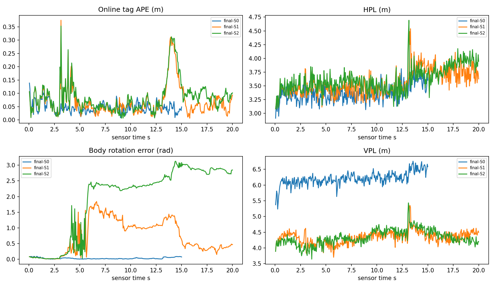
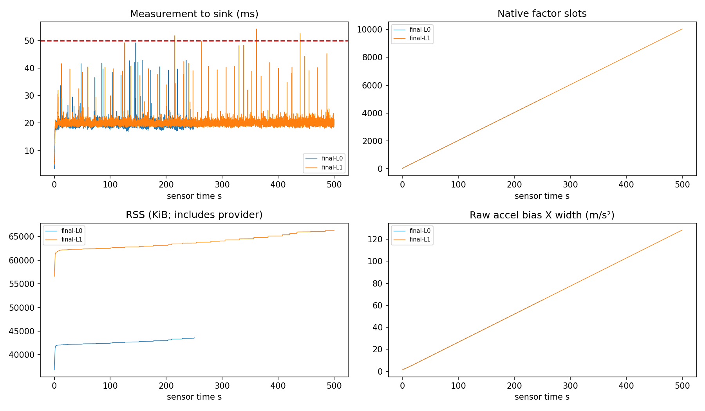

# SC6 results

## 1. Conclusion

**SC6_EVALUATED_WITH_GAPS**. W0→W4 development and the registered final short/5000/10000 paced evaluation were executed in this Goal. No production noise, risk, AL or publication rule changed; no push.

|Capability|Actual scope/status|
|---|---|
|SIMULATION_END_TO_END_VERIFIED|Verified conditional registered D0/G0 and D1/G1 simulation flow; G2 functional refusal retained. Privileged simulation source qualification only.|
|PL_TIGHTENING_VERIFIED_FOR_SCOPE|Verified coupled dynamics + sphere contractors on the original event; same-center M gain. Main bias remains RW-only.|
|FAULT_RECOVERY_VALIDATED_FOR_SCOPE|D0 six strong witnesses validated. Requested D1/weak/late scope has missed episodes; no blanket recovery award.|
|REALTIME_TARGET_MET_FOR_TESTED_PROFILES|OPEN: retain every 40/50ms miss below, including 40/40. Means do not grant a strict deadline award.|
|RESOURCE_BEHAVIOR_VERIFIED_FOR_TESTED_DURATION|Finite measured behavior below; RESOURCE_OPTIMIZATION_OPEN for native tombstone/alert growth. No O(1) total memory.|

Frozen final matrix (includes retained initial L1 logging failure when present): 32010 planned / 31710 successful receipts / 31710 raw-qualified. Sampled H/V exceedance count=0; this finite observation does not prove epsilon=1e-6. Mathematical inclusion/risk proof is separate. Application and hardware qualification stay CLOSED/UNQUALIFIED.

## 2. Baseline and scope

Entry HEAD `20831ec47888c6d96c9ac73571254b0efd8e9b52`; computation freeze `adab2da91a1448422c3982ef3dd5500cd16c6405`. Runner SHA256 `564818f491f8059637ae808e0a7535f28747b6044b7c5391e7afecf7550077b1`; unchanged production DSO `5faa46cc2d41492a55c65e9972a7bbe1f2a1b1773d791034ebdf119ec5954189`; config `55265150404b589c9f08867e29fe64ecbbcfa3ba9d044fac3ace2b113acca6e5`. Final delivery commit is obtained with `git log -1`, avoiding self-referential SHA.

Actual computation identities (math/source/selection model is shared, clock instrumentation revision is separate):
- final-C1,final-C2,final-F0,final-F1,final-F2,final-F3,final-F4,final-F5,final-L0,final-S0,final-S0-off,final-S1,final-S1-off,final-S2,final-S2-off,final-S3,final-V-20-20,final-V-30-10,final-V-40-40,final-W0,final-W1,final-W2,final-baseline-S0,final-baseline-S1,final-baseline-S1-off,final-baseline-S2,initial-L1: HEAD `2285aaf8d0a4f3fc1a9dec3b97033378caa1a1ca`, ELF `e71003396d1c066951e4d178f19d96aab4ba6dd3e471a7e895e63d6e23390723`.
- final-L1: HEAD `adab2da91a1448422c3982ef3dd5500cd16c6405`, ELF `564818f491f8059637ae808e0a7535f28747b6044b7c5391e7afecf7550077b1`.
GTSAM4.2a5 `/usr/local/lib/libgtsam.so.4` + unstable; Eigen3.3.7; TBB2020.1. Release `-O3 -march=native`; proof sources `-frounding-math -ffp-contract=off`, no fast-math. One TBB/BLAS/FGO worker; no affinity/WCET guarantee. Platform: Linux6.18.54.1-microsoft-standard-WSL2, x86_64, Intel Core Ultra5 125H,18 logical CPUs; no CPU affinity.

Original source: range sigma=.1m, accel ADC=.02m/s², gyro ADC=.001rad/s; original initial15D tangent sigmas and sample-grid bias RW from inherited IMU config. Epsilon=1e-6; global time-uniform births never reset. D0 A=.04/Omega=.2; D1 A=1/Omega=1/J=2/alpha=2. Config freezes G0, G1 eight corners (±4,±4,0/4), G2 weak vertical0/.001; seeds20261010/20261011 and complete fault manifests. Duration/strength were not changed after results. All actual raw digests agree in A comparisons.

W0 old B0/B1:650/650 receipts/raw; B1 repairs61/321 and rejoins80–83/340–343. Legacy times included scoring and omitted final gate/I/O, so no equivalent speed ratio to SC6. W1 raw/initial/range evidence exact old equality. Recovered adapter discrepancy1.686 was fixed by passing resolved window config to backend; W3 B1 max state/PL difference5.399e-8 (existing GN tolerances1e-7),400/400 and two true repairs. Production DSO SHA never changed.

## 3. Mathematical changes and independent checks

For ||a(t)||≤A, p1−p0−dt(v0+v1)/2=∫(dt/2−s)a(s)ds, so norm≤A dt²/4. Directed coordinate inverse intersections preserve every feasible trajectory; exact bang-bang a(s)=A sign(dt/2−s) attains the bound. Independent100-digit oracle verifies the extremum and halves an informative old displacement box. This adds a relation, not extra old scans.

For all SO(3), ||Rl||=||l||: intersect tag with p±||l|| and inverse p with tag±||l||. A shell row requires (xj−aj)²≤u²−sum(other coordinate distances²); outward lower bounds on the sum and outward sqrt give a necessary inverse. Intersect within each h, union all nine still-possible masks. Unprocessed frontier stays, including max_boxes=0 retaining all9 original boxes; no chosen FDE identity, local optimum, Gaussian-min or GT branch selection enters raw proof. All operators inherit E; no new random source or risk charge. Original numeric same-contract fallback remains.

Prototype known-R scalar constant-a: a=(p2−2p1+p0)/dt² and y=a+b+f+n, with carried RW. p=(0,.5,2), y=3, dt=1, n∈[−.2,.2] (support10 times the original ADC sigma .02) contracts healthy b from[−10,10] to[1.8,2.2]. Unbounded fault keeps the full box: (b=1,f=1) and(b=2,f=0) give identical observations. Prototype is executable, separately tested and deliberately not inserted into the main all-fault bias union. Main bias has no observation update; all-direction bias/attitude observability remains OPEN.

Original all-time induction remains: delta0=eps/2, deltak=eps/[2k(k+1)], block0 has21 sources and each subsequent block128. Shared ADC keeps original birth q; RW/history/ended episodes persist in separator and symbolic birth recipe. Summable union gives P(E complement)≤eps without independence between adaptive outputs. New necessary intersections preserve the true path on E. Every issued bound protects the same function-produced committed tag/receipt/stamp, including after numerical prior replacement. Unknown model/concurrency/hardware risks are not assigned zero.

|M same center|denominator|strict H/V|mean new/old H/V|
|---|---|---|---|
|S0|300/300|300/300 each|.767141/.897589|
|S1|400/400|400/400 each|.799357/.802006|

M uses one actual commit center and two proof chains; its doubled cost is not paced service performance. A lets the new capsule affect recovery metric; tight profiles also retain existing frozen boundary rotation as an optimization metric because polar midpoint of a full rotation box is not identifiable. It is not an independent observation. Mixed numerical effects below are retained. P fixes this mathematical/selection model and caches constants/candidates, stops exactly fixed passes, and reduces copied transaction material. P90 healthy+joint pairs are bit-equal in all state/action/PL/risk/source/ledger fields; median core51.4368→16.5313ms and52.7797→18.2749ms.

## 4. Simulation and isolation

M1 quintic stop–go: q=10u³−15u⁴+6u⁵, d=(.8,.4,.2), travel4s/rest2s/return4s/rest2s, continuous p/v/a; max second derivative10/sqrt3 and third60 give A<.331,J<.860. M2/M3 sinusoidal3D(.8,.6,.4),(.6,.5,.4) give A<.332,J<.191. R=Rx(.3sin(.4t))Ry(.4sin(.3t))Rz(.5sin(.2t)); body gyro=RzᵀRyᵀex*xprime+Rzᵀey*yprime+ez*zprime, rate≤.34, alpha<.181. Analytic continuous proof fits frozen D1. Directed Taylor/Machin-pi/Rodrigues numerics, seam/late100-digit independent scalar oracle and raw generator checks pass.

Provider owns trajectory/GT/draws/injection labels. Service receives only arrived measurements, original law/domain and privileged SIMULATION_SOURCE_CERTIFIED numerical qualification/sealed range residue. Certification actually executes per arrived epoch inside service, with carried RW residue; it does not reveal health or future extrema. Domain is consumed by monitor, physical propagator and actual D1 bridge. Current/future GT/data cannot enter step; direct future mutation leaves actual state/action/PL equal. Scoring follows payload delivery; main scores use committed terminal states, known world, no alignment or history smoothing. Hardware-source portability remains unqualified.

## 5. Complete final system results

|Row/profile/FDE/mode|planned/native/raw/timely|abort/unattempted|tag RMSE m|H/V RMSE m|HPL/VPL mean m|40/50 misses|
|---|---|---|---|---|---|---|
|final-C1/tight-optimized/on/paced|300/300/300/300|0/0|0.0516152|0.0365954/0.0363992|3.35002/6.22526|1/0|
|final-C2/tight-optimized/on/paced|400/400/400/400|0/0|0.0931412|0.0812702/0.0455021|3.60941/4.33937|0/0|
|final-F0/tight-optimized/on/paced|160/160/160/160|0/0|0.0740133|0.0512303/0.0534174|3.32396/6.11781|1/0|
|final-F1/tight-optimized/on/paced|160/160/160/160|0/0|0.0740133|0.0512303/0.0534174|3.32396/6.11781|0/0|
|final-F2/tight-optimized/on/paced|160/160/160/160|0/0|0.0740133|0.0512303/0.0534174|3.32396/6.11781|0/0|
|final-F3/tight-optimized/on/paced|160/160/160/160|0/0|0.0727009|0.0512129/0.051601|3.32207/6.11754|0/0|
|final-F4/tight-optimized/on/paced|160/160/160/160|0/0|0.0727009|0.0512129/0.051601|3.32207/6.11754|0/0|
|final-F5/tight-optimized/on/paced|160/160/160/160|0/0|0.0727009|0.0512129/0.051601|3.32207/6.11754|0/0|
|final-L0/tight-optimized/on/paced|5000/5000/5000/5000|0/0|0.0458142|0.031277/0.0334767|3.61518/6.44231|11/0|
|final-L1/tight-optimized/on/paced|10000/10000/10000/9996|0/0|0.075248|0.063607/0.0402047|3.79189/4.51405|23/4|
|final-S0/tight-optimized/on/paced|300/300/300/300|0/0|0.0500571|0.0355781/0.0352123|3.36607/6.20246|0/0|
|final-S0-off/tight-optimized/off/offline|300/300/300/300|0/0|0.0500571|0.0355781/0.0352123|3.36607/6.20246|0/0|
|final-S1/tight-optimized/on/paced|400/400/400/400|0/0|0.090906|0.0716728/0.0559187|3.56331/4.33671|0/0|
|final-S1-off/tight-optimized/off/offline|400/400/400/400|0/0|0.22139|0.19788/0.0992823|3.57144/4.29282|0/0|
|final-S2/tight-optimized/on/paced|400/400/400/400|0/0|0.102563|0.0816901/0.0620157|3.61609/4.33742|0/0|
|final-S2-off/tight-optimized/off/offline|400/400/400/400|0/0|0.224942|0.202304/0.0983451|3.6377/4.30859|0/0|
|final-S3/tight-optimized/on/paced|300/0/0/0|1/299|NA|NA/NA|NA/NA|NA/NA|
|final-V-20-20/tight-optimized/on/paced|250/250/250/250|0/0|0.0806439|0.0524118/0.0612898|3.34002/6.16798|0/0|
|final-V-30-10/tight-optimized/on/paced|250/250/250/250|0/0|0.0801072|0.0560766/0.0572065|3.34064/6.16437|0/0|
|final-V-40-40/tight-optimized/on/paced|250/250/250/249|0/0|0.0752464|0.0519125/0.0544712|3.33972/6.16074|3/1|
|final-W0/tight-optimized/on/paced|200/200/200/200|0/0|0.0582674|0.0428327/0.0395025|3.32342/6.1264|0/0|
|final-W1/tight-optimized/on/paced|200/200/200/200|0/0|0.0688667|0.047437/0.0499234|3.32509/6.13443|1/0|
|final-W2/tight-optimized/on/paced|200/200/200/200|0/0|0.0636682|0.0459946/0.0440243|3.32604/6.13294|1/0|
|final-baseline-S0/baseline-adapter/on/offline|300/300/300/300|0/0|0.0500571|0.0355781/0.0352123|4.38917/6.91889|0/0|
|final-baseline-S1/baseline-adapter/on/offline|400/400/400/398|0/0|0.0894948|0.0711863/0.0542387|4.45705/5.40373|3/2|
|final-baseline-S1-off/baseline-adapter/off/offline|400/400/400/399|0/0|0.22139|0.19788/0.0992823|4.46665/5.36464|1/1|
|final-baseline-S2/baseline-adapter/on/offline|400/400/400/399|0/0|0.0888951|0.0686844/0.0564339|4.4538/5.37835|4/1|
|initial-L1/tight-optimized/on/paced|10000/10000/10000/9997|0/0|0.075248|0.063607/0.0402047|3.79189/4.51405|31/3|

All refusal/missing outputs remain in denominators; no stale fill. G2/S3 functional numerical seed/candidate refusal is not a proof that the physical feasible set is empty. Its planned300 epochs are retained. Offline service timing is not paced measurement-to-sink.

|Full-state row|velocity RMSE m/s|rotation RMSE rad|accel/gyro bias RMSE|RPE1 translation/angle mean|RPE20 translation/angle mean|
|---|---|---|---|---|---|
|final-C1|0.15779|0.0673882|0.140596/0.0140124|0.024386/0.00765132 (299/299)|0.0679689/0.0329818 (280/280)|
|final-C2|0.441987|2.11121|0.30243/0.0520319|0.0610064/0.106661 (399/399)|0.588685/0.400606 (380/380)|
|final-F0|0.338395|0.668647|0.218871/0.0159464|0.0733545/0.168308 (159/159)|0.152358/0.41762 (140/140)|
|final-F1|0.338395|0.668647|0.218871/0.0159464|0.0733545/0.168308 (159/159)|0.152358/0.41762 (140/140)|
|final-F2|0.338395|0.668647|0.218871/0.0159464|0.0733545/0.168308 (159/159)|0.152358/0.41762 (140/140)|
|final-F3|0.329626|0.573575|0.208445/0.0158982|0.0701153/0.167248 (159/159)|0.134383/0.364708 (140/140)|
|final-F4|0.329626|0.573575|0.208445/0.0158982|0.0701153/0.167248 (159/159)|0.134383/0.364708 (140/140)|
|final-F5|0.329626|0.573575|0.208445/0.0158982|0.0701153/0.167248 (159/159)|0.134383/0.364708 (140/140)|
|final-L0|0.0867929|0.132642|0.0528572/0.00325233|0.0210003/0.00403038 (4999/4999)|0.0612614/0.0155284 (4980/4980)|
|final-L1|0.352108|1.40586|0.10975/0.00948817|0.0294744/0.00733375 (9999/9999)|0.342235/0.0406697 (9980/9980)|
|final-S0|0.146371|0.0398358|0.18859/0.0109565|0.0237377/0.00773759 (299/299)|0.0703763/0.0309442 (280/280)|
|final-S0-off|0.146371|0.0398358|0.18859/0.0109565|0.0237377/0.00773759 (299/299)|0.0703763/0.0309442 (280/280)|
|final-S1|0.413064|0.898931|0.29171/0.0324137|0.0444057/0.0776745 (399/399)|0.201871/0.312465 (380/380)|
|final-S1-off|1.21783|1.30288|0.566375/0.0658284|0.0343762/0.0161778 (399/399)|0.302444/0.192238 (380/380)|
|final-S2|0.451546|2.21514|0.407906/0.0507633|0.0604399/0.0832649 (399/399)|0.587803/0.32908 (380/380)|
|final-S2-off|1.23731|1.74072|0.892338/0.0715566|0.0455858/0.0176395 (399/399)|0.621097/0.229009 (380/380)|
|final-V-20-20|0.504728|1.01096|0.214386/0.0151258|0.0726851/0.161411 (249/249)|0.176755/0.610863 (230/230)|
|final-V-30-10|0.546124|0.605785|0.20981/0.0158161|0.0829348/0.215679 (249/249)|0.146483/0.39369 (230/230)|
|final-V-40-40|0.449855|0.441508|0.207325/0.0157794|0.0936605/0.260689 (249/249)|0.162052/0.473491 (230/230)|
|final-W0|0.241258|0.0727181|0.202497/0.0143833|0.0293325/0.0121622 (199/199)|0.0806836/0.0396704 (180/180)|
|final-W1|0.306554|0.737364|0.223556/0.0148919|0.063635/0.14804 (199/199)|0.147635/0.370439 (180/180)|
|final-W2|0.342663|1.11605|0.202221/0.0145125|0.0630907/0.181545 (199/199)|0.15181/0.359275 (180/180)|
|final-baseline-S0|0.146371|0.0398358|0.18859/0.0109565|0.0237377/0.00773759 (299/299)|0.0703763/0.0309442 (280/280)|
|final-baseline-S1|0.411227|1.28332|0.21765/0.0346844|0.0478815/0.0850058 (399/399)|0.247784/0.387076 (380/380)|
|final-baseline-S1-off|1.21783|1.30288|0.566375/0.0658284|0.0343762/0.0161778 (399/399)|0.302444/0.192238 (380/380)|
|final-baseline-S2|0.408357|0.332349|0.212876/0.0345285|0.0472486/0.0841794 (399/399)|0.162102/0.231923 (380/380)|
|initial-L1|0.352108|1.40586|0.10975/0.00948817|0.0294744/0.00733375 (9999/9999)|0.342235/0.0406697 (9980/9980)|

|Bias axis RMSE row|accel x/y/z m/s²|gyro x/y/z rad/s|
|---|---|---|
|final-S0|0.155567/0.104284/0.0221374|0.00412408/0.00254808/0.00982565|
|final-S1|0.272042/0.101496/0.0280347|0.0185869/0.0031091/0.0263725|
|final-S2|0.334062/0.230408/0.0412552|0.0215979/0.0128243/0.0441133|
|final-L0|0.0439916/0.0276761/0.00962582|0.00108492/0.0009918/0.00290119|
|final-L1|0.093252/0.0569467/0.0103036|0.00365238/0.00182039/0.00856572|

No application accuracy threshold exists; these are numerical evaluations. APE/H/V and state error P95/max are provided for main/long rows below. Bias per-axis errors are scored separately in native trace; scalar table is vector RMSE.


**final-S0** error median/P95/max:
- ape: 0.0424015/0.0838904/0.138667
- hpe: 0.0294585/0.0614104/0.0885208
- vpe: 0.0228177/0.0685611/0.120204
- velocity_error: 0.0961352/0.260021/0.868359
- rotation_error: 0.0211582/0.0847748/0.0932769
- accel_bias_error: 0.198724/0.210581/0.217695
- gyro_bias_error: 0.00807413/0.0179786/0.020057
Fault-phase vector RMSE (n; tag/velocity/rotation/accel-bias/gyro-bias):
- normal: 300; 0.0500571/0.146371/0.0398358/0.18859/0.0109565
- fault: 0; NA/NA/NA/NA/NA
- repair_after: 0; NA/NA/NA/NA/NA

**final-S1** error median/P95/max:
- ape: 0.0540668/0.192185/0.374792
- hpe: 0.0362441/0.172871/0.28136
- vpe: 0.0304713/0.110213/0.369871
- velocity_error: 0.194571/1.0581/1.80102
- rotation_error: 0.508772/1.58587/1.84156
- accel_bias_error: 0.209299/0.544941/0.638128
- gyro_bias_error: 0.0168342/0.0655301/0.0694316
Fault-phase vector RMSE (n; tag/velocity/rotation/accel-bias/gyro-bias):
- normal: 380; 0.0883884/0.414734/0.899662/0.296787/0.0331321
- fault: 20; 0.12977/0.379955/0.88493/0.168309/0.0124922
- repair_after: 80; 0.158628/0.824828/0.838525/0.282372/0.0372648

**final-S2** error median/P95/max:
- ape: 0.0719121/0.215846/0.353054
- hpe: 0.0460392/0.173967/0.302173
- vpe: 0.0378618/0.114987/0.340992
- velocity_error: 0.238643/1.12901/2.15675
- rotation_error: 2.35671/2.99324/3.12756
- accel_bias_error: 0.211503/0.754416/0.939296
- gyro_bias_error: 0.0257547/0.0975116/0.102085
Fault-phase vector RMSE (n; tag/velocity/rotation/accel-bias/gyro-bias):
- normal: 380; 0.100265/0.452011/2.23325/0.416097/0.0517501
- fault: 20; 0.139205/0.442629/1.83731/0.1953/0.025594
- repair_after: 80; 0.169577/0.862404/2.10858/0.465058/0.0551446

**final-L0** error median/P95/max:
- ape: 0.0399691/0.0764428/0.138667
- hpe: 0.0260471/0.0532709/0.0903595
- vpe: 0.0226973/0.0664501/0.120204
- velocity_error: 0.0728356/0.13354/0.868359
- rotation_error: 0.121991/0.215443/0.267491
- accel_bias_error: 0.0242911/0.154811/0.217695
- gyro_bias_error: 0.00131069/0.0062303/0.020057
Fault-phase vector RMSE (n; tag/velocity/rotation/accel-bias/gyro-bias):
- normal: 5000; 0.0458142/0.0867929/0.132642/0.0528572/0.00325233
- fault: 0; NA/NA/NA/NA/NA
- repair_after: 0; NA/NA/NA/NA/NA

**final-L1** error median/P95/max:
- ape: 0.0430028/0.0858865/0.985314
- hpe: 0.0303562/0.068582/0.977233
- vpe: 0.0221946/0.0667964/0.591477
- velocity_error: 0.0979935/0.240995/6.87477
- rotation_error: 0.474197/2.63271/2.81347
- accel_bias_error: 0.100133/0.173776/0.244495
- gyro_bias_error: 0.00928144/0.0140741/0.0210382
Fault-phase vector RMSE (n; tag/velocity/rotation/accel-bias/gyro-bias):
- normal: 9940; 0.0715502/0.280691/1.40654/0.109732/0.00948215
- fault: 60; 0.30918/2.75879/1.28806/0.112608/0.0104377
- repair_after: 240; 0.33941/1.6298/1.25346/0.133948/0.0108169

|Episode row|onset/axis/duration|first real bridge|prior repair|first4 real IMU rejoin|UWB correct isolation epochs|
|---|---|---|---|---|---|
|final-C2|61/0/500|61|[61]|[80, 81, 82, 83]|[61, 62, 63]|
|final-C2|261/3/500|None|[]|[]|[261, 262, 263]|
|final-F0|61/0/500|61|[61]|[80, 81, 82, 83]|[61, 62, 63]|
|final-F1|61/1/500|61|[61]|[80, 81, 82, 83]|[61, 62, 63]|
|final-F2|61/2/500|61|[61]|[80, 81, 82, 83]|[61, 62, 63]|
|final-F3|61/3/500|61|[61]|[80, 81, 82, 83]|[61, 62, 63]|
|final-F4|61/4/500|61|[61]|[80, 81, 82, 83]|[61, 62, 63]|
|final-F5|61/5/500|61|[61]|[80, 81, 82, 83]|[61, 62, 63]|
|final-L1|121/0/500|121|[121]|[140, 141, 142, 143]|[124, 125, 126]|
|final-L1|1121/3/500|None|[]|[]|[1118, 1119, 1120]|
|final-L1|3121/0/500|None|[]|[]|[3124, 3125, 3126]|
|final-L1|5121/3/500|None|[]|[]|[5118, 5119, 5120]|
|final-L1|7121/0/500|None|[]|[]|[7124, 7125, 7126]|
|final-L1|9121/3/500|None|[]|[]|[9118, 9119, 9120]|
|final-S1|61/0/500|61|[61]|[80, 81, 82, 83]|[58, 59, 60]|
|final-S1|261/3/500|None|[]|[]|[264, 265, 266]|
|final-S2|61/0/500|61|[61]|[80, 81, 82, 83]|[61, 62, 63]|
|final-S2|261/3/500|None|[]|[]|[261, 262, 263]|
|final-V-20-20|61/0/500|61|[61]|[80, 81, 82, 83]|[61, 62, 63]|
|final-V-20-20|161/3/500|161|[161]|[180, 181, 182, 183]|[161, 162, 163]|
|final-V-30-10|61/0/500|61|[61]|[80, 81, 82, 83]|[61, 62, 63]|
|final-V-30-10|161/3/500|161|[161]|[180, 181, 182, 183]|[161, 162, 163]|
|final-V-40-40|61/0/500|61|[61]|[80, 81, 82, 83]|[61, 62, 63]|
|final-V-40-40|161/3/500|161|[161]|[180, 181, 182, 183]|[161, 162, 163]|
|final-W0|61/0/50|None|[]|[]|[61, 62, 63]|
|final-W1|61/3/500|61|[61]|[80, 81, 82, 83]|[61, 62, 63]|
|final-W2|61/0/50|61|[61]|[71, 72, 73, 74]|[61, 62, 63]|
|initial-L1|121/0/500|121|[121]|[140, 141, 142, 143]|[124, 125, 126]|
|initial-L1|1121/3/500|None|[]|[]|[1118, 1119, 1120]|
|initial-L1|3121/0/500|None|[]|[]|[3124, 3125, 3126]|
|initial-L1|5121/3/500|None|[]|[]|[5118, 5119, 5120]|
|initial-L1|7121/0/500|None|[]|[]|[7124, 7125, 7126]|
|initial-L1|9121/3/500|None|[]|[]|[9118, 9119, 9120]|

Bridge/prior/rejoin fields come from actual unique backend receipts and ledger checks. Rejoined flags from an earlier episode are not counted for a newly missed episode. D1 gyro and late misses stay requested-scope OPEN. Healthy extra UWB exclusions (including conservative hold) are: final-S1=2, final-C2=4, final-S2=4, final-F3=2, final-F2=2, final-V-30-10=4, final-W1=2, final-L0=0, final-V-20-20=4, final-W0=137, final-F1=2, final-F4=2, final-F0=2, final-V-40-40=4, final-W2=2, final-F5=2, final-S0=0, final-S3=0, final-C1=0, initial-L1=12, final-L1=12. No current hypothesis is used as truth.

## 6. Realtime and resource behavior

RUN_READY maps sensor stamps to steady clock. Independent producer releases200Hz IMU and20Hz UWB while single worker can be busy. Payload copy and actual receiver stamp/version/duplicate/gap/deadline gate are measured through sink; GT and diagnostic trace follow handoff. Required source verification, proposal, sole commit, proof and internal cleanup are inside service. Diagnostic scoring/I/O and release of provider envelope after delivery can delay the next worker and are reflected in paced queue/measurement-age; they are not hidden precomputation. This is finite software measurement, not hardware/WCET certification.

|Paced row|core mean/P95/max ms|measurement-to-sink mean/P95/max ms|RSS max KiB|slots first/last/max|live/ledger max|queue peak|
|---|---|---|---|---|---|---|
|final-C1|18.375/20.491/41.227|18.556/20.64/41.411|23480|5/334/334|61/90|10|
|final-C2|19.446/22.276/38.895|19.587/22.407/38.992|24176|5/453/453|88/141|10|
|final-F0|18.433/23.497/44.983|18.611/23.673/45.155|23396|5/213/213|88/141|10|
|final-F1|17.687/21.699/28.38|17.863/21.9/28.555|23100|5/213/213|88/141|10|
|final-F2|17.781/22.735/39.719|17.926/22.894/39.914|23316|5/213/213|88/141|10|
|final-F3|17.73/22.761/38.761|17.871/22.923/38.944|23160|5/195/195|79/123|10|
|final-F4|18.294/22.372/28.881|18.448/22.508/29|23108|5/195/195|79/123|10|
|final-F5|17.755/22.042/38.159|17.918/22.239/38.373|23148|5/195/195|79/123|10|
|final-L0|19.535/21.229/49.067|19.714/21.411/49.238|43636|5/5034/5034|61/90|10|
|final-L1|19.921/21.497/52.557|20.064/21.641/54.274|66392|5/10034/10034|88/141|10|
|final-S0|18.446/20.92/39.693|18.631/21.094/39.851|23624|5/334/334|61/90|10|
|final-S1|18.892/21.98/31.879|19.077/22.158/32.092|24272|5/434/434|88/138|10|
|final-S2|19.589/22.111/39.338|19.757/22.296/39.467|24260|5/453/453|88/141|10|
|final-V-20-20|13.494/16.648/24.469|13.675/16.808/24.712|21832|5/274/274|59/101|10|
|final-V-30-10|10.56/13.538/23.059|10.704/13.7/23.264|22492|5/294/294|88/138|10|
|final-V-40-40|23.916/31.6/57.814|24.095/31.761/57.971|25296|5/333/333|108/178|11|
|final-W0|20.587/28.717/35.372|20.731/28.867/35.523|23016|5/234/234|61/119|10|
|final-W1|18.614/22.924/47.89|18.758/23.116/48.051|23292|5/253/253|88/141|10|
|final-W2|18.549/21.899/44.262|18.704/22.054/44.433|23400|5/253/253|79/141|10|
|initial-L1|20.094/22.077/52.413|20.241/22.218/52.634|66356|5/10034/10034|88/141|10|

40/40 has genuine strict deadline misses; no average removes them. Failure paths have separate total cost in native full-schema refusal rows. Real cancel16:2 mutations/14 refusals; real overload16:3 mutations/13 refusals, queue80,160/110 IMU and16/11 UWB released/enqueued, no stale protection. Receiver unit tests cover timeout/duplicate/stamp/gap and continuity after a mere late receipt. Source gaps latch refusal, do not reset event. No raw stamp is replaced by wall time.

Native tombstones grow because GTSAM marginalizeLeaves appends priors bypassing already-enabled ordinary slot reuse. No unsafe remapping/second commit was attempted. Transient transaction copy is reduced; observed-alert records retain IDs until4096 then refuse. RSS includes the finite provider dataset, which scales with playback duration; online proof window/replay/capsules are separately bounded. q/bias growth is physical/source support, not reset away. RESOURCE_OPTIMIZATION_OPEN remains for infinite slot/record behavior.

## 7. Final long streams and late faults

**final-L0**: 5000 planned / 5000 rows / 5000 actual mutations / 5000 receipts / 5000 finite estimates / 5000 raw-qualified / 5000 timely; abort0, refusal0, unattempted0, never emitted0; inputs {'released_imu': 50000, 'enqueued_imu': 50000, 'released_uwb': 5000, 'enqueued_uwb': 5000, 'queue_peak': 10}.

First/last/max: q=7/9/9, risk=7.5e-07/9.999e-07/9.999e-07, bias_width=1.4099/64.6606/64.6606, hpl=2.91135/3.65121/4.14805, vpl=5.37235/6.50295/6.92773, slots=5/5034/5034, rss=36828/43636/43636, alerts=0/0/0, replay=11/601/601, capsules=2/61/61.

Snapshots at all500-epoch boundaries and declared late episode onsets (epoch:HPL/VPL/bias-width/q/alerts/bridge/repair):
- 121: 3.2098510343303697/5.6329482845935921/2.7590592820405853/8/0/0/0
- 500: 3.4704779787342024/6.3142954840290528/7.3849519961630508/9/0/0/0
- 1000: 3.8008709186251695/6.244344026711782/13.748913226842401/9/0/0/0
- 1121: 3.6744490881320138/6.4142800476859634/15.288991844666814/9/0/0/0
- 1500: 3.4448906321695962/6.7637350364155804/20.112874457521798/9/0/0/0
- 2000: 3.5090671211955367/6.6704482348675826/26.476835688201191/9/0/0/0
- 2500: 3.6679404006204184/6.382091408097919/32.840796918880585/9/0/0/0
- 3000: 3.4974166478213591/6.3808714651266447/39.204758149559979/9/0/0/0
- 3121: 3.6544064749658456/6.4875459714693307/40.744836767384392/9/0/0/0
- 3500: 3.6047315003893674/6.385096366086235/45.568719380239372/9/0/0/0
- 4000: 3.7700594814580057/6.614305412976492/51.932680610918766/9/0/0/0
- 4500: 3.5644399780911127/6.6539732589691498/58.296641841598159/9/0/0/0
- 5000: 3.6512067413904594/6.5029481918534451/64.660603072277922/9/0/0/0
**final-L1**: 10000 planned / 10000 rows / 10000 actual mutations / 10000 receipts / 10000 finite estimates / 10000 raw-qualified / 9996 timely; abort0, refusal0, unattempted0, never emitted0; inputs {'released_imu': 100000, 'enqueued_imu': 100000, 'released_uwb': 10000, 'enqueued_uwb': 10000, 'queue_peak': 10}.

First/last/max: q=7/9/9, risk=7.5e-07/9.9995e-07/9.9995e-07, bias_width=1.4099/128.3/128.3, hpl=3.08435/3.96388/4.92651, vpl=3.89174/4.47575/5.83476, slots=5/10034/10034, rss=56588/66392/66392, alerts=0/1/1, replay=11/601/601, capsules=2/61/61.

Snapshots at all500-epoch boundaries and declared late episode onsets (epoch:HPL/VPL/bias-width/q/alerts/bridge/repair):
- 121: 3.4935397639678212/4.2573654908644061/2.7590592820405853/8/1/1/1
- 500: 3.904103543174871/4.7681365941353784/7.3849519961630508/9/1/0/0
- 1000: 3.936254122476385/4.2538413710395337/13.748913226842401/9/1/0/0
- 1121: 3.7755767062347658/4.8758203110571037/15.288991844666814/9/1/0/0
- 1500: 3.6178769317831545/4.8319090289679201/20.112874457521798/9/1/0/0
- 2000: 3.8143319495289938/4.4583849582411679/26.476835688201191/9/1/0/0
- 2500: 3.6433225348396796/4.7090088036117477/32.840796918880585/9/1/0/0
- 3000: 3.6912515462193403/4.6274934779776382/39.204758149559979/9/1/0/0
- 3121: 3.7474009140738214/4.7396289288171518/40.744836767384392/9/1/0/0
- 3500: 3.9705339293764847/4.2063150388692954/45.568719380239372/9/1/0/0
- 4000: 3.7169928905314986/4.8534080769434444/51.932680610918766/9/1/0/0
- 4500: 3.7792146397802941/4.2015640358013204/58.296641841598159/9/1/0/0
- 5000: 3.9537711483486873/4.6691635898133406/64.660603072277922/9/1/0/0
- 5121: 3.7796457985721941/4.4002307787618919/66.200681690103195/9/1/0/0
- 5500: 3.9512464042732427/4.278688446223593/71.024564302960869/9/1/0/0
- 6000: 3.8629993845181612/4.2704798626489922/77.388525533643815/9/1/0/0
- 6500: 3.7432092304747728/4.9378785640108438/83.752486764326761/9/1/0/0
- 7000: 3.7876492395507029/4.0479627391154791/90.116447995009707/9/1/0/0
- 7121: 3.5980399566549419/5.0140039913344019/91.65652661283498/9/1/0/0
- 7500: 4.0679673409451986/4.6567221790090674/96.480409225692654/9/1/0/0
- 8000: 3.9502495918046301/4.2191919797493176/102.8443704563756/9/1/0/0
- 8500: 3.8188579162230187/4.4639011371091879/109.20833168705855/9/1/0/0
- 9000: 3.7306860792683887/4.7833269966690066/115.57229291774149/9/1/0/0
- 9121: 3.8177168315136858/4.6175388572653464/117.11237153556677/9/1/0/0
- 9500: 3.8362952324175859/4.0084865958117861/121.93625414842444/9/1/0/0
- 10000: 3.9638827120645579/4.4757533415116066/128.30021537910773/9/1/0/0

Long measurement durations are250s/500s after RUN_READY, not risk horizons. Later20m/s² and1rad/s episodes use the original amplitudes. Expanding RW/motion support can hide them; this is LATE_FAULT_DETECTABILITY_OPEN, not successful restoration. Larger PL can cover a degraded estimate but cannot establish navigation recovery. No10k zero-violation inference to1e-6/infinite realtime.

## 8. SC6-A01–A24

|ID|Status and concrete evidence/limitation|
|---|---|
|A01|PASS baseline raw identity, resolved-config B1 regression, unchanged DSO/defaults; arithmetic difference quantified.|
|A02|PASS conditional trusted simulation provider/service/scorer isolation and future-mutation check; privileged numeric source is not hardware detection.|
|A03|PASS analytic continuous D1 and directed numeric source; monitor/propagator/D1 bridge consume same domain.|
|A04|PASS scoped independent100-digit extrema/seams, prior core Gaussian/full-state/cross/dof and geometry/rotation/event oracles; regression results below. Not arbitrary nonlinear observability.|
|A05|PASS inherited all-time E and raw induction, complete masks/frontier/shared birth/RW/historical carry.|
|A06|PASS new coupled p/v and norm/shell constraints with inclusion proof and fallback/frontier checks.|
|A07|PASS local prototype + two indistinguishable lawful solutions; main bias observation contraction OPEN.|
|A08|PASS same-center700/700 strict H/V M contractions, no law/noise/AL/fault manipulation.|
|A09|PASS frozen A ON/OFF and old/new actual identical raw digests and full-state/stage scoring; mixed effects retained.|
|A10|PASS D0 six strong witnesses real prior removal/ledger/4 IMU rejoin; requested D1 gyro scope OPEN.|
|A11|PASS evaluation weak/short/staggered/repeated/late full denominators; unbounded/unknown concurrent scope not zero; functional misses OPEN.|
|A12|PASS SC6 shared-step operator-held polluted prior actually repaired55/rejoin56–59 in80 epochs; tight optimized beyond-replay104 refuses100–104; unique commits, old104 negative retained.|
|A13|PASS terminal unaligned tag/full-state/RPE1/20/ON/OFF/stage scores; NAVIGATION_ACCURACY_OPEN.|
|A14|PASS independent200Hz/20Hz release/enqueue/queue, actual source/service/gate/sink clocks. Actual UWB alarm clock recording fixed and validated without changing native semantics; affected L1 rerun only, original failure retained.|
|A15|PASS receiver timeout/stamp/duplicate/gap unit checks and real cancel/overflow; late space-valid outputs have no current protection.|
|A16|PASS finite measured resource evaluation and transient copy reduction; RESOURCE_OPTIMIZATION_OPEN native tombstone/alert growth.|
|A17|PASS exact same-model P90 healthy+joint semantics/raw identity, about3x median net improvement.|
|A18|OPEN REALTIME_PROFILE_OPEN: actual misses in registered40/40 and other rows; all counters retained.|
|A19|PASS full5000/10000 actual paced flows with complete denominators and late episodes.|
|A20|PASS AL2/3,5/5,10/10 immutable postprocessing only; formal/application publication always0.|
|A21|PASS M/A/P distinguished, frozen SHA/digests/profiles and failed/debug denominators retained.|
|A22|PASS final10/10 core invocations after long flows, including actual SC6 polluted-prior/beyond-replay and independent full-state/cross/dof/geometry/event checks.|
|A23|PASS separates proof/recovery/accuracy/timeliness/resources; no finite-zero/WCET/infinite-memory/application claim.|
|A24|PASS delivery after final local W4 save and own-cache cleanup; sole result and two actual figures. No push.|

Five statuses above are scoped independently; requested D1/late recovery, complete navigation accuracy, strict realtime and infinite resource optimization remain OPEN. SC6_COMPLETE_FOR_REGISTERED_SIMULATION_SCOPE is **not** granted.

## 9. Reproduction, failures and Git

W0 `2b19fed`; W1 `3f8a196`; W2 `69ccb4d`; W3 freeze `2285aaf`; W4 alarm-clock recording fix `adab2da` (mathematical/selection semantics unchanged). W4 result/test/local save is final `git log -1`.

```bash
python3 tools/sc6_system_research.py check --build
python3 tools/sc6_system_research.py freeze
python3 tools/sc6_system_research.py final --group short
python3 tools/sc6_system_research.py final --group long
python3 tools/sc6_evaluate.py
```

W4 actual logging bug: initial L1 missed separate UWB wall alarm timestamps, though all10000 receipts/raw and31 core/3 delivery misses were measured. Fix records immediately after actual functional UWB statistic; service consumes earliest IMU/UWB alarm. Shared-service held-FDE and S0/S2 paired90 prefixes validate actual clocks and bit-equal state/action/PL/risk/source/ledger versus old frozen executable. No source or algorithm change. Only affected L1 was rerun once as final-L1-clockfix; initial10000 failure row remains separately above. L0 has no alarms/exclusions and is retained at its original actual ELF, with11 core misses. Corrected L1 uses the updated freeze ELF; no fastest-selection or discarded denominator.

Native: `epoch_raim_runner CONFIG CSV CASE sc6 on|off COUNT baseline-adapter|tight-reference|tight-optimized offline|paced SEED [shadow|cancel:3|delay:3]`. COUNT0 selects registered length. Use tools environment for the private DSO. Long runs only frozen candidate once each; no fastest rerun. W0 original B0/B1 commands and old SC1–SC5 results are reused, not whole campaigns repeated.

Failure accounting: W1 compile const-config error, new-target make reconfiguration issue, one wrong-DSO direct check; all corrected before stage save. Initial680 W1 rows had valid native states but invalid Eigen-lazy tag/scoring fields; stable reruns only affected rows. Original recovered adapter mismatch was identified/fixed, not reported as P equality. W2 initial700 M +960 axis and560 rotation-metric A checks are retained in this result; metrics could improve one row and worsen another. W3 one decimal-refusal parser failure was fixed/rescored. Final S3 and every realtime miss remain above. No noise reduction, raised AL, strengthened fault, reset q/bias/risk, removed difficult case, or repeated long selection.

AL numeric counts on frozen traces: final-S1={'2/3': 0, '5/5': 397, '10/10': 400}, final-S2={'2/3': 0, '5/5': 397, '10/10': 400}, final-L0={'2/3': 0, '5/5': 0, '10/10': 5000}, final-S0={'2/3': 0, '5/5': 0, '10/10': 300}, final-L1={'2/3': 0, '5/5': 9798, '10/10': 10000}. Their computation cannot mutate state/action/PL/event.

Transient traces/config/logs were exclusive to `.cache/sc6-20261014`; final cleanup removes only that task-created cache after summary verification. User requirement files and prior evidence are untouched.






Figures use only actual committed outputs; omitted/refused counts appear in tables. First figure:1100/1100 S0/S1/S2 committed; second:15000/15000 L0/L1 committed, including3 late outputs. Global finite qualified=31710, planned=32010.

Final necessary core regression: **10/10 PASS** after original long flows; after the clock-only bug fix, only directly affected SC6/open boundary checks are supplemented, preserving the original invocation results.

|Target|Result|
|---|---|
|sc6_checks []|PASS|
|time_uniform_event_checks []|PASS|
|open_rolling_checks []|PASS|
|sc5_math_checks []|PASS|
|sc5_event_checks []|PASS|
|sc5_rolling_checks []|PASS|
|sc5_rolling_checks ['boundary']|PASS|
|hybrid_tightening_checks []|PASS|
|raw_range_checks []|PASS|
|fde_next_checks ['config/fde_next.yaml']|PASS|

SC6 shared-service additional tests:184/184 sole native mutations/raw-qualified; actual polluted marginal prior repaired55 and IMU rejoin56–59; beyond replay100–104 has raw coverage and no restoration. Original frozen runner SHA stayed unchanged through the original regression build; the subsequent clock fix has its own recorded ELF and exact semantic-prefix comparison. No main noise sigma was changed.

Clock-only fix directly affected supplement after corrected L1: **3/3 PASS** (sc6_checks [], open_rolling_checks [], sc5_rolling_checks ['boundary']). Original10 regression results and initial L1 failure remain unchanged.
Final bookkeeping audit:28 rows (25 registered short + retained initial L1 +2 accepted final long),32010 planned/31710 native/raw/31698 timely;80 core40 and12 delivery50 misses including the retained initial L1. Primary final L0/L1:15000/15000 receipts/raw,14996 timely,34 core40 and4 delivery50 misses. No input loss, source gap or native abort in either final long.
