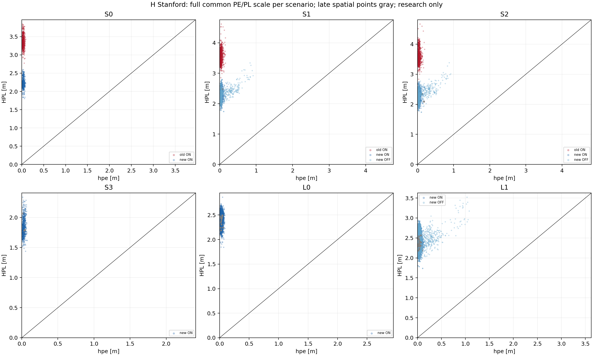
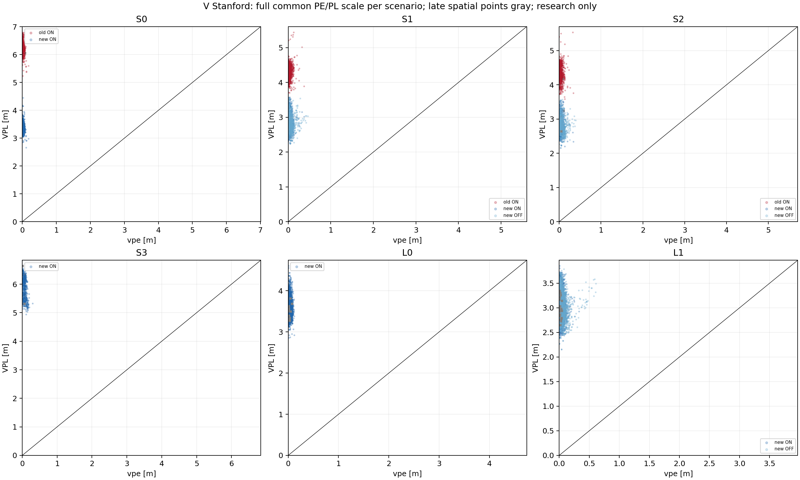
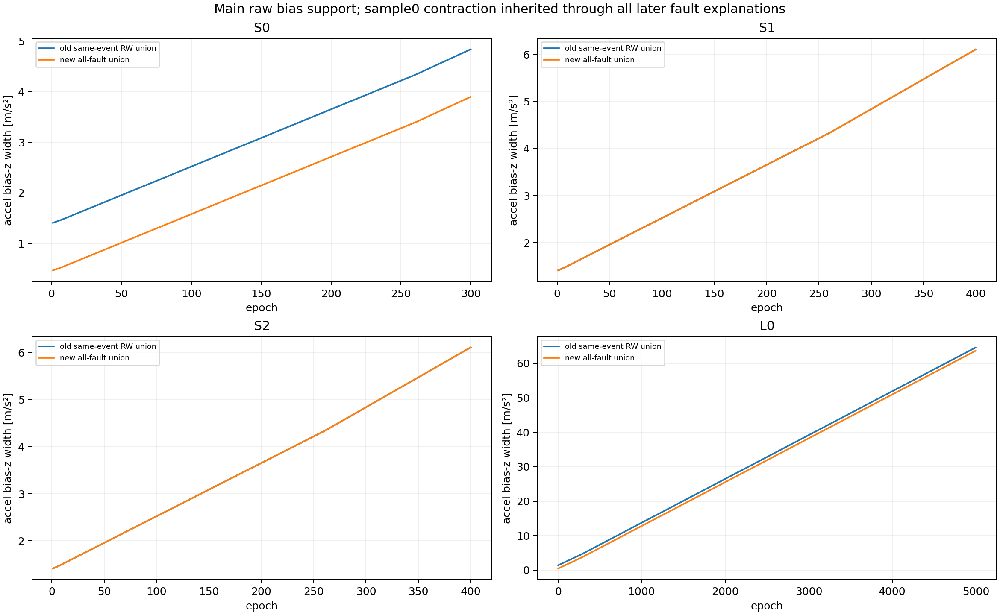
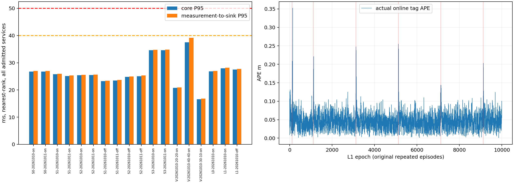

# SC7 results

SC7_COMPLETE_FOR_REGISTERED_SCOPE — final frozen combined native evaluation below.

Entry source SHA: `43abd3fcb35568259e6b2e4131dfdc909e216c3a` (matches reviewed baseline). No applicable ancestor/repository AGENTS.md found. Tracked worktree clean at entry. Requirements were ignored by existing Git patterns and are explicitly retained with this change. No original noise/risk/fault/AL/publication settings changed; all additions research opt-in. No push.

## W0 frozen protocol and actual attribution

Development/confirmation seeds 20261010/20261011. Snapshots S0/31,250; S1/S2/61,300; G2/1, with 1/31/61/250/300 supplementary captures. Native four motion×geometry D1 prefixes and legacy M0/D0/G0 each 300 epochs; S1/S2 also 300. Geometry varies actual ranges with the same seeded standardized draw streams, never byte-identical ranges. D1 override reaches proof, fault/temporal monitoring, and bridge configuration.

Read-only K1/K2 and actual 31-step paired services pass exact state/tag/action/raw-box/PL/event/source/parent equality, including x0 retirement. Same-set union→hull VPL identity passes every captured range operation. H3/4/5 and two-update projection loss independent fixtures pass. Bias-only diagnostic kernel perturbation [-100,100] leaves old raw p/tag identical: bias growth is not a direct old raw VPL cause.

All table columns use the same actual center within their row. Leaf union includes all nine lawful range masks; its endpoints have NO_FEASIBILITY_WITNESS. Rows are ordered operator observations, not independent additive causal percentages.

|Control, epoch|propagated H/V|leaf-union H/V|coordinate hull H/V|recomputed tag H/V|V half/offset|z low/high mask|
|---|---|---|---|---|---|---|
|legacy/31|3.544967/6.277475|2.267944/5.274225|2.685320/5.274225|3.259590/5.749199|4.608366/1.140832|[0, 0]|
|legacy/250|3.747563/6.235569|2.174590/5.588018|2.565340/5.588018|3.236955/6.062992|4.663676/1.399315|[1, 0]|
|A00/31|3.648485/6.350675|2.267944/5.274225|2.685320/5.274225|3.314001/5.749199|4.608366/1.140832|[0, 0]|
|A00/250|4.594272/6.834369|2.174590/5.588018|2.565340/5.588018|3.236955/6.062992|4.663676/1.399315|[1, 0]|
|A01/31|3.694955/4.705377|2.413216/4.050262|2.831811/4.050262|3.503281/4.525236|3.812859/0.712377|[6, 4]|
|A01/250|4.484839/5.295100|2.387952/3.922868|2.727331/3.922868|3.398636/4.397842|3.819955/0.577887|[4, 4]|
|A30/31|3.645346/6.014091|2.224491/4.842507|2.498731/4.842507|3.137451/5.317480|4.399608/0.917872|[4, 0]|
|A30/250|4.630356/7.018061|2.474028/5.581264|2.659124/5.581264|3.326042/6.056237|4.649793/1.406445|[4, 1]|
|A31/31|3.760400/4.384229|2.573912/3.843201|2.906889/3.843201|3.577263/4.318175|3.816550/0.501624|[1, 4]|
|A31/250|4.600413/5.371753|2.578086/3.757968|2.729038/3.757968|3.393844/4.232942|3.663992/0.568949|[1, 4]|
|S1/31|3.722685/4.668844|2.463914/4.009032|2.843267/4.009032|3.514334/4.484006|3.822310/0.661696|[6, 4]|
|S1/250|4.650634/5.284416|2.360931/3.686840|2.785176/3.686840|3.456704/4.161814|3.727267/0.434546|[4, 4]|
|S2/31|3.760400/4.384229|2.573912/3.843201|2.906889/3.843201|3.577263/4.318175|3.816550/0.501624|[1, 4]|
|S2/250|4.612354/5.374080|2.590168/3.760295|2.733729/3.760295|3.398176/4.235269|3.663992/0.571276|[1, 4]|

Observed causes: fault-mask coordinate hull introduces artificial horizontal corners. It does not enlarge current VPL. The later body/lever projection and tag recomputation add 0.474973683m to each z endpoint at these snapshots (2||lever||); this is repeated relation loss, not proof of a physical lower bound. Vertical halfwidth dominates center displacement here. Common D1 geometry G1 reduces V relative to G0 in both motion recipes; both actual anchor layouts have 4m height separation and differ in position/layout. Propagation growth and repeated box projection interact. No claim that all remaining range endpoints are feasible or that geometry is the only cause. W3 will retain current tag supports and add necessary shell constraints; W2 will investigate IMU/bias relations and separator retention.

Frozen remaining matrix: G2 native 300×two seeds; S0/S1/S2 ≤400 each ×two seeds new/old, affected S1/S2 ON/OFF; 20/20,40/40,30/10 each250; relevant K1–K9/core regression; final frozen L0 5000 and L1 10000 paced, plus L1 OFF if recovery centers change. M same-center proof, A actual closed loop, P same mathematical method performance stay distinct. Slow/admitted abort rows enter nearest-rank P95; missing/unattempted remain separate. No confirmation-seed tuning.

Old G2 first epoch reproduced: NO_COMPLETE_POST_PASSED_ROLLING_ACTION; 0/1 native commits (not a physical impossibility result).

W0 reproduction: `cmake -S . -B /home/mint/ws_fusion_uwb/build/uwb_imu_pl`; `cmake --build /home/mint/ws_fusion_uwb/build/uwb_imu_pl --target sc7_checks epoch_raim_runner -j2`; `python3 tools/sc7_research.py check`; `python3 tools/sc7_research.py attribute` (temporary traces `.cache/sc7/`). Original generated A controls preceded the retained temporal config fix; their no-fault trajectories are unaffected. S1/S2 were rerun with inherited Closure temporal monitoring after that fix.

W0 was an intermediate save; final combined assessment follows W3 below.

## W1 — G2 numerical and native recovery

Implemented observation-only six-seed, anchor-centered/scaled trust-region damped WLS, with exact residual curvature and positive curvature safeguard. The latter fixes diagnosed near-plane GN stagnation (mask5: independent optimum z≈−0.000318m, objective1.399602725; tiny GN curvature stalled x/y when damping stabilized z). No enlarged legacy 10m guard, no GT/prior root choice, unchanged retained covariance/residuals. Final residual/Jacobian are recomputed at the final numerical root.

All9 first-input candidates converge and pass functional post-test. Eight masks expose two roots; mask5 converges to one near-plane minimizer; this is not a root-completeness claim. Independent SciPy36/36 fixed-seed solves agree in minimum objectives within printed precision1e-4. Coplanar fixture retains ±1.7m roots with full local range-J rank, while anchor-difference rank is2; coincident/near-range-zero cases tested. Local Gaussian reference/alpha qualification is explicitly false; PL=∞ for this diagnostic. Functional post thresholds are heuristics, not inherited false-alarm claims. Main raw masks/sets do not consume numerical roots, so unknown/missed roots remain covered by the original raw outer domain.

|G2 seed|native/finite raw/scheduled|timely|x0 exit|core/sink nearest-rank P95 ms|core/sink max ms|core40/sink50|
|---|---|---|---|---|---|---|
|20261010|300/300/300|298|True|33.689852/34.221745|54.821739/54.990612|2/2|
|20261011|300/300/300|292|True|34.974551/36.909168|86.681927/86.831652|5/8|

Both runs include epoch1, actual marginalization and one native commit per epoch; numerical all9 census precedes the single commit. W1 G2 native recovery is verified for this scope, with no AL or global-root uniqueness award. Final integration will retest the frozen combined candidate. Reproduce: `python3 tools/sc7_research.py geometry`. Tested ELF `6a8e84fce298387c404e3223311edd851fc7580a58cd0f389e33327229b10bac`, original DSO `5faa46cc2d41492a55c65e9972a7bbe1f2a1b1773d791034ebdf119ec5954189`; source entry59bdd59 plus this W1 patch (local implementation commit follows).

## W2 — main raw joint state/bias contraction

Implemented `joint_raw.cpp`: for all7 per-epoch IMU explanations (none or any one axis), original ADC/RW supports, both endpoint states, globally bounded rotation entries, measured specific force, arbitrary shared theta, and bounded-jerk position/velocity integrals. Birth q is reused, not a likelihood or fresh noise draw. The50ms-block theta relaxation includes adjacent/repeated50/500ms episodes without a healthy gap; it may lose500ms correlation, never infer a healthy axis from FDE. Raw UWB shells and IMU relations intersect inside the same30-state chain, with all branch hulls retained. Budget-exhausted branches retain unchanged inputs. This is new IMU/state integration, not the old physical-only p/v pass.

An original-law sample0 force-norm shell (`g-A≤||y_a-b_a-n_a||≤g+A`) contracts initial accel-bias z; the automaton permits first episode only at5ms. All future fault interpretations inherit that same initial constraint. This is the source of the measured MAIN raw bias contraction; it is not evidence that arbitrary later faulty IMU alone identifies bias. Both initial sample0 and tangent observation belong to the original21-source birth block. Initial norm contraction cannot be retroactively applied to an old parent that has discarded this source; enabling is allowed only at generation0.

A finite tag relation `tag∈T, tag=p+Rl` now survives separator projection. Propagation uses `T_next⊆T+dt*v±A*dt²/2±||l||Ωdt`; range contraction intersects it. No relation is restored from an already projected old parent. State/lever/source values and all explicit IMU samples are sealed with the existing proposal/receipt. New method `sc7-joint-imu-tag-box-v1` dispatches through the same native finalize.

Containment argument: every physical sample's R is enclosed by endpoint rotations ±Ωt (clipped to[-1,1]); sample bias is enclosed by both endpoint RW sums. Original measurement equations then yield necessary signal/bias/theta intervals; a shared theta is intersected over every sample in the block. Integrating endpoint acceleration intervals uses `J*dt*ds/2` velocity and `J*dt²*ds/2` position remainders plus directed numerical allowances. Each intersection contains every matching physical history and stays inside its input. Union over all7 explanations, or unchanged unprocessed frontier, contains the full original fault scope. Coordinate union projection only enlarges; sealed tag relation and bias outer intervals are consumed by the next real separator/window. No covariance or GT enters these operations. SO3 orthonormality is relaxed conservatively, not locally chart-inverted.

K5/K6/K7 PASS: four8-epoch independent raw problems with full attitude/RW/shared endpoints, healthy and true accel/gyro episodes; all7 branch budgets0–6; source-tamper rejection; true-state inclusion. Four main native70-step runs S0/F0/F3/S2 pass280/280 actual single commits, raw qualification, actual x0 retirement, three actual prior repairs. Scalar bias/ADC/constant-theta overlap extends through adjacent50ms episodes; full static ±yaw histories with the actual registered lever have identical tag/body IMU values and legal different initial tangent draws. These are support-overlap counterexamples, not a claim that statistical detection has no power.

|S0 epoch|all-fault-union accel bias-z width|old same-event RW-only width|strict reduction|each of7 current branch widths|
|---|---|---|---|---|
|1|0.470397336|1.409899496|0.939502160|0.381019/0.381019/0.381019/0.470397/0.381019/0.381019/0.381019|
|31|0.801323321|1.740825481|0.939502160|0.773809/0.773809/0.773809/0.801323/0.773809/0.773809/0.773809|
|70|1.242557968|2.182060128|0.939502160|1.242558/1.242558/1.242558/1.242558/1.242558/1.242558/1.242558|
|80|1.355695057|2.295197217|0.939502160|1.355695/1.355695/1.355695/1.355695/1.355695/1.355695/1.355695|

This is main-chain all-fault-union observation contraction, including separator-crossing31/70/80, rather than only one selected healthy branch. General later-sample bias observability remains unproved; the tested award is deliberately limited to inherited sample0 contraction in S0/D0. Joint proof/capsules may change recovery metrics, so final new/old comparisons are A closed-loop, with L1 OFF required.

W2 development native80 S0 core P95=27.181393ms (offline, not paced qualification).40/40 development70 cost probe P95=42.210614ms: P95 target OPEN for this dense candidate. W3 must address this measured cost before final pacing, preserving the complete scope. Reproduce `sc7_joint_checks` and `python3 tools/sc7_research.py run --case S0 --epochs 80 --variant w2-dev`. W2 direct validations precede the local implementation commit; final frozen combined source/ELF is reported separately below.

## W3 — final combined implementation and evidence

**SC7_COMPLETE_FOR_REGISTERED_SCOPE**. Tested source SHA `f318f4da545df649feb8c705dfb5b9c6a26beaf2`; source-content digest `fda8dcc48656222ad49bebd20aa4532b2d8fdb18a22123a10a97bcf4c120d3b5`; ELF `ba4c9a029d0a4d15d30c3207fd98b1019356bcdf2a5249e2bbdc39bc5a66a520`; actual loaded production DSO `5faa46cc2d41492a55c65e9972a7bbe1f2a1b1773d791034ebdf119ec5954189`. Documentation save SHA is separately resolved by `git log -1 --format=%H -- docs/fde_next/SC7_RESULTS.md` after the final local save; this file does not invent a self-referential SHA. Frozen requirements SHA `ca3dd105608195477276e467f641c10a9fb419f216256e4b3aed55ae1336804e`.

The common H/V operator keeps all9 range-mask leaf boxes and every budget frontier. Directed lower-shell coordinate projection retains both signs unless an existing interval proves one; depth2 splitting and upper/lower/slab propagation reduce feasible z extrema. HPL is max over per-leaf horizontal corner radii at the actual committed center; VPL comes from the surviving z endpoints. It is not a per-branch VPL trick or a sampled optimizer. Old box support is retained as a mathematically valid fallback. `sc7-branch-box-union-tag-v1` and immutable support evidence bind complete raw batch, parent, event/q, center, receipt, frame, directed arithmetic and frontier policy; consumers recompute the numerical bounds. Seal/receipt failure after a native mutation never retries the update.

The measured dense W2 cost motivated a frozen single IMU-contractor sweep after the first physical pass, across the full configured window. This is a bounded outer-contractor schedule, not a claim of identical P-class semantics to the dense prototype. Every unconsumed constraint is simply relaxed; no fault branch or source is dropped. Original raw reference remains available. M comparisons below use the same input box/parent/batch/event/fault scope/actual center immediately before terminal support refinement. A comparisons run complete old/new or ON/OFF native loops; changed recovery centers are allowed and explicitly not called bit-identical. The exact dominant-hull optimization is P-class: processed branch union can terminate when it equals input X or the common physical integral image U. Every branch output is a subset of U⊆X, proved with the same directed sum/contract order; once the processed hull is U the complete hull is U. The fixed axis order is independent of GT/FDE. Remaining branches retain the corresponding proven common frontier, rather than being pruned. Independent full-enumeration/shortcut comparisons retain identical p/v/R/bias supports on all8-epoch healthy/fault problems and every resource budget. This changes work/frontier counters, never the mathematical state or source event.

All paced runs keep independent absolute200Hz IMU/20Hz UWB releases. Core includes source qualification, all numerical candidates, proof, seal/receipt, native commit and cleanup; sink includes queuing/payload copy/gating. GT and file I/O are post-sink. All admitted measurable slow/abort services enter nearest-rank P95; no timing filter by qualification or deadline. Missing/unattempted/expired are separate. Production/publication/application flags remain0. Zero sampled underbounds does not prove epsilon=1e-6; the original source-event containment is the conditional mathematical argument. Original AL values are post-processing only.

|Capability|Actual status|Scope|
|---|---|---|
|C15/G2|PASS|native300×2, actual first epoch/x0 exit/single commit, full raw domain; no unique-root/Gaussian award|
|C13/main raw bias|PASS|S0/D0 accel bias-z full fault union; inherited original sample0 force-norm information across real separators; no later-fault general bias observability claim|
|HPL|PASS|same-center terminal branch support strictly improves H with no widened samples|
|VPL|PASS|actual z extrema contracted by shell/split operator; same-center no widening|
|fault recovery|PASS|26/26 original strong ON episodes restored; weak/held/outside cases separate|
|P95|PASS|24/24 required paced positive profiles dualP95 and timely-spatial≥95%|

### Per-profile timing, availability and every miss

Each timing cell is P50/P95/P99/max ms; denominator includes all scheduled epochs. Offline rows are functional evidence only.

|Run|scheduled/attempted/committed/raw/timely|core P50/P95/P99/max|sink P50/P95/P99/max|core40/sink50 epochs|P95 positive|
|---|---|---|---|---|---|
|final-old-S0-20261010-30-30-on-paced|300/300/300/300/299|18.7999/21.0511/22.9795/55.2681|18.9557/21.2488/23.3725/55.4275|40,212 / 40|True|
|final-new-S0-20261010-30-30-on-paced|300/300/300/300/299|24.0096/26.7609/28.5064/58.1052|24.1779/27.0148/29.1542/58.2575|73,215 / 215|True|
|final-old-S0-20261011-30-30-on-paced|300/300/300/300/300|18.9483/21.3945/26.5563/40.6712|19.1026/21.5573/26.7513/40.8556|72 / none|True|
|final-new-S0-20261011-30-30-on-paced|300/300/300/300/300|23.8913/26.7848/31.7417/46.858|24.048/26.9637/31.8874/46.9889|94,238 / none|True|
|final-old-S1-20261010-30-30-on-paced|400/400/400/400/400|19.2792/23.5672/29.3089/47.6478|19.4379/23.7321/37.909/47.7874|264,288 / none|True|
|final-new-S1-20261010-30-30-on-paced|400/400/400/400/400|20.9569/25.7941/29.6377/46.558|21.1211/25.9259/29.8167/46.7245|173,305 / none|True|
|final-old-S1-20261011-30-30-on-paced|400/400/400/400/400|19.4294/22.9029/28.3412/42.3247|19.6004/23.0882/28.66/42.5398|56,238 / none|True|
|final-new-S1-20261011-30-30-on-paced|400/400/400/400/399|21.0636/25.1108/29.3478/57.7558|21.2272/25.3087/29.4882/57.9571|146,291,386 / 386|True|
|final-old-S2-20261010-30-30-on-paced|400/400/400/400/399|20.4234/23.8592/30.3603/53.0511|20.6093/23.9923/30.539/53.2052|38,220,386 / 38|True|
|final-new-S2-20261010-30-30-on-paced|400/400/400/400/399|22.0108/25.3917/29.0976/55.4545|22.1917/25.5435/29.6994/55.5806|124,268 / 268|True|
|final-old-S2-20261011-30-30-on-paced|400/400/400/400/400|20.276/23.7787/27.113/44.4174|20.4387/23.9353/27.2571/44.551|171,342 / none|True|
|final-new-S2-20261011-30-30-on-paced|400/400/400/400/400|21.9069/25.4675/29.3388/44.3432|22.0635/25.6173/29.5054/44.5111|93,195,333 / none|True|
|final-new-S1-20261010-30-30-off-paced|400/400/400/400/399|20.7603/23.2131/27.0458/50.0729|20.9265/23.3999/27.4249/50.2806|72,137,219,366 / 137|True|
|final-new-S1-20261011-30-30-off-paced|400/400/400/400/400|20.6485/23.5001/29.9792/44.9564|20.7937/23.6757/30.1717/45.1408|105,285 / none|True|
|final-new-S2-20261010-30-30-off-paced|400/400/400/400/399|21.983/24.8061/29.0458/49.8472|22.1522/24.9928/29.2677/50.0278|163,309 / 309|True|
|final-new-S2-20261011-30-30-off-paced|400/400/400/400/399|21.6812/25.0479/30.8771/55.6475|21.828/25.3067/31.0711/55.8342|111–112,245,382 / 112|True|
|final-new-S3-20261010-30-30-on-paced|300/300/300/300/298|31.7867/34.6263/36.6961/55.8675|31.948/34.7878/42.9649/56.0399|119,267–268 / 119,267|True|
|final-new-S3-20261011-30-30-on-paced|300/300/300/300/298|31.9441/34.6185/36.9595/56.2445|32.0927/34.8338/37.3449/56.4891|111,248 / 111,248|True|
|final-new-V-20261010-20-20-on-paced|250/250/250/250/249|17.5234/20.7783/31.5033/50.0366|17.6649/20.9404/31.6591/50.3043|93,208 / 208|True|
|final-new-V-20261010-40-40-on-paced|250/250/250/250/249|30.8447/37.479/43.7151/57.2571|30.9808/39.1472/43.8942/57.444|65,76,134,162–165 / 134|True|
|final-new-V-20261010-30-10-on-paced|250/250/250/250/250|12.6941/16.6054/23.8138/35.3464|12.856/16.7795/24.0221/35.6107|none / none|True|
|final-new-F0-20261010-30-30-on-offline|160/160/160/160/160|22.12/25.8025/30.8432/32.3783|22.1239/25.8051/30.8465/32.3806|none / none|True|
|final-new-F1-20261010-30-30-on-offline|160/160/160/160/160|22.1209/26.3406/33.1321/49.1501|22.1236/26.3435/33.1352/49.1555|135 / none|True|
|final-new-F2-20261010-30-30-on-offline|160/160/160/160/160|21.885/25.1823/31.8691/33.449|21.887/25.1851/31.8725/33.454|none / none|True|
|final-new-F3-20261010-30-30-on-offline|160/160/160/160/160|21.6725/25.6403/30.4522/32.1306|21.675/25.6432/30.4548/32.1336|none / none|True|
|final-new-F4-20261010-30-30-on-offline|160/160/160/160/160|21.5768/25.5461/30.9853/32.1354|21.5792/25.5493/30.989/32.1383|none / none|True|
|final-new-F5-20261010-30-30-on-offline|160/160/160/160/160|21.8488/24.5794/31.0198/31.2774|21.8515/24.5825/31.0223/31.2806|none / none|True|
|final-new-W0-20261010-30-30-on-offline|200/200/200/200/200|22.6114/25.9949/29.7665/44.3621|22.6146/25.9983/29.7709/44.367|183 / none|True|
|final-new-W1-20261010-30-30-on-offline|200/200/200/200/200|22.0748/25.2643/29.4305/29.9617|22.0771/25.2664/29.4325/29.964|none / none|True|
|final-new-W2-20261010-30-30-on-offline|200/200/200/200/200|22.4233/25.0394/28.5308/29.1881|22.4258/25.0417/28.5353/29.1934|none / none|True|
|final-new-cancel-S0-20261010-30-30-on-paced|16/2/2/2/2|4.87688/4.95427/4.95427/4.95427|5.02602/5.11434/5.11434/5.11434|none / none|False|
|final-new-delay-S0-20261010-30-30-on-paced|16/3/3/3/2|4.8291/6.04875/6.04875/6.04875|6.22124/605.107/605.107/605.107|none / 3|False|
|final-new-L0-20261010-30-30-on-paced|5000/5000/5000/5000/4988|24.3968/26.8028/32.4716/67.9789|24.5439/26.9989/32.8178/68.1443|66,202,347,492,510,638,774,919,1063,1207,1350,1399–1400,1488,1624,1661,1771,1898,2027,2168,2314,2459,2595,2740,2883,2959,3026,3167,3308,3449,3594,3736,3873,4018,4163,4308,4442,4470–4471,4589,4732,4875 / 510,638,1399,2459,2959–2960,4308,4442,4470–4471,4732,4875|True|
|final-new-L1-20261010-30-30-on-paced|10000/10000/10000/10000/9962|25.3426/27.962/33.4993/74.0153|25.5001/28.1914/35.437/74.1946|131,271,400,535,678,819,961,993,1100,1244,1388,1532,1665,1809,1950,2092,2224,2366,2382,2506,2648,2763,2896,3038,3182,3324,3459,3529–3530,3601,3742,3884,4019,4158,4300,4441,4574,4713,4857,4999,5082,5140,5276,5420,5561,5702,5837,5980,6124,6267,6402,6543,6686,6740–6741,6831,7105,7249,7393,7537,7604–7605,7672,7678–7679,7811,7955,8094,8227,8368,8512,8655,8752,8856,8997,9113–9114,9141,9282,9420,9564,9707,9850,9983 / 131,993,1809,1950,2224,2382,2506,2648,2763,3038,3459,3529–3530,3742,3884,4019,4158,4300,4713–4714,4999,5082–5083,6402,6741,7604–7605,7678–7679,8094,8368,8512,8655,8856,9114,9141,9282,9850|True|
|final-new-L1-20261010-30-30-off-paced|10000/10000/10000/10000/9974|25.0185/27.5027/32.2253/60.8339|25.1805/27.7041/33.5213/66.8031|109,245,388,536,681,961,1104,1247,1391,1525,1670,1727–1728,1814,1959,2096,2238,2381,2525,2662,2803,2951,3098,3233,3379,3522,3659,3741–3742,3802,3940,4083,4226,4371,4470,4613,4759,4902,5039,5184,5270–5271,5325,5468,5750,5893,6039,6175,6310,6455,6556–6557,6600,6745,6881,7026,7171,7315,7449,7595,7622–7623,7736,7881,8018,8163,8306,8449,8592,8674–8675,8730,8876,9020,9163,9298,9443,9588,9731,9865 / 388,1727–1728,2525,2803,2951,3522,3742,4371,4470,4902,5325,6175,6310,6556–6557,6600,7026,7622–7623,8018,8306,8675,9020,9443,9731|True|

### M-class H/V and all-fault bias support

|Native new run|same-input center n|H/V strict|H/V widened|H gain P95/max m|V gain P95/max m|bias-z strict epochs|joint fallbacks|leaf count max|
|---|---|---|---|---|---|---|---|---|
|final-new-S0-20261010-30-30-on-paced|300|300/300|0/0|0.62594/1.18781|2.62754/2.89275|300|0|34|
|final-new-S0-20261011-30-30-on-paced|300|300/300|0/0|0.610892/0.924074|2.63422/2.79006|300|0|34|
|final-new-S1-20261010-30-30-on-paced|400|400/400|0/0|0.914318/1.46747|1.40971/2.04698|0|0|36|
|final-new-S1-20261011-30-30-on-paced|400|400/400|0/0|0.943055/1.70991|1.42989/2.39063|0|0|36|
|final-new-S2-20261010-30-30-on-paced|400|400/400|0/0|1.02398/1.83753|1.53681/2.52363|0|0|36|
|final-new-S2-20261011-30-30-on-paced|400|400/400|0/0|1.03862/1.87541|1.55767/2.38831|0|0|36|
|final-new-S1-20261010-30-30-off-paced|400|400/400|0/0|0.90125/1.47103|1.35507/2.04698|0|0|36|
|final-new-S1-20261011-30-30-off-paced|400|400/400|0/0|0.904627/1.60947|1.37289/1.95806|0|0|36|
|final-new-S2-20261010-30-30-off-paced|400|400/400|0/0|1.00094/1.33807|1.40404/2.12953|0|0|36|
|final-new-S2-20261011-30-30-off-paced|400|400/400|0/0|1.03993/1.39914|1.43855/1.9977|0|0|36|
|final-new-S3-20261010-30-30-on-paced|300|298/260|0/0|0.109909/0.134862|0.301094/0.452368|0|0|36|
|final-new-S3-20261011-30-30-on-paced|300|298/250|0/0|0.104717/0.163805|0.331847/0.481686|0|0|36|
|final-new-V-20261010-20-20-on-paced|250|250/250|0/0|0.679779/1.40083|2.62476/3.08193|250|0|34|
|final-new-V-20261010-40-40-on-paced|250|250/250|0/0|0.696205/1.4|2.63302/3.08193|250|0|34|
|final-new-V-20261010-30-10-on-paced|250|250/250|0/0|0.687903/1.40054|2.62476/3.08193|250|0|34|
|final-new-F0-20261010-30-30-on-offline|160|160/160|0/0|0.626538/1.40052|2.54211/2.9529|160|0|34|
|final-new-F1-20261010-30-30-on-offline|160|160/160|0/0|0.626538/1.40052|2.54211/2.9529|160|0|34|
|final-new-F2-20261010-30-30-on-offline|160|160/160|0/0|0.626538/1.40052|2.54211/2.9529|160|0|34|
|final-new-F3-20261010-30-30-on-offline|160|160/160|0/0|0.629157/1.40091|2.54211/2.9529|160|0|34|
|final-new-F4-20261010-30-30-on-offline|160|160/160|0/0|0.629157/1.40091|2.54211/2.9529|160|0|34|
|final-new-F5-20261010-30-30-on-offline|160|160/160|0/0|0.629157/1.40091|2.54211/2.9529|160|0|34|
|final-new-L0-20261010-30-30-on-paced|5000|5000/5000|0/0|0.752497/1.20916|2.64237/2.8989|5000|0|36|
|final-new-L1-20261010-30-30-on-paced|10000|10000/9998|0/0|1.08581/2.00584|1.49916/2.79301|0|0|36|
|final-new-L1-20261010-30-30-off-paced|10000|10000/9998|0/0|1.08398/1.51064|1.48261/2.50191|0|0|36|

### A-class pairs, all state accuracy and recovery

Raw-input digests compare initial observation plus complete raw IMU/UWB bytes, including source IDs/stamps/draws. Whole audit SHA may differ because it also prints research method configuration. Every old/new and ON/OFF pair above is checked on the actual raw-input digest. No trace alignment or retrospective smoothing. Accuracy cells are RMSE/P95/max; m, m/s, rad, m/s², rad/s respectively. All adverse values are retained.

|Run|tag APE|HPE|VPE|velocity|SO3|accel bias vector|gyro bias vector|
|---|---|---|---|---|---|---|---|
|final-old-S0-20261010-30-30-on-paced|0.0500571/0.0838865/0.138667|0.0355781/0.0613762/0.0885208|0.0352123/0.0684815/0.120204|0.146371/0.258363/0.868359|0.0398358/0.0847229/0.0932769|0.18859/0.210574/0.217695|0.0109565/0.0179772/0.020057|
|final-new-S0-20261010-30-30-on-paced|0.0500571/0.0838865/0.138667|0.0355781/0.0613762/0.0885208|0.0352123/0.0684815/0.120204|0.146371/0.258363/0.868359|0.0398358/0.0847229/0.0932769|0.18859/0.210574/0.217695|0.0109565/0.0179772/0.020057|
|final-old-S0-20261011-30-30-on-paced|0.0516152/0.0839286/0.183954|0.0365954/0.0618413/0.0808338|0.0363992/0.0648507/0.182077|0.15779/0.242094/1.03896|0.0673882/0.127214/0.140611|0.140596/0.218211/0.232652|0.0140124/0.0278839/0.0292369|
|final-new-S0-20261011-30-30-on-paced|0.0516152/0.0839286/0.183954|0.0365954/0.0618413/0.0808338|0.0363992/0.0648507/0.182077|0.15779/0.242094/1.03896|0.0673882/0.127214/0.140611|0.140596/0.218211/0.232652|0.0140124/0.0278839/0.0292369|
|final-old-S1-20261010-30-30-on-paced|0.0739466/0.133742/0.374792|0.0460957/0.093962/0.15815|0.0578211/0.110204/0.369871|0.395242/0.508222/4.07729|0.665432/1.40568/2.31455|0.194966/0.22325/0.235718|0.01584/0.0193108/0.0207059|
|final-new-S1-20261010-30-30-on-paced|0.0753565/0.127962/0.374797|0.0496692/0.0926312/0.205262|0.0566708/0.105476/0.369876|0.379112/0.504577/4.33012|1.12424/1.72584/3.08081|0.228619/0.264911/0.273135|0.0208756/0.0287933/0.0308629|
|final-old-S1-20261011-30-30-on-paced|0.0709512/0.122546/0.271532|0.049352/0.0859094/0.152503|0.0509751/0.105762/0.260693|0.363106/0.662436/2.06653|1.77196/3.03177/3.14144|0.180736/0.236559/0.251309|0.0239189/0.0345063/0.0377533|
|final-new-S1-20261011-30-30-on-paced|0.0703904/0.11928/0.271399|0.0491321/0.0856498/0.135542|0.0504068/0.105295/0.260594|0.330088/0.617131/1.91255|0.719058/1.28773/3.08482|0.185194/0.238069/0.275778|0.0225377/0.0291432/0.0338069|
|final-old-S2-20261010-30-30-on-paced|0.0737421/0.129311/0.353054|0.0473278/0.0909421/0.192944|0.0565506/0.106575/0.340992|0.379712/0.51772/4.29758|1.24783/1.87266/3.10369|0.185888/0.214733/0.228346|0.0196517/0.0281242/0.0302092|
|final-new-S2-20261010-30-30-on-paced|0.0743708/0.129321/0.353056|0.0483065/0.0921075/0.195942|0.0565464/0.106575/0.340994|0.379711/0.512063/4.3189|1.1011/1.74201/2.68685|0.209687/0.270185/0.28889|0.0176146/0.0281174/0.0303096|
|final-old-S2-20261011-30-30-on-paced|0.0719409/0.123447/0.240626|0.0506318/0.0933328/0.163589|0.0511069/0.107377/0.230326|0.330279/0.614841/1.95283|0.632706/1.09948/2.48171|0.184522/0.239908/0.253696|0.024801/0.0390018/0.0455662|
|final-new-S2-20261011-30-30-on-paced|0.071158/0.129217/0.240621|0.0503422/0.0922853/0.173338|0.0502904/0.104694/0.230319|0.336513/0.642426/2.044|1.1323/2.18803/2.42465|0.193943/0.240273/0.253981|0.020949/0.0281866/0.0311798|
|final-new-S1-20261010-30-30-off-paced|0.22139/0.535801/0.930872|0.19788/0.480468/0.912333|0.0992823/0.204245/0.464596|1.21783/3.10004/6.35517|1.30288/1.64009/1.68919|0.566375/0.836656/0.844316|0.0658284/0.13292/0.202495|
|final-new-S1-20261011-30-30-off-paced|0.210595/0.528716/0.851463|0.192862/0.488665/0.839355|0.0845836/0.196467/0.324471|1.2017/3.00324/6.298|1.4038/1.77111/1.79023|0.789591/1.20913/1.21646|0.0611341/0.120398/0.185756|
|final-new-S2-20261010-30-30-off-paced|0.224942/0.545181/0.938873|0.202304/0.474529/0.91865|0.0983451/0.19382/0.394365|1.23731/3.00337/6.55796|1.74072/2.24241/2.26624|0.892338/1.35669/1.36944|0.0715566/0.125453/0.187302|
|final-new-S2-20261011-30-30-off-paced|0.214806/0.528732/0.831198|0.197786/0.491321/0.824368|0.0837979/0.167752/0.260796|1.22756/2.9114/6.4846|1.79876/2.26331/2.28115|1.13866/1.67069/1.68404|0.0664781/0.114845/0.169692|
|final-new-S3-20261010-30-30-on-paced|0.0756193/0.137013/0.206701|0.0283572/0.0486899/0.0710505|0.070101/0.13466/0.205986|0.122741/0.196069/0.531557|0.0461503/0.0881185/0.101638|0.200906/0.212861/0.219456|0.0106253/0.0176312/0.0183654|
|final-new-S3-20261011-30-30-on-paced|0.0854257/0.156968/0.299571|0.0340217/0.0587202/0.0719781|0.0783587/0.148719/0.298225|0.143744/0.241477/0.541423|0.0605084/0.119936/0.197146|0.168649/0.22502/0.242221|0.013257/0.0277321/0.0284821|
|final-new-V-20261010-20-20-on-paced|0.0814323/0.14954/0.302647|0.0552371/0.108979/0.190536|0.0598338/0.114131/0.295411|0.462504/0.802763/2.98707|0.864406/1.75594/2.5406|0.210306/0.221365/0.231963|0.0311838/0.0535213/0.055131|
|final-new-V-20261010-40-40-on-paced|0.0798341/0.13872/0.301321|0.0557557/0.112558/0.190888|0.0571383/0.11338/0.294502|0.532834/1.20692/3.02395|1.29989/2.5255/3.13206|0.235509/0.489541/0.494973|0.0272841/0.0390288/0.0408369|
|final-new-V-20261010-30-10-on-paced|0.667914/1.79558/3.29894|0.100479/0.157423/0.551902|0.660313/1.79046/3.28279|3.00856/9.17659/10.2888|1.27421/3.06663/3.14134|0.981439/2.44752/4.53022|0.0278378/0.0442819/0.0485985|
|final-new-F0-20261010-30-30-on-offline|0.0733583/0.129367/0.192777|0.0512088/0.0885208/0.190625|0.0525271/0.104943/0.15422|0.295006/0.64159/1.21814|0.722623/1.41327/1.57448|0.205832/0.215566/0.221649|0.0187892/0.022045/0.0230018|
|final-new-F1-20261010-30-30-on-offline|0.0733583/0.129367/0.192777|0.0512088/0.0885208/0.190625|0.0525271/0.104943/0.15422|0.295006/0.64159/1.21814|0.722623/1.41327/1.57448|0.205832/0.215566/0.221649|0.0187892/0.022045/0.0230018|
|final-new-F2-20261010-30-30-on-offline|0.0733583/0.129367/0.192777|0.0512088/0.0885208/0.190625|0.0525271/0.104943/0.15422|0.295006/0.64159/1.21814|0.722623/1.41327/1.57448|0.205832/0.215566/0.221649|0.0187892/0.022045/0.0230018|
|final-new-F3-20261010-30-30-on-offline|0.0727899/0.129289/0.192554|0.0506041/0.0873605/0.190408|0.052322/0.104943/0.154112|0.303869/0.600926/1.33911|0.739943/1.57561/2.54621|0.210775/0.218545/0.233526|0.0186371/0.0216117/0.0227918|
|final-new-F4-20261010-30-30-on-offline|0.0727899/0.129289/0.192554|0.0506041/0.0873605/0.190408|0.052322/0.104943/0.154112|0.303869/0.600926/1.33911|0.739943/1.57561/2.54621|0.210775/0.218545/0.233526|0.0186371/0.0216117/0.0227918|
|final-new-F5-20261010-30-30-on-offline|0.0727899/0.129289/0.192554|0.0506041/0.0873605/0.190408|0.052322/0.104943/0.154112|0.303869/0.600926/1.33911|0.739943/1.57561/2.54621|0.210775/0.218545/0.233526|0.0186371/0.0216117/0.0227918|
|final-new-W0-20261010-30-30-on-offline|0.0710309/0.138725/0.23422|0.0534615/0.109121/0.210867|0.0467681/0.0845545/0.201225|0.383525/0.734346/2.72722|0.533125/1.04065/1.7241|0.216753/0.233704/0.248662|0.0176184/0.0225971/0.0237417|
|final-new-W1-20261010-30-30-on-offline|0.0682057/0.117939/0.192777|0.04759/0.0860625/0.190625|0.048859/0.0967822/0.15422|0.269856/0.551998/1.21814|0.821208/1.39739/1.57448|0.200992/0.215185/0.221649|0.017603/0.0217735/0.0230018|
|final-new-W2-20261010-30-30-on-offline|0.0689536/0.138667/0.232174|0.0496672/0.0999448/0.209587|0.0478306/0.0860494/0.20099|0.347655/0.600926/2.68556|1.13106/1.8492/2.40756|0.198253/0.212451/0.215864|0.0184203/0.0236085/0.0254835|
|final-new-cancel-S0-20261010-30-30-on-paced|0.128063/0.138667/0.138667|0.0605741/0.0691353/0.0691353|0.112832/0.120204/0.120204|0.407629/0.456759/0.456759|0.0833377/0.0841269/0.0841269|0.211224/0.211422/0.211422|0.0171149/0.0171267/0.0171267|
|final-new-delay-S0-20261010-30-30-on-paced|0.109219/0.138667/0.138667|0.0544737/0.0691353/0.0691353|0.0946642/0.120204/0.120204|0.601767/0.868359/0.868359|0.0852043/0.0888199/0.0888199|0.211917/0.213296/0.213296|0.0171026/0.0171267/0.0171267|
|final-new-L0-20261010-30-30-on-paced|0.0458142/0.07644/0.138667|0.031277/0.053267/0.0903595|0.0334767/0.0664417/0.120204|0.0867929/0.13354/0.868359|0.132642/0.215432/0.267491|0.0528572/0.154789/0.217695|0.00325233/0.00623008/0.020057|
|final-new-L1-20261010-30-30-on-paced|0.0508773/0.0825547/0.352409|0.0371409/0.0648586/0.229257|0.0347715/0.0670504/0.328967|0.169481/0.220779/3.51759|1.47556/2.91211/3.13936|0.117121/0.243212/0.298287|0.0126226/0.0260389/0.0452948|
|final-new-L1-20261010-30-30-off-paced|0.0928443/0.103717/1.08315|0.0791379/0.0749132/1.07636|0.0485517/0.0807143/0.610432|0.438923/0.293943/7.06023|1.33533/1.84416/1.93238|0.414344/0.774637/2.00613|0.00974768/0.00824575/0.139126|

|Run|ba x|ba y|ba z|bg x|bg y|bg z|RPE1 trans/rotation RMSE|RPE20 trans/rotation RMSE|
|---|---|---|---|---|---|---|---|---|
|final-old-S0-20261010-30-30-on-paced|0.155567/0.16873/0.178856|0.104284/0.134073/0.151998|0.0221374/0.0364146/0.0584803|0.00412408/0.008674/0.0102789|0.00254808/0.00553454/0.0106778|0.00982565/0.0148253/0.015359|0.0268376/0.0114104|0.0760964/0.0367416|
|final-new-S0-20261010-30-30-on-paced|0.155567/0.16873/0.178856|0.104284/0.134073/0.151998|0.0221374/0.0364146/0.0584803|0.00412408/0.008674/0.0102789|0.00254808/0.00553454/0.0106778|0.00982565/0.0148253/0.015359|0.0268376/0.0114104|0.0760964/0.0367416|
|final-old-S0-20261011-30-30-on-paced|0.112494/0.125041/0.131712|0.0351227/0.0699107/0.0829331|0.0766728/0.174727/0.19662|0.00502895/0.01178/0.0133281|0.0119634/0.0242662/0.0267832|0.00528524/0.00755175/0.00825791|0.0281019/0.0106135|0.0742934/0.0400062|
|final-new-S0-20261011-30-30-on-paced|0.112494/0.125041/0.131712|0.0351227/0.0699107/0.0829331|0.0766728/0.174727/0.19662|0.00502895/0.01178/0.0133281|0.0119634/0.0242662/0.0267832|0.00528524/0.00755175/0.00825791|0.0281019/0.0106135|0.0742934/0.0400062|
|final-old-S1-20261010-30-30-on-paced|0.149373/0.178532/0.191784|0.117932/0.148041/0.166857|0.0423267/0.0828091/0.112166|0.00776108/0.0122777/0.015982|0.00356939/0.00648598/0.0119614|0.0133391/0.0158545/0.0170385|0.0932224/0.304379|0.219102/0.760666|
|final-new-S1-20261010-30-30-on-paced|0.178576/0.2405/0.256873|0.135666/0.216211/0.233872|0.0444053/0.0821521/0.112529|0.0120213/0.0239996/0.0274011|0.00619636/0.0135934/0.0163422|0.0159023/0.0213548/0.0223431|0.0880098/0.280568|0.307207/1.01078|
|final-old-S1-20261011-30-30-on-paced|0.0937435/0.136451/0.147156|0.0981298/0.169301/0.190896|0.119365/0.194957/0.211168|0.00876221/0.0133709/0.0170132|0.0201922/0.0317004/0.0349717|0.0093601/0.0135937/0.0147879|0.0978186/0.42817|0.344128/0.872049|
|final-new-S1-20261011-30-30-on-paced|0.115989/0.18605/0.201669|0.0817563/0.113809/0.139207|0.118994/0.195829/0.211991|0.00924623/0.0132871/0.0162962|0.0189446/0.025767/0.0319915|0.00797221/0.0111551/0.0126462|0.0923546/0.373941|0.244731/0.757063|
|final-old-S2-20261010-30-30-on-paced|0.132823/0.174619/0.182599|0.124601/0.148159/0.160183|0.0372393/0.0614102/0.0932071|0.0092536/0.0219877/0.0244786|0.0105743/0.0185639/0.0215527|0.0137384/0.0196243/0.0228795|0.092986/0.312154|0.505564/0.862641|
|final-new-S2-20261010-30-30-on-paced|0.14931/0.18161/0.197179|0.139167/0.189344/0.22901|0.0480392/0.0880366/0.108789|0.00974817/0.0220731/0.0245119|0.00808417/0.0167581/0.020919|0.0122431/0.0149183/0.0209476|0.0933214/0.307399|0.469305/0.69|
|final-old-S2-20261011-30-30-on-paced|0.109106/0.148976/0.157859|0.0889329/0.13774/0.158997|0.11931/0.198533/0.213853|0.0132561/0.02508/0.0283452|0.0198562/0.0307256/0.0366012|0.00671544/0.00969059/0.0121585|0.098098/0.403984|0.323675/0.578442|
|final-new-S2-20261011-30-30-on-paced|0.123752/0.159796/0.172461|0.0922275/0.131033/0.158359|0.117446/0.199045/0.214382|0.00872493/0.0120976/0.0145309|0.018029/0.0250215/0.0270944|0.00613935/0.00807165/0.00979774|0.0936466/0.347191|0.40393/0.723805|
|final-new-S1-20261010-30-30-off-paced|0.248076/0.4029/0.440898|0.469528/0.739789/0.747634|0.196932/0.365196/0.375532|0.0164383/0.0295721/0.0301999|0.0449551/0.132888/0.201154|0.0451907/0.0718251/0.0735107|0.0442617/0.028572|0.405664/0.339947|
|final-new-S1-20261011-30-30-off-paced|0.114898/0.240536/0.322362|0.749195/1.12927/1.13694|0.221267/0.409404/0.431542|0.016587/0.0276592/0.0280687|0.0421516/0.120159/0.184992|0.0410547/0.0648874/0.0677671|0.0424161/0.0297292|0.394105/0.348728|
|final-new-S2-20261010-30-30-off-paced|0.163193/0.215383/0.40095|0.84245/1.25669/1.26265|0.244773/0.472254/0.490556|0.0178386/0.0327687/0.0334716|0.0408808/0.118404/0.18602|0.0559543/0.0942542/0.0956372|0.053877/0.0348276|0.674535/0.42762|
|final-new-S2-20261011-30-30-off-paced|0.371504/0.525362/0.740903|1.05034/1.52074/1.53681|0.23522/0.462376/0.477074|0.0171279/0.0306605/0.031089|0.0388495/0.107422/0.168425|0.0511536/0.0851972/0.0867183|0.0522985/0.0353027|0.676887/0.429625|
|final-new-S3-20261010-30-30-on-paced|0.16061/0.175367/0.177723|0.118404/0.137719/0.142581|0.0234182/0.0435409/0.0733534|0.00389895/0.00893077/0.0103517|0.00183784/0.00409991/0.00564131|0.00971169/0.0147862/0.0150863|0.0328846/0.010044|0.106007/0.0315064|
|final-new-S3-20261011-30-30-on-paced|0.12956/0.142723/0.145778|0.0456489/0.0805809/0.0829651|0.0978416/0.181797/0.201577|0.00518066/0.0118336/0.0130831|0.0113473/0.0241173/0.0247194|0.00448875/0.00757497/0.00823823|0.0354259/0.0127713|0.106063/0.0475805|
|final-new-V-20261010-20-20-on-paced|0.169345/0.179037/0.181394|0.116835/0.13651/0.164407|0.0435964/0.0949667/0.105735|0.00865818/0.0132026/0.0154867|0.00321559/0.00566661/0.0106273|0.0297847/0.0517656/0.053792|0.108464/0.351154|0.195742/0.726902|
|final-new-V-20261010-40-40-on-paced|0.178521/0.349697/0.376624|0.150749/0.316421/0.346676|0.0294891/0.0517578/0.0658685|0.00725141/0.00955667/0.0115516|0.0046439/0.00852054/0.0113232|0.0258896/0.0383996/0.0404556|0.149667/0.615639|0.278238/1.24063|
|final-new-V-20261010-30-10-on-paced|0.382874/0.764881/1.23938|0.769962/2.02058/3.82456|0.473063/1.07043/2.21586|0.00754276/0.0101/0.0115582|0.00486982/0.0102886/0.0134168|0.0263502/0.0431598/0.048429|0.197833/0.426844|0.967029/1.33196|
|final-new-F0-20261010-30-30-on-offline|0.165857/0.181237/0.189379|0.119604/0.133763/0.173826|0.0235239/0.0431648/0.0584803|0.00724895/0.00955667/0.0111448|0.00359114/0.00642225/0.0106778|0.0169585/0.0199726/0.0205009|0.100641/0.31609|0.157951/0.528904|
|final-new-F1-20261010-30-30-on-offline|0.165857/0.181237/0.189379|0.119604/0.133763/0.173826|0.0235239/0.0431648/0.0584803|0.00724895/0.00955667/0.0111448|0.00359114/0.00642225/0.0106778|0.0169585/0.0199726/0.0205009|0.100641/0.31609|0.157951/0.528904|
|final-new-F2-20261010-30-30-on-offline|0.165857/0.181237/0.189379|0.119604/0.133763/0.173826|0.0235239/0.0431648/0.0584803|0.00724895/0.00955667/0.0111448|0.00359114/0.00642225/0.0106778|0.0169585/0.0199726/0.0205009|0.100641/0.31609|0.157951/0.528904|
|final-new-F3-20261010-30-30-on-offline|0.171861/0.18619/0.197214|0.119592/0.133532/0.164291|0.0242427/0.0445949/0.0584803|0.0070589/0.0094458/0.0102789|0.00411353/0.00778391/0.0106778|0.0167509/0.0199412/0.0204232|0.10157/0.354662|0.19725/0.858588|
|final-new-F4-20261010-30-30-on-offline|0.171861/0.18619/0.197214|0.119592/0.133532/0.164291|0.0242427/0.0445949/0.0584803|0.0070589/0.0094458/0.0102789|0.00411353/0.00778391/0.0106778|0.0167509/0.0199412/0.0204232|0.10157/0.354662|0.19725/0.858588|
|final-new-F5-20261010-30-30-on-offline|0.171861/0.18619/0.197214|0.119592/0.133532/0.164291|0.0242427/0.0445949/0.0584803|0.0070589/0.0094458/0.0102789|0.00411353/0.00778391/0.0106778|0.0167509/0.0199412/0.0204232|0.10157/0.354662|0.19725/0.858588|
|final-new-W0-20261010-30-30-on-offline|0.181585/0.206915/0.214099|0.11582/0.133532/0.153849|0.0243834/0.0408649/0.0584803|0.00676693/0.00924778/0.0112153|0.00363008/0.00604547/0.0106778|0.0158568/0.0204983/0.0213316|0.0987455/0.425891|0.166643/0.600807|
|final-new-W1-20261010-30-30-on-offline|0.161097/0.180181/0.189379|0.118126/0.134812/0.173826|0.0221776/0.0399/0.0584803|0.00676814/0.0094458/0.0111448|0.00326523/0.00606006/0.0106778|0.0159184/0.019882/0.0205009|0.0910452/0.286903|0.151487/0.476164|
|final-new-W2-20261010-30-30-on-offline|0.159576/0.175866/0.18043|0.115887/0.133532/0.148177|0.0202437/0.0400967/0.0584803|0.00623183/0.00899639/0.0102789|0.00470354/0.00809417/0.0115962|0.0166838/0.0211792/0.0228163|0.0954997/0.422422|0.191443/0.703713|
|final-new-cancel-S0-20261010-30-30-on-paced|0.176995/0.177088/0.177088|0.112548/0.11281/0.11281|0.0249275/0.0250941/0.0250941|0.00849972/0.00850682/0.00850682|0.0029884/0.00299206/0.00299206|0.0145514/0.0145702/0.0145702|0.0401893/0.0022129|NA/NA|
|final-new-delay-S0-20261010-30-30-on-paced|0.177618/0.178856/0.178856|0.112848/0.113446/0.113446|0.0250218/0.0252092/0.0252092|0.00850658/0.00852027/0.00852027|0.00300168/0.00302806/0.00302806|0.0145302/0.0145702/0.0145702|0.0818597/0.0134138|NA/NA|
|final-new-L0-20261010-30-30-on-paced|0.0439916/0.143805/0.178856|0.0276761/0.0556941/0.151998|0.00962582/0.0175033/0.0584803|0.00108492/0.00181642/0.0102789|0.0009918/0.00221404/0.0106778|0.00290119/0.00524864/0.015359|0.0229506/0.00520622|0.0668651/0.0189338|
|final-new-L1-20261010-30-30-on-paced|0.0921289/0.184127/0.237381|0.0701229/0.141809/0.21106|0.0176767/0.0429562/0.135454|0.00334266/0.00841832/0.0228568|0.00361098/0.00860755/0.0206282|0.011624/0.0226166/0.0450483|0.043089/0.105426|0.486519/0.257204|
|final-new-L1-20261010-30-30-off-paced|0.160466/0.363321/0.612196|0.377297/0.624132/1.91533|0.0598223/0.0691544/0.587261|0.00322045/0.00527021/0.0119855|0.00593991/0.00224988/0.125145|0.00702591/0.00754552/0.0762173|0.0354741/0.0119995|0.50287/0.118324|

|Pair first→second|raw digest|common committed/missing pair epochs|tag RMSE first→second|signed mean / absolute P95/max paired tag-error delta|
|---|---|---|---|---|
|final-old-S0-20261010-30-30-on-paced→final-new-S0-20261010-30-30-on-paced|374487b1e1ca072772a348fd48885d6d58d9230cf94a5d56bc8c84593abc0978|300/0|0.0500571→0.0500571|0/0/0|
|final-old-S0-20261011-30-30-on-paced→final-new-S0-20261011-30-30-on-paced|9cabd32fd57e7d7f54301b9b95c97fa6e661a1400ed3539666222d75d9b7b083|300/0|0.0516152→0.0516152|0/0/0|
|final-old-S1-20261010-30-30-on-paced→final-new-S1-20261010-30-30-on-paced|48d907ad130ac7f603454bb86099817e108ef8de57d7496bb132b8f82e0dbffa|400/0|0.0739466→0.0753565|-0.00219869/0.0245972/0.0936772|
|final-old-S1-20261011-30-30-on-paced→final-new-S1-20261011-30-30-on-paced|0e4381c00cb5d571647bfead5e1df3d2ef2c797688456100a90792003b79cc03|400/0|0.0709512→0.0703904|0.000260949/0.0297608/0.0501441|
|final-old-S2-20261010-30-30-on-paced→final-new-S2-20261010-30-30-on-paced|1287c81e2408ae7703333ce1e3d8bf1fa2f379810b6834659539b4ab0111db11|400/0|0.0737421→0.0743708|-0.00074347/0.012756/0.0509259|
|final-old-S2-20261011-30-30-on-paced→final-new-S2-20261011-30-30-on-paced|9bb92dc36bd5ee53df70a49d6befa3a201b6b0b02859e74f82e1aac5574b4fa8|400/0|0.0719409→0.071158|0.00113099/0.0277977/0.0802437|
|final-new-S1-20261010-30-30-off-paced→final-new-S1-20261010-30-30-on-paced|48d907ad130ac7f603454bb86099817e108ef8de57d7496bb132b8f82e0dbffa|400/0|0.22139→0.0753565|0.0814696/0.478555/0.832546|
|final-new-S1-20261011-30-30-off-paced→final-new-S1-20261011-30-30-on-paced|0e4381c00cb5d571647bfead5e1df3d2ef2c797688456100a90792003b79cc03|400/0|0.210595→0.0703904|0.0759454/0.45025/0.780552|
|final-new-S2-20261010-30-30-off-paced→final-new-S2-20261010-30-30-on-paced|1287c81e2408ae7703333ce1e3d8bf1fa2f379810b6834659539b4ab0111db11|400/0|0.224942→0.0743708|0.0891214/0.464803/0.833091|
|final-new-S2-20261011-30-30-off-paced→final-new-S2-20261011-30-30-on-paced|9bb92dc36bd5ee53df70a49d6befa3a201b6b0b02859e74f82e1aac5574b4fa8|400/0|0.214806→0.071158|0.0833517/0.428533/0.755569|
|final-new-L1-20261010-30-30-off-paced→final-new-L1-20261010-30-30-on-paced|194e97e5207bc5a917b6188eef5c725a0d8c50e28b94e23e6d9e8168bccd7f41|10000/0|0.0928443→0.0508773|0.0120265/0.046791/0.995031|

Phase precedence follows Closure; phases partition committed epochs. Weak faults may remain undetected legitimately.

|Run/phase|n|tag|velocity|SO3|ba vector|bg vector|
|---|---|---|---|---|---|---|
|final-new-S1-20261010-30-30-on-paced/healthy_before|60|0.0736366/0.118229/0.126832|0.198824/0.321334/0.511435|0.0414503/0.0741785/0.0858032|0.211171/0.218832/0.227849|0.0170892/0.0180054/0.0181915|
|final-new-S1-20261010-30-30-on-paced/fault_active|0|NA/NA/NA|NA/NA/NA|NA/NA/NA|NA/NA/NA|NA/NA/NA|
|final-new-S1-20261010-30-30-on-paced/detected_not_isolated|0|NA/NA/NA|NA/NA/NA|NA/NA/NA|NA/NA/NA|NA/NA/NA|
|final-new-S1-20261010-30-30-on-paced/quarantine_bridge|31|0.1555/0.336424/0.374797|0.324832/0.550645/0.646171|0.593309/1.11927/1.13082|0.211976/0.212814/0.212985|0.0169628/0.0171841/0.0171919|
|final-new-S1-20261010-30-30-on-paced/post_rejoin|309|0.0622272/0.104834/0.217688|0.409624/0.546104/4.33012|1.26511/1.76125/3.08081|0.233436/0.267413/0.273135|0.0218759/0.028963/0.0308629|
|final-new-S1-20261010-30-30-on-paced/late_unrecovered|0|NA/NA/NA|NA/NA/NA|NA/NA/NA|NA/NA/NA|NA/NA/NA|
|final-new-S1-20261011-30-30-on-paced/healthy_before|60|0.0574987/0.0836967/0.0955586|0.215074/0.370931/0.522618|0.0590189/0.097055/0.109322|0.198891/0.232451/0.247093|0.0262249/0.0280327/0.028768|
|final-new-S1-20261011-30-30-on-paced/fault_active|0|NA/NA/NA|NA/NA/NA|NA/NA/NA|NA/NA/NA|NA/NA/NA|
|final-new-S1-20261011-30-30-on-paced/detected_not_isolated|0|NA/NA/NA|NA/NA/NA|NA/NA/NA|NA/NA/NA|NA/NA/NA|
|final-new-S1-20261011-30-30-on-paced/quarantine_bridge|31|0.119655/0.220357/0.271399|0.263461/0.445969/0.489035|0.2667/0.414986/0.418297|0.232145/0.237675/0.237698|0.0277273/0.0282561/0.0282754|
|final-new-S1-20261011-30-30-on-paced/post_rejoin|309|0.0658458/0.110288/0.182864|0.353695/0.735636/1.91255|0.813327/1.34243/3.08482|0.176946/0.240502/0.275778|0.0211392/0.0292601/0.0338069|
|final-new-S1-20261011-30-30-on-paced/late_unrecovered|0|NA/NA/NA|NA/NA/NA|NA/NA/NA|NA/NA/NA|NA/NA/NA|
|final-new-S2-20261010-30-30-on-paced/healthy_before|60|0.0757681/0.12607/0.13134|0.20183/0.324521/0.512063|0.0420384/0.0741468/0.0857975|0.210621/0.220127/0.226768|0.0171078/0.0180435/0.0182231|
|final-new-S2-20261010-30-30-on-paced/fault_active|0|NA/NA/NA|NA/NA/NA|NA/NA/NA|NA/NA/NA|NA/NA/NA|
|final-new-S2-20261010-30-30-on-paced/detected_not_isolated|0|NA/NA/NA|NA/NA/NA|NA/NA/NA|NA/NA/NA|NA/NA/NA|
|final-new-S2-20261010-30-30-on-paced/quarantine_bridge|31|0.154698/0.328806/0.353056|0.321041/0.494068/0.582268|0.97103/1.72407/1.7352|0.210918/0.213084/0.213092|0.0170532/0.01731/0.0173189|
|final-new-S2-20261010-30-30-on-paced/post_rejoin|309|0.0603678/0.107843/0.213908|0.410356/0.683261/4.3189|1.2143/1.8858/2.68685|0.209382/0.273538/0.28889|0.0177664/0.0283615/0.0303096|
|final-new-S2-20261010-30-30-on-paced/late_unrecovered|0|NA/NA/NA|NA/NA/NA|NA/NA/NA|NA/NA/NA|NA/NA/NA|
|final-new-S2-20261011-30-30-on-paced/healthy_before|60|0.0572457/0.0850131/0.0951303|0.213491/0.367793/0.512392|0.0587517/0.0970563/0.107644|0.200288/0.231058/0.24506|0.0262761/0.0280427/0.0288201|
|final-new-S2-20261011-30-30-on-paced/fault_active|0|NA/NA/NA|NA/NA/NA|NA/NA/NA|NA/NA/NA|NA/NA/NA|
|final-new-S2-20261011-30-30-on-paced/detected_not_isolated|0|NA/NA/NA|NA/NA/NA|NA/NA/NA|NA/NA/NA|NA/NA/NA|
|final-new-S2-20261011-30-30-on-paced/quarantine_bridge|31|0.122368/0.233513/0.240621|0.257549/0.413544/0.430274|0.217609/0.305004/0.317259|0.234169/0.240759/0.240785|0.0276908/0.027986/0.0280154|
|final-new-S2-20261011-30-30-on-paced/post_rejoin|309|0.0664536/0.115922/0.19853|0.362057/0.764572/2.044|1.28618/2.2476/2.42465|0.18815/0.239244/0.253981|0.0188974/0.0284972/0.0311798|
|final-new-S2-20261011-30-30-on-paced/late_unrecovered|0|NA/NA/NA|NA/NA/NA|NA/NA/NA|NA/NA/NA|NA/NA/NA|
|final-new-S1-20261010-30-30-off-paced/healthy_before|60|0.103487/0.126832/0.438048|0.273486/0.511435/1.08696|0.0439654/0.0821147/0.0930151|0.212526/0.224901/0.241133|0.0182791/0.0181915/0.0390068|
|final-new-S1-20261010-30-30-off-paced/fault_active|0|NA/NA/NA|NA/NA/NA|NA/NA/NA|NA/NA/NA|NA/NA/NA|
|final-new-S1-20261010-30-30-off-paced/detected_not_isolated|20|0.44441/0.781073/0.86035|3.31269/6.14599/6.35517|1.22095/1.67055/1.68919|0.362174/0.50856/0.518599|0.051022/0.0688118/0.0837906|
|final-new-S1-20261010-30-30-off-paced/quarantine_bridge|0|NA/NA/NA|NA/NA/NA|NA/NA/NA|NA/NA/NA|NA/NA/NA|
|final-new-S1-20261010-30-30-off-paced/post_rejoin|0|NA/NA/NA|NA/NA/NA|NA/NA/NA|NA/NA/NA|NA/NA/NA|
|final-new-S1-20261010-30-30-off-paced/late_unrecovered|320|0.216599/0.535801/0.930872|1.07424/2.88697/5.61423|1.42419/1.64024/1.65365|0.619927/0.837917/0.844316|0.0720512/0.15268/0.202495|
|final-new-S1-20261011-30-30-off-paced/healthy_before|60|0.0918624/0.0955586/0.424374|0.277029/0.507842/0.992342|0.0642943/0.107615/0.149037|0.198797/0.232451/0.247093|0.0270852/0.0280848/0.0385679|
|final-new-S1-20261011-30-30-off-paced/fault_active|0|NA/NA/NA|NA/NA/NA|NA/NA/NA|NA/NA/NA|NA/NA/NA|
|final-new-S1-20261011-30-30-off-paced/detected_not_isolated|20|0.425612/0.744114/0.792089|3.35264/6.17296/6.298|1.30215/1.78717/1.79023|0.521747/0.71158/0.718909|0.0461039/0.0573066/0.0717504|
|final-new-S1-20261011-30-30-off-paced/quarantine_bridge|0|NA/NA/NA|NA/NA/NA|NA/NA/NA|NA/NA/NA|NA/NA/NA|
|final-new-S1-20261011-30-30-off-paced/post_rejoin|0|NA/NA/NA|NA/NA/NA|NA/NA/NA|NA/NA/NA|NA/NA/NA|
|final-new-S1-20261011-30-30-off-paced/late_unrecovered|320|0.206237/0.520817/0.851463|1.04318/2.80085/5.50207|1.53511/1.77111/1.78721|0.868846/1.21072/1.21646|0.0663424/0.139701/0.185756|
|final-new-S2-20261010-30-30-off-paced/healthy_before|60|0.0757681/0.12607/0.13134|0.20183/0.324521/0.512063|0.0420384/0.0741468/0.0857975|0.210621/0.220127/0.226768|0.0171078/0.0180435/0.0182231|
|final-new-S2-20261010-30-30-off-paced/fault_active|0|NA/NA/NA|NA/NA/NA|NA/NA/NA|NA/NA/NA|NA/NA/NA|
|final-new-S2-20261010-30-30-off-paced/detected_not_isolated|20|0.502949/0.828223/0.885868|3.51188/6.3612/6.55796|1.54783/2.24015/2.26624|0.599273/0.830377/0.834548|0.0517493/0.0690887/0.084587|
|final-new-S2-20261010-30-30-off-paced/quarantine_bridge|0|NA/NA/NA|NA/NA/NA|NA/NA/NA|NA/NA/NA|NA/NA/NA|
|final-new-S2-20261010-30-30-off-paced/post_rejoin|0|NA/NA/NA|NA/NA/NA|NA/NA/NA|NA/NA/NA|NA/NA/NA|
|final-new-S2-20261010-30-30-off-paced/late_unrecovered|320|0.215319/0.504281/0.938873|1.06546/2.71114/5.75692|1.90724/2.24315/2.2533|0.982126/1.35806/1.36944|0.0786014/0.142726/0.187302|
|final-new-S2-20261011-30-30-off-paced/healthy_before|60|0.0572457/0.0850131/0.0951303|0.213491/0.367793/0.512392|0.0587517/0.0970563/0.107644|0.200288/0.231058/0.24506|0.0262761/0.0280427/0.0288201|
|final-new-S2-20261011-30-30-off-paced/fault_active|0|NA/NA/NA|NA/NA/NA|NA/NA/NA|NA/NA/NA|NA/NA/NA|
|final-new-S2-20261011-30-30-off-paced/detected_not_isolated|20|0.478885/0.781943/0.803031|3.54215/6.36559/6.4846|1.59201/2.27394/2.2743|0.793277/1.09777/1.10117|0.0482044/0.0637037/0.0702906|
|final-new-S2-20261011-30-30-off-paced/quarantine_bridge|0|NA/NA/NA|NA/NA/NA|NA/NA/NA|NA/NA/NA|NA/NA/NA|
|final-new-S2-20261011-30-30-off-paced/post_rejoin|0|NA/NA/NA|NA/NA/NA|NA/NA/NA|NA/NA/NA|NA/NA/NA|
|final-new-S2-20261011-30-30-off-paced/late_unrecovered|320|0.206711/0.496383/0.831198|1.04447/2.70046/5.63834|1.97113/2.2685/2.28115|1.25453/1.67661/1.68404|0.0724534/0.128939/0.169692|
|final-new-L1-20261010-30-30-on-paced/healthy_before|120|0.0641582/0.116987/0.13134|0.160031/0.29811/0.512063|0.0372273/0.0697789/0.0857975|0.206888/0.216173/0.226768|0.0144302/0.0177704/0.0182231|
|final-new-L1-20261010-30-30-on-paced/fault_active|0|NA/NA/NA|NA/NA/NA|NA/NA/NA|NA/NA/NA|NA/NA/NA|
|final-new-L1-20261010-30-30-on-paced/detected_not_isolated|0|NA/NA/NA|NA/NA/NA|NA/NA/NA|NA/NA/NA|NA/NA/NA|
|final-new-L1-20261010-30-30-on-paced/quarantine_bridge|75|0.124592/0.208672/0.255186|0.234102/0.367979/0.505524|0.640148/1.19015/1.27809|0.227425/0.254656/0.254875|0.0185471/0.0195573/0.019588|
|final-new-L1-20261010-30-30-on-paced/post_rejoin|9805|0.0497078/0.0806712/0.352409|0.169004/0.21766/3.51759|1.4891/2.91303/3.13936|0.114327/0.242446/0.298287|0.0125427/0.026304/0.0452948|
|final-new-L1-20261010-30-30-on-paced/late_unrecovered|0|NA/NA/NA|NA/NA/NA|NA/NA/NA|NA/NA/NA|NA/NA/NA|
|final-new-L1-20261010-30-30-off-paced/healthy_before|120|0.0641582/0.116987/0.13134|0.160031/0.29811/0.512063|0.0372273/0.0697789/0.0857975|0.206888/0.216173/0.226768|0.0144302/0.0177704/0.0182231|
|final-new-L1-20261010-30-30-off-paced/fault_active|0|NA/NA/NA|NA/NA/NA|NA/NA/NA|NA/NA/NA|NA/NA/NA|
|final-new-L1-20261010-30-30-off-paced/detected_not_isolated|60|0.494393/0.976291/1.03911|3.58767/6.76367/7.06023|0.969805/1.50068/1.51866|0.335855/0.611764/0.612729|0.00738663/0.00983223/0.0366743|
|final-new-L1-20261010-30-30-off-paced/quarantine_bridge|0|NA/NA/NA|NA/NA/NA|NA/NA/NA|NA/NA/NA|NA/NA/NA|
|final-new-L1-20261010-30-30-off-paced/post_rejoin|0|NA/NA/NA|NA/NA/NA|NA/NA/NA|NA/NA/NA|NA/NA/NA|
|final-new-L1-20261010-30-30-off-paced/late_unrecovered|9820|0.085055/0.0998757/1.08315|0.342386/0.266164/6.27009|1.34538/1.84455/1.93238|0.416672/0.777886/2.00613|0.00968922/0.0072059/0.139126|

|ON run/IMU onset axis duration|FD/bridge/prior repair/rejoin4|source TTD/TTI/TTR ms|shared-fault rejoin|recovered|
|---|---|---|---|---|
|final-new-S1-20261010-30-30-on-paced/61 axis0 500ms|61/61/61/[81, 82, 83, 84]|0.0/45.0/1045.0|[]|True|
|final-new-S1-20261010-30-30-on-paced/261 axis3 500ms|261/261/261/[272, 273, 274, 275]|0.0/45.0/595.0|[]|True|
|final-new-S1-20261011-30-30-on-paced/61 axis0 500ms|61/61/61/[81, 82, 83, 84]|0.0/45.0/1045.0|[]|True|
|final-new-S1-20261011-30-30-on-paced/261 axis3 500ms|261/261/261/[272, 273, 274, 275]|0.0/45.0/595.0|[]|True|
|final-new-S2-20261010-30-30-on-paced/61 axis0 500ms|61/61/61/[81, 82, 83, 84]|0.0/45.0/1045.0|[]|True|
|final-new-S2-20261010-30-30-on-paced/261 axis3 500ms|261/261/261/[272, 273, 274, 275]|0.0/45.0/595.0|[]|True|
|final-new-S2-20261011-30-30-on-paced/61 axis0 500ms|61/61/61/[81, 82, 83, 84]|0.0/45.0/1045.0|[]|True|
|final-new-S2-20261011-30-30-on-paced/261 axis3 500ms|261/261/261/[272, 273, 274, 275]|0.0/45.0/595.0|[]|True|
|final-new-V-20261010-20-20-on-paced/61 axis0 500ms|61/61/61/[81, 82, 83, 84]|0.0/45.0/1045.0|[]|True|
|final-new-V-20261010-20-20-on-paced/161 axis3 500ms|161/161/161/[181, 182, 183, 184]|0.0/45.0/1045.0|[]|True|
|final-new-V-20261010-40-40-on-paced/61 axis0 500ms|61/61/61/[81, 82, 83, 84]|0.0/45.0/1045.0|[]|True|
|final-new-V-20261010-40-40-on-paced/161 axis3 500ms|161/161/161/[181, 182, 183, 184]|0.0/45.0/1045.0|[]|True|
|final-new-V-20261010-30-10-on-paced/61 axis0 500ms|61/61/61/[81, 82, 83, 84]|0.0/45.0/1045.0|[]|True|
|final-new-V-20261010-30-10-on-paced/161 axis3 500ms|161/161/161/[181, 182, 183, 184]|0.0/45.0/1045.0|[]|True|
|final-new-F0-20261010-30-30-on-offline/61 axis0 500ms|61/61/61/[81, 82, 83, 84]|0.0/45.0/1045.0|[]|True|
|final-new-F1-20261010-30-30-on-offline/61 axis1 500ms|61/61/61/[81, 82, 83, 84]|0.0/45.0/1045.0|[]|True|
|final-new-F2-20261010-30-30-on-offline/61 axis2 500ms|61/61/61/[81, 82, 83, 84]|0.0/45.0/1045.0|[]|True|
|final-new-F3-20261010-30-30-on-offline/61 axis3 500ms|61/61/61/[81, 82, 83, 84]|0.0/45.0/1045.0|[]|True|
|final-new-F4-20261010-30-30-on-offline/61 axis4 500ms|61/61/61/[81, 82, 83, 84]|0.0/45.0/1045.0|[]|True|
|final-new-F5-20261010-30-30-on-offline/61 axis5 500ms|61/61/61/[81, 82, 83, 84]|0.0/45.0/1045.0|[]|True|
|final-new-L1-20261010-30-30-on-paced/121 axis0 500ms|121/121/121/[141, 142, 143, 144]|0.0/45.0/1045.0|[]|True|
|final-new-L1-20261010-30-30-on-paced/1121 axis3 500ms|1121/1121/1121/[1132, 1133, 1134, 1135]|0.0/45.0/595.0|[]|True|
|final-new-L1-20261010-30-30-on-paced/3121 axis0 500ms|3121/3121/3121/[3132, 3133, 3134, 3135]|0.0/45.0/595.0|[]|True|
|final-new-L1-20261010-30-30-on-paced/5121 axis3 500ms|5121/5121/5121/[5132, 5133, 5134, 5135]|0.0/45.0/595.0|[]|True|
|final-new-L1-20261010-30-30-on-paced/7121 axis0 500ms|7121/7121/7121/[7132, 7133, 7134, 7135]|0.0/45.0/595.0|[]|True|
|final-new-L1-20261010-30-30-on-paced/9121 axis3 500ms|9121/9121/9121/[9132, 9133, 9134, 9135]|0.0/45.0/595.0|[]|True|

|Run/phase|ba x|ba y|ba z|bg x|bg y|bg z|
|---|---|---|---|---|---|---|
|final-new-S1-20261010-30-30-on-paced/healthy_before|0.166344/0.176616/0.177132|0.123725/0.140212/0.147369|0.04019/0.0734274/0.0865104|0.00808972/0.00946741/0.0101253|0.00356657/0.00504032/0.00552254|0.0146246/0.0149637/0.0151317|
|final-new-S1-20261010-30-30-on-paced/fault_active|NA/NA/NA|NA/NA/NA|NA/NA/NA|NA/NA/NA|NA/NA/NA|NA/NA/NA|
|final-new-S1-20261010-30-30-on-paced/detected_not_isolated|NA/NA/NA|NA/NA/NA|NA/NA/NA|NA/NA/NA|NA/NA/NA|NA/NA/NA|
|final-new-S1-20261010-30-30-on-paced/quarantine_bridge|0.174312/0.175856/0.175898|0.118592/0.119769/0.119786|0.0220262/0.0367667/0.0369683|0.00799076/0.00823175/0.00823484|0.0033474/0.00357067/0.00361873|0.0145835/0.0146803/0.0146845|
|final-new-S1-20261010-30-30-on-paced/post_rejoin|0.181272/0.241925/0.256873|0.139436/0.219495/0.233872|0.0467998/0.0828018/0.112529|0.0129598/0.0246118/0.0274011|0.00679029/0.0137521/0.0163422|0.0162632/0.0214973/0.0223431|
|final-new-S1-20261010-30-30-on-paced/late_unrecovered|NA/NA/NA|NA/NA/NA|NA/NA/NA|NA/NA/NA|NA/NA/NA|NA/NA/NA|
|final-new-S1-20261011-30-30-on-paced/healthy_before|0.11305/0.124135/0.126039|0.0650668/0.0819178/0.0830303|0.150146/0.193255/0.209708|0.0105443/0.0123495/0.0132871|0.0228852/0.0244631/0.0249551|0.00726833/0.00779116/0.00807949|
|final-new-S1-20261011-30-30-on-paced/fault_active|NA/NA/NA|NA/NA/NA|NA/NA/NA|NA/NA/NA|NA/NA/NA|NA/NA/NA|
|final-new-S1-20261011-30-30-on-paced/detected_not_isolated|NA/NA/NA|NA/NA/NA|NA/NA/NA|NA/NA/NA|NA/NA/NA|NA/NA/NA|
|final-new-S1-20261011-30-30-on-paced/quarantine_bridge|0.101287/0.101724/0.101898|0.0888418/0.0920162/0.0920176|0.189048/0.196233/0.19631|0.0114626/0.0116888/0.0117|0.0242754/0.0247914/0.0248096|0.00693656/0.00700999/0.0070253|
|final-new-S1-20261011-30-30-on-paced/post_rejoin|0.117918/0.187737/0.201669|0.0838965/0.11528/0.139207|0.101816/0.193782/0.211991|0.00871205/0.0139434/0.0162962|0.0174293/0.026409/0.0319915|0.00819683/0.0112861/0.0126462|
|final-new-S1-20261011-30-30-on-paced/late_unrecovered|NA/NA/NA|NA/NA/NA|NA/NA/NA|NA/NA/NA|NA/NA/NA|NA/NA/NA|
|final-new-S2-20261010-30-30-on-paced/healthy_before|0.165145/0.176678/0.177137|0.123799/0.140438/0.147714|0.0419774/0.0777278/0.0931673|0.00810994/0.00944229/0.0100863|0.0036098/0.00504706/0.00559836|0.0146244/0.0149683/0.015125|
|final-new-S2-20261010-30-30-on-paced/fault_active|NA/NA/NA|NA/NA/NA|NA/NA/NA|NA/NA/NA|NA/NA/NA|NA/NA/NA|
|final-new-S2-20261010-30-30-on-paced/detected_not_isolated|NA/NA/NA|NA/NA/NA|NA/NA/NA|NA/NA/NA|NA/NA/NA|NA/NA/NA|
|final-new-S2-20261010-30-30-on-paced/quarantine_bridge|0.172585/0.174427/0.174469|0.119478/0.124197/0.124237|0.0206412/0.0328774/0.0329721|0.00807813/0.00844365/0.00844739|0.00327878/0.0033869/0.00340652|0.0146563/0.0147884/0.0147927|
|final-new-S2-20261010-30-30-on-paced/post_rejoin|0.14344/0.183723/0.197179|0.143747/0.192845/0.22901|0.0510147/0.0891186/0.108789|0.010183/0.0226421/0.0245119|0.00899954/0.0173401/0.020919|0.0114437/0.0149152/0.0209476|
|final-new-S2-20261010-30-30-on-paced/late_unrecovered|NA/NA/NA|NA/NA/NA|NA/NA/NA|NA/NA/NA|NA/NA/NA|NA/NA/NA|
|final-new-S2-20261011-30-30-on-paced/healthy_before|0.114334/0.128713/0.129861|0.0654162/0.0818815/0.0830322|0.150877/0.192191/0.208336|0.0105607/0.0124694/0.0133148|0.0229301/0.0245189/0.0251254|0.00728812/0.00784592/0.00820249|
|final-new-S2-20261011-30-30-on-paced/fault_active|NA/NA/NA|NA/NA/NA|NA/NA/NA|NA/NA/NA|NA/NA/NA|NA/NA/NA|
|final-new-S2-20261011-30-30-on-paced/detected_not_isolated|NA/NA/NA|NA/NA/NA|NA/NA/NA|NA/NA/NA|NA/NA/NA|NA/NA/NA|
|final-new-S2-20261011-30-30-on-paced/quarantine_bridge|0.100782/0.101631/0.101807|0.0897136/0.0922134/0.0922616|0.191389/0.199449/0.199532|0.0113927/0.0114725/0.0114838|0.0242533/0.0245624/0.0245854|0.00698296/0.00702103/0.00703174|
|final-new-S2-20261011-30-30-on-paced/post_rejoin|0.127543/0.160617/0.172461|0.0968117/0.133435/0.158359|0.0987966/0.197387/0.214382|0.00799158/0.0119026/0.0145309|0.016114/0.0251653/0.0270944|0.00579534/0.00817665/0.00979774|
|final-new-S2-20261011-30-30-on-paced/late_unrecovered|NA/NA/NA|NA/NA/NA|NA/NA/NA|NA/NA/NA|NA/NA/NA|NA/NA/NA|
|final-new-S1-20261010-30-30-off-paced/healthy_before|0.166405/0.176616/0.177132|0.12441/0.142403/0.147369|0.0447081/0.0762284/0.112158|0.00858728/0.010051/0.0156674|0.00600983/0.00552254/0.0275055|0.0149755/0.0151317/0.0227929|
|final-new-S1-20261010-30-30-off-paced/fault_active|NA/NA/NA|NA/NA/NA|NA/NA/NA|NA/NA/NA|NA/NA/NA|NA/NA/NA|
|final-new-S1-20261010-30-30-off-paced/detected_not_isolated|0.15945/0.217542/0.228329|0.299199/0.428825/0.435039|0.12738/0.165584/0.165986|0.00641679/0.00961303/0.0110588|0.0297275/0.0665162/0.0825484|0.0409675/0.059214/0.0613549|
|final-new-S1-20261010-30-30-off-paced/quarantine_bridge|NA/NA/NA|NA/NA/NA|NA/NA/NA|NA/NA/NA|NA/NA/NA|NA/NA/NA|
|final-new-S1-20261010-30-30-off-paced/post_rejoin|NA/NA/NA|NA/NA/NA|NA/NA/NA|NA/NA/NA|NA/NA/NA|NA/NA/NA|
|final-new-S1-20261010-30-30-off-paced/late_unrecovered|0.264851/0.415734/0.440898|0.516792/0.741562/0.747634|0.217/0.366495/0.375532|0.0179268/0.0296527/0.0301999|0.0496407/0.152594/0.201154|0.049049/0.0720334/0.0735107|
|final-new-S1-20261011-30-30-off-paced/healthy_before|0.113734/0.126039/0.141664|0.0647762/0.0819178/0.0830303|0.149628/0.193255/0.209708|0.0105459/0.0123495/0.0132871|0.0237153/0.0249551/0.0351419|0.00774444/0.00807949/0.015051|
|final-new-S1-20261011-30-30-off-paced/fault_active|NA/NA/NA|NA/NA/NA|NA/NA/NA|NA/NA/NA|NA/NA/NA|NA/NA/NA|
|final-new-S1-20261011-30-30-off-paced/detected_not_isolated|0.151524/0.272334/0.303116|0.488651/0.695046/0.701981|0.102375/0.148903/0.153881|0.00929661/0.0156197/0.0162312|0.0247719/0.0521722/0.0701892|0.0377557/0.0560288/0.0564542|
|final-new-S1-20261011-30-30-off-paced/quarantine_bridge|NA/NA/NA|NA/NA/NA|NA/NA/NA|NA/NA/NA|NA/NA/NA|NA/NA/NA|
|final-new-S1-20261011-30-30-off-paced/post_rejoin|NA/NA/NA|NA/NA/NA|NA/NA/NA|NA/NA/NA|NA/NA/NA|NA/NA/NA|
|final-new-S1-20261011-30-30-off-paced/late_unrecovered|0.112434/0.244441/0.322362|0.828195/1.1299/1.13694|0.237373/0.411137/0.431542|0.0178229/0.027716/0.0280687|0.0455757/0.139637/0.184992|0.0447942/0.0652282/0.0677671|
|final-new-S2-20261010-30-30-off-paced/healthy_before|0.165145/0.176678/0.177137|0.123799/0.140438/0.147714|0.0419774/0.0777278/0.0931673|0.00810994/0.00944229/0.0100863|0.0036098/0.00504706/0.00559836|0.0146244/0.0149683/0.015125|
|final-new-S2-20261010-30-30-off-paced/fault_active|NA/NA/NA|NA/NA/NA|NA/NA/NA|NA/NA/NA|NA/NA/NA|NA/NA/NA|
|final-new-S2-20261010-30-30-off-paced/detected_not_isolated|0.14181/0.170462/0.174727|0.566388/0.797254/0.802879|0.134992/0.159907/0.16071|0.00901025/0.0144466/0.014513|0.0297905/0.0669748/0.0825135|0.0413441/0.0650154/0.065634|
|final-new-S2-20261010-30-30-off-paced/quarantine_bridge|NA/NA/NA|NA/NA/NA|NA/NA/NA|NA/NA/NA|NA/NA/NA|NA/NA/NA|
|final-new-S2-20261010-30-30-off-paced/post_rejoin|NA/NA/NA|NA/NA/NA|NA/NA/NA|NA/NA/NA|NA/NA/NA|NA/NA/NA|
|final-new-S2-20261010-30-30-off-paced/late_unrecovered|0.164072/0.242551/0.40095|0.929639/1.25792/1.26265|0.270967/0.474417/0.490556|0.0195029/0.0329035/0.0334716|0.0450682/0.140306/0.18602|0.0613732/0.0944449/0.0956372|
|final-new-S2-20261011-30-30-off-paced/healthy_before|0.114334/0.128713/0.129861|0.0654162/0.0818815/0.0830322|0.150877/0.192191/0.208336|0.0105607/0.0124694/0.0133148|0.0229301/0.0245189/0.0251254|0.00728812/0.00784592/0.00820249|
|final-new-S2-20261011-30-30-off-paced/fault_active|NA/NA/NA|NA/NA/NA|NA/NA/NA|NA/NA/NA|NA/NA/NA|NA/NA/NA|
|final-new-S2-20261011-30-30-off-paced/detected_not_isolated|0.354556/0.449522/0.450152|0.70504/1.00038/1.00873|0.0806072/0.120615/0.123297|0.0089472/0.0131007/0.0132262|0.0265933/0.0532326/0.0685223|0.0391971/0.0613166/0.0616235|
|final-new-S2-20261011-30-30-off-paced/quarantine_bridge|NA/NA/NA|NA/NA/NA|NA/NA/NA|NA/NA/NA|NA/NA/NA|NA/NA/NA|
|final-new-S2-20261011-30-30-off-paced/post_rejoin|NA/NA/NA|NA/NA/NA|NA/NA/NA|NA/NA/NA|NA/NA/NA|NA/NA/NA|
|final-new-S2-20261011-30-30-off-paced/late_unrecovered|0.402755/0.564223/0.740903|1.16067/1.52339/1.53681|0.253942/0.464467/0.477074|0.0184605/0.0307491/0.031089|0.0417591/0.12448/0.168425|0.0562573/0.0854185/0.0867183|
|final-new-L1-20261010-30-30-on-paced/healthy_before|0.162694/0.175338/0.177137|0.123333/0.140488/0.147714|0.0335007/0.0629389/0.0931673|0.00588821/0.00927152/0.0100863|0.0027719/0.00475721/0.00559836|0.0128793/0.0148946/0.015125|
|final-new-L1-20261010-30-30-on-paced/fault_active|NA/NA/NA|NA/NA/NA|NA/NA/NA|NA/NA/NA|NA/NA/NA|NA/NA/NA|
|final-new-L1-20261010-30-30-on-paced/detected_not_isolated|NA/NA/NA|NA/NA/NA|NA/NA/NA|NA/NA/NA|NA/NA/NA|NA/NA/NA|
|final-new-L1-20261010-30-30-on-paced/quarantine_bridge|0.197919/0.221189/0.221468|0.103585/0.118737/0.119347|0.0426677/0.0701347/0.0714714|0.00842739/0.00899104/0.00905361|0.00330231/0.00398896/0.00404019|0.0161886/0.0171662/0.0171965|
|final-new-L1-20261010-30-30-on-paced/post_rejoin|0.0896268/0.182626/0.237381|0.0688969/0.141969/0.21106|0.0170593/0.040981/0.135454|0.00322924/0.00824018/0.0228568|0.0036223/0.00867915/0.0206282|0.0115659/0.0227232/0.0450483|
|final-new-L1-20261010-30-30-on-paced/late_unrecovered|NA/NA/NA|NA/NA/NA|NA/NA/NA|NA/NA/NA|NA/NA/NA|NA/NA/NA|
|final-new-L1-20261010-30-30-off-paced/healthy_before|0.162694/0.175338/0.177137|0.123333/0.140488/0.147714|0.0335007/0.0629389/0.0931673|0.00588821/0.00927152/0.0100863|0.0027719/0.00475721/0.00559836|0.0128793/0.0148946/0.015125|
|final-new-L1-20261010-30-30-off-paced/fault_active|NA/NA/NA|NA/NA/NA|NA/NA/NA|NA/NA/NA|NA/NA/NA|NA/NA/NA|
|final-new-L1-20261010-30-30-off-paced/detected_not_isolated|0.15503/0.307541/0.313238|0.297064/0.528471/0.529167|0.0227369/0.0433124/0.0583948|0.00119194/0.00195146/0.00214988|0.00607546/0.00915382/0.0347411|0.00402869/0.00800064/0.0117498|
|final-new-L1-20261010-30-30-off-paced/quarantine_bridge|NA/NA/NA|NA/NA/NA|NA/NA/NA|NA/NA/NA|NA/NA/NA|NA/NA/NA|
|final-new-L1-20261010-30-30-off-paced/post_rejoin|NA/NA/NA|NA/NA/NA|NA/NA/NA|NA/NA/NA|NA/NA/NA|NA/NA/NA|
|final-new-L1-20261010-30-30-off-paced/late_unrecovered|0.160471/0.365078/0.612196|0.379785/0.624358/1.91533|0.0602281/0.0705189/0.587261|0.00318261/0.00519528/0.0119855|0.0059674/0.00215533/0.125145|0.00693845/0.00573201/0.0762173|

### Stanford and research AL sensitivity

Each axis/AL cell: scheduled/spatial/timely; covered/underbound; AL-admissible/timely-AL-admissible; MI/HMI counterfactual candidates. Expired points are never counted timely. Missing points are not synthesized.

|Run|AL H/V|H counts|V counts|expired/refused/missing|
|---|---|---|---|---|
|final-old-S0-20261010-30-30-on-paced|2/3|300/300/299;299/0;0/0;0/0|300/300/299;299/0;0/0;0/0|1/0/0|
|final-old-S0-20261010-30-30-on-paced|5/5|300/300/299;299/0;299/299;0/0|300/300/299;299/0;0/0;0/0|1/0/0|
|final-old-S0-20261010-30-30-on-paced|10/10|300/300/299;299/0;299/299;0/0|300/300/299;299/0;299/299;0/0|1/0/0|
|final-new-S0-20261010-30-30-on-paced|2/3|300/300/299;299/0;7/7;0/0|300/300/299;299/0;5/5;0/0|1/0/0|
|final-new-S0-20261010-30-30-on-paced|5/5|300/300/299;299/0;299/299;0/0|300/300/299;299/0;299/299;0/0|1/0/0|
|final-new-S0-20261010-30-30-on-paced|10/10|300/300/299;299/0;299/299;0/0|300/300/299;299/0;299/299;0/0|1/0/0|
|final-old-S0-20261011-30-30-on-paced|2/3|300/300/300;300/0;0/0;0/0|300/300/300;300/0;0/0;0/0|0/0/0|
|final-old-S0-20261011-30-30-on-paced|5/5|300/300/300;300/0;300/300;0/0|300/300/300;300/0;0/0;0/0|0/0/0|
|final-old-S0-20261011-30-30-on-paced|10/10|300/300/300;300/0;300/300;0/0|300/300/300;300/0;300/300;0/0|0/0/0|
|final-new-S0-20261011-30-30-on-paced|2/3|300/300/300;300/0;10/10;0/0|300/300/300;300/0;3/3;0/0|0/0/0|
|final-new-S0-20261011-30-30-on-paced|5/5|300/300/300;300/0;300/300;0/0|300/300/300;300/0;300/300;0/0|0/0/0|
|final-new-S0-20261011-30-30-on-paced|10/10|300/300/300;300/0;300/300;0/0|300/300/300;300/0;300/300;0/0|0/0/0|
|final-old-S1-20261010-30-30-on-paced|2/3|400/400/400;400/0;0/0;0/0|400/400/400;400/0;0/0;0/0|0/0/0|
|final-old-S1-20261010-30-30-on-paced|5/5|400/400/400;400/0;400/400;0/0|400/400/400;400/0;396/396;0/0|0/0/0|
|final-old-S1-20261010-30-30-on-paced|10/10|400/400/400;400/0;400/400;0/0|400/400/400;400/0;400/400;0/0|0/0/0|
|final-new-S1-20261010-30-30-on-paced|2/3|400/400/400;400/0;30/30;0/0|400/400/400;400/0;309/309;0/0|0/0/0|
|final-new-S1-20261010-30-30-on-paced|5/5|400/400/400;400/0;400/400;0/0|400/400/400;400/0;400/400;0/0|0/0/0|
|final-new-S1-20261010-30-30-on-paced|10/10|400/400/400;400/0;400/400;0/0|400/400/400;400/0;400/400;0/0|0/0/0|
|final-old-S1-20261011-30-30-on-paced|2/3|400/400/400;400/0;0/0;0/0|400/400/400;400/0;0/0;0/0|0/0/0|
|final-old-S1-20261011-30-30-on-paced|5/5|400/400/400;400/0;400/400;0/0|400/400/400;400/0;397/397;0/0|0/0/0|
|final-old-S1-20261011-30-30-on-paced|10/10|400/400/400;400/0;400/400;0/0|400/400/400;400/0;400/400;0/0|0/0/0|
|final-new-S1-20261011-30-30-on-paced|2/3|400/400/399;399/0;24/24;0/0|400/400/399;399/0;287/287;0/0|1/0/0|
|final-new-S1-20261011-30-30-on-paced|5/5|400/400/399;399/0;399/399;0/0|400/400/399;399/0;399/399;0/0|1/0/0|
|final-new-S1-20261011-30-30-on-paced|10/10|400/400/399;399/0;399/399;0/0|400/400/399;399/0;399/399;0/0|1/0/0|
|final-old-S2-20261010-30-30-on-paced|2/3|400/400/399;399/0;0/0;0/0|400/400/399;399/0;0/0;0/0|1/0/0|
|final-old-S2-20261010-30-30-on-paced|5/5|400/400/399;399/0;399/399;0/0|400/400/399;399/0;396/396;0/0|1/0/0|
|final-old-S2-20261010-30-30-on-paced|10/10|400/400/399;399/0;399/399;0/0|400/400/399;399/0;399/399;0/0|1/0/0|
|final-new-S2-20261010-30-30-on-paced|2/3|400/400/399;399/0;24/24;0/0|400/400/399;399/0;299/299;0/0|1/0/0|
|final-new-S2-20261010-30-30-on-paced|5/5|400/400/399;399/0;399/399;0/0|400/400/399;399/0;399/399;0/0|1/0/0|
|final-new-S2-20261010-30-30-on-paced|10/10|400/400/399;399/0;399/399;0/0|400/400/399;399/0;399/399;0/0|1/0/0|
|final-old-S2-20261011-30-30-on-paced|2/3|400/400/400;400/0;0/0;0/0|400/400/400;400/0;0/0;0/0|0/0/0|
|final-old-S2-20261011-30-30-on-paced|5/5|400/400/400;400/0;400/400;0/0|400/400/400;400/0;398/398;0/0|0/0/0|
|final-old-S2-20261011-30-30-on-paced|10/10|400/400/400;400/0;400/400;0/0|400/400/400;400/0;400/400;0/0|0/0/0|
|final-new-S2-20261011-30-30-on-paced|2/3|400/400/400;400/0;37/37;0/0|400/400/400;400/0;310/310;0/0|0/0/0|
|final-new-S2-20261011-30-30-on-paced|5/5|400/400/400;400/0;400/400;0/0|400/400/400;400/0;400/400;0/0|0/0/0|
|final-new-S2-20261011-30-30-on-paced|10/10|400/400/400;400/0;400/400;0/0|400/400/400;400/0;400/400;0/0|0/0/0|
|final-new-S1-20261010-30-30-off-paced|2/3|400/400/399;399/0;28/28;0/0|400/400/399;399/0;298/298;0/0|1/0/0|
|final-new-S1-20261010-30-30-off-paced|5/5|400/400/399;399/0;399/399;0/0|400/400/399;399/0;399/399;0/0|1/0/0|
|final-new-S1-20261010-30-30-off-paced|10/10|400/400/399;399/0;399/399;0/0|400/400/399;399/0;399/399;0/0|1/0/0|
|final-new-S1-20261011-30-30-off-paced|2/3|400/400/400;400/0;20/20;0/0|400/400/400;400/0;287/287;0/0|0/0/0|
|final-new-S1-20261011-30-30-off-paced|5/5|400/400/400;400/0;400/400;0/0|400/400/400;400/0;400/400;0/0|0/0/0|
|final-new-S1-20261011-30-30-off-paced|10/10|400/400/400;400/0;400/400;0/0|400/400/400;400/0;400/400;0/0|0/0/0|
|final-new-S2-20261010-30-30-off-paced|2/3|400/400/399;399/0;21/21;0/0|400/400/399;399/0;310/310;0/0|1/0/0|
|final-new-S2-20261010-30-30-off-paced|5/5|400/400/399;399/0;399/399;0/0|400/400/399;399/0;399/399;0/0|1/0/0|
|final-new-S2-20261010-30-30-off-paced|10/10|400/400/399;399/0;399/399;0/0|400/400/399;399/0;399/399;0/0|1/0/0|
|final-new-S2-20261011-30-30-off-paced|2/3|400/400/399;399/0;35/35;0/0|400/400/399;399/0;312/312;0/0|1/0/0|
|final-new-S2-20261011-30-30-off-paced|5/5|400/400/399;399/0;399/399;0/0|400/400/399;399/0;399/399;0/0|1/0/0|
|final-new-S2-20261011-30-30-off-paced|10/10|400/400/399;399/0;399/399;0/0|400/400/399;399/0;399/399;0/0|1/0/0|
|final-new-S3-20261010-30-30-on-paced|2/3|300/300/298;298/0;251/251;0/0|300/300/298;298/0;0/0;0/0|2/0/0|
|final-new-S3-20261010-30-30-on-paced|5/5|300/300/298;298/0;298/298;0/0|300/300/298;298/0;1/1;0/0|2/0/0|
|final-new-S3-20261010-30-30-on-paced|10/10|300/300/298;298/0;298/298;0/0|300/300/298;298/0;298/298;0/0|2/0/0|
|final-new-S3-20261011-30-30-on-paced|2/3|300/300/298;298/0;249/249;0/0|300/300/298;298/0;0/0;0/0|2/0/0|
|final-new-S3-20261011-30-30-on-paced|5/5|300/300/298;298/0;298/298;0/0|300/300/298;298/0;0/0;0/0|2/0/0|
|final-new-S3-20261011-30-30-on-paced|10/10|300/300/298;298/0;298/298;0/0|300/300/298;298/0;298/298;0/0|2/0/0|
|final-new-V-20261010-20-20-on-paced|2/3|250/250/249;249/0;8/8;0/0|250/250/249;249/0;5/5;0/0|1/0/0|
|final-new-V-20261010-20-20-on-paced|5/5|250/250/249;249/0;249/249;0/0|250/250/249;249/0;249/249;0/0|1/0/0|
|final-new-V-20261010-20-20-on-paced|10/10|250/250/249;249/0;249/249;0/0|250/250/249;249/0;249/249;0/0|1/0/0|
|final-new-V-20261010-40-40-on-paced|2/3|250/250/249;249/0;8/8;0/0|250/250/249;249/0;5/5;0/0|1/0/0|
|final-new-V-20261010-40-40-on-paced|5/5|250/250/249;249/0;249/249;0/0|250/250/249;249/0;249/249;0/0|1/0/0|
|final-new-V-20261010-40-40-on-paced|10/10|250/250/249;249/0;249/249;0/0|250/250/249;249/0;249/249;0/0|1/0/0|
|final-new-V-20261010-30-10-on-paced|2/3|250/250/250;250/0;8/8;0/0|250/250/250;250/0;5/5;0/0|0/0/0|
|final-new-V-20261010-30-10-on-paced|5/5|250/250/250;250/0;250/250;0/0|250/250/250;250/0;236/236;0/0|0/0/0|
|final-new-V-20261010-30-10-on-paced|10/10|250/250/250;250/0;250/250;0/0|250/250/250;250/0;250/250;0/0|0/0/0|
|final-new-F0-20261010-30-30-on-offline|2/3|160/160/160;160/0;7/7;0/0|160/160/160;160/0;5/5;0/0|0/0/0|
|final-new-F0-20261010-30-30-on-offline|5/5|160/160/160;160/0;160/160;0/0|160/160/160;160/0;160/160;0/0|0/0/0|
|final-new-F0-20261010-30-30-on-offline|10/10|160/160/160;160/0;160/160;0/0|160/160/160;160/0;160/160;0/0|0/0/0|
|final-new-F1-20261010-30-30-on-offline|2/3|160/160/160;160/0;7/7;0/0|160/160/160;160/0;5/5;0/0|0/0/0|
|final-new-F1-20261010-30-30-on-offline|5/5|160/160/160;160/0;160/160;0/0|160/160/160;160/0;160/160;0/0|0/0/0|
|final-new-F1-20261010-30-30-on-offline|10/10|160/160/160;160/0;160/160;0/0|160/160/160;160/0;160/160;0/0|0/0/0|
|final-new-F2-20261010-30-30-on-offline|2/3|160/160/160;160/0;7/7;0/0|160/160/160;160/0;5/5;0/0|0/0/0|
|final-new-F2-20261010-30-30-on-offline|5/5|160/160/160;160/0;160/160;0/0|160/160/160;160/0;160/160;0/0|0/0/0|
|final-new-F2-20261010-30-30-on-offline|10/10|160/160/160;160/0;160/160;0/0|160/160/160;160/0;160/160;0/0|0/0/0|
|final-new-F3-20261010-30-30-on-offline|2/3|160/160/160;160/0;7/7;0/0|160/160/160;160/0;5/5;0/0|0/0/0|
|final-new-F3-20261010-30-30-on-offline|5/5|160/160/160;160/0;160/160;0/0|160/160/160;160/0;160/160;0/0|0/0/0|
|final-new-F3-20261010-30-30-on-offline|10/10|160/160/160;160/0;160/160;0/0|160/160/160;160/0;160/160;0/0|0/0/0|
|final-new-F4-20261010-30-30-on-offline|2/3|160/160/160;160/0;7/7;0/0|160/160/160;160/0;5/5;0/0|0/0/0|
|final-new-F4-20261010-30-30-on-offline|5/5|160/160/160;160/0;160/160;0/0|160/160/160;160/0;160/160;0/0|0/0/0|
|final-new-F4-20261010-30-30-on-offline|10/10|160/160/160;160/0;160/160;0/0|160/160/160;160/0;160/160;0/0|0/0/0|
|final-new-F5-20261010-30-30-on-offline|2/3|160/160/160;160/0;7/7;0/0|160/160/160;160/0;5/5;0/0|0/0/0|
|final-new-F5-20261010-30-30-on-offline|5/5|160/160/160;160/0;160/160;0/0|160/160/160;160/0;160/160;0/0|0/0/0|
|final-new-F5-20261010-30-30-on-offline|10/10|160/160/160;160/0;160/160;0/0|160/160/160;160/0;160/160;0/0|0/0/0|
|final-new-W0-20261010-30-30-on-offline|2/3|200/200/200;200/0;7/7;0/0|200/200/200;200/0;5/5;0/0|0/0/0|
|final-new-W0-20261010-30-30-on-offline|5/5|200/200/200;200/0;200/200;0/0|200/200/200;200/0;200/200;0/0|0/0/0|
|final-new-W0-20261010-30-30-on-offline|10/10|200/200/200;200/0;200/200;0/0|200/200/200;200/0;200/200;0/0|0/0/0|
|final-new-W1-20261010-30-30-on-offline|2/3|200/200/200;200/0;7/7;0/0|200/200/200;200/0;5/5;0/0|0/0/0|
|final-new-W1-20261010-30-30-on-offline|5/5|200/200/200;200/0;200/200;0/0|200/200/200;200/0;200/200;0/0|0/0/0|
|final-new-W1-20261010-30-30-on-offline|10/10|200/200/200;200/0;200/200;0/0|200/200/200;200/0;200/200;0/0|0/0/0|
|final-new-W2-20261010-30-30-on-offline|2/3|200/200/200;200/0;7/7;0/0|200/200/200;200/0;5/5;0/0|0/0/0|
|final-new-W2-20261010-30-30-on-offline|5/5|200/200/200;200/0;200/200;0/0|200/200/200;200/0;200/200;0/0|0/0/0|
|final-new-W2-20261010-30-30-on-offline|10/10|200/200/200;200/0;200/200;0/0|200/200/200;200/0;200/200;0/0|0/0/0|
|final-new-cancel-S0-20261010-30-30-on-paced|2/3|16/2/2;2/0;2/2;0/0|16/2/2;2/0;1/1;0/0|0/14/0|
|final-new-cancel-S0-20261010-30-30-on-paced|5/5|16/2/2;2/0;2/2;0/0|16/2/2;2/0;2/2;0/0|0/14/0|
|final-new-cancel-S0-20261010-30-30-on-paced|10/10|16/2/2;2/0;2/2;0/0|16/2/2;2/0;2/2;0/0|0/14/0|
|final-new-delay-S0-20261010-30-30-on-paced|2/3|16/3/2;2/0;2/2;0/0|16/3/2;2/0;1/1;0/0|1/13/0|
|final-new-delay-S0-20261010-30-30-on-paced|5/5|16/3/2;2/0;2/2;0/0|16/3/2;2/0;2/2;0/0|1/13/0|
|final-new-delay-S0-20261010-30-30-on-paced|10/10|16/3/2;2/0;2/2;0/0|16/3/2;2/0;2/2;0/0|1/13/0|
|final-new-L0-20261010-30-30-on-paced|2/3|5000/5000/4988;4988/0;7/7;0/0|5000/5000/4988;4988/0;5/5;0/0|12/0/0|
|final-new-L0-20261010-30-30-on-paced|5/5|5000/5000/4988;4988/0;4988/4988;0/0|5000/5000/4988;4988/0;4988/4988;0/0|12/0/0|
|final-new-L0-20261010-30-30-on-paced|10/10|5000/5000/4988;4988/0;4988/4988;0/0|5000/5000/4988;4988/0;4988/4988;0/0|12/0/0|
|final-new-L1-20261010-30-30-on-paced|2/3|10000/10000/9962;9962/0;25/25;0/0|10000/10000/9962;9962/0;5448/5448;0/0|38/0/0|
|final-new-L1-20261010-30-30-on-paced|5/5|10000/10000/9962;9962/0;9962/9962;0/0|10000/10000/9962;9962/0;9962/9962;0/0|38/0/0|
|final-new-L1-20261010-30-30-on-paced|10/10|10000/10000/9962;9962/0;9962/9962;0/0|10000/10000/9962;9962/0;9962/9962;0/0|38/0/0|
|final-new-L1-20261010-30-30-off-paced|2/3|10000/10000/9974;9974/0;24/24;0/0|10000/10000/9974;9974/0;5546/5546;0/0|26/0/0|
|final-new-L1-20261010-30-30-off-paced|5/5|10000/10000/9974;9974/0;9974/9974;0/0|10000/10000/9974;9974/0;9974/9974;0/0|26/0/0|
|final-new-L1-20261010-30-30-off-paced|10/10|10000/10000/9974;9974/0;9974/9974;0/0|10000/10000/9974;9974/0;9974/9974;0/0|26/0/0|

### Resources, long history and complete regressions

Slots/ledger/provider storage remain O(T), inherited from the original backend; no O(1)/WCET award. New IMU material and support are bounded by the configured window and finite leaf/frontier policy. Source-prefix count is a virtual identity recipe, not a new source allocation per constraint reuse. Stage costs below include maintenance in the measured core.

|Run|slots first→last|live max|ledger max|RSS first→last KiB|active states/proof epochs max|replay/capsule max|leaf/frontier max|source prefix max|proof/cleanup P95 ms|
|---|---|---|---|---|---|---|---|---|---|
|final-old-S0-20261010-30-30-on-paced|5→334|61|90|18456→23940|30/29|601/61|0/0|38421|13.6326/0.345256|
|final-new-S0-20261010-30-30-on-paced|5→334|61|90|18404→23892|30/29|601/61|34/0|38421|18.99/0.352614|
|final-old-S0-20261011-30-30-on-paced|5→334|61|90|18388→23824|30/29|601/61|0/0|38421|13.7673/0.363473|
|final-new-S0-20261011-30-30-on-paced|5→334|61|90|18592→24120|30/29|601/61|34/0|38421|18.9358/0.342661|
|final-old-S1-20261010-30-30-on-paced|5→434|89|143|18740→24512|30/29|601/61|0/0|51221|13.3209/0.339846|
|final-new-S1-20261010-30-30-on-paced|5→434|89|143|18752→24512|30/29|601/61|36/0|51221|15.2652/0.335625|
|final-old-S1-20261011-30-30-on-paced|5→434|89|143|18880→24584|30/29|601/61|0/0|51221|13.2041/0.354233|
|final-new-S1-20261011-30-30-on-paced|5→434|89|143|18808→24556|30/29|601/61|36/0|51221|15.1107/0.377954|
|final-old-S2-20261010-30-30-on-paced|5→453|89|143|18744→24468|30/29|601/61|0/0|51221|13.3363/0.328705|
|final-new-S2-20261010-30-30-on-paced|5→453|89|143|18720→24596|30/29|601/61|36/0|51221|15.4544/0.345772|
|final-old-S2-20261011-30-30-on-paced|5→453|89|143|18788→24516|30/29|601/61|0/0|51221|13.5275/0.34062|
|final-new-S2-20261011-30-30-on-paced|5→453|89|143|18780→24596|30/29|601/61|36/0|51221|15.9769/0.375248|
|final-new-S1-20261010-30-30-off-paced|5→434|61|90|18896→24452|30/29|601/61|36/0|51221|15.2943/0.365477|
|final-new-S1-20261011-30-30-off-paced|5→434|61|90|18660→24220|30/29|601/61|36/0|51221|15.2678/0.358497|
|final-new-S2-20261010-30-30-off-paced|5→434|61|90|18632→24180|30/29|601/61|36/0|51221|15.7561/0.385007|
|final-new-S2-20261011-30-30-off-paced|5→434|61|90|18708→24228|30/29|601/61|36/0|51221|15.8402/0.343614|
|final-new-S3-20261010-30-30-on-paced|5→334|61|90|18468→23904|30/29|601/61|36/0|38421|25.9137/0.354201|
|final-new-S3-20261011-30-30-on-paced|5→334|61|90|18668→24128|30/29|601/61|36/0|38421|26.1546/0.358617|
|final-new-V-20261010-20-20-on-paced|5→274|59|101|18292→22068|20/19|501/51|34/0|32021|13.2497/0.279638|
|final-new-V-20261010-40-40-on-paced|5→333|109|178|18300→25736|40/39|701/71|34/0|32021|23.9915/0.478631|
|final-new-V-20261010-30-10-on-paced|5→294|89|138|18140→22824|30/9|601/61|34/0|32021|7.06431/0.286426|
|final-new-F0-20261010-30-30-on-offline|5→213|89|141|17716→23112|30/29|601/61|34/0|20501|17.5826/0.304185|
|final-new-F1-20261010-30-30-on-offline|5→213|89|141|18064→23472|30/29|601/61|34/0|20501|18.0545/0.30725|
|final-new-F2-20261010-30-30-on-offline|5→213|89|141|18068→23528|30/29|601/61|34/0|20501|17.7506/0.288283|
|final-new-F3-20261010-30-30-on-offline|5→195|80|123|18064→23452|30/29|601/61|34/0|20501|17.7941/0.309999|
|final-new-F4-20261010-30-30-on-offline|5→195|80|123|17832→23260|30/29|601/61|34/0|20501|17.41/0.290372|
|final-new-F5-20261010-30-30-on-offline|5→195|80|123|17968→23408|30/29|601/61|34/0|20501|17.6609/0.352291|
|final-new-W0-20261010-30-30-on-offline|5→255|81|143|17996→23536|30/29|601/61|34/0|25621|18.6604/0.360588|
|final-new-W1-20261010-30-30-on-offline|5→253|89|141|17964→23508|30/29|601/61|34/0|25621|18.2951/0.301892|
|final-new-W2-20261010-30-30-on-offline|5→253|80|141|18048→23496|30/29|601/61|34/0|25621|18.2551/0.308147|
|final-new-cancel-S0-20261010-30-30-on-paced|5→7|7|7|17408→17488|3/2|21/3|34/0|277|2.03986/0.098995|
|final-new-delay-S0-20261010-30-30-on-paced|5→9|9|9|17660→17868|4/3|31/4|34/0|405|2.27544/0.144656|
|final-new-L0-20261010-30-30-on-paced|5→5034|61|90|37052→43996|30/29|601/61|36/0|640021|19.2366/0.356968|
|final-new-L1-20261010-30-30-on-paced|5→10034|89|143|56668→66584|30/29|601/61|36/0|1.28002e+06|18.5573/0.355451|
|final-new-L1-20261010-30-30-off-paced|5→10034|61|90|56844→66468|30/29|601/61|36/0|1.28002e+06|18.4043/0.36104|

Executed independent/core checks: `sc6_checks []` PASS, `time_uniform_event_checks []` PASS, `open_rolling_checks []` PASS, `sc5_math_checks []` PASS, `sc5_event_checks []` PASS, `sc5_rolling_checks []` PASS, `sc5_rolling_checks ['boundary']` PASS, `hybrid_tightening_checks []` PASS, `raw_range_checks []` PASS, `fde_next_checks ['config/fde_next.yaml']` PASS, `sc6_closure_checks []` PASS, `sc7_checks []` PASS, `sc7_joint_checks []` PASS, `sc7_support_checks []` PASS, `test_sc6_closure.py` PASS, `sc7_support_checks finite-mode guard + all open-scope checks` PASS. No unrelated historical campaign rerun.

### SC7-A01–A20

|Clause|Status|Actual evidence / limit|
|---|---|---|
|SC7-A01|PASS|baseline/source sigma/risk/fault/AL/publication audit; research opt-in|
|SC7-A02|PASS|W0 fixed-center staged native attribution; endpoints labelled outer, no fabricated percentages|
|SC7-A03|PASS|four300 common-D1 motion/geometry controls, legacy D0 separate; G2 design/local rank and global mirrors|
|SC7-A04|PASS|independent V identity, H3/4/5, two-time projection and actual-center tests|
|SC7-A05|PASS|scaled fixed six-seed damped trust region with residual curvature; original sigma/covariance|
|SC7-A06|PASS|two native G2 300 traces, sole commit, first epoch and actual x0 retirement|
|SC7-A07|PASS|coplanar roots and unsearched-domain retention; Gaussian qualification explicitly false|
|SC7-A08|PASS|raw IMU/state/theta integral constraints in configured30 chain; directed continuous remainder/union proof|
|SC7-A09|PASS|S0 full fault-union bias-z shrinks via original sample0 shell and persists across native separators; later-fault general observability OPEN|
|SC7-A10|PASS|legal distinct static yaw histories and bias/ADC/adjacent episode overlap, no powerlessness overclaim|
|SC7-A11|PASS|full leaf/frontier common H/V support at final center, versioned consumer dispatch|
|SC7-A12|PASS|registered native strict H and V M gains; no same-center widening; A trajectories separate|
|SC7-A13|PASS|original birth event/q and repeat scope; epoch-theta outer relaxation; frontier and separator retention|
|SC7-A14|PASS|seal/source/center/event/q/parent/receipt tamper, proof-after-commit no second update and safe fallback|
|SC7-A15|PASS|same raw-input new/old and ON/OFF pairs; all-state/axis/phase metrics and actual recovery denominators|
|SC7-A16|PASS|trace-derived H/V Stanford, research AL sensitivity, late/missing denominators|
|SC7-A17|PASS|per-profile paced dual nearest-rank P95 and95% timely-spatial; all misses/max retained|
|SC7-A18|PASS|L0 5000,L1 10000 ON/OFF actual long streams; x0 retirement, repeated repairs, bounded new memory and inherited O(T) slots|
|SC7-A19|PASS|K1–K9 related oracles, core and Python regressions; failed development timings retained|
|SC7-A20|PASS|this single result report, necessary code/config/tests, ≤4 real figures, explicit local commits and owned-cache cleanup|

Further limits remain even for passing registered conditional scope: no general15D/yaw observability, no arbitrary-later-fault-only bias identification, no root-completeness or inherited multiroot Gaussian alpha theorem, no application/hardware publication, no O(1) source/provider/slot lifetime or WCET guarantee. VPL may still exceed research AL. Counterexamples and finite zero-underbound runs do not replace the event containment argument.

Reproduction: `python3 tools/sc7_research.py check`; `python3 tools/sc7_research.py joint`; `sc7_support_checks`; `python3 tools/sc7_research.py geometry` (W1-only reproduction should disable joint/tag support to reproduce its stage timing); `python3 tools/sc7_research.py freeze`; `python3 tools/sc7_research.py final`; `python3 tools/sc7_research.py report`. Build `sc7_checks sc7_joint_checks sc7_support_checks epoch_raim_runner` in the documented workspace first; the final core checks are listed above. Freeze requires saved tracked source. Final registration/matrix, traces and input audits are temporary in `.cache/sc7/`; report/figures are derived from individual same-receipt rows, not synthesized from old averages. After report/denominator/hash verification, owned temporary evidence is cleaned. No push.






## Independent delivery audit, fingerprints and scope details

Actual trace re-read PASS: 35 registered runs, 33942 scheduled, 33915 raw, 33824 timely; 11 complete original-input pairs. Every measured admitted row, including all deadline misses, agrees with nearest-rank P95. State/action equality and full-method H/V nonwidening hold for both600 S0 old/new outputs. All source prefixes, generation/parent stamps and monotone original risk were independently checked; all publication flags0. No new conditional guarantee is inferred from zero sampled underbounds.

W0 standardized-source audit: four300-epoch common-D1 controls, 5402 source rows each, common draw/identity digest `07bc40f4873c686fecd5a9ec661d9d42937dfab3b119843c3a11934cf92c9c75`. Actual geometry-dependent range bytes differ. Independent original G2 first-step recomputation: `{
  "seed": [
    0.25006235215730555,
    -0.05481441398676938,
    -325.126475102979
  ],
  "old_gn_step_norm": 319.82664660040695,
  "design_singular": [
    39.19183595257223,
    22.62741699796952,
    0.0032659863180407897
  ]
}`.

|A native pair / seed|HPL p50 first→new|VPL p50 first→new|H/V native widened epochs|
|---|---|---|---|
|S0/20261010|3.34302663→2.2153417|6.18952264→3.36055784|0/0|
|S0/20261011|3.32976514→2.20868482|6.221563→3.37418662|0/0|
|S1/20261010|3.51772732→2.23872585|4.34460808→2.8279681|0/0|
|S1/20261011|3.52105177→2.23422251|4.35045929→2.80330523|0/0|
|S2/20261010|3.57319269→2.24737328|4.3184421→2.79647157|0/0|
|S2/20261011|3.55258908→2.21662946|4.3515111→2.79538887|0/0|

The A comparison permits changed centers after recovery; it is distinct from the certified same-center M no-widening guarantee. APE or attitude can worsen even when PL tightens. The following paced alarm/action/rejoin wall times include the actual20Hz service arrival; source-stamp TTD0 does not mean an instantaneous wall-clock alarm. Offline axis fixtures have no paced wall-time award.

|Paced ON run / onset|actual wall TTD/TTI/TTR ms|actual rejoin4|
|---|---|---|
|final-new-S1-20261010-30-30-on-paced/61|46.81847400000015/69.2817/1067.1587869999998|[81, 82, 83, 84]|
|final-new-S1-20261010-30-30-on-paced/261|46.97086300000046/69.86380099999951/619.9339280000004|[272, 273, 274, 275]|
|final-new-S1-20261011-30-30-on-paced/61|46.988832/72.69732900000008/1065.0206440000002|[81, 82, 83, 84]|
|final-new-S1-20261011-30-30-on-paced/261|46.982615999999325/69.77229699999953/616.1396239999995|[272, 273, 274, 275]|
|final-new-S2-20261010-30-30-on-paced/61|48.07102900000018/69.57846999999992/1066.3584070000002|[81, 82, 83, 84]|
|final-new-S2-20261010-30-30-on-paced/261|47.74000999999953/69.70866000000024/619.2717699999994|[272, 273, 274, 275]|
|final-new-S2-20261011-30-30-on-paced/61|47.76078099999995/72.29202200000009/1066.6668570000002|[81, 82, 83, 84]|
|final-new-S2-20261011-30-30-on-paced/261|47.80387999999948/69.91980800000056/619.3753620000007|[272, 273, 274, 275]|
|final-new-V-20261010-20-20-on-paced/61|46.50369199999977/63.390714000000116/1060.2376570000001|[81, 82, 83, 84]|
|final-new-V-20261010-20-20-on-paced/161|46.46241999999984/63.473195999999916/1061.2518139999993|[181, 182, 183, 184]|
|final-new-V-20261010-40-40-on-paced/61|46.50355900000022/76.37192499999992/1073.8656999999998|[81, 82, 83, 84]|
|final-new-V-20261010-40-40-on-paced/161|46.48954400000002/83.86510400000043/1073.0445660000005|[181, 182, 183, 184]|
|final-new-V-20261010-30-10-on-paced/61|47.30859199999986/61.29427200000009/1057.321074|[81, 82, 83, 84]|
|final-new-V-20261010-30-10-on-paced/161|46.47111399999994/59.21298099999967/1058.1859700000005|[181, 182, 183, 184]|
|final-new-L1-20261010-30-30-on-paced/121|47.9876290000002/70.84729900000002/1066.1120300000002|[141, 142, 143, 144]|
|final-new-L1-20261010-30-30-on-paced/1121|47.584712999996555/71.83457300000009/618.7284989999971|[1132, 1133, 1134, 1135]|
|final-new-L1-20261010-30-30-on-paced/3121|47.794435999996495/74.42363400000613/621.2488700000104|[3132, 3133, 3134, 3135]|
|final-new-L1-20261010-30-30-on-paced/5121|48.84583499998553/76.47867099998984/620.1184010000143|[5132, 5133, 5134, 5135]|
|final-new-L1-20261010-30-30-on-paced/7121|48.11463800002821/74.1690139999846/622.4666619999916|[7132, 7133, 7134, 7135]|
|final-new-L1-20261010-30-30-on-paced/9121|47.81058900000062/74.13582500000484/620.6122089999844|[9132, 9133, 9134, 9135]|

|Run|raw-input digest|trace SHA256|exit|cold init/audit/ready ms|released/enqueued IMU;UWB;queue peak|cumulative core/proof/cleanup s|
|---|---|---|---|---|---|---|
|final-old-S0-20261010-30-30-on-paced|374487b1e1ca072772a348fd48885d6d58d9230cf94a5d56bc8c84593abc0978|eff2a851ddc265954c82ae873a2196d79322f7fb109b46007c03ceafce16605c|0|31.9572/19.6824/52.0413|3000/3000;300/300;11|5.528385/3.571227/0.066540|
|final-new-S0-20261010-30-30-on-paced|374487b1e1ca072772a348fd48885d6d58d9230cf94a5d56bc8c84593abc0978|41a8500bda8492d44a441aad266a036b039a97d8179992a30bdf005eeff881e1|0|30.5944/18.7087/49.5677|3000/3000;300/300;11|6.943093/4.906463/0.071502|
|final-old-S0-20261011-30-30-on-paced|9cabd32fd57e7d7f54301b9b95c97fa6e661a1400ed3539666222d75d9b7b083|de8220b3f94a4210f3640064b7dda3bd240576abd11cacbeb4128c13404dfbce|0|30.9059/23.5056/54.7573|3000/3000;300/300;10|5.564189/3.617700/0.067931|
|final-new-S0-20261011-30-30-on-paced|9cabd32fd57e7d7f54301b9b95c97fa6e661a1400ed3539666222d75d9b7b083|d1c5760ed14c1e7698b4c21883aa3c5e78fba95db3260c6ec4dc65da6293477b|0|30.6002/19.3935/50.3346|3000/3000;300/300;10|7.003192/5.038342/0.071298|
|final-old-S1-20261010-30-30-on-paced|48d907ad130ac7f603454bb86099817e108ef8de57d7496bb132b8f82e0dbffa|89577320065d4004e1df0cebdda419f6f4105306f0fdc64c04eae95073f9b92d|0|45.3735/25.4605/71.2484|4000/4000;400/400;12|7.757830/4.713156/0.091287|
|final-new-S1-20261010-30-30-on-paced|48d907ad130ac7f603454bb86099817e108ef8de57d7496bb132b8f82e0dbffa|53c247420e14b4e4a025bd77ad841f6a6faa69541de94950fd3ef4f471f49d65|0|56.2676/29.3877/86.0736|4000/4000;400/400;10|8.398855/5.356718/0.093714|
|final-old-S1-20261011-30-30-on-paced|0e4381c00cb5d571647bfead5e1df3d2ef2c797688456100a90792003b79cc03|d77adb412121a526221b7c155b727c99f2240ceff9bd4f5ed2c656c76a4741c7|0|45.7721/25.4824/71.662|4000/4000;400/400;10|7.724864/4.686064/0.092800|
|final-new-S1-20261011-30-30-on-paced|0e4381c00cb5d571647bfead5e1df3d2ef2c797688456100a90792003b79cc03|e4b5ef7f72217b7344a92e6b425cf7ffcdac5db057a2f9439162f72336f6c775|0|46.709/25.5883/72.7069|4000/4000;400/400;11|8.421947/5.354357/0.100482|
|final-old-S2-20261010-30-30-on-paced|1287c81e2408ae7703333ce1e3d8bf1fa2f379810b6834659539b4ab0111db11|452ab6e065bf3e153df611a8bfb52c618a14b4fd7c52372394b2e86896c98f0d|0|48.0211/25.6705/74.0619|4000/4000;400/400;10|8.155124/4.746078/0.090223|
|final-new-S2-20261010-30-30-on-paced|1287c81e2408ae7703333ce1e3d8bf1fa2f379810b6834659539b4ab0111db11|75df60b2735145b688a1143c7325e4750bc10d1184a8322e9b47fb1aa7d75dbc|0|45.6998/24.3468/70.3951|4000/4000;400/400;11|8.760355/5.375948/0.093989|
|final-old-S2-20261011-30-30-on-paced|9bb92dc36bd5ee53df70a49d6befa3a201b6b0b02859e74f82e1aac5574b4fa8|2eca24a8bf210bb7bb7107f5cd5a59420f701bc95b899dccbb0ff792ea1eb7cb|0|50.0899/27.492/78.0108|4000/4000;400/400;10|8.087747/4.763540/0.090887|
|final-new-S2-20261011-30-30-on-paced|9bb92dc36bd5ee53df70a49d6befa3a201b6b0b02859e74f82e1aac5574b4fa8|191814d3738b6de4de70e20c686b9c4162f95a49799a1728d1ff6342e7d688cb|0|48.5074/25.4862/74.3415|4000/4000;400/400;10|8.722015/5.390731/0.097370|
|final-new-S1-20261010-30-30-off-paced|48d907ad130ac7f603454bb86099817e108ef8de57d7496bb132b8f82e0dbffa|c3474ff3b369d87c03a5a4a868da3fdc1ccc798da092401561b18cd8205e96ae|0|46.7127/26.1588/73.2531|4000/4000;400/400;10|8.236048/5.405533/0.096306|
|final-new-S1-20261011-30-30-off-paced|0e4381c00cb5d571647bfead5e1df3d2ef2c797688456100a90792003b79cc03|d36882f3e9ac53e2a55e205f1978257d046d490056c0b7706dd1657e50e58d4f|0|48.4175/25.6093/74.8023|4000/4000;400/400;10|8.202670/5.374823/0.094493|
|final-new-S2-20261010-30-30-off-paced|1287c81e2408ae7703333ce1e3d8bf1fa2f379810b6834659539b4ab0111db11|48ffd800a01c25e9b8e8577550ddcd11035933393f34542bbb8400c5c4ae5cf5|0|46.6074/25.6558/72.6587|4000/4000;400/400;10|8.687631/5.423775/0.097984|
|final-new-S2-20261011-30-30-off-paced|9bb92dc36bd5ee53df70a49d6befa3a201b6b0b02859e74f82e1aac5574b4fa8|4462286bfd265939a53f2988a6488d4dd1fce804ef84dcb3ecb4a798bd554660|0|46.5164/25.772/72.6877|4000/4000;400/400;11|8.664163/5.450774/0.098441|
|final-new-S3-20261010-30-30-on-paced|509484739c8551183c85f0de90e3872d6396873a8f3e4659cff39151b9f1da61|4c4100738459b8f4b1bf50364ab9fd3083d342c4ce3207233034dc01df8e990e|0|31.8144/19.3684/51.5846|3000/3000;300/300;11|9.264305/6.814336/0.073625|
|final-new-S3-20261011-30-30-on-paced|2d6eadf5e7c9f32a4db66493ee01137f258de0131caa87ad5599af058102371c|e31bca2c0ccfbcc8cc0696d44c86703bf5e7e57f726d32820f92e0b4d5dc29c4|0|31.5339/19.1952/51.039|3000/3000;300/300;11|9.300850/6.897104/0.072559|
|final-new-V-20261010-20-20-on-paced|36725bb84722987b217a16197f6d59d5afa35df3d04038157a361f145a6ffd35|51e4fe4004ce6c260f353bcf9a599554c67be500b68dd7a832464e4d9d3e4dea|0|31.9933/18.3456/50.6488|2500/2500;250/250;10|4.324857/2.806729/0.048406|
|final-new-V-20261010-40-40-on-paced|36725bb84722987b217a16197f6d59d5afa35df3d04038157a361f145a6ffd35|4b73b9476884fe5af8b8156bb5c4926d01512fddcf70acf22e313aa2a1cc6df1|0|33.043/16.0514/49.3692|2500/2500;250/250;11|7.280512/5.009084/0.073042|
|final-new-V-20261010-30-10-on-paced|36725bb84722987b217a16197f6d59d5afa35df3d04038157a361f145a6ffd35|72366724d0df0ba502fbd6b2b3ef0a9a0b6eeb8761907c1c4ee71b277ef3a773|0|31.8037/15.7673/47.7873|2500/2500;250/250;10|3.257088/1.543122/0.058291|
|final-new-F0-20261010-30-30-on-offline|ec9cd0fd6a1e320930a342a9c04d0ef6598209e9b0cafcd9ce969a77f0cc57cd|1e4544dc43aa1ed7cd51dcca88ef6bc802c5f332af57e96423677d35eb762afc|0|23.6087/10.6985/34.5071|0/0;0/0;0|3.269926/2.316103/0.032804|
|final-new-F1-20261010-30-30-on-offline|7a8c626b4dab4d6494e4b746ff123799341a8e4ef4ba894bdfb5da5e68e32a97|47fdf2427231e6627fcad15c96655267c7049fd416311541f9903936bb71da8e|0|22.3214/10.6164/33.1277|0/0;0/0;0|3.303911/2.332869/0.033414|
|final-new-F2-20261010-30-30-on-offline|1db6a57db0f8e36c472eaab5f73117ab9c367ef9cabbb45d557d698a2518e2d7|51bc028fa3b90fcb44191b21257de1368354b159b8bfc3f63a933b8a200e0d56|0|22.3504/11.1916/33.774|0/0;0/0;0|3.248060/2.313875/0.031989|
|final-new-F3-20261010-30-30-on-offline|7a2061c628663a130ed7b407578529b7e9e3add2a62ae9ed148ec916c193c8f9|a2ec4f52ebb7f1e9c1f1ccb37fd1c402aad1e3daa89363031cf494be58ed81f9|0|22.4782/11.849/34.6496|0/0;0/0;0|3.236418/2.309698/0.031947|
|final-new-F4-20261010-30-30-on-offline|781b5913676e1ad88f42e2b6f74411d12d534f8e1164854ef387407649bffe06|0d37f622812514404f5f6d507128817cd5887a30c8976b1c961159928547c716|0|25.9401/12.0611/38.2088|0/0;0/0;0|3.235456/2.298175/0.031749|
|final-new-F5-20261010-30-30-on-offline|09d1a84c21c5bb05877b8be79f52b8d16b0aff1cabd7c177f9fe330396e765bc|ce5f1826dbb71090b1d1c87d626198d51357de4bf1d453f30cca148de9a85a6f|0|26.1852/10.7616/37.1341|0/0;0/0;0|3.235336/2.300076/0.033302|
|final-new-W0-20261010-30-30-on-offline|f1360e3b646afc0a789dcc19ebd3851faa9b4f6a85c9762ad1411182a9b4993e|168ec58bff2d1ad2b7b4ea5df74e4d22581d8ece70440426ebc7792c1d9132f8|0|27.6455/15.3384/43.2509|0/0;0/0;0|4.254417/3.072089/0.043346|
|final-new-W1-20261010-30-30-on-offline|a34b22a47def684606685ead5f2ffec9c3ebb82fe61946df37c7b4ef4e5e9d4c|718d865e79496f4acd503db48f264bd884f0d5906e389ec51ca74f926ff41eb6|0|25.5681/12.8315/38.612|0/0;0/0;0|4.167651/3.001281/0.041619|
|final-new-W2-20261010-30-30-on-offline|1a7a15dbe5c8dcafb36a7aea2ac593bbae99645e4e2d61884b9ce119318b3e79|b8d350e1c47bae97d1f8453425bdee3b33fda57229223114a2bfcf493c40cedd|0|26.0062/15.0396/41.3458|0/0;0/0;0|4.178877/3.051877/0.041427|
|final-new-cancel-S0-20261010-30-30-on-paced|None|7b4084aaeb203d76216b53499af91ddfa5754f38dae1c48d06c0059e04e60c9a|2|10.8871/0.000857/10.9942|160/160;16/16;10|0.010725/0.003572/0.000196|
|final-new-delay-S0-20261010-30-30-on-paced|None|8a0d7b2356ef4587dfd0de1729654f90f6a7957d4642badfb1a62d8a9600e257|0|10.9326/0.000943/11.0701|160/110;16/11;80|0.015820/0.005899/0.000357|
|final-new-L0-20261010-30-30-on-paced|d0ead4bedf5179e0b5530d773e9c70821bcd643a12c8e6b9b522e79a0f274141|d27cdf8753ebd61089fd20fae07d313d5e6ae3478b056621ba95a027e3f726d0|0|373.159/321.514/697.863|50000/50000;5000/5000;13|123.251579/89.452964/1.245801|
|final-new-L1-20261010-30-30-on-paced|194e97e5207bc5a917b6188eef5c725a0d8c50e28b94e23e6d9e8168bccd7f41|0b56662b240b72280ae219df8caccabb0971917d496c13eb887e099c82c1ce0e|0|1300.39/631.406/1943.02|100000/100000;10000/10000;14|254.847744/170.169498/2.486230|
|final-new-L1-20261010-30-30-off-paced|194e97e5207bc5a917b6188eef5c725a0d8c50e28b94e23e6d9e8168bccd7f41|bc0dcdf0a9d0605590914ae5b84018f31b584543e6d9692c6ba7c6ab03d7c6e7|0|1303.63/646.804/1956.52|100000/100000;10000/10000;13|251.301974/169.540426/2.498880|

Cold provider initialization/input audit and initial certificate setup finish before RUN_READY/absolute simulated measurement origin, as in the original platform. No hardware startup-latency award. Required per-arrival source qualification stays inside core. Post-sink diagnostic timing excludes its own trailing serialization; the serial worker/independent absolute producer still exposes any such delay as queue age on subsequent arrivals. No proof/commit work runs in the background.

Platform: `Linux mint 6.18.54.1-microsoft-standard-WSL2 #1 SMP PREEMPT_DYNAMIC Tue Oct  6 19:13:07 UTC 2026 x86_64 x86_64 x86_64 GNU/Linux`. CPU(s):                                  18; Model name:                              Intel(R) Core(TM) Ultra 5 125H; Hypervisor vendor:                       Microsoft; NUMA node0 CPU(s):                       0-17. Single TBB/OMP/BLAS worker, no affinity. Release `-O3 -DNDEBUG -march=native`; joint/raw/boundary/tag-support sources use `-frounding-math -ffp-contract=off`, no fast-math. Actual `ldd` resolves production DSO under `devel/.private/uwb_imu_pl/lib/`, whose SHA matches the frozen original above.

## Final scope-admission patch and version separation

Full35-run matrix measured implementation `f318f4da545df649feb8c705dfb5b9c6a26beaf2` / ELF `ba4c9a029d0a4d15d30c3207fd98b1019356bcdf2a5249e2bbdc39bc5a66a520`. Final implementation `2b35c8ad1cbadfa527304bdb51c8f71f4e206917` adds only the pre-RUN_READY `enableJoint` rejection of unsupported finite-event mode and separates deliberate negative controls in Stanford plots. The joint source event is time-uniform; a finite certificate cannot borrow its narrower birth q. The explicit negative test verifies rejection before changing generation0. Original finite methods remain available with joint mode off. All registered profiles are open and keep the same supported mathematical method. No source/risk/noise/fault/AL change.

Final actual ELF `32636b2f6c07c1355c2965fc77a7076334e9da467efc51c8e81ca512dae0c370`; source-content digest `fff3e26b91e58ae75768694a4721c2fb3bd557503a5a518224531637d2f22c3e`; production DSO `5faa46cc2d41492a55c65e9972a7bbe1f2a1b1773d791034ebdf119ec5954189`. This is a separately identified P-class patch, not an old executable labelled as new. Physical source law, configuration and hot measurement algorithms are unchanged for the registered open scope. Three fresh paced profiles verify all850 rows with exact equality of every deterministic state/action/PL/support/source/risk/receipt/resource-count field; only clocks/timely/RSS differ. The long-stream timing rows above remain explicitly attributed to the original frozen ELF; they are not relabelled as new-ELF measurements.

|Final-ELF P profile|exact semantic fields per row|raw/timely/scheduled|core/sink P95 ms|core/sink P99 ms|core/sink max ms|all core40/sink50 epochs|trace SHA256|
|---|---|---|---|---|---|---|---|
|P-scope-guard-S0-20261010-30-30-on-paced|226|300/299/300|26.334118/26.500873|29.100615/31.148780|52.595065/52.750865|129,274/129|3850a4b25357085f8a1a0afd1e344638e6434683153ed7c4ddbb696e4154711f|
|P-scope-guard-S3-20261010-30-30-on-paced|226|300/298/300|34.970796/35.138581|36.506722/37.342894|56.435808/56.596170|118,250/118,250|c9e2175685dd23d24e29e9e00373635b4ecb7d23fdae65cf9557fee8e2ebfc9b|
|P-scope-guard-V-20261010-40-40-on-paced|226|250/248/250|39.338963/39.692883|44.601765/45.664462|62.436301/62.566879|64–66,74,76,87,162–165,232/87,232|a28b6683c222feaccd304d8f721818dd148965d79f07c277a80a8d94ee6493dd|

Final handoff capability scope: C15 nativeG2, raw joint operator, S0/D0 full-fault bias support contraction inherited from sample0, common H/V support, registered recovery and finite paced P95 are verified. General later-fault bias identification, complete15D/yaw observability, unique G2 roots, Gaussian multiroot alpha, hardware publication, WCET and asymptotically bounded old slot/provider storage remain outside this award.

Final-patch replay commands (from repository root):

```bash
python3 tools/sc7_research.py run --case S0 --epochs 300 --mode paced --variant P-scope-guard
python3 tools/sc7_research.py run --case S3 --epochs 300 --mode paced --variant P-scope-guard
python3 tools/sc7_research.py run --case V --epochs 250 --window 40/40 --mode paced --variant P-scope-guard
```

Use `python3 tools/sc7_research.py check` to invoke native checks with the actual build-directory paths and library environment, rather than assuming their names are on PATH. All final source/test/config and reporting commands are real executed interfaces.

|Retained conclusion figure|SHA256|
|---|---|
|sc7_h_stanford.png|`46f3befdd788a5571abbe35a0fdbf7161ba17b757c23b6ecc7b0b3b28509e919`|
|sc7_v_stanford.png|`4fa23eef9743cd6e23affccb182d11a1c661a5c68deea04f0aa662902b30e147`|
|sc7_bias_union.png|`eb722237e13fd806b024c969e112e93502f4e394ff6d0f9b611184537520acb9`|
|sc7_recovery_p95.png|`b8a40a80104faa1d65345e4f256a438e7dec963bd1797106301f23d134df29ea`|

Stage saves: W0 `59bdd59`, W1 `a880ff9`, W2 `a43b7f2`, W3 freeze `f318f4d`, scope-admission correction `2b35c8a`; final results/figures are a separate documentation save. No push. Source/config diff against entry contains only `config/sc7.yaml` among `config/src/include`; original production code, noise, risk, fault, AL and formal publication configuration remain unchanged.

Actual cleanup after independent audit: 339 task-owned `.cache/sc7/` files removed (about398MiB). Also removed only these exact task-generated fixture/cache paths: `.cache/sc6-closure/check-temporal-outside.yaml`, `.cache/sc6-closure/check-temporal-polluted.yaml`, `.cache/sc6-20261014/check-outside.yaml`, `.cache/sc6-20261014/check-polluted.yaml`, `tools/__pycache__/sc7_research.cpython-38.pyc`, `tools/__pycache__/sc6_closure.cpython-38.pyc`. No user evidence, requirements, old reports or repository backups were removed. Permanent additions are necessary code/tests/config, requirements, this one results report and exactly four trace-derived figures.
