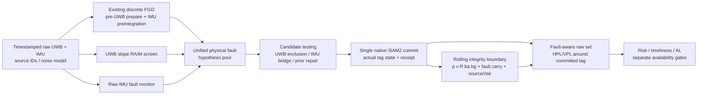

# SC8 Advisor Progress Presentation — Slide Design & Evidence Specification

**Deliverable language: English (all visible slide text, captions, legends, tables, speaker notes).**  
**Visual style: academic, WHITE background, moderately information-dense, restrained color.**  
**Task type: build the actual editable PowerPoint and an exported PDF, not merely an outline.**  
**Recommended main deck: exactly 15 slides; optional 2–3 backup slides only if the relevant evidence is available.**  
**Audience: supervising professor, navigation / sensor fusion / integrity research. Target: 14–18 min presentation + questions.**  
**Scientific scope: SC8 frozen results and preceding verified architecture; not a claim of hardware-qualified integrity.**

## 1. Authoritative evidence and absolute constraints

### 1.1 Primary sources to load before designing slides

1. Repository `docs/sc8/SC8_RESULTS.md`, its frozen registry, metrics, plotdata and `docs/sc8/figures/` (locate actual files; **do not assume guessed filenames exist**).
2. The attached `SC8_RESULTS.pdf` (66 pages) is a human-readable mirror; **figure-rich pages 54–62** are especially valuable. If repository figure SVGs exist, prefer them; otherwise reconstruct from the frozen summary data, and only as a last choice crop/embed original report images without inventing data.
3. Existing research architecture documentation, e.g. `docs/fde_next/SC7_RESULTS.md`, `ROLLING_INTEGRITY_RESULTS.md`, `HYBRID_RESULTS.md`, plus current source interfaces, **only to draw the flowchart correctly**. Do not silently substitute their performance values for SC8 results.
4. Previous methodology in `docs/requirements/sc8/SC8_EXPERIMENT_HANDBOOK.md` for method naming, study design and caveats.

**Frozen computation identity (per SC8 report):** `61907ab417450d317e443e4ff10f2cce062deabe`. The SC8 report also records an entry HEAD `fa5b3dc9ffe3c88492352491d79ba022f373bfb5`; final handoff may contain other local commits. State the computation/figure identity accurately, not the present source HEAD as though it generated the plotted results.

**Frozen result status:** `SC8_EVALUATED_WITH_EXECUTION_GAPS`. There were **143 unique registered runs**, outcomes **130 SUCCESS / 12 RESOURCE_LIMIT / 1 FAIL**; **159 attempts + one auxiliary ROS counterpart**. Runs completed as scheduled in the registry does *not* mean every requested trajectory segment was processed. The active project result may be unpushed: do not use a remote branch's older code as if it produced all SC8 values.

### 1.2 Evidence-tier contract (must remain visible)

- **T-SIM / conditional mathematical guarantee:** Registered source law, initial observation, 20 Hz UWB / 200 Hz IMU, physical motion/fault assumptions and rolling set containment. Bounds protect **actual committed tag position**, not all 15 state components. The risk bound is conditional and not hardware safety qualification.
- **T-REAL / empirical-only:** Raw real recordings; SC7 raw producer refuses qualification. The requested `O-FULL` is actually `O-FDE-ENG` on real data, while no-FDE is `O-ENG-NOFDE`. Both can be experimentally timed/scored where truth references are valid, but cannot be labeled statistically protected.
- **T-SEMI / real data plus synthetic overlay:** The imposed fault label is known; pre-existing natural faults and complete noise law are not known. Never claim the original recording was fault-free.
- **SFUISE:** `S-ONLINE` is the first causal estimate; `S-FINAL` is the *same run's retained-history final revision* and is not an online result nor guaranteed full batch optimum. Its official UWB residual rejection remains enabled. Differences in initialization/input timing make cross-algorithm absolute rankings conditional.
- **CAL/TEST:** Walk tracker-to-body/tag reference **not physically closed**; the saved distances are *proxies*, **not physical APE/ARE**. STAR-Loc rig/gyro input convention remains uncertain; SFUISE kilometer-scale divergence on frozen STAR input is **not intrinsic proof of algorithm inferiority**. Own Vicon results are GT-assisted with a TEST-involved calibration segment, not an independent blind benchmark.
- **Empirical error vs statistical integrity:** 77,131 qualified raw receipts had no observed H/V underbound, but these correlated samples are not independent probability trials and do **not** establish an empirical `10^-6` guarantee. Legacy research AL values are not certified application requirements.

### 1.3 Must-not-do list

Do not fabricate plots, coordinates, invented sample-size totals, full-length SFUISE/real-data rankings, successful full 10,000-epoch FDE recovery, or missing data after resource censoring. Do not drop negative FDE gains, high ARE, late bounds, failed attempts, or invalid/truncated segments. Never call an unqualified real-data PL 'protected'. Never present a pure nominal FGO ~1 ms measurement as the complete ~24 ms integrity service. Don't sum nested stage P95s. Do not reuse earlier SC6/SC7 plots to represent frozen SC8 outcomes without clear historical labels.

## 2. Slide design system — strict style requirements

- **16:9 widescreen, 13.333×7.5 in, pure white (`#FFFFFF`) canvas**. No dark themes, gradients, heavy shadows, 3D effects, decorative stock photos, large solid-color callouts, or flashy animations. Visually sophisticated **by charts, alignment, whitespace and annotation**.
- **Typography:** Aptos / Arial / Source Sans (sensible installed fallback). Titles ~26–30 pt; short one-line research question ~16–18 pt; body ~15–17 pt; quantitative tables ~12–14 pt; figure captions **10.5–12 pt minimum**; small source line ~9–10 pt. No squashed text, font size <9 pt, or unreadable original PDF charts.
- **Margins:** ~0.45–0.55 in. Header title with page-level question, figure/evidence zone occupying ~60–72% of usable area, compact conclusion at bottom. Use one strong **claim sentence**, backed by data; do not fill empty space with generic explanatory prose.
- **Semantic palette:** ours FDE ON deep blue `#216A9B`, ours OFF light blue-grey `#8BB7CC` (or distinguish with line style), SFUISE orange `#C36A2D`, fault interval muted burgundy `#B24F54`, censored/unavailable grey `#858B91`, raw PL optional teal `#148477`. Use accessible markers / dashed lines for B&W readability. Keep colors *consistent across all slides*. Never reuse the same warm color for both SFUISE and alert without labeling.
- **Charts:** Prefer the existing frozen editable **SVG** from `docs/sc8/figures/`; use 300-dpi PNG only when SVG is missing/incompatible. Preserve full axes and extreme/outlier markers. Re-plot with original plotdata only after a data consistency check; keep source code for figure generation. Existing report page screenshots should NOT be stretched to fill a slide: crop plots properly or recreate as readable chart panels.
- **Editable architecture:** Build the first-slide system diagram with native PowerPoint shapes/arrows/text so the adviser can alter it; do not just insert a screenshot. Use source files (e.g. `pptxgenjs` JavaScript, Python) for reproducibility. Existing SVG chart assets may remain vector insertions; no obligation to make every plotted observation individually editable if the graph's source code/data are saved.
- **Captions for EVERY graph/diagram/table:** 1–2 meaningful complete sentences, addressing (a) what the axes/encoding mean, (b) how to read the comparison or event marker, (c) what conclusion is supported, and (d) critical caveat if necessary. A title such as “Figure 3: accuracy” is NOT an acceptable caption. Captions must not assert causality or statistical confidence absent in the report.
- **Slide-level structure:** Title (the question), evidence headline (metric), figure/table, **Takeaway:** bold one sentence, two-sentence maximum caption, precise footer `Source: SC8_RESULTS, E0x; frozen solver 61907ab; method/scope`.
- **Slide numbering:** `1/15` to `15/15`, discreet. No separate blank title page: Slide 1 MUST be the current system diagram. Slide 15 MUST contain specific questions/decisions for the adviser, not a “Thank You” slide.
- **Timing:** Main 15 slides ~40–70 seconds each, 15–18 minutes. Put deeper calibration, derivations, extra per-seed data in 2–3 *clearly separated backups*, not in the main visual field.

## 3. Main slide-by-slide blueprint (exact titles, claim, source, visual, caption)

### Slide 01 — **The System Today: One FGO, Joint Fault Handling, Rolling Integrity**

**Research question:** “How are estimation, fault exclusion and protection connected in the live UWB–IMU system?”

**Must DRAW an editable 2-layer flowchart** (not imported architecture image) with seven stages:

**Inset: rolling fixed lag, never zero-reset:** a horizontal mini timeline `retired raw epochs → certified boundary B_k | explicit active FGO/proof window 30 epochs | new epoch k+1`, arrow `B_k → B_{k+1}`; call out: “state/error, possible historical faults, shared source identity, and the same time-uniform risk event survive marginalization”. Risk horizon ≠ 30 epochs. **No second FGO or all-history re-solve every epoch.**

**Data strip:** Discrete UWB 20 Hz / IMU 200 Hz; default FGO/integrity explicit window **30/30 epochs**; joint FDE with real prior-repair under registered scope; position (tag) PL. Label `T-SIM: conditional raw integrity` and `T-REAL: engineering FDE only, raw unqualified` visibly.

**Figure caption (example exact text):** “Raw measurements drive one incremental factor graph and parallel fault monitors; a unified hypothesis selector commits at most one native update. Marginalized history is not discarded from integrity: a rolling certificate carries state uncertainty, fault consequences and source/risk identity into the next epoch.”

**Takeaway:** “The contribution is a coupled incremental estimator and rolling fault-aware **position** integrity layer, not just a per-epoch UWB RAIM test.”

**Source:** SC7/SC8 code and SC8 Results, architecture; avoid presenting offline Gaussian C as a live mandatory call.

### Slide 02 — **E00 — What Was Actually Tested, and Which Comparisons Are Valid?**

**Research question:** “Which datasets, ground truths and algorithm modes support a defensible comparison?”

**Graphic:** Left: compact 3-tier evidence-lane schematic (**T-SIM**, **T-REAL**, **T-SEMI**), with arrows from producer → estimator → truth/qualification. Right: a small 6-row registry table (IDs, sequence, duration, reference status), e.g.:

| ID | Recording | Approx. duration | Physical reference / key boundary |
|---|---|---:|---|
| R1 | ISAS-Walk2 | 76.09 s | Walk tracker→IMU/tag OPEN; proxy only |
| R2 | ISAS-Walk3 | 81.66 s | Same reference OPEN |
| R3 | Own Vicon, no obstacle | 73.39 s | GT-assisted segmented CAL/TEST (not blind) |
| R4 | Own Vicon, obstacle | 11.39 s | GT-assisted, short recording |
| R5 | STAR-Loc loop-3d-z_s3 | 150.10 s | rig/gyro input convention OPEN |
| R6 | STAR-Loc loop-2d-fast_s3 | 55.40 s | same input concern |

**Evidence chip:** “143 planned runs: 130 success | 12 resource-limited | 1 rejected; 159 attempts + 1 ROS control.” **Avoid** saying all 143 full trajectories completed.

**Caption:** “Rows identify the pre-registered, representative real recordings, not six cherry-picked successful results. The evidence lanes prevent conditional simulation PL from being silently transferred to empirical real-data comparisons.”

**Takeaway:** “Comparability must be established before APE rankings; two real-data reference/input contracts remain open.”

**Source:** SC8 Results E00, pp. 3–6; preflight/CAL/TEST registry.

### Slide 03 — **E01 — Healthy Simulation: Good Accuracy Under the Declared Model**

**Research question:** “How accurately does the coupled pipeline localize without imposed faults?”

**Graphic:** A small multiple / paired dot plot with exactly the **three frozen healthy seeds** for ours Full and NoFDE, plus SFUISE Online and Final in separate styles. Use available per-seed metrics, not just synthetic three fabricated data points. A table of the range and one time-budget measure next to chart.

**Supported number:** `O-FULL tag APE RMSE 0.0487176–0.0526469 m` over 3 seeds; P95/timely pass 3/3 under registered simulation profile. Optionally quote `S-ONLINE` ~0.28–0.32 m only with exact values extracted from report (and initialization mismatch caveat).

**Caption:** “Each point represents one independent simulation seed; lower APE RMSE is better. The comparison is a system-level result—SFUISE uses its own sensor initialization, whereas ours receives an independently noisy initial observation—so it is not a controlled optimizer-only comparison.”

**Takeaway:** “The healthy incremental pipeline delivers approximately **5 cm tag RMSE** in the registered simulated model.”

**Source:** SC8 Results E01 / English Results. **No GT-aligned estimate labels** if report primary metric is world-frame unaligned.

### Slide 04 — **E02 — Real-Data Validation Is Currently an Interface Problem**

**Research question:** “Which real-data comparisons can we physically interpret?”

**Graphic:** Use source trajectory/height/inset panel from **SC8 report p.54** (prefer its SVG), but **show one validated or qualification-aware scenario**, avoiding framing proxy Walk as physical GT. Alongside a 3-column status matrix:

- `Walk R1/R2`: tracker–IMU/body/tag transform not closed ⇒ *physical tag APE/ARE/RPE = NA*; frozen proxy separate.
- `Own Vicon R3/R4`: GT-assisted calibration, R3 test-involved segmented fit ⇒ empirical results with CAL disclosure.
- `STAR R5/R6`: geometry & tag fields valid, but gyro/rig transform interpretation OPEN ⇒ SFUISE divergence cannot be intrinsic-method verdict.

**Caption:** “Trajectory traces illustrate the frozen interface's numerical behavior; they are not uniformly valid physical accuracy comparisons. The status matrix explains which frame/lever/time assumptions permit actual APE scoring and where only an engineering proxy is available.”

**Takeaway:** “Several apparent ‘algorithm failures’ cannot yet be separated from missing physical frame and timing validation.”

**Source:** SC8 Results E00/E02; PDF p.54 and pp.2–4.

### Slide 05 — **E02 — Real FDE Execution, Not Nominal Localization, Is the Bottleneck**

**Research question:** “Can the fault-handling pipeline sustain a complete real recording?”

**Graphic:** horizontal bar comparison of **GT TEST output coverage** (not commit/attempt rate), method colors O-FDE-ENG vs O-ENG-NOFDE, R1–R6; plot missing as NA, not zero:

| Recording | FDE engineering | NoFDE engineering |
|---|---:|---:|
| R1 Walk2 | 5.36% | 86.60% |
| R2 Walk3 | 5.78% | 85.30% |
| R3 Own no-obstacle | NA | 99.91% |
| R4 Own obstacle | 47.58% | 81.97% |
| R5 STAR 3D | 1.43% | 98.64% |
| R6 STAR fast | 5.56% | 97.75% |

**Small callout:** “4/6 FDE real runs resource-limited; **no real raw PL qualification**.” If algorithm/GT time-grid denominator unavailable, keep actual coverage table and footnote explicitly rather than fabricating percentages. Cite freeze for the table.

**Caption:** “Bars show the fraction of each recording's registered GT TEST grid with emitted estimates; they do not measure accuracy or statistical integrity. The no-FDE path covers most of the recordings, while FDE often exhausts the resource budget or terminates after a short prefix.”

**Takeaway:** “The main real-data blocker is **FDE execution continuity**, not just nominal FGO data loading.”

**Source:** SC8 Results E02, GT TEST coverage tables. **Always use `O-FDE-ENG`, NOT qualified O-FULL.**

### Slide 06 — **E03 — FDE Benefits Are Fault-Dependent, Not Uniformly Positive**

**Research question:** “Does FDE actually improve position and attitude accuracy?”

**Graphic:** Reuse/adapt **SC8 PDF p.56** paired seed chart, with zero reference and two adjacent metrics (APE m and ARE rad). One mini-table for mean `OFF − ON` over 3 seeds:

| Fault class | Δ APE RMSE (m) | Δ ARE RMSE (rad) | Interpretation |
|---|---:|---:|---|
| UWB only | −0.007908 | +0.058060 | position slightly worse overall |
| Accel | +0.092363 | −1.13562 | position improves; attitude worsens |
| Gyro | −0.067733 | −1.23141 | position and attitude can worsen |
| Joint UWB+IMU | +0.114792 | +0.20435 | position improves; attitude benefit variable |

**Caption:** “Each thin mark is a matched source/noise seed; positive OFF−ON values mean the FDE run has lower error, while negative values mean degradation. A position gain must not be interpreted as an attitude gain, especially for accelerometer and gyro faults.”

**Takeaway:** “FDE demonstrably helps accel/joint fault positioning, but **gyro-only and long-term recovery are unresolved**.”

**Source:** SC8 Results E03; PDF p.56. **Do not report negative improvements as percent without a correct denominator.**

### Slide 07 — **E03 — Real Isolation Can Still Be Followed by Estimation Drift**

**Research question:** “What happens before, during and after a detected joint fault?”

**Graphic:** Reuse **PDF p.55** joint fault timeline, enlarged/rearranged as clear 3 or 4-row time series with event bands and actual receipt markers. Include a tiny 3-row event table: `UWB +2.25 m / 3 epochs`, `accel +20 m/s² / 500 ms`, `rejoin/bridge receipt`. Note the figure's **APE y-axis is linear below 0.1 m and logarithmic above**; do not silently relabel as purely log or purely linear. If p.55 uses specific seed/epoch, preserve that exact ID.

**Caption:** “Fault bands mark the source-level injection, while event markers indicate actual detected/excluded/repaired/rejoined transactions. The error trace shows that successful isolation is a functional event; it does not by itself guarantee recovery of position, attitude or bias accuracy in the following epochs.”

**Takeaway:** “The scientific problem is not only detection: **post-FDE state consistency and recovery** determine net accuracy.”

**Source:** SC8 Results E03, PDF p.55; episode/phase tables. If this slide would duplicate E03 slide 6, emphasize timing and state mechanism rather than restating RMSE percentages.

### Slide 08 — **E04 — Horizontal Stanford: Conservative Bounds, Conditional Coverage**

**Research question:** “How do horizontal position errors relate to the emitted HPL?”

**Graphic:** Reuse **PDF p.57 Horizontal Stanford** with FULL and zoom views and O-FULL/O-NOFDE paired source; ensure axes and the HPE~0–0.5m zoom panel stay readable. Use a small evidence strip: `77,131 qualified T-SIM receipts overall; observed H/V underbounds 0; conditional risk ≠ empirical safety certification`.

**Caption:** “The x-axis is actual horizontal position error HPE and the y-axis is HPL; points **above** the y=x line are empirically covered at that stamp. The zoom reveals centimeter/decimeter errors with meter-scale bounds; gray delayed bounds are excluded from timely availability, and zero observed violations do not establish 10⁻⁶ risk.”

**Takeaway:** “The horizontal bounds empirically cover registered errors but remain much wider than the observed position error.”

**Source:** SC8 Results E04; PDF p.57. Caption and speaker notes must distinguish the `AL` threshold in red dotted axes from measurement-error diagonal.

### Slide 09 — **E04 — Vertical Stanford: Availability Depends on the Application AL**

**Research question:** “Why can a centimeter-level estimate still be unavailable?”

**Graphic:** Reuse **PDF p.58 Vertical Stanford** (full + zoom). Add a small AL bar/dot graphic copied from the supplementary chart on p.58 (after verifying its plotdata) with **healthy 3-seed joint timely availability**:

- research HAL/VAL `(2,3) m`: **3.5–5.667%**;
- research `(5,5) m`: **99.67–100%**.

**Caption:** “VPE is on the horizontal axis and VPL on the vertical axis; the y=x diagonal tests empirical coverage, while the horizontal alert-limit line tests *numerical* admissibility. Changing the diagnostic AL changes the fraction accepted without changing the state estimate, fault decisions or PL—and no research AL is a certified application requirement.”

**Takeaway:** “**PL tightness and application availability are distinct from estimator accuracy**, especially vertically.”

**Source:** SC8 Results E04; PDF p.58. Keep the validity qualifier T-SIM ONLY.

### Slide 10 — **E05 — 30 vs 1000 Epochs: When Is a Longer Window Worth It?**

**Research question:** “Does retaining much more history improve accuracy or integrity enough to justify the cost?”

**Graphic:** Reuse/adapt **PDF p.59 Pareto front** with markers sized by sampled RSS. Add a table anchored in the same 1101–2100 common 1000-epoch interval:

| Test | 30/30 | 1000/1000 | Interpretation |
|---|---:|---:|---|
| Healthy APE RMSE | 0.04753682 m | 0.04754147 m | no meaningful improvement |
| Healthy core P95 | 25.0956 ms | 795.501 ms | ~32× larger |
| Repeated-fault APE RMSE | 0.1034583 m | 0.05404642 m | improvement in this particular stream |

Add a small side-note about explicit-window experiment `FGO=300, integrity=30/100/300`; since LF, LI and replay are coupled in the joint sweep, do not attribute all accuracy changes solely to integrity window length.

**Caption:** “The plot trades position error and integrity width against measured compute cost; marker size denotes *sampled* RSS, not a certified peak. Only complete common windows define the connected accuracy comparison, while censored cases remain labeled; a large window is not necessarily real-time.”

**Takeaway:** “Use **30/30 as the default online reference**; extend history only where fault-recovery benefit justifies the measured latency.”

**Source:** SC8 Results E05, PDF p.59. Keep core 40ms reference in a plot or table.

### Slide 11 — **E06 — Runtime Breakdown: Fast Simulation, Expensive Real FDE**

**Research question:** “Where does the computation go, and which timing numbers are comparable?”

**Graphic:** Reuse **PDF p.60** complementary timing plots: stage-exclusive mean breakdown, total core/sink ECDFs for healthy and fault loads. Create a compact table:

- `T-SIM O-FULL healthy core/sink P95 ≈ 23.73/23.89 ms` (seed20 registered profile; verify exact values at plotting time).
- `T-SIM O-FULL joint core/sink P95 ≈ 24.89/25.16 ms` (one frozen joint profile).
- `T-SIM O-NOM core ≈ 2.10 ms` in nominal-only profile; **not same capability**.
- `T-REAL O-FDE-ENG` can reach multi-second core and very long queue/sink delays, with resource-limited attempts; do not plot a fake complete-service P95 for censored suffixes.

**Caption:** “Stacked bars are additive *exclusive mean* stage times; the ECDF gives percentiles of measured whole-service latency. Stage-specific P95s must not be summed; SFUISE timing includes distinct buffering/software-clock behavior and is not an equal-capability PL service.”

**Takeaway:** “The registered **small-window simulated full path** meets the P95 study target, whereas the current real-data engineering FDE path does not.”

**Source:** SC8 Results E06, PDF p.60 and service/CPU/RTF tables.

### Slide 12 — **E07 — Ablations: Which Integrity Components Actually Matter?**

**Research question:** “Are rolling constraints and recovery logic causally necessary, or just complexity?”

**Graphic:** Reuse **PDF p.61** ablation heatmap (red = increasing PL relative to FULL, blue = decreasing), highlight 2–3 quantitative rows including:

- `D0, ablate terminal support`: mean H/V PL **2.82197 / 5.82864 m**.
- `D0, ablate joint constraints`: **3.49291 / 6.30337 m**.
- `Joint fault, ablate support`: **3.01021 / 3.94333 m**; `ablate joint`: **3.67985 / 4.41808 m**.
- `G2, remove dedicated initializer`: **0/80 committed, abort at epoch1**; APE/PL **NA**, not zero.

The reported D0 support-removal effect can be described as widening H/V, but **do not assert an exact percent unless recalculated against matched FULL metrics**. Distinguish M (same-center PL), A (full trajectory) and P (performance) ablations; not every switch can be isolated into an independent effect.

**Caption:** “Cells show the change relative to the complete method under the registered experiment; positive/red PL changes indicate a less tight bound. G2's zero commit is a functional failure—no valid PL or trajectory exists to average—rather than a zero-error result.”

**Takeaway:** “The key set constraints and geometry-aware solver have measurable effects; ablation failures must remain visible.”

**Source:** SC8 Results E07; PDF p.61. Only cite actual executed ablations, not planned but omitted weak-UWB and S1/S2-bias studies.

### Slide 13 — **E08 — Long-Run Integrity: Healthy Complete, Repeated-Fault Case Censored**

**Research question:** “Does the full pipeline sustain 10,000 epochs and process the last injected fault?”

**Graphic:** Reuse **PDF p.62** timelines (APE/ARE, latency, active factor/resource markers). A large 3-row result table:

| Run | Committed / planned | Producer/queue | Interpretation |
|---|---:|---|---|
| `L0 O-FULL` healthy | **5,000 / 5,000** | queue peak 13 | complete |
| `L1 O-FULL` repeated faults | **7,171 / 10,000** | queue peak 80, **2,829 refused** | censored; late injection not verified |
| `L1 O-NOFDE` repeated faults | **10,000 / 10,000** | queue peak 15 | complete under no-FDE policy |

**Caption:** “The traces retain all registered epochs; the missing right-hand tail in FULL is an actual unprocessed suffix, not a flat zero error. Vertical markers denote scheduled fault episodes; episodes after epoch 7171 cannot be claimed as recovered by FULL.”

**Takeaway:** “Continuous recovery at scale is **not yet established**: the fault-aware route stops where the no-FDE route continues.”

**Source:** SC8 Results E08; PDF p.62. Processes may exit SUCCESS despite incomplete plan: use actual `committed/planned`.

### Slide 14 — **Synthesis — What We Have Demonstrated, and What Remains Open**

**Research question:** “Which claims can we defend in a paper today?”

**Graphic:** 3-column ‘evidence-to-claim’ matrix with 4–5 precise rows and small numerical evidence icons, no stock photographs:

| Defensible result | Evidence | Important boundary |
|---|---|---|
| Conditional simulated rolling position integrity | time-uniform proof + 77,131 qualified receipts, 0 observed H/V underbounds | registered physical/noise/fault model only |
| Healthy simulated tag positioning ~5 cm | 3 independent seeds | initialization not matched optimizer-only to SFUISE |
| FDE benefit is fault-specific | accel/joint improvements, gyro regression | recovery can worsen attitude/late error |
| Real-data cross-method ranking incomplete | frame and gyro interface gaps + real FDE censoring | no real-data formal raw protection |
| Default small window justified | 25 ms vs 795 ms core P95 in healthy window comparison | larger lag helps some fault cases but violates study realtime |

**Caption for matrix:** “Each claim is paired with its direct supporting evidence and the hypothesis it does **not** establish. The purpose is to separate mathematical validity, empirical accuracy, execution reliability and application certification.”

**Takeaway:** “The strongest current contribution is a **conditional, rolling, fault-aware position integrity method**, with real-data execution and calibration still open.”

**Source:** SC8 Results summary / English Results / pp.1–4, 62–66.

### Slide 15 — **Questions for the Advisor — Decisions Needed Before the Next Study**

**Only this final slide may be primarily discussion-driven.** Make the questions specific, actionable and answerable, not vague “Any feedback?”

1. **Research scope / publication claim:** “Should the near-term paper focus on the **conditional rolling raw position PL + joint FDE architecture**, with honest execution/real-data limitations, or is physically qualified real-data integrity required before submission?”
   - Decision requested: `theory + qualified simulation first` vs `hardware validation first`.
2. **Calibration resources:** “Can we obtain independent **tracker↔IMU/body↔tag 6-DoF extrinsics, timing and anchor-world references**, or collect a new calibration sequence with three-axis motion and independent held-out TEST?”
   - Decision requested: who can provide hardware / protocol and what sensors are available.
3. **FDE recovery research:** “Should we prioritize explaining and fixing **gyro-induced attitude degradation / long-term state recovery**, or first make engineering FDE process complete real recordings within a bounded resource budget?”
   - Decision requested: algorithmic research priority vs engineering qualification priority.
4. **Application integrity target:** “For the intended deployment, what **HAL / VAL, TTA, covered fault classes and failure action** should determine meaningful protected availability?”
   - Decision requested: target application and first defensible safety requirements.

**Graphic:** no experimental plot required (this is a decision slide). A compact right-hand panel ‘Proposed next action’ can show `Close independent calibration → stabilize real FDE → limited rerun`, with clear links back to pages 4, 5 and 13. Last line: “Requested outcome: scope, resource owner, and priority order.”

## 4. Optional backup slides (outside the main 15)

- **B1 Calibration and frame semantics:** Walk tracker≈180° mismatch diagnostic; STAR gyro/rig frame convention; own Vicon test-involved fit. Include exactly what is known vs what remains missing.
- **B2 Integrity theorem and qualification:** Source/time-uniform event (conditional); multiple fault modes; HPL/VPL support function; AL vs PL vs PE; no hardware probability qualification.
- **B3 Detailed per-seed and CPU timing:** full 3-seed U/A/G/J table, R1–R6 coverage denominator, hardware/ELF/source IDs and method label legend.

Backup slides are optional. They must be **after** the adviser questions and clearly marked `Backup`; the **last MAIN slide must remain the questions slide**. If exported PDF includes backups, section them after a separator but keep main numbering 1/15–15/15.

## 5. Production workflow and QA required of Codex

1. **Read** actual local SC8 report, frozen figure/plotdata registry and the existing architecture implementation. Detect mismatched current HEAD vs frozen computation and state results identity in deck notes.
2. **Lock the 15-slide storyboard before authoring**, assign for each: question, one-line takeaway, source figure, data numerator/denominator, 1–2 sentence caption, source footnote, speaker notes (2–4 English bullets).
3. **Locate and verify original SVG/PNG assets** and prefer editable/high-res versions. If the figure is hard to read on a 16:9 slide, **re-layout/re-plot from registered plotdata**, preserving all outliers/censored values, never manufacture points. Implement a small figure manifest: `slide → source_path → data_digest → page/section → displayed metric → caveat`.
4. **Draw slide 1 architecture in editable PPT shapes** with arrows and the nested fixed-lag/boundary inset. Use native text and vector shape connectors. Ensure direction of arrows/source ownership agrees with current code, especially one native commit and rolling parent certificate.
5. **Build editable `SC8_ADVISOR_PROGRESS.pptx` and `SC8_ADVISOR_PROGRESS.pdf`**, plus deck-generation source (`.js` / `.py`), and a light `FIGURE_SOURCES.md`/manifest. Preferred output dir: `docs/sc8/presentation/` (or whichever nearby location existing project uses). Do not put build caches or data dumps under git.
6. **Inspect every slide**: generate PNG slide previews/contact sheet, open it, then inspect the first architecture, most crowded plot/table and last questions individually. Fix overflow, cramped text, cropped axes, illegible captions and confusing colors. One chart = one coherent takeaway; tables have units and N.
7. **Automated checks**: main count 15; slide01 flow has `rolling certificate`, `single native commit`, `FGO`, `UWB/IMU FDE`, `tag PL`, conditional scope; slide15 exact advisor questions; every E00–E08 covered by a plot and numeric table or data annotation; every chart has how-to-read caption, no `T-REAL protected` claim; `7171/10000` not claimed complete; figure source present; no missing images.
8. **Numerical audit**: compare all slide values to report registry/per-seed metrics. Check signs of OFF−ON and percentage formulas. Check 77,131 count represents correlated receipts. Avoid mistake: 130 successes are process exit statuses, not full-length completed tasks. Check sample size labels, physical units, error-point vs tag/body frames, AL qualification and window units.
9. **Final deliverables**: editable PPTX, PDF, source script(s), verified preview/contact sheet (internal or optional), small manifest and no large raw backups. Keep original repo reports and plotdata untouched. Local Git commit after validated artifact; **do not push without explicit instruction**.

### 5.1 Rejection criteria

A final deck is NOT acceptable if any of the following occurs:

- Slide 1 is a generic title page without architecture and rolling window information.
- Slide 15 is a generic Thank You, or adviser questions are not actionable.
- Any of E00–E08 has no figure/table evidence or no stated conclusion.
- Stanford charts omit axes/PL=PE/AL or imply zero observed HMI proves a `10^-6` risk; real-data PL is falsely assigned the same guarantee.
- Missing SFUISE input/GT caveats, false STAR algorithm rankings, real engineering FDE described as formally protected, or final historical output advertised as causal.
- `L1 O-FULL` shown as full 10,000-epoch success rather than 7,171 of 10,000.
- Graph captions merely repeat titles and do not explain how to read charts.
- Unreadable small fonts, truncated tick labels, clipped tables, or cramped PDF screenshots.
- White background/English text/consistent legend requirements not met.
- The PDF and PPTX show materially different content, slide numbers or figure values.

## 6. Source locations / quick reference

- `SC8_RESULTS.pdf` **pp. 1–4**: high-level conclusions, evidence tiers, run outcomes.
- **pp. 54–55**: real-data trajectories and fault/recovery timeline.
- **p. 56**: fault-type paired accuracy gains including negative results.
- **pp. 57–58**: horizontal/vertical Stanford full+zoom and AL sensitivity.
- **p. 59**: 30–1000 window cost frontier.
- **p. 60**: ECDF / core / sink and module time breakdown.
- **p. 61**: ablations and raw bias/PL relations.
- **p. 62**: long-run receipts, queues, error, resources.
- **pp. 63–66**: limitations, acceptance, frozen identities and English Results.

Repository primary: `docs/sc8/SC8_RESULTS.md`, `docs/sc8/figures/`, SC8 frozen metrics/plotdata/registry; find the exact paths before building.

**Scientific tone to preserve throughout:** “We have a functioning, fault-aware, rolling position-integrity research system under declared simulation assumptions, but its real-data calibration and long-run FDE execution are not yet closed.”
