# SC8 实验结果与复现报告

**状态：IN_PROGRESS。**

本轮实测值来自本次执行 journal；未复用历史 CSV。算法输、界较宽和大窗非实时均作为结果保留。进程 SUCCESS 只表示正常退出，功能、资格、deadline 和应用可用性分别列出。

## 当前实测结论

健康 D1/M3/G1：3 个独立 seed 的 FULL tag APE RMSE 为 0.0487176–0.0526469 m，ARE 为 0.077836–0.145406 rad；默认双 P95 与及时空间比例条件通过 3/3。这只覆盖实测的注册 profile，不授予真实应用资格。

同一健康组在研究 AL(H,V)=(2,3) m 下，joint 及时可用率为 3.5%–5.667%。空间 raw 资格、deadline 和满足所选 AL 是三个不同条件；厘米级实际误差不意味着 PL 也为厘米级。

同一健康组在研究 AL(H,V)=(5,5) m 下，joint 及时可用率为 99.67%–100%。空间 raw 资格、deadline 和满足所选 AL 是三个不同条件；厘米级实际误差不意味着 PL 也为厘米级。

SC8-U：3 个 seed 的公共观测区间上 OFF−ON APE 改善 -0.0165427–0.00364377 m（均值 -0.00790838 m）；ARE 改善 -0.00559297–0.126921 rad。负值是退化，不能由另一个指标抵销。

SC8-A：3 个 seed 的公共观测区间上 OFF−ON APE 改善 0.0800965–0.0989567 m（均值 0.0923626 m）；ARE 改善 -1.84491–-0.00337908 rad。负值是退化，不能由另一个指标抵销。

SC8-G：3 个 seed 的公共观测区间上 OFF−ON APE 改善 -0.231997–0.0189474 m（均值 -0.0677327 m）；ARE 改善 -2.09146–-0.343893 rad。负值是退化，不能由另一个指标抵销。

SC8-J：3 个 seed 的公共观测区间上 OFF−ON APE 改善 0.111106–0.118577 m（均值 0.114792 m）；ARE 改善 -1.35405–1.80446 rad。负值是退化，不能由另一个指标抵销。

真实工程 FDE：已结束 6/6 条完整录制尝试，其中 4 条在预登记 wall 资源门限截断；SC7 raw 资格仍全部拒绝。未完成后缀不填误差，不能将有限公共区间的收益推广到全录制。

Walk R1/R2 的 tracker→IMU/body/tag 参照未闭合：物理 APE/ARE/RPE 撤回为 NA，原冻结参考下的数值只留作明确标注的代理诊断。没有按 TEST 选择翻转、时移或新杆臂来改善任何方法的分数。

STAR-Loc R5 的 SFUISE 首次在线流 tag APE RMSE 15854.8 m、最大 29335 m，保留整个实测尺度；官方剔除未关闭，codec/单位/原始输入逐项核对，不能删去发散段后宣称成功。CAL-S 对 gyro/rig 转换的方向约定和角速度一致性尚未闭合，因此这些值描述冻结接口下的实际行为，不作为正确输入下算法本身的优劣证据。工程 ON 只有截断前缀，不能以其短段误差与该完整流作全程排名。

实际原生条件 raw 记录共 36660 个合格 tag receipt（不同场景/消融/窗口不可当作独立概率样本），H/V 合计 underbound 0 次。计数包含迟到与 AL-unavailable 的合格界；无论是否为零，都不作为风险概率证明。

窗口前沿已结束 7/14：资源截断 0，进入公共 1101–2100 评分区间 7。窗口/回放同时变化，缺失公共区间不外推；1000 历元是否经历边缘化只认实际 receipt。

## 身份、预算与证据边界

入口 HEAD `fa5b3dc9ffe3c88492352491d79ba022f373bfb5`；计算冻结提交 `61907ab417450d317e443e4ff10f2cce062deabe`。实际源内容/ELF/生产 DSO、loaded libraries、编译环境、平台、噪声、risk/birth q、AL、窗口 guard 和原合同摘要在 [冻结登记](../../config/sc8_experiments.yaml)；未升级 SFUISE、未 push。分析模块可在计算冻结后继续开发，不改变求解。

登记 143 个唯一逻辑运行；当前状态 {'SUCCESS': 114, 'RESOURCE_LIMIT': 12, 'RUNNING': 1, 'NOT_ATTEMPTED': 16}，合计 143。实际 attempt 143，另有辅助 ROS 求解 1，上限 160。W0 额外 attempt（包括预检失败）全部保留（版本状态与实际 exit code 分开，见 JSON），SFUISE 首发/历史共用一个进程。E06 两次确认不增加独立精度样本。

- **T-SIM**：当前注册物理 law 下的条件 raw 保证；资格与实际数值/receipt 逐帧核验，仍无真实应用资格。
- **T-REAL**：原始真实录制上的经验表现；SC7 raw producer 拒绝，不放宽采样率/噪声/运动域/anchor guard。requested O-FULL 实际明确为 **O-FDE-ENG**，off 为 **O-ENG-NOFDE**，均不冒充 SC7 恢复/PL。
- **T-SEMI**：R2/R3 原始输入上叠加登记故障，GT 不变；原录制本身未认证健康，不将天然异常称已知 false alarm。

SFUISE 固定 SHA `75bf5a32f1a8e5c3046a5bd1a1ddf659fa996f7d`，官方测距剔除保持。插入式只读数值/时间观察与 lossless Float64 ToA wire 单独披露：内部仍为原 TOAData double，剥离插入后原数值语句逐字节相同；双实例确定性检查覆盖状态、标定、knot 与官方剔除状态。原始 float32 wire 会改变量测，故正式流使用与 ours 逐值一致的 double；不是改变噪声/残差/优化器。

## E00：数据、CAL/TEST 与因果接口

九条输入新做单位/frame/lever/时间/GT/anchor/range 审计。六条测试按数据族预先选择，不按算法精度删序列；本地库存均存在，因此不启用 MILUV 备用；HUEC 和历史 40 条 campaign 未全跑。

| ID | 序列 | IMU Hz | 时长 s | 最大 IMU gap s | anchor/tag | 最大测距组跨度 s |
|---|---|---|---|---|---|---|
| R1 | ISAS-Walk2 | 81.8928 | 76.0937 | 0.0128069 | 5/1 | 0 |
| R2 | ISAS-Walk3 | 81.8912 | 81.6594 | 0.0133388 | 5/1 | 0 |
| R3 | 2025-10-24-15-31-28_vicon_lidar_uwb_imu_no_obstacle | 202.233 | 73.3939 | 0.015393 | 4/1 | 0 |
| R4 | 2025-10-24-15-46-27_vicon_lidar_uwb_imu_obstacle | 201.533 | 11.39 | 0.0153227 | 4/1 | 0 |
| R5 | loop-3d-z_s3 | 202.218 | 150.104 | 0.25714 | 8/1 | 0.02 |
| R6 | loop-2d-fast_s3 | 202.218 | 55.4028 | 0.0370875 | 8/1 | 0.02 |
| CAL-W | ISAS-Walk1 | 81.896 | 59.1154 | 0.0213645 | 5/1 | 0 |
| CAL-O | 2025-10-24-15-48-55_vicon_lidar_uwb_imu_obstacle | 202.33 | 11.5602 | 0.0154514 | 4/1 | 0 |
| CAL-S | loop-2d_s3 | 202.218 | 105.138 | 0.034615 | 8/1 | 0.02 |


Walk 世界变换只用 CAL-W Walk1：844 个 fit 样本，残差 RMSE 0.178204 m。CAL-O 15-48-55 激励不足（gyro 激励奇异值约 0.103/0.0217/0.0144），没有把它宣称独立完整外参标定。固定 R3 第一 20%（截至 14.678774643 s）用于接口拟合，另隔离 2 s，主 TEST 自 16.678774643 s 开始；该族为 **GT-assisted / test-involved segmented calibration / CALIBRATION_OPEN**。固定拟合时移 0.0155421 s、gyro RMSE 0.147482 rad/s、accel RMSE 0.287109 m/s²；不表示完整 6D 外参独立可辨识。STAR 使用官方几何/外参，未用 R5/R6 GT 再拟合。全部数字参数保存在 registry，不逐方法选对齐或时移。

原始每条 range 时间保留，公共组末时间用于两种估计器的批处理近似，STAR 20 ms 异步组不称同步、不给 raw 资格。range_raw→calibrated range 只应用一次，SFUISE runtime offsets=0。GT 只进预登记 CAL 和评分，不给真状态初值、不选镜像、不发 truth topics。仿真 ours 用同一独立含噪初始观测；SFUISE 保留原生传感器初始化，不消费这一额外 prior，因此两者不是纯优化器隔离对照。

原生 source-only 导出与正式求解使用同一 ELF，逐值验证真实 ADC/range/时间/ID/独立初始观测。W0 曾发现两个 C++ 入口模板实例约 1e-15 的差异，正式缓存按 native-export-v1 独立留存；旧 W0 不悄悄换输入。SFUISE 静态 map readiness 统一为 max(首 IMU,首合法 range)+25 ms，保留原 sensor 时间和值，等待计入延迟。R6 早期 SIGSEGV 及旧 float32 协议、wrong-lever 工程诊断均保留为失败/被替代版本，不计作最终方法结果。

修正 actual realtime 杆臂后，新 direct/ROS fde=off R3 前缀：899/899 样本，tag 最大差 2.5855843e-10 m、姿态最大差 1.7075473e-6 deg（均小于 1e-5）；GT topic 发布 0，truth subscriptions 为空。20× 离线回放仅验证提交路径等价，不作为实时依据。

| W0 流 | requested | effective | 进程状态 | wall s |
|---|---|---|---|---|
| R1 | O-NOM | O-NOM | SUCCESS | 15.602 |
| R1 | O-FULL | O-FDE-ENG | SUCCESS | 1038.86 |
| R1 | SFUISE | SFUISE_PINNED_OBSERVED | SUCCESS | 30.1469 |
| R2 | O-NOM | O-NOM | SUCCESS | 15.546 |
| R2 | O-FULL | O-FDE-ENG | SUCCESS | 875.163 |
| R2 | SFUISE | SFUISE_PINNED_OBSERVED | SUCCESS | 30.2116 |
| R3 | O-NOM | O-NOM | SUCCESS | 18.0824 |
| R3 | O-FULL | O-FDE-ENG | RESOURCE_LIMIT | 1200.15 |
| R3 | SFUISE | SFUISE_PINNED_OBSERVED | SUCCESS | 33.0489 |
| R4 | O-NOM | O-NOM | SUCCESS | 9.4729 |
| R4 | O-FULL | O-FDE-ENG | RESOURCE_LIMIT | 1200.08 |
| R4 | SFUISE | SFUISE_PINNED_OBSERVED | SUCCESS | 24.1658 |
| R5 | O-NOM | O-NOM | SUCCESS | 16.8696 |
| R5 | O-FULL | O-FDE-ENG | RESOURCE_LIMIT | 1200.09 |
| R5 | SFUISE | SFUISE_PINNED_OBSERVED | SUCCESS | 32.8985 |
| R6 | O-NOM | O-NOM | SUCCESS | 18.7593 |
| R6 | O-FULL | O-FDE-ENG | SUCCESS | 1103.95 |
| R6 | SFUISE | SFUISE_PINNED_OBSERVED | SUCCESS | 33.5574 |
| SC8-H | O-FULL | O-FULL | SUCCESS | 4.55788 |
| SC8-H | O-NOFDE | O-NOFDE | SUCCESS | 4.5981 |
| SC8-J | O-FULL | O-FULL | SUCCESS | 8.58626 |
| SC8-J | O-NOFDE | O-NOFDE | SUCCESS | 8.57068 |


## 评分、配对和不确定性口径

主 APE/HPE/VPE 在实际首发 estimate stamp 对同物理 tag/world 的 GT 插值，ARE 是 body SO(3) 测地角（rad，主表同时给 deg）；不拟合 SE(3)、yaw 或测试时延。tag difference RPE 和减去固定杆臂后的 body SE(3) RPE 分别给 0.5/1 s，任何输入/GT gap>100 ms 的对均拒绝。RPE 的公共 GT 网格与配对表的有限间隔插值只用于评价首次输出流，不改因果输出、不使用最终历史替首发。SFUISE S-FINAL 是同一次运行在同一在线 stamp 网格的可验证子集上由最终 retained history + 最终标定导出，不是全局 batch 最优；artifact 级 revision 与最后输入上界独立记录，不冒充逐点精确依赖。

原生旧 W0 联合故障前缀与正式 J600 的前160：raw ADC/range/独立初始观测、IDs/时间、state/PL 和 FD/先验/bridge/rejoin receipts 逐值相同（差0），不增加求解或精度重复样本。独立评分器 13 项测试与 evo v1.29.0 对口径检查覆盖单位、符号、SO(3)、tag/body 杆臂、错误杆臂、固定偏置、SE(3) 世界变换、错序/重复/非有限、真实 dt、缺口与 nearest-rank 慢值。资源截断产生的不完整末行拒绝；完整 post-commit state 行只作固定物理 tag 转换并与完整 TUM 逐点核对，不从 GT 重建。真实 velocity/bias 无独立真值为 NA；仿真原生有物理状态/bias 真值，单列评分。SFUISE 未导出 velocity/bias 真值对口径时也不凭位置差分伪造。

历史导出的额外边界审计：冻结适配器将移动窗口的 idle 控制点写入 global history，导致起始 `t < global_origin + 2*dt` 的历史插值引用后续控制点。用原始 SplineState 类、不构造估计器的确定性 codec 检查：在线 p/q/velocity/bias 复原误差 0，安全域后历史误差 0，起始错误可直接复现。原始输出未改写，其 hash、被拒绝点的原始数值和时间永久留在 JSON；过程 trace 最后按约定清理。按样条支撑域对所有流统一拒绝这一历史前缀（通常 2 个点），不是按 PE 选点。S-ONLINE 全部首次输出不受影响；S-FINAL 仅报告可验证历史域，拒绝数、原始错误点/时间保存在 JSON，作为导出接口缺口列出。

独立统计单位是 seed 或录制，三个 seed 不夸大显著性；逐帧 Stanford/ECDF 仅是有限运行描述，不作独立置信区间。配对收益为 OFF−ON，百分比用 OFF 作分母，退化保持负数；不同截止时刻的 SFUISE 另列 state age，S-FINAL 不排实时名次。过程被截断时不填后缀误差，配对表显式给公共可观测区间。

## E01/E02：健康与真实主对照

**Walk 参照缺口（W1 后审计修正）**：冻结适配器把 VIVE tracker 当成 IMU/body 并直接加 IMU→tag 杆臂。CAL-W 968 对角速度的单位旋转 RMSE 0.485762 rad/s，固定旋转诊断拟合为约 179.725°、RMSE 0.105943 rad/s，推翻了 tracker=IMU 假设；bag 无静态外参，tracker→tag 平移/姿态与重力系仍未独立闭合。先前 Walk 表中的数值不再称物理 tag APE/body ARE，主表改为 NA，原数值完整留为 proxy。没有将拟合旋转应用到输入、GT 或估计器，也没有修改冻结参数。论文仅确认额外 tracker 提供 GT，不给本轮所需的完整外参：[原论文 §V-D](https://isas.iar.kit.edu/pdf/RAL23_Li.pdf)。

**STAR 输入接口缺口**：发布的 tf_cam_rig / tf_cam_imu 方向标签与冻结组合 C_cam_rigᵀ C_cam_imu 存在解释分歧。只读 CAL-S 检查中，冻结 gyro 与 GT 差分 RMSE 约 0.393 rad/s；按文字方向组合的候选约 0.324 rad/s，仍未闭合，故没有悄悄替换或拟合 TEST。官方 tag_pos、rig 四元数与 CAD 杆臂自洽到约 4e−16 m，位置误差仍是实际管线输出误差；R5/R6 均标 input OPEN，不将发散归因于正确输入下算法本身。细节和两种矩阵见 reference-check 收据。

| Walk 数值代理（不作物理精度排名） | view | 时间匹配 N | 冻结 proxy 距离 RMSE m | tracker proxy 四元数差 rad |
|---|---|---|---|---|
| E02/R1 | O-FDE-ENG | 68 | 0.102861 | 2.7268 |
| E02/R1 | O-ENG-NOFDE | 1140 | 0.25345 | 1.53478 |
| E02/R1 | S-ONLINE | 760 | 0.249007 | 3.02068 |
| E02/R1 | S-FINAL | 758 | 0.154495 | 3.10481 |
| E02/R2 | O-FDE-ENG | 91 | 0.124852 | 2.32105 |
| E02/R2 | O-ENG-NOFDE | 1222 | 0.392616 | 2.23734 |
| E02/R2 | S-ONLINE | 816 | 0.339099 | 2.87975 |
| E02/R2 | S-FINAL | 814 | 0.182397 | 2.9479 |
| E03/R2-FU | O-FDE-ENG | 68 | 0.09248 | 2.74115 |
| E03/R2-FU | O-ENG-NOFDE | 1222 | 0.431091 | 2.06003 |
| E03/R2-FU | S-ONLINE | 816 | 0.344698 | 2.8666 |
| E03/R2-FU | S-FINAL | 814 | 0.182518 | 2.94802 |
| E03/R2-FG | O-FDE-ENG | 46 | 0.293494 | 2.70803 |
| E03/R2-FG | O-ENG-NOFDE | 1222 | 0.510197 | 2.0843 |
| E03/R2-FG | S-ONLINE | 816 | 2320.1 | 2.67005 |
| E03/R2-FG | S-FINAL | 814 | 2322.76 | 2.7488 |
| E03/R2-FJ | O-FDE-ENG | 22 | 0.0806861 | 2.87009 |
| E03/R2-FJ | O-ENG-NOFDE | 1222 | 0.447846 | 1.65885 |
| E03/R2-FJ | S-ONLINE | 816 | 9585.39 | 2.45564 |
| E03/R2-FJ | S-FINAL | 814 | 9593.78 | 2.52979 |


| 组/流/seed | view | status | 匹配 N | APE m | HPE m | VPE m | ARE rad / deg | tag RPE0.5 m | body RPE0.5 m / rad |
|---|---|---|---|---|---|---|---|---|---|
| E01/SC8-H/20 | O-FULL | SUCCESS | 600 | 0.0490479 | 0.0353238 | 0.0340284 | 0.077836 / 4.45967 | 0.0665703 | 0.0677771 / 0.0261778 |
| E01/SC8-H/20 | O-NOFDE | SUCCESS | 600 | 0.0490479 | 0.0353238 | 0.0340284 | 0.077836 / 4.45967 | 0.0665703 | 0.0677771 / 0.0261778 |
| E01/SC8-H/20 | S-ONLINE | SUCCESS | 300 | 0.318676 | 0.210887 | 0.238917 | 1.12411 / 64.4066 | 0.240042 | 0.350325 / 0.607652 |
| E01/SC8-H/20 | S-FINAL | SUCCESS | 298 | 0.263078 | 0.182179 | 0.189791 | 0.812558 / 46.5562 | 0.0497582 | 0.134147 / 0.023022 |
| E01/SC8-H/21 | O-FULL | SUCCESS | 600 | 0.0526469 | 0.0347111 | 0.0395832 | 0.145406 / 8.33113 | 0.0625663 | 0.0682346 / 0.0282603 |
| E01/SC8-H/21 | O-NOFDE | SUCCESS | 600 | 0.0526469 | 0.0347111 | 0.0395832 | 0.145406 / 8.33113 | 0.0625663 | 0.0682346 / 0.0282603 |
| E01/SC8-H/21 | S-ONLINE | SUCCESS | 300 | 0.289558 | 0.195789 | 0.213332 | 1.25905 / 72.1383 | 0.129097 | 0.256643 / 0.613833 |
| E01/SC8-H/21 | S-FINAL | SUCCESS | 298 | 0.257861 | 0.167362 | 0.196169 | 0.840917 / 48.181 | 0.040399 | 0.127407 / 0.0208796 |
| E01/SC8-H/22 | O-FULL | SUCCESS | 600 | 0.0487176 | 0.0335416 | 0.0353322 | 0.113639 / 6.51103 | 0.0623874 | 0.0647843 / 0.0236203 |
| E01/SC8-H/22 | O-NOFDE | SUCCESS | 600 | 0.0487176 | 0.0335416 | 0.0353322 | 0.113639 / 6.51103 | 0.0623874 | 0.0647843 / 0.0236203 |
| E01/SC8-H/22 | S-ONLINE | SUCCESS | 300 | 0.281683 | 0.204308 | 0.193916 | 1.24643 / 71.4152 | 0.133312 | 0.266351 / 0.590888 |
| E01/SC8-H/22 | S-FINAL | SUCCESS | 298 | 0.252981 | 0.17887 | 0.178898 | 0.801951 / 45.9484 | 0.0463209 | 0.132033 / 0.021815 |
| E01/SC8-D0/20 | O-FULL | SUCCESS | 600 | 0.0452439 | 0.0340975 | 0.0297384 | 0.0584128 / 3.34681 | 0.0634548 | 0.0634532 / 0.0249041 |
| E01/SC8-D0/20 | O-NOFDE | SUCCESS | 600 | 0.0452439 | 0.0340975 | 0.0297384 | 0.0584128 / 3.34681 | 0.0634548 | 0.0634532 / 0.0249041 |
| E01/SC8-D0/20 | S-ONLINE | SUCCESS | 300 | 0.251192 | 0.2054 | 0.144596 | 2.80972 / 160.985 | 0.113061 | 0.19346 / 0.526002 |
| E01/SC8-D0/20 | S-FINAL | SUCCESS | 298 | 0.2754 | 0.234969 | 0.143649 | 2.89238 / 165.721 | 0.0292081 | 0.0728914 / 0.0257379 |
| E01/SC8-G2/20 | O-FULL | SUCCESS | 600 | 0.0610026 | 0.0337921 | 0.0507879 | 0.0633548 / 3.62996 | 0.0753449 | 0.0751732 / 0.0267861 |
| E01/SC8-G2/20 | O-NOFDE | SUCCESS | 600 | 0.0610026 | 0.0337921 | 0.0507879 | 0.0633548 / 3.62996 | 0.0753449 | 0.0751732 / 0.0267861 |
| E01/SC8-G2/20 | S-ONLINE | SUCCESS | 300 | 2.28816 | 0.252203 | 2.27422 | 2.92148 / 167.389 | 0.364733 | 0.479387 / 0.523618 |
| E01/SC8-G2/20 | S-FINAL | SUCCESS | 298 | 2.07682 | 0.235997 | 2.06336 | 2.95891 / 169.533 | 0.185308 | 0.263748 / 0.0239563 |
| E01/SC8-H/20 | O-NOM | SUCCESS | 600 | 0.0490479 | 0.0353238 | 0.0340284 | 0.077836 / 4.45967 | 0.0665703 | 0.0677771 / 0.0261778 |
| E02/R1/20 | O-FDE-ENG | RESOURCE_LIMIT | 0 | NA | NA | NA | NA / NA | NA | NA / NA |
| E02/R1/20 | O-ENG-NOFDE | SUCCESS | 0 | NA | NA | NA | NA / NA | NA | NA / NA |
| E02/R1/20 | S-ONLINE | SUCCESS | 0 | NA | NA | NA | NA / NA | NA | NA / NA |
| E02/R1/20 | S-FINAL | SUCCESS | 0 | NA | NA | NA | NA / NA | NA | NA / NA |
| E02/R2/20 | O-FDE-ENG | RESOURCE_LIMIT | 0 | NA | NA | NA | NA / NA | NA | NA / NA |
| E02/R2/20 | O-ENG-NOFDE | SUCCESS | 0 | NA | NA | NA | NA / NA | NA | NA / NA |
| E02/R2/20 | S-ONLINE | SUCCESS | 0 | NA | NA | NA | NA / NA | NA | NA / NA |
| E02/R2/20 | S-FINAL | SUCCESS | 0 | NA | NA | NA | NA / NA | NA | NA / NA |
| E02/R3/20 | O-FDE-ENG | RESOURCE_LIMIT | NA | NA | NA | NA | NA / NA | NA | NA / NA |
| E02/R3/20 | O-ENG-NOFDE | SUCCESS | 2817 | 1.26593 | 0.236291 | 1.24369 | 2.17188 / 124.44 | 0.203904 | 0.728166 / 0.134913 |
| E02/R3/20 | S-ONLINE | SUCCESS | 563 | 1.19724 | 0.153048 | 1.18742 | 0.978299 / 56.0524 | 0.1085 | 0.334765 / 0.127536 |
| E02/R3/20 | S-FINAL | SUCCESS | 563 | 1.19084 | 0.137757 | 1.18285 | 0.911575 / 52.2294 | 0.0573676 | 0.286824 / 0.124668 |
| E02/R4/20 | O-FDE-ENG | SUCCESS | 274 | 3.55889 | 0.158065 | 3.55538 | 3.03767 / 174.046 | 0.0640066 | 0.0631568 / 0.0498612 |
| E02/R4/20 | O-ENG-NOFDE | SUCCESS | 468 | 3.00803 | 0.18732 | 3.00219 | 3.00684 / 172.279 | 0.38717 | 0.438425 / 0.102453 |
| E02/R4/20 | S-ONLINE | SUCCESS | 113 | 1.00095 | 0.120662 | 0.993653 | 1.32466 / 75.8972 | 0.14656 | 0.209895 / 1.23699 |
| E02/R4/20 | S-FINAL | SUCCESS | 111 | 0.968712 | 0.112376 | 0.962172 | 0.607929 / 34.8317 | 0.0907409 | 0.129598 / 0.0600843 |
| E02/R5/20 | O-FDE-ENG | RESOURCE_LIMIT | 92 | 0.252638 | 0.0576196 | 0.24598 | 3.1237 / 178.975 | 0.062389 | 0.166633 / 0.168842 |
| E02/R5/20 | O-ENG-NOFDE | SUCCESS | 6439 | 0.469521 | 0.269785 | 0.384273 | 2.83264 / 162.298 | 0.225714 | 0.35841 / 0.16767 |
| E02/R5/20 | S-ONLINE | SUCCESS | 1483 | 15854.8 | 15271.5 | 4261.18 | 1.83527 / 105.153 | 162.412 | 162.45 / 0.362584 |
| E02/R5/20 | S-FINAL | SUCCESS | 1481 | 15863.9 | 15280.1 | 4263.97 | 1.74859 / 100.187 | 162.005 | 162.04 / 0.214459 |
| E02/R6/20 | O-FDE-ENG | SUCCESS | 141 | 0.189342 | 0.0457294 | 0.183737 | 3.09259 / 177.192 | 0.0335192 | 0.0466116 / 0.0731506 |
| E02/R6/20 | O-ENG-NOFDE | SUCCESS | 2408 | 0.329522 | 0.120336 | 0.306764 | 2.43249 / 139.372 | 0.140816 | 0.653093 / 0.22778 |
| E02/R6/20 | S-ONLINE | SUCCESS | 548 | 4442.22 | 2884.77 | 3378.08 | 2.12457 / 121.729 | 112.293 | 112.316 / 0.514749 |
| E02/R6/20 | S-FINAL | SUCCESS | 548 | 4440.3 | 2883.6 | 3376.55 | 2.09065 / 119.785 | 112.28 | 112.288 / 0.328896 |


| 实测流/method | attempt / planned | commit / timely | 未覆盖/资源后缀 | 原生 FDE 状态计数 |
|---|---|---|---|---|
| R1/O-FDE-ENG | 265 / 1172 | 83 / 6 | 907 | {'RISK_BUDGET_INVALID': 26, 'NO_VALID_CANDIDATE': 57, 'AMBIGUOUS_UNAVAILABLE': 91, 'NOT_TRIGGERED': 91} |
| R1/O-ENG-NOFDE | 1140 / 1172 | 1140 / 1140 | 32 | {'FDE_DISABLED': 1140} |
| R1/SFUISE_PINNED_OBSERVED | NA / NA | NA / NA | NA | {'SFUISE': 'official rejection; no matched raw PL'} |
| R2/O-FDE-ENG | 341 / 1253 | 101 / 7 | 912 | {'NO_VALID_CANDIDATE': 80, 'RISK_BUDGET_INVALID': 23, 'AMBIGUOUS_UNAVAILABLE': 158, 'NOT_TRIGGERED': 80} |
| R2/O-ENG-NOFDE | 1222 / 1253 | 1222 / 1222 | 31 | {'FDE_DISABLED': 1222} |
| R2/SFUISE_PINNED_OBSERVED | NA / NA | NA / NA | NA | {'SFUISE': 'official rejection; no matched raw PL'} |
| R3/O-FDE-ENG | 764 / 3669 | 545 / 6 | 2905 | {'RISK_BUDGET_INVALID': 534, 'NO_VALID_CANDIDATE': 11, 'AMBIGUOUS_UNAVAILABLE': 126, 'NOT_TRIGGERED': 93} |
| R3/O-ENG-NOFDE | 3568 / 3669 | 3568 / 3568 | 101 | {'FDE_DISABLED': 3568} |
| R3/SFUISE_PINNED_OBSERVED | NA / NA | NA / NA | NA | {'SFUISE': 'official rejection; no matched raw PL'} |
| R4/O-FDE-ENG | 468 / 569 | 274 / 5 | 101 | {'RISK_BUDGET_INVALID': 264, 'NO_VALID_CANDIDATE': 10, 'AMBIGUOUS_UNAVAILABLE': 98, 'NOT_TRIGGERED': 96} |
| R4/O-ENG-NOFDE | 468 / 569 | 468 / 468 | 101 | {'FDE_DISABLED': 468} |
| R4/SFUISE_PINNED_OBSERVED | NA / NA | NA / NA | NA | {'SFUISE': 'official rejection; no matched raw PL'} |
| R5/O-FDE-ENG | 318 / 6578 | 112 / 6 | 6260 | {'NO_VALID_CANDIDATE': 112, 'AMBIGUOUS_UNAVAILABLE': 118, 'NOT_TRIGGERED': 88} |
| R5/O-ENG-NOFDE | 6440 / 6578 | 6440 / 6440 | 138 | {'FDE_DISABLED': 6440} |
| R5/SFUISE_PINNED_OBSERVED | NA / NA | NA / NA | NA | {'SFUISE': 'official rejection; no matched raw PL'} |
| R6/O-FDE-ENG | 2408 / 2502 | 141 / 5 | 94 | {'NO_VALID_CANDIDATE': 2244, 'AMBIGUOUS_UNAVAILABLE': 90, 'NOT_TRIGGERED': 53, 'MODEL_INVALID': 21} |
| R6/O-ENG-NOFDE | 2408 / 2502 | 2408 / 2408 | 94 | {'FDE_DISABLED': 2408} |
| R6/SFUISE_PINNED_OBSERVED | NA / NA | NA / NA | NA | {'SFUISE': 'official rejection; no matched raw PL'} |


| 实测 view | 整个 GT TEST 网格覆盖 / N | 实际输出时间区间 s |
|---|---|---|
| R1/O-FDE-ENG | 0.0536137 / 3805 | [4.471092224, 8.785741329] |
| R1/O-ENG-NOFDE | 0.865966 / 3805 | [4.471092224, 78.456339598] |
| R1/S-ONLINE | 0.997372 / 3805 | [2.527455901000053, 78.42745590100003] |
| R1/S-FINAL | 0.994744 / 3805 | [2.7274559010000985, 78.42745590100003] |
| R2/O-FDE-ENG | 0.0578006 / 4083 | [4.524949789, 10.841878653] |
| R2/O-ENG-NOFDE | 0.853049 / 4083 | [4.524949789, 84.11412477500001] |
| R2/S-ONLINE | 0.998041 / 4083 | [2.583362912000098, 84.08336291199998] |
| R2/S-FINAL | 0.995591 / 4083 | [2.7833629120000296, 84.08336291199998] |
| R3/O-FDE-ENG | NA / NA | NA |
| R3/O-ENG-NOFDE | 0.999097 / 16617 | [16.688840389000003, 73.36938762700001] |
| R3/S-ONLINE | 0.998014 / 16617 | [16.715542069000094, 73.315542069] |
| R3/S-FINAL | 0.998014 / 16617 | [16.715542069000094, 73.315542069] |
| R4/O-FDE-ENG | 0.475778 / 3344 | [2.0349226000000002, 7.4944698810000006] |
| R4/O-ENG-NOFDE | 0.819677 / 3344 | [2.0349226000000002, 11.374230146] |
| R4/S-ONLINE | 0.984749 / 3344 | [0.11554206900007102, 11.315542069000116] |
| R4/S-FINAL | 0.967105 / 3344 | [0.3155420690001165, 11.315542069000116] |
| R5/O-FDE-ENG | 0.0142889 / 35342 | [3.2149668780000002, 5.302897269000001] |
| R5/O-ENG-NOFDE | 0.98639 / 35342 | [3.2149668780000002, 150.225228073] |
| R5/S-ONLINE | 0.999208 / 35342 | [1.3087889090001, 150.20878890900008] |
| R5/S-FINAL | 0.99785 / 35342 | [1.5087889090000317, 150.20878890900008] |
| R6/O-FDE-ENG | 0.0556453 / 12993 | [1.3033820820000002, 4.4600668720000005] |
| R6/O-ENG-NOFDE | 0.977526 / 12993 | [1.3033820820000002, 54.704960264] |
| R6/S-ONLINE | 0.999923 / 12993 | [-0.5968393109999397, 54.703160689000015] |
| R6/S-FINAL | 0.999923 / 12993 | [-0.3968393109998942, 54.703160689000015] |


主表是每方法实际 stamp 指标。ON/OFF 收益只用两条首次流的公共区间；F01 的对照点另用所有可用视图（含有效历史域）的共同网格，缺方法明确为 NA；任一方法缺完整 TEST 输出时公共表保留 NA，不将短前缀性能当完整录制性能。

| 流/seed | 公共区间 s | 公共 N | APE 改善 m / % | ARE 改善 rad | 输入 digest 一致 |
|---|---|---|---|---|---|
| SC8-H/20 | [0.05, 30.0] | 600 | 0 / 0 | 0 | True |
| SC8-H/21 | [0.05, 30.0] | 600 | 0 / 0 | 0 | True |
| SC8-H/22 | [0.05, 30.0] | 600 | 0 / 0 | 0 | True |
| SC8-D0/20 | [0.05, 30.0] | 600 | 0 / 0 | 0 | True |
| SC8-G2/20 | [0.05, 30.0] | 600 | 0 / 0 | 0 | True |
| R1/20 | [4.480014801025391, 8.780027627944946] | 204 | NA / NA | NA | True |
| R2/20 | [4.659981966018677, 10.839972257614136] | 236 | NA / NA | NA | True |
| R3/20 | NA | 0 | NA / NA | NA | True |
| R4/20 | [2.035036563873291, 7.491589307785034] | 1591 | 0 / 0 | 0 | True |
| R5/20 | [3.214966878, 5.302897269] | 505 | 0 / 0 | 0 | True |
| R6/20 | [1.303382082, 4.460066872] | 723 | 0 / 0 | 0 | True |


| SF 同次运行历史对照 | 共同有效 N | 首次 / 历史 APE m | 首次 / 历史 ARE rad |
|---|---|---|---|
| SC8-H/20 | 298 | 0.319082 / 0.263078 | 1.12135 / 0.812558 |
| SC8-H/21 | 298 | 0.289572 / 0.257861 | 1.24872 / 0.840917 |
| SC8-H/22 | 298 | 0.281263 / 0.252981 | 1.24641 / 0.801951 |
| SC8-D0/20 | 298 | 0.251432 / 0.2754 | 2.81572 / 2.89238 |
| SC8-G2/20 | 298 | 2.29575 / 2.07682 | 2.92782 / 2.95891 |
| R1/20 | 758 | NA / NA | NA / NA |
| R2/20 | 814 | NA / NA | NA / NA |
| R3/20 | 563 | 1.19724 / 1.19084 | 0.978299 / 0.911575 |
| R4/20 | 111 | 1.00534 / 0.968712 | 1.29012 / 0.607929 |
| R5/20 | 1481 | 15865.5 / 15863.9 | 1.83405 / 1.74859 |
| R6/20 | 548 | 4442.22 / 4440.3 | 2.12457 / 2.09065 |
| SC8-U/20 | 298 | 0.319039 / 0.262383 | 1.12488 / 0.820274 |
| SC8-U/21 | 298 | 0.289453 / 0.257606 | 1.24915 / 0.842485 |
| SC8-U/22 | 298 | 0.281443 / 0.253031 | 1.24746 / 0.802198 |
| SC8-A/20 | 298 | 462.43 / 461.83 | 1.08954 / 0.890104 |
| SC8-A/21 | 298 | 405.431 / 404.885 | 1.5079 / 1.28318 |
| SC8-A/22 | 298 | 461.863 / 461.27 | 1.25537 / 0.934717 |
| SC8-G/20 | 298 | 293.45 / 293.086 | 2.21632 / 2.21842 |
| SC8-G/21 | 298 | 289.109 / 288.714 | 2.2902 / 2.26496 |
| SC8-G/22 | 298 | 391.264 / 390.771 | 2.26914 / 2.21357 |
| SC8-J/20 | 298 | 462.172 / 461.572 | 1.09034 / 0.891084 |
| SC8-J/21 | 298 | 404.786 / 404.239 | 1.48584 / 1.25415 |
| SC8-J/22 | 298 | 456.361 / 455.769 | 1.23622 / 0.907139 |
| R2-FU/20 | 814 | NA / NA | NA / NA |
| R2-FG/20 | 814 | NA / NA | NA / NA |
| R2-FJ/20 | 814 | NA / NA | NA / NA |
| R3-FU/20 | 563 | 1.19716 / 1.19076 | 0.976131 / 0.909707 |
| R3-FG/20 | 563 | 2396.62 / 2395.24 | 1.73475 / 1.72851 |
| R3-FJ/20 | 563 | 266.59 / 266.447 | 2.47332 / 2.4809 |


## E03：故障、恢复与实测增量

主流 U/A/G/J 各三 seed、600 历元；健康 F0 复用 E01。登记强度保持 range +2.25 m/3 历元、raw accel 20 m/s² 或 gyro 1 rad/s/500 ms，标准噪声 draw 与初始观测不变；另有 D0 六轴、弱短、负、错峰定向例，不全排列。真实 overlay 公共交集若不足两个注入后状态，故障 gain 为 NA，故障前数值另留 JSON，不以零差异冒充恢复效果。R2/R3 仅 FU/FG/FJ；注入 ORIGINAL_SENSOR_X 经固定旋转进入 body，保留 raw sample/range IDs、原时刻、delta 与 GT unchanged，不宣称这一未认证 body 混合方向满足单轴 raw 定理。

| 流/seed | 公共 / 注入后公共 N | APE OFF−ON m | APE % | ARE OFF−ON rad |
|---|---|---|---|---|
| SC8-U/20 | 600 / NA | -0.0165427 | -29.3036 | -0.00559297 |
| SC8-U/21 | 600 / NA | 0.00364377 | 5.6354 | 0.0528513 |
| SC8-U/22 | 600 / NA | -0.0108262 | -18.1641 | 0.126921 |
| SC8-A/20 | 600 / NA | 0.0980346 | 62.1112 | -1.55856 |
| SC8-A/21 | 600 / NA | 0.0800965 | 51.9671 | -1.84491 |
| SC8-A/22 | 600 / NA | 0.0989567 | 62.3426 | -0.00337908 |
| SC8-G/20 | 600 / NA | 0.0189474 | 25.7013 | -0.343893 |
| SC8-G/21 | 600 / NA | 0.00985192 | 13.2005 | -1.25888 |
| SC8-G/22 | 600 / NA | -0.231997 | -315.043 | -2.09146 |
| SC8-J/20 | 600 / NA | 0.111106 | 65.7334 | 0.162639 |
| SC8-J/21 | 600 / NA | 0.114695 | 64.0749 | -1.35405 |
| SC8-J/22 | 600 / NA | 0.118577 | 66.9864 | 1.80446 |
| R2-FU/20 | 177 / 121 | NA | NA | NA |
| R2-FG/20 | 115 / 60 | NA | NA | NA |
| R2-FJ/20 | 53 / 0 | NA | NA | NA |
| R3-FU/20 | 0 / 0 | NA | NA | NA |
| R3-FG/20 | 0 / 0 | NA | NA | NA |
| R3-FJ/20 | 0 / 0 | NA | NA | NA |


| E03 主流 | view | 独立单位 N | APE mean / min / max m | ARE mean / min / max rad |
|---|---|---|---|---|
| SC8-U | O-FULL | 3 | 0.0681463 / 0.0610149 / 0.0729954 | 0.098745 / 0.0795472 / 0.124498 |
| SC8-U | O-NOFDE | 3 | 0.060238 / 0.0564527 / 0.0646587 | 0.156805 / 0.0739542 / 0.21911 |
| SC8-U | S-ONLINE | 3 | 0.296645 / 0.281862 / 0.318633 | 1.21152 / 1.1276 / 1.25948 |
| SC8-U | S-FINAL | 3 | 0.257674 / 0.253031 / 0.262383 | 0.821652 / 0.802198 / 0.842485 |
| SC8-A | O-FULL | 3 | 0.0645363 / 0.0597737 / 0.0740327 | 1.49096 / 0.258535 / 2.25069 |
| SC8-A | O-NOFDE | 3 | 0.156899 / 0.154129 / 0.15873 | 0.355343 / 0.255156 / 0.405782 |
| SC8-A | S-ONLINE | 3 | 441.761 / 404.077 / 460.886 | 1.2876 / 1.09259 / 1.51489 |
| SC8-A | S-FINAL | 3 | 442.662 / 404.885 / 461.83 | 1.036 / 0.890104 / 1.28318 |
| SC8-G | O-FULL | 3 | 0.141731 / 0.0547741 / 0.305637 | 1.46377 / 0.513466 / 2.28544 |
| SC8-G | O-NOFDE | 3 | 0.073998 / 0.07364 / 0.0746327 | 0.232362 / 0.169574 / 0.333533 |
| SC8-G | S-ONLINE | 3 | 323.524 / 288.144 / 389.958 | 2.25552 / 2.21221 / 2.2905 |
| SC8-G | S-FINAL | 3 | 324.19 / 288.714 / 390.771 | 2.23232 / 2.21357 / 2.26496 |
| SC8-J | O-FULL | 3 | 0.0602216 / 0.057919 / 0.0643066 | 1.03189 / 0.240301 / 2.31313 |
| SC8-J | O-NOFDE | 3 | 0.175014 / 0.169025 / 0.179002 | 1.23624 / 0.704863 / 2.04476 |
| SC8-J | S-ONLINE | 3 | 439.633 / 403.435 / 460.629 | 1.27426 / 1.09338 / 1.49309 |
| SC8-J | S-FINAL | 3 | 440.527 / 404.239 / 461.572 | 1.01746 / 0.891084 / 1.25415 |


| 定向例 | status | APE m | ARE rad | raw / planned |
|---|---|---|---|---|
| SC8-AX0 | SUCCESS | 0.0729321 | 0.731284 | 160 / 160 |
| SC8-AX1 | SUCCESS | 0.0729321 | 0.731284 | 160 / 160 |
| SC8-AX2 | SUCCESS | 0.0729321 | 0.731284 | 160 / 160 |
| SC8-AX3 | SUCCESS | 0.0723629 | 1.18043 | 160 / 160 |
| SC8-AX4 | SUCCESS | 0.0723629 | 1.18043 | 160 / 160 |
| SC8-AX5 | SUCCESS | 0.0723629 | 1.18043 | 160 / 160 |
| SC8-WEAK | SUCCESS | 0.0762377 | 1.7485 | 200 / 200 |
| SC8-NEG | SUCCESS | 0.0762377 | 1.7485 | 200 / 200 |
| SC8-STAGGER | SUCCESS | 0.0771021 | 1.16777 | 200 / 200 |


以下为真实原生 episode receipt，FD/隔离/边缘先验替换/bridge/rejoin 分开；sensor TTD 与 wall TTD/TTI/TTR 不混。仅有 FD 或 PL 资格不等于恢复执行；first nominal receipt 不等于误差恢复。阶段 APE/ARE/速度/bias（healthy/fault/bridge/rejoin/late）完整保存在 JSON，位置改善不抵销姿态退化。

| 流/seed/method | episode / exposure | FD | 隔离提交 | prior / bridge | rejoin4 | TTD sensor / wall ms | TTI / TTR wall ms | unsafe endpoint |
|---|---|---|---|---|---|---|---|---|
| SC8-U/20/O-FULL | UWB/0@121 / FULL_FAULT_INTERVAL_CONFIRMED | True | True | None / None | NA | 0 / 6.10953 | 31.085 / NA | NA |
| SC8-U/20/O-NOFDE | UWB/0@121 / FULL_FAULT_INTERVAL_CONFIRMED | True | False | None / None | NA | 0 / 5.86639 | NA / NA | NA |
| SC8-U/21/O-FULL | UWB/0@121 / FULL_FAULT_INTERVAL_CONFIRMED | True | True | None / None | NA | 0 / 5.18268 | 22.453 / NA | NA |
| SC8-U/21/O-NOFDE | UWB/0@121 / FULL_FAULT_INTERVAL_CONFIRMED | True | False | None / None | NA | 0 / 5.02426 | NA / NA | NA |
| SC8-U/22/O-FULL | UWB/0@121 / FULL_FAULT_INTERVAL_CONFIRMED | True | True | None / None | NA | 0 / 5.63093 | 22.494 / NA | NA |
| SC8-U/22/O-NOFDE | UWB/0@121 / FULL_FAULT_INTERVAL_CONFIRMED | True | False | None / None | NA | 0 / 5.8492 | NA / NA | NA |
| SC8-A/20/O-FULL | IMU/0@121 / FULL_FAULT_INTERVAL_CONFIRMED | True | True | 121 / 121 | [141, 142, 143, 144] | 8.88178e-13 / 48.4627 | 69.5149 / 1066.32 | [] |
| SC8-A/20/O-NOFDE | IMU/0@121 / FULL_FAULT_INTERVAL_CONFIRMED | True | False | None / None | [] | 8.88178e-13 / 47.744 | NA / NA | [] |
| SC8-A/21/O-FULL | IMU/0@121 / FULL_FAULT_INTERVAL_CONFIRMED | True | True | 121 / 121 | [141, 142, 143, 144] | 8.88178e-13 / 48.6509 | 70.2565 / 1065.61 | [] |
| SC8-A/21/O-NOFDE | IMU/0@121 / FULL_FAULT_INTERVAL_CONFIRMED | True | False | None / None | [] | 8.88178e-13 / 48.9576 | NA / NA | [] |
| SC8-A/22/O-FULL | IMU/0@121 / FULL_FAULT_INTERVAL_CONFIRMED | True | True | 121 / 121 | [141, 142, 143, 144] | 8.88178e-13 / 47.7893 | 71.1594 / 1066.83 | [] |
| SC8-A/22/O-NOFDE | IMU/0@121 / FULL_FAULT_INTERVAL_CONFIRMED | True | False | None / None | [] | 8.88178e-13 / 47.8231 | NA / NA | [] |
| SC8-G/20/O-FULL | IMU/3@121 / FULL_FAULT_INTERVAL_CONFIRMED | True | True | 121 / 121 | [132, 133, 134, 135] | 8.88178e-13 / 48.8215 | 70.4538 / 616.491 | [] |
| SC8-G/20/O-NOFDE | IMU/3@121 / FULL_FAULT_INTERVAL_CONFIRMED | True | False | None / None | [] | 8.88178e-13 / 47.7347 | NA / NA | [] |
| SC8-G/21/O-FULL | IMU/3@121 / FULL_FAULT_INTERVAL_CONFIRMED | True | True | 121 / 121 | [132, 133, 134, 135] | 8.88178e-13 / 47.6429 | 69.6469 / 617.389 | [] |
| SC8-G/21/O-NOFDE | IMU/3@121 / FULL_FAULT_INTERVAL_CONFIRMED | True | False | None / None | [] | 8.88178e-13 / 47.8306 | NA / NA | [] |
| SC8-G/22/O-FULL | IMU/3@121 / FULL_FAULT_INTERVAL_CONFIRMED | True | True | 121 / 121 | [132, 133, 134, 135] | 8.88178e-13 / 48.2377 | 69.2857 / 617.383 | [] |
| SC8-G/22/O-NOFDE | IMU/3@121 / FULL_FAULT_INTERVAL_CONFIRMED | True | False | None / None | [] | 8.88178e-13 / 48.5691 | NA / NA | [] |
| SC8-J/20/O-FULL | IMU/0@121 / FULL_FAULT_INTERVAL_CONFIRMED | True | True | 121 / 121 | [141, 142, 143, 144] | 8.88178e-13 / 47.7472 | 68.7016 / 1065.34 | [] |
| SC8-J/20/O-FULL | UWB/0@121 / FULL_FAULT_INTERVAL_CONFIRMED | True | True | None / None | NA | 0 / 4.9991 | 23.7016 / NA | NA |
| SC8-J/20/O-NOFDE | IMU/0@121 / FULL_FAULT_INTERVAL_CONFIRMED | True | False | None / None | [] | 8.88178e-13 / 47.7017 | NA / NA | [] |
| SC8-J/20/O-NOFDE | UWB/0@121 / FULL_FAULT_INTERVAL_CONFIRMED | True | False | None / None | NA | 0 / 5.2677 | NA / NA | NA |
| SC8-J/21/O-FULL | IMU/0@121 / FULL_FAULT_INTERVAL_CONFIRMED | True | True | 121 / 121 | [141, 142, 143, 144] | 8.88178e-13 / 48.9737 | 71.1544 / 1066.49 | [] |
| SC8-J/21/O-FULL | UWB/0@121 / FULL_FAULT_INTERVAL_CONFIRMED | True | True | None / None | NA | 0 / 6.49278 | 26.1544 / NA | NA |
| SC8-J/21/O-NOFDE | IMU/0@121 / FULL_FAULT_INTERVAL_CONFIRMED | True | False | None / None | [] | 8.88178e-13 / 47.687 | NA / NA | [] |
| SC8-J/21/O-NOFDE | UWB/0@121 / FULL_FAULT_INTERVAL_CONFIRMED | True | False | None / None | NA | 0 / 4.93194 | NA / NA | NA |
| SC8-J/22/O-FULL | IMU/0@121 / FULL_FAULT_INTERVAL_CONFIRMED | True | True | 121 / 121 | [141, 142, 143, 144] | 8.88178e-13 / 47.8619 | 70.083 / 1067.87 | [] |
| SC8-J/22/O-FULL | UWB/0@121 / FULL_FAULT_INTERVAL_CONFIRMED | True | True | None / None | NA | 0 / 5.30279 | 25.083 / NA | NA |
| SC8-J/22/O-NOFDE | IMU/0@121 / FULL_FAULT_INTERVAL_CONFIRMED | True | False | None / None | [] | 8.88178e-13 / 47.7098 | NA / NA | [] |
| SC8-J/22/O-NOFDE | UWB/0@121 / FULL_FAULT_INTERVAL_CONFIRMED | True | False | None / None | NA | 0 / 5.03262 | NA / NA | NA |
| SC8-AX0/20/O-FULL | IMU/0@61 / FULL_FAULT_INTERVAL_CONFIRMED | True | True | 61 / 61 | [81, 82, 83, 84] | 4.44089e-13 / 46.5207 | 70.1119 / 1067.39 | [] |
| SC8-AX1/20/O-FULL | IMU/1@61 / FULL_FAULT_INTERVAL_CONFIRMED | True | True | 61 / 61 | [81, 82, 83, 84] | 4.44089e-13 / 46.6145 | 70.645 / 1068.31 | [] |
| SC8-AX2/20/O-FULL | IMU/2@61 / FULL_FAULT_INTERVAL_CONFIRMED | True | True | 61 / 61 | [81, 82, 83, 84] | 4.44089e-13 / 46.5563 | 69.8849 / 1066.44 | [] |
| SC8-AX3/20/O-FULL | IMU/3@61 / FULL_FAULT_INTERVAL_CONFIRMED | True | True | 61 / 61 | [81, 82, 83, 84] | 4.44089e-13 / 47.532 | 72.0528 / 1066.05 | [] |
| SC8-AX4/20/O-FULL | IMU/4@61 / FULL_FAULT_INTERVAL_CONFIRMED | True | True | 61 / 61 | [81, 82, 83, 84] | 4.44089e-13 / 46.8079 | 70.8126 / 1067.28 | [] |
| SC8-AX5/20/O-FULL | IMU/5@61 / FULL_FAULT_INTERVAL_CONFIRMED | True | True | 61 / 61 | [81, 82, 83, 84] | 4.44089e-13 / 47.6079 | 71.3255 / 1068.31 | [] |
| SC8-WEAK/20/O-FULL | IMU/0@61 / FULL_FAULT_INTERVAL_CONFIRMED | True | True | 61 / 61 | [72, 73, 74, 75] | 4.44089e-13 / 47.7412 | 69.4792 / 616.588 | [] |
| SC8-NEG/20/O-FULL | IMU/3@61 / FULL_FAULT_INTERVAL_CONFIRMED | True | True | 61 / 61 | [72, 73, 74, 75] | 4.44089e-13 / 47.7756 | 69.2558 / 616.653 | [] |
| SC8-STAGGER/20/O-FULL | IMU/0@61 / FULL_FAULT_INTERVAL_CONFIRMED | True | True | 61 / 61 | [81, 82, 83, 84] | 4.44089e-13 / 48.2899 | 69.1728 / 1067.73 | [] |
| SC8-STAGGER/20/O-FULL | UWB/0@58 / FULL_FAULT_INTERVAL_CONFIRMED | True | True | None / None | NA | 0 / 5.2369 | 26.2692 / NA | NA |


以下阶段按每个 seed 的 RMSE 等权汇总；rejoin 是恢复后的状态，可与 late 重叠，不是互斥完整性分区。未执行 bridge/rejoin 的 OFF 阶段为 NA。每个 seed 原值和帧 N 留在 JSON。

| 主流/method/阶段 | seed N / receipt N | APE mean [min,max] m | ARE mean [min,max] rad | v mean m/s | ba / bg mean m/s² / rad/s |
|---|---|---|---|---|---|
| SC8-U/O-FULL/healthy_prefix | 3 / 360 | 0.0565217 [0.0509997,0.0626498] | 0.121667 [0.0562972,0.175035] | 0.193587 | 0.160935 / 0.0142521 |
| SC8-U/O-FULL/fault_active | 3 / 9 | 0.0521149 [0.0445659,0.0636826] | 0.10308 [0.00544949,0.179897] | 0.0873052 | 0.145276 / 0.00692152 |
| SC8-U/O-FULL/bridge | 0 / 0 | NA [NA,NA] | NA [NA,NA] | NA | NA / NA |
| SC8-U/O-FULL/rejoin | 0 / 0 | NA [NA,NA] | NA [NA,NA] | NA | NA / NA |
| SC8-U/O-FULL/late_last_quarter | 3 / 450 | 0.078002 [0.061491,0.104891] | 0.0785275 [0.0493998,0.132419] | 0.179869 | 0.0707515 / 0.00416014 |
| SC8-U/O-NOFDE/healthy_prefix | 3 / 360 | 0.0565217 [0.0509997,0.0626498] | 0.121667 [0.0562972,0.175035] | 0.193587 | 0.160935 / 0.0142521 |
| SC8-U/O-NOFDE/fault_active | 3 / 9 | 0.296297 [0.277733,0.326514] | 0.109829 [0.0588271,0.17144] | 0.695537 | 0.15669 / 0.0133546 |
| SC8-U/O-NOFDE/bridge | 0 / 0 | NA [NA,NA] | NA [NA,NA] | NA | NA / NA |
| SC8-U/O-NOFDE/rejoin | 0 / 0 | NA [NA,NA] | NA [NA,NA] | NA | NA / NA |
| SC8-U/O-NOFDE/late_last_quarter | 3 / 450 | 0.0471013 [0.0410154,0.0584062] | 0.162517 [0.111222,0.236822] | 0.0847995 | 0.0727698 / 0.00281383 |
| SC8-A/O-FULL/healthy_prefix | 3 / 360 | 0.0565217 [0.0509997,0.0626498] | 0.121667 [0.0562972,0.175035] | 0.193587 | 0.160935 / 0.0142521 |
| SC8-A/O-FULL/fault_active | 3 / 30 | 0.124981 [0.119602,0.135143] | 0.132743 [0.0809031,0.181279] | 0.264578 | 0.169564 / 0.0174734 |
| SC8-A/O-FULL/bridge | 3 / 60 | 0.122711 [0.11409,0.131221] | 0.153642 [0.114931,0.181465] | 0.261677 | 0.169738 / 0.0174555 |
| SC8-A/O-FULL/rejoin | 3 / 1380 | 0.0626036 [0.0546351,0.0747305] | 1.69873 [0.285211,2.56864] | 0.291197 | 0.418806 / 0.0179057 |
| SC8-A/O-FULL/late_last_quarter | 3 / 450 | 0.050334 [0.0425118,0.0606259] | 1.61342 [0.0465267,2.52527] | 0.134952 | 0.323737 / 0.0112718 |
| SC8-A/O-NOFDE/healthy_prefix | 3 / 360 | 0.0565217 [0.0509997,0.0626498] | 0.121667 [0.0562972,0.175035] | 0.193587 | 0.160935 / 0.0142521 |
| SC8-A/O-NOFDE/fault_active | 3 / 30 | 0.505345 [0.501497,0.512145] | 0.178946 [0.125925,0.20787] | 4.69138 | 0.167405 / 0.0204872 |
| SC8-A/O-NOFDE/bridge | 0 / 0 | NA [NA,NA] | NA [NA,NA] | NA | NA / NA |
| SC8-A/O-NOFDE/rejoin | 0 / 0 | NA [NA,NA] | NA [NA,NA] | NA | NA / NA |
| SC8-A/O-NOFDE/late_last_quarter | 3 / 450 | 0.0475268 [0.0411217,0.0588349] | 0.41608 [0.298733,0.478518] | 0.100097 | 0.223705 / 0.0210842 |
| SC8-G/O-FULL/healthy_prefix | 3 / 360 | 0.0565217 [0.0509997,0.0626498] | 0.121667 [0.0562972,0.175035] | 0.193587 | 0.160935 / 0.0142521 |
| SC8-G/O-FULL/fault_active | 3 / 30 | 0.125009 [0.119659,0.135164] | 0.130509 [0.0496356,0.196275] | 0.270268 | 0.171475 / 0.0175104 |
| SC8-G/O-FULL/bridge | 3 / 33 | 0.122705 [0.118024,0.130181] | 0.136693 [0.0498126,0.213343] | 0.26133 | 0.171504 / 0.0175101 |
| SC8-G/O-FULL/rejoin | 3 / 1407 | 0.152912 [0.0493606,0.344244] | 1.65424 [0.580017,2.5839] | 0.914062 | 0.207269 / 0.0174515 |
| SC8-G/O-FULL/late_last_quarter | 3 / 450 | 0.0495675 [0.0424864,0.0610667] | 1.51041 [0.544972,2.41542] | 0.125239 | 0.0526218 / 0.0165802 |
| SC8-G/O-NOFDE/healthy_prefix | 3 / 360 | 0.0565217 [0.0509997,0.0626498] | 0.121667 [0.0562972,0.175035] | 0.193587 | 0.160935 / 0.0142521 |
| SC8-G/O-NOFDE/fault_active | 3 / 30 | 0.0812714 [0.0599471,0.106328] | 0.325149 [0.300508,0.367427] | 0.495876 | 0.147391 / 0.00757685 |
| SC8-G/O-NOFDE/bridge | 0 / 0 | NA [NA,NA] | NA [NA,NA] | NA | NA / NA |
| SC8-G/O-NOFDE/rejoin | 0 / 0 | NA [NA,NA] | NA [NA,NA] | NA | NA / NA |
| SC8-G/O-NOFDE/late_last_quarter | 3 / 450 | 0.0518779 [0.043248,0.0637472] | 0.206638 [0.191761,0.233762] | 0.153414 | 0.114348 / 0.0247512 |
| SC8-J/O-FULL/healthy_prefix | 3 / 360 | 0.0565217 [0.0509997,0.0626498] | 0.121667 [0.0562972,0.175035] | 0.193587 | 0.160935 / 0.0142521 |
| SC8-J/O-FULL/fault_active | 3 / 30 | 0.127964 [0.116363,0.13939] | 0.133237 [0.0906435,0.183409] | 0.273998 | 0.168755 / 0.0174625 |
| SC8-J/O-FULL/bridge | 3 / 60 | 0.124424 [0.118623,0.129493] | 0.149489 [0.110932,0.185296] | 0.266869 | 0.16893 / 0.0174446 |
| SC8-J/O-FULL/rejoin | 3 / 1380 | 0.0566573 [0.0516781,0.0620422] | 1.17402 [0.263913,2.63999] | 0.27505 | 0.162723 / 0.0124004 |
| SC8-J/O-FULL/late_last_quarter | 3 / 450 | 0.0486869 [0.0423429,0.0609102] | 1.005 [0.0778332,2.81266] | 0.110383 | 0.120085 / 0.00523945 |
| SC8-J/O-NOFDE/healthy_prefix | 3 / 360 | 0.0565217 [0.0509997,0.0626498] | 0.121667 [0.0562972,0.175035] | 0.193587 | 0.160935 / 0.0142521 |
| SC8-J/O-NOFDE/fault_active | 3 / 30 | 0.654282 [0.63203,0.685099] | 0.285797 [0.140397,0.538805] | 4.96013 | 0.239951 / 0.0236931 |
| SC8-J/O-NOFDE/bridge | 0 / 0 | NA [NA,NA] | NA [NA,NA] | NA | NA / NA |
| SC8-J/O-NOFDE/rejoin | 0 / 0 | NA [NA,NA] | NA [NA,NA] | NA | NA / NA |
| SC8-J/O-NOFDE/late_last_quarter | 3 / 450 | 0.0841788 [0.0566034,0.115069] | 1.40625 [0.685711,2.50605] | 0.217127 | 0.635755 / 0.0161608 |


| 真实 overlay/method | 实际注入前沿确认 |
|---|---|
| R2-FU/O-FDE-ENG | {'manifest_base_onset_s': 6.005, 'physical_begin_s': 6.05, 'physical_end_s': 6.2, 'last_confirmed_numeric_input_s': 23.193716526000003, 'onset_confirmed_reached': True, 'last_fault_input_confirmed_reached': True, 'semantics': 'Completed native attempt / SF numeric receipt only; absent confirmation is not a claimed miss or false alarm; unmeasured inflight work may exist.', 'last_saved_state_s': 9.272984982, 'saved_states_after_overlay_begin': 45, 'saved_states_after_overlay_end': 45, 'saved_state_scope': 'Actual complete first-stream state rows; no GT reconstruction or gap fill'} |
| R2-FU/O-ENG-NOFDE | {'manifest_base_onset_s': 6.005, 'physical_begin_s': 6.05, 'physical_end_s': 6.2, 'last_confirmed_numeric_input_s': 84.11412477500001, 'onset_confirmed_reached': True, 'last_fault_input_confirmed_reached': True, 'semantics': 'Completed native attempt / SF numeric receipt only; absent confirmation is not a claimed miss or false alarm; unmeasured inflight work may exist.', 'last_saved_state_s': 84.11412477500001, 'saved_states_after_overlay_begin': 1199, 'saved_states_after_overlay_end': 1197, 'saved_state_scope': 'Actual complete first-stream state rows; no GT reconstruction or gap fill'} |
| R2-FU/SFUISE_PINNED_OBSERVED | {'manifest_base_onset_s': 6.005, 'physical_begin_s': 6.05, 'physical_end_s': 6.2, 'last_confirmed_numeric_input_s': 84.08164143600015, 'onset_confirmed_reached': True, 'last_fault_input_confirmed_reached': True, 'semantics': 'Completed native attempt / SF numeric receipt only; absent confirmation is not a claimed miss or false alarm; unmeasured inflight work may exist.', 'last_saved_state_s': 84.08336291199998, 'saved_states_after_overlay_begin': 781, 'saved_states_after_overlay_end': 779, 'saved_state_scope': 'Actual complete first-stream state rows; no GT reconstruction or gap fill'} |
| R2-FG/O-FDE-ENG | {'manifest_base_onset_s': 6.005, 'physical_begin_s': 6.005, 'physical_end_s': 6.505, 'last_confirmed_numeric_input_s': 84.11412477500001, 'onset_confirmed_reached': True, 'last_fault_input_confirmed_reached': True, 'semantics': 'Completed native attempt / SF numeric receipt only; absent confirmation is not a claimed miss or false alarm; unmeasured inflight work may exist.', 'last_saved_state_s': 7.6587374210000005, 'saved_states_after_overlay_begin': 24, 'saved_states_after_overlay_end': 16, 'saved_state_scope': 'Actual complete first-stream state rows; no GT reconstruction or gap fill'} |
| R2-FG/O-ENG-NOFDE | {'manifest_base_onset_s': 6.005, 'physical_begin_s': 6.005, 'physical_end_s': 6.505, 'last_confirmed_numeric_input_s': 84.11412477500001, 'onset_confirmed_reached': True, 'last_fault_input_confirmed_reached': True, 'semantics': 'Completed native attempt / SF numeric receipt only; absent confirmation is not a claimed miss or false alarm; unmeasured inflight work may exist.', 'last_saved_state_s': 84.11412477500001, 'saved_states_after_overlay_begin': 1200, 'saved_states_after_overlay_end': 1192, 'saved_state_scope': 'Actual complete first-stream state rows; no GT reconstruction or gap fill'} |
| R2-FG/SFUISE_PINNED_OBSERVED | {'manifest_base_onset_s': 6.005, 'physical_begin_s': 6.005, 'physical_end_s': 6.505, 'last_confirmed_numeric_input_s': 84.08164143600015, 'onset_confirmed_reached': True, 'last_fault_input_confirmed_reached': True, 'semantics': 'Completed native attempt / SF numeric receipt only; absent confirmation is not a claimed miss or false alarm; unmeasured inflight work may exist.', 'last_saved_state_s': 84.08336291199998, 'saved_states_after_overlay_begin': 781, 'saved_states_after_overlay_end': 776, 'saved_state_scope': 'Actual complete first-stream state rows; no GT reconstruction or gap fill'} |
| R2-FJ/O-FDE-ENG | {'manifest_base_onset_s': 6.005, 'physical_begin_s': 6.005, 'physical_end_s': 6.505, 'last_confirmed_numeric_input_s': 83.20403242100001, 'onset_confirmed_reached': True, 'last_fault_input_confirmed_reached': True, 'semantics': 'Completed native attempt / SF numeric receipt only; absent confirmation is not a claimed miss or false alarm; unmeasured inflight work may exist.', 'last_saved_state_s': 5.969116449, 'saved_states_after_overlay_begin': 0, 'saved_states_after_overlay_end': 0, 'saved_state_scope': 'Actual complete first-stream state rows; no GT reconstruction or gap fill'} |
| R2-FJ/O-ENG-NOFDE | {'manifest_base_onset_s': 6.005, 'physical_begin_s': 6.005, 'physical_end_s': 6.505, 'last_confirmed_numeric_input_s': 84.11412477500001, 'onset_confirmed_reached': True, 'last_fault_input_confirmed_reached': True, 'semantics': 'Completed native attempt / SF numeric receipt only; absent confirmation is not a claimed miss or false alarm; unmeasured inflight work may exist.', 'last_saved_state_s': 84.11412477500001, 'saved_states_after_overlay_begin': 1200, 'saved_states_after_overlay_end': 1192, 'saved_state_scope': 'Actual complete first-stream state rows; no GT reconstruction or gap fill'} |
| R2-FJ/SFUISE_PINNED_OBSERVED | {'manifest_base_onset_s': 6.005, 'physical_begin_s': 6.005, 'physical_end_s': 6.505, 'last_confirmed_numeric_input_s': 84.08164143600015, 'onset_confirmed_reached': True, 'last_fault_input_confirmed_reached': True, 'semantics': 'Completed native attempt / SF numeric receipt only; absent confirmation is not a claimed miss or false alarm; unmeasured inflight work may exist.', 'last_saved_state_s': 84.08336291199998, 'saved_states_after_overlay_begin': 781, 'saved_states_after_overlay_end': 776, 'saved_state_scope': 'Actual complete first-stream state rows; no GT reconstruction or gap fill'} |
| R3-FU/O-FDE-ENG | {'manifest_base_onset_s': 20.005, 'physical_begin_s': 20.05, 'physical_end_s': 20.2, 'last_confirmed_numeric_input_s': 17.248669863, 'onset_confirmed_reached': False, 'last_fault_input_confirmed_reached': False, 'semantics': 'Completed native attempt / SF numeric receipt only; absent confirmation is not a claimed miss or false alarm; unmeasured inflight work may exist.', 'last_saved_state_s': 12.948263168, 'saved_states_after_overlay_begin': 0, 'saved_states_after_overlay_end': 0, 'saved_state_scope': 'Actual complete first-stream state rows; no GT reconstruction or gap fill'} |
| R3-FU/O-ENG-NOFDE | {'manifest_base_onset_s': 20.005, 'physical_begin_s': 20.05, 'physical_end_s': 20.2, 'last_confirmed_numeric_input_s': 73.36938762700001, 'onset_confirmed_reached': True, 'last_fault_input_confirmed_reached': True, 'semantics': 'Completed native attempt / SF numeric receipt only; absent confirmation is not a claimed miss or false alarm; unmeasured inflight work may exist.', 'last_saved_state_s': 73.36938762700001, 'saved_states_after_overlay_begin': 2666, 'saved_states_after_overlay_end': 2659, 'saved_state_scope': 'Actual complete first-stream state rows; no GT reconstruction or gap fill'} |
| R3-FU/SFUISE_PINNED_OBSERVED | {'manifest_base_onset_s': 20.005, 'physical_begin_s': 20.05, 'physical_end_s': 20.2, 'last_confirmed_numeric_input_s': 73.31539706300009, 'onset_confirmed_reached': True, 'last_fault_input_confirmed_reached': True, 'semantics': 'Completed native attempt / SF numeric receipt only; absent confirmation is not a claimed miss or false alarm; unmeasured inflight work may exist.', 'last_saved_state_s': 73.315542069, 'saved_states_after_overlay_begin': 533, 'saved_states_after_overlay_end': 532, 'saved_state_scope': 'Actual complete first-stream state rows; no GT reconstruction or gap fill'} |
| R3-FG/O-FDE-ENG | {'manifest_base_onset_s': 20.005, 'physical_begin_s': 20.005, 'physical_end_s': 20.505, 'last_confirmed_numeric_input_s': 17.248669863, 'onset_confirmed_reached': False, 'last_fault_input_confirmed_reached': False, 'semantics': 'Completed native attempt / SF numeric receipt only; absent confirmation is not a claimed miss or false alarm; unmeasured inflight work may exist.', 'last_saved_state_s': 12.948263168, 'saved_states_after_overlay_begin': 0, 'saved_states_after_overlay_end': 0, 'saved_state_scope': 'Actual complete first-stream state rows; no GT reconstruction or gap fill'} |
| R3-FG/O-ENG-NOFDE | {'manifest_base_onset_s': 20.005, 'physical_begin_s': 20.005, 'physical_end_s': 20.505, 'last_confirmed_numeric_input_s': 73.36938762700001, 'onset_confirmed_reached': True, 'last_fault_input_confirmed_reached': True, 'semantics': 'Completed native attempt / SF numeric receipt only; absent confirmation is not a claimed miss or false alarm; unmeasured inflight work may exist.', 'last_saved_state_s': 73.36938762700001, 'saved_states_after_overlay_begin': 2669, 'saved_states_after_overlay_end': 2644, 'saved_state_scope': 'Actual complete first-stream state rows; no GT reconstruction or gap fill'} |
| R3-FG/SFUISE_PINNED_OBSERVED | {'manifest_base_onset_s': 20.005, 'physical_begin_s': 20.005, 'physical_end_s': 20.505, 'last_confirmed_numeric_input_s': 73.31539706300009, 'onset_confirmed_reached': True, 'last_fault_input_confirmed_reached': True, 'semantics': 'Completed native attempt / SF numeric receipt only; absent confirmation is not a claimed miss or false alarm; unmeasured inflight work may exist.', 'last_saved_state_s': 73.315542069, 'saved_states_after_overlay_begin': 534, 'saved_states_after_overlay_end': 529, 'saved_state_scope': 'Actual complete first-stream state rows; no GT reconstruction or gap fill'} |
| R3-FJ/O-FDE-ENG | {'manifest_base_onset_s': 20.005, 'physical_begin_s': 20.005, 'physical_end_s': 20.505, 'last_confirmed_numeric_input_s': 17.248669863, 'onset_confirmed_reached': False, 'last_fault_input_confirmed_reached': False, 'semantics': 'Completed native attempt / SF numeric receipt only; absent confirmation is not a claimed miss or false alarm; unmeasured inflight work may exist.', 'last_saved_state_s': 12.948263168, 'saved_states_after_overlay_begin': 0, 'saved_states_after_overlay_end': 0, 'saved_state_scope': 'Actual complete first-stream state rows; no GT reconstruction or gap fill'} |
| R3-FJ/O-ENG-NOFDE | {'manifest_base_onset_s': 20.005, 'physical_begin_s': 20.005, 'physical_end_s': 20.505, 'last_confirmed_numeric_input_s': 73.36938762700001, 'onset_confirmed_reached': True, 'last_fault_input_confirmed_reached': True, 'semantics': 'Completed native attempt / SF numeric receipt only; absent confirmation is not a claimed miss or false alarm; unmeasured inflight work may exist.', 'last_saved_state_s': 73.36938762700001, 'saved_states_after_overlay_begin': 2669, 'saved_states_after_overlay_end': 2644, 'saved_state_scope': 'Actual complete first-stream state rows; no GT reconstruction or gap fill'} |
| R3-FJ/SFUISE_PINNED_OBSERVED | {'manifest_base_onset_s': 20.005, 'physical_begin_s': 20.005, 'physical_end_s': 20.505, 'last_confirmed_numeric_input_s': 73.31539706300009, 'onset_confirmed_reached': True, 'last_fault_input_confirmed_reached': True, 'semantics': 'Completed native attempt / SF numeric receipt only; absent confirmation is not a claimed miss or false alarm; unmeasured inflight work may exist.', 'last_saved_state_s': 73.315542069, 'saved_states_after_overlay_begin': 534, 'saved_states_after_overlay_end': 529, 'saved_state_scope': 'Actual complete first-stream state rows; no GT reconstruction or gap fill'} |


| 真实 overlay | view | 公共 / 注入后公共 N | 增量 APE m | 增量 ARE rad / 注入后可评 |
|---|---|---|---|---|
| R2-FU | O-FDE-ENG | 177 / 121 | NA | NA / False |
| R2-FU | O-ENG-NOFDE | 3483 / 3426 | NA | NA / False |
| R2-FU | S-ONLINE | 4075 / 3902 | NA | NA / False |
| R2-FU | S-FINAL | 4065 / 3902 | NA | NA / False |
| R2-FG | O-FDE-ENG | 115 / 60 | NA | NA / False |
| R2-FG | O-ENG-NOFDE | 3483 / 3428 | NA | NA / False |
| R2-FG | S-ONLINE | 4075 / 3904 | NA | NA / False |
| R2-FG | S-FINAL | 4065 / 3904 | NA | NA / False |
| R2-FJ | O-FDE-ENG | 53 / 0 | NA | NA / False |
| R2-FJ | O-ENG-NOFDE | 3483 / 3428 | NA | NA / False |
| R2-FJ | S-ONLINE | 4075 / 3904 | NA | NA / False |
| R2-FJ | S-FINAL | 4065 / 3904 | NA | NA / False |
| R3-FU | O-ENG-NOFDE | 16602 / 15627 | 0.00266349 | 0.109703 / True |
| R3-FU | S-ONLINE | 16584 / 15616 | -7.76257e-05 | -0.00217571 / True |
| R3-FU | S-FINAL | 16584 / 15616 | -8.091e-05 | -0.00187787 / True |
| R3-FG | O-ENG-NOFDE | 16602 / 15641 | 0.00127006 | 0.225619 / True |
| R3-FG | S-ONLINE | 16584 / 15630 | 2396.01 | 0.757858 / True |
| R3-FG | S-FINAL | 16584 / 15630 | 2394.64 | 0.818394 / True |
| R3-FJ | O-ENG-NOFDE | 16602 / 15641 | 0.68302 | -0.535418 / True |
| R3-FJ | S-ONLINE | 16584 / 15630 | 265.475 | 1.49686 / True |
| R3-FJ | S-FINAL | 16584 / 15630 | 265.337 | 1.57096 / True |


## E04：原生完整性、Stanford 与 AL

F05-H/V 使用同 stamp/tag/receipt 的实际 PE（横）/PL（纵）计数，不由均值合成。主图 full 尺度与 5 m zoom 均留 overflow；灰色 late bounds 不算及时可用；SFUISE/真实未知 PL 不画同 epsilon 点云。2/3、5/5、10/10 m 仅为研究 AL 后验评价，不改变在线噪声、risk、q 或发布规则。每轴互斥分区和 underbound 另外计数，AL-unavailable 中的 underbound 也不删除。零 HMI 样本不构成概率证明。

| 流/seed/method | planned / committed / raw / timely | missing / refused | H under / V under | joint timely AL2/3 / 5/5 / 10/10 | publication protected |
|---|---|---|---|---|---|
| SC8-H/20/O-FULL | 600 / 600 / 600 / 599 | 0 / 0 | 0 / 0 | 29 / 599 / 599 | 0 |
| SC8-H/20/O-NOFDE | 600 / 600 / 600 / 600 | 0 / 0 | 0 / 0 | 29 / 600 / 600 | 0 |
| SC8-H/21/O-FULL | 600 / 600 / 600 / 598 | 0 / 0 | 0 / 0 | 34 / 598 / 598 | 0 |
| SC8-H/21/O-NOFDE | 600 / 600 / 600 / 600 | 0 / 0 | 0 / 0 | 34 / 600 / 600 | 0 |
| SC8-H/22/O-FULL | 600 / 600 / 600 / 600 | 0 / 0 | 0 / 0 | 21 / 600 / 600 | 0 |
| SC8-H/22/O-NOFDE | 600 / 600 / 600 / 598 | 0 / 0 | 0 / 0 | 21 / 598 / 598 | 0 |
| SC8-D0/20/O-FULL | 600 / 600 / 600 / 599 | 0 / 0 | 0 / 0 | 2 / 599 / 599 | 0 |
| SC8-D0/20/O-NOFDE | 600 / 600 / 600 / 600 | 0 / 0 | 0 / 0 | 2 / 600 / 600 | 0 |
| SC8-G2/20/O-FULL | 600 / 600 / 600 / 597 | 0 / 0 | 0 / 0 | 0 / 0 / 597 | 0 |
| SC8-G2/20/O-NOFDE | 600 / 600 / 600 / 599 | 0 / 0 | 0 / 0 | 0 / 0 / 599 | 0 |
| SC8-U/20/O-FULL | 600 / 600 / 600 / 599 | 0 / 0 | 0 / 0 | 31 / 599 / 599 | 0 |
| SC8-U/20/O-NOFDE | 600 / 600 / 600 / 600 | 0 / 0 | 0 / 0 | 30 / 600 / 600 | 0 |
| SC8-U/21/O-FULL | 600 / 600 / 600 / 597 | 0 / 0 | 0 / 0 | 31 / 597 / 597 | 0 |
| SC8-U/21/O-NOFDE | 600 / 600 / 600 / 600 | 0 / 0 | 0 / 0 | 32 / 600 / 600 | 0 |
| SC8-U/22/O-FULL | 600 / 600 / 600 / 600 | 0 / 0 | 0 / 0 | 22 / 600 / 600 | 0 |
| SC8-U/22/O-NOFDE | 600 / 600 / 600 / 598 | 0 / 0 | 0 / 0 | 21 / 598 / 598 | 0 |
| SC8-A/20/O-FULL | 600 / 600 / 600 / 600 | 0 / 0 | 0 / 0 | 31 / 600 / 600 | 0 |
| SC8-A/20/O-NOFDE | 600 / 600 / 600 / 599 | 0 / 0 | 0 / 0 | 25 / 599 / 599 | 0 |
| SC8-A/21/O-FULL | 600 / 600 / 600 / 596 | 0 / 0 | 0 / 0 | 26 / 596 / 596 | 0 |
| SC8-A/21/O-NOFDE | 600 / 600 / 600 / 598 | 0 / 0 | 0 / 0 | 22 / 598 / 598 | 0 |
| SC8-A/22/O-FULL | 600 / 600 / 600 / 600 | 0 / 0 | 0 / 0 | 21 / 600 / 600 | 0 |
| SC8-A/22/O-NOFDE | 600 / 600 / 600 / 600 | 0 / 0 | 0 / 0 | 19 / 600 / 600 | 0 |
| SC8-G/20/O-FULL | 600 / 600 / 600 / 598 | 0 / 0 | 0 / 0 | 32 / 598 / 598 | 0 |
| SC8-G/20/O-NOFDE | 600 / 600 / 600 / 600 | 0 / 0 | 0 / 0 | 25 / 600 / 600 | 0 |
| SC8-G/21/O-FULL | 600 / 600 / 600 / 600 | 0 / 0 | 0 / 0 | 31 / 600 / 600 | 0 |
| SC8-G/21/O-NOFDE | 600 / 600 / 600 / 600 | 0 / 0 | 0 / 0 | 27 / 600 / 600 | 0 |
| SC8-G/22/O-FULL | 600 / 600 / 600 / 598 | 0 / 0 | 0 / 0 | 18 / 598 / 598 | 0 |
| SC8-G/22/O-NOFDE | 600 / 600 / 600 / 600 | 0 / 0 | 0 / 0 | 22 / 600 / 600 | 0 |
| SC8-J/20/O-FULL | 600 / 600 / 600 / 600 | 0 / 0 | 0 / 0 | 34 / 600 / 600 | 0 |
| SC8-J/20/O-NOFDE | 600 / 600 / 600 / 599 | 0 / 0 | 0 / 0 | 26 / 599 / 599 | 0 |
| SC8-J/21/O-FULL | 600 / 600 / 600 / 600 | 0 / 0 | 0 / 0 | 34 / 600 / 600 | 0 |
| SC8-J/21/O-NOFDE | 600 / 600 / 600 / 600 | 0 / 0 | 0 / 0 | 24 / 600 / 600 | 0 |
| SC8-J/22/O-FULL | 600 / 600 / 600 / 600 | 0 / 0 | 0 / 0 | 21 / 600 / 600 | 0 |
| SC8-J/22/O-NOFDE | 600 / 600 / 600 / 599 | 0 / 0 | 0 / 0 | 22 / 599 / 599 | 0 |


## E05：窗口成本前沿

合法 7 配置 × 两个 2100 历元流；联动 30/100/300/600/1000 与固定 LF=300 的 LI=30/100/300 分开。100–1000 是真实 UWB 历元（5–50 s），不能把 IMU 条数叫窗口。公共评分 1101–2100、故障 1201/1601。表中另给公共提交/有效界 N；截断公共子段可描述但不连成完整区间收益趋势，未确认到达故障不能声称处理了该事件。4 个大窗 canary 是同一健康运行的 LF+2，不重启、不清零风险；必须观察实际 x0 退出/边缘化。预登记 RSS、1200 s wall 和连续 20 个 core>2 s 截断，保留 inflight lower bound，右截断不冒充完整 P95。

| 流 / LF,LI | status | actual / planned | common commits / valid bounds | common APE m | common mean H/V m | P95 core ms | receipt RSS max MiB | x0 retired / resource |
|---|---|---|---|---|---|---|---|---|
| SC8-WH [30, 30] | SUCCESS | 2100/2100 | 1000 / 1000 | 0.0475368 | 2.39015 / 3.01454 | 25.0956 | 30.4805 | True / None |
| SC8-WJ [30, 30] | SUCCESS | 2100/2100 | 1000 / 1000 | 0.103458 | 2.39239 / 3.03572 | 25.6903 | 30.8242 | True / None |
| SC8-WH [100, 100] | SUCCESS | 2100/2100 | 1000 / 1000 | 0.0475364 | 2.39016 / 3.01454 | 74.6034 | 42.5078 | True / None |
| SC8-WJ [100, 100] | SUCCESS | 2100/2100 | 1000 / 1000 | 0.0717634 | 2.38935 / 3.02065 | 75.9103 | 43.4531 | True / None |
| SC8-WH [300, 300] | SUCCESS | 2100/2100 | 1000 / 1000 | 0.0475421 | 2.39017 / 3.01454 | 232.552 | 75.9805 | True / None |
| SC8-WJ [300, 300] | SUCCESS | 2100/2100 | 1000 / 1000 | 0.0552928 | 2.39072 / 3.01472 | 239.186 | 78.2734 | True / None |
| SC8-WH [600, 600] | SUCCESS | 2100/2100 | 1000 / 1000 | 0.047547 | 2.39016 / 3.01454 | 488.937 | 126.555 | True / None |
| SC8-WJ None | RUNNING | NA/2100 | 0 / 0 | NA | NA / NA | NA | NA | None / None |
| SC8-WH None | NOT_ATTEMPTED | NA/2100 | 0 / 0 | NA | NA / NA | NA | NA | None / None |
| SC8-WJ None | NOT_ATTEMPTED | NA/2100 | 0 / 0 | NA | NA / NA | NA | NA | None / None |
| SC8-WH None | NOT_ATTEMPTED | NA/2100 | 0 / 0 | NA | NA / NA | NA | NA | None / None |
| SC8-WJ None | NOT_ATTEMPTED | NA/2100 | 0 / 0 | NA | NA / NA | NA | NA | None / None |
| SC8-WH None | NOT_ATTEMPTED | NA/2100 | 0 / 0 | NA | NA / NA | NA | NA | None / None |
| SC8-WJ None | NOT_ATTEMPTED | NA/2100 | 0 / 0 | NA | NA / NA | NA | NA | None / None |


| 同进程 canary run | LF+2 实际 receipt |
|---|---|
| E05-SC8-WH-O-FULL-20261020-100x100 | {'epoch': 102, 'admitted': True, 'receipt': {'version': '103', 'generation': '102', 'parent': '101', 'boundary': '3', 'x0': '0', 'active_states': '100', 'proof_explicit': '99'}, 'same_process_continues': True} |
| E05-SC8-WH-O-FULL-20261020-300x300 | {'epoch': 302, 'admitted': True, 'receipt': {'version': '303', 'generation': '302', 'parent': '301', 'boundary': '3', 'x0': '0', 'active_states': '300', 'proof_explicit': '299'}, 'same_process_continues': True} |
| E05-SC8-WH-O-FULL-20261020-600x600 | {'epoch': 602, 'admitted': True, 'receipt': {'version': '603', 'generation': '602', 'parent': '601', 'boundary': '3', 'x0': '0', 'active_states': '600', 'proof_explicit': '599'}, 'same_process_continues': True} |


联动结果同时改变 FGO/replay 与 PL 历史，不能将 APE 变化只归因于完整性窗口。扩展窗不要求 40/50 ms，通过或不通过不是调整 guard 的理由；未到公共区间的 APE/PL 为 NA，不按短窗外推 1000。

## E06：时间、CPU、RTF 与默认 profile

core 从原始到达验证开始到 cleanup/receipt 完成；sink 含 ready/排队/载荷/接收门，不含 GT 评分。原生 source 资格计算属于 core，独立 source 生成与冷启动另列；独立 producer 按绝对 source 时间发布，初始化需等待真实 2 s 前缀到达，积压不免费。SFUISE core 包含 callback 与两次发布之间所有 active run 开销，CPU/RSS 来自 root solver；整进程 bag/start/drain wall 不作为 core 或算法加速比。SF 软件 clock 仿射映射在 EOF 后继续计时，1 ms 发布粒度与软件 jitter 未提供硬件实时资格。数值输入 cutoff 与仅 buffered callback cutoff 分列。

| 组/流/seed/method | measured core N | P95 core / sink / age ms | P99 core / sink ms | root CPU s | CPU RTF / service RTF / processing RTF | RSS KiB | timely fraction / profile |
|---|---|---|---|---|---|---|---|
| E01/SC8-H/20/O-FULL | 600 | 23.7258 / 23.8928 / 23.8928 | 27.344 / 27.502 | 13.1413 | 0.438045 / 0.423731 / 0.430338 | 100728 | 0.998333 / True |
| E01/SC8-H/20/O-NOFDE | 600 | 23.9635 / 24.1273 / 24.1273 | 25.0212 / 25.1786 | 13.4488 | 0.448293 / 0.434306 / 0.440928 | 103720 | 1 / True |
| E01/SC8-H/20/SFUISE_PINNED_OBSERVED | 300 | 67.015 / 167.747 / 167.747 | 88.1414 / 188.71 | 48.765 | 1.6255 / 0.369421 / NA | 103828 | NA / NA: no matched raw PL |
| E01/SC8-H/21/O-FULL | 600 | 24.3919 / 24.5215 / 24.5215 | 35.5191 / 36.3122 | 13.4207 | 0.447357 / 0.433273 / 0.43993 | 104816 | 0.996667 / True |
| E01/SC8-H/21/O-NOFDE | 600 | 23.2974 / 23.4434 / 23.4434 | 24.2403 / 24.3983 | 13.1303 | 0.437678 / 0.423741 / 0.430268 | 105572 | 1 / True |
| E01/SC8-H/21/SFUISE_PINNED_OBSERVED | 300 | 65.6574 / 165.311 / 165.311 | 88.6471 / 189.632 | 48.9958 | 1.63319 / 0.370974 / NA | 105568 | NA / NA: no matched raw PL |
| E01/SC8-H/22/O-FULL | 600 | 22.9206 / 23.0692 / 23.0692 | 23.9522 / 24.089 | 13.0487 | 0.434956 / 0.421165 / 0.427546 | 104816 | 1 / True |
| E01/SC8-H/22/O-NOFDE | 600 | 23.4293 / 23.6415 / 23.6415 | 25.9021 / 26.1084 | 13.3128 | 0.443761 / 0.430042 / 0.436621 | 105328 | 0.996667 / True |
| E01/SC8-H/22/SFUISE_PINNED_OBSERVED | 300 | 62.3682 / 62.5213 / 62.5213 | 75.3915 / 76.5543 | 47.2749 | 1.57583 / 0.357917 / NA | 105320 | NA / NA: no matched raw PL |
| E01/SC8-D0/20/O-FULL | 600 | 25.6845 / 25.8746 / 25.8746 | 26.8018 / 27.0346 | 14.5446 | 0.484821 / 0.470994 / 0.477428 | 100404 | 0.998333 / True |
| E01/SC8-D0/20/O-NOFDE | 600 | 25.8468 / 25.9927 / 25.9927 | 27.5319 / 27.66 | 14.3985 | 0.479949 / 0.466348 / 0.472678 | 105188 | 1 / True |
| E01/SC8-D0/20/SFUISE_PINNED_OBSERVED | 300 | 63.6189 / 163.507 / 163.507 | 70.1425 / 171.344 | 48.1123 | 1.60374 / 0.364647 / NA | 105196 | NA / NA: no matched raw PL |
| E01/SC8-G2/20/O-FULL | 600 | 35.0141 / 35.2711 / 35.2711 | 35.9169 / 36.7891 | 19.4288 | 0.647627 / 0.634727 / 0.641504 | 105232 | 0.995 / True |
| E01/SC8-G2/20/O-NOFDE | 600 | 34.7134 / 34.8736 / 34.8736 | 37.9676 / 38.6524 | 19.3902 | 0.646339 / 0.633776 / 0.640431 | 106000 | 0.998333 / True |
| E01/SC8-G2/20/SFUISE_PINNED_OBSERVED | 300 | 72.9155 / 73.5311 / 73.5311 | 90.3783 / 91.219 | 55.755 | 1.8585 / 0.42867 / NA | 105996 | NA / NA: no matched raw PL |
| E01/SC8-H/20/O-NOM | 600 | 2.1001 / 2.30293 / 2.30293 | 2.48613 / 2.68557 | 2.54677 | 0.0848924 / 0.0322906 / NA | 105908 | 1 / NA: no matched raw PL |
| E02/R1/20/O-FDE-ENG | 265 | 12917.8 / 1.09137e+06 / 1.09137e+06 | 14684.1 / 1.15558e+06 | 1199.26 | NA / NA / NA | NA | 0.00511945 / NA: no matched raw PL |
| E02/R1/20/O-ENG-NOFDE | 1140 | 2.48141 / 2.67505 / 2.67505 | 3.01352 / 3.20732 | 5.82148 | 0.0765041 / 0.0272825 / NA | 106176 | 0.972696 / NA: no matched raw PL |
| E02/R1/20/SFUISE_PINNED_OBSERVED | 760 | 39.7014 / 113.435 / 109.053 | 56.7106 / 154.548 | 84.7739 | 1.11407 / 0.220988 / NA | 106000 | NA / NA: no matched raw PL |
| E02/R2/20/O-FDE-ENG | 341 | 12799.3 / 1.13629e+06 / 1.13629e+06 | 13372.6 / 1.16663e+06 | 1199.29 | NA / NA / NA | NA | 0.00558659 / NA: no matched raw PL |
| E02/R2/20/O-ENG-NOFDE | 1222 | 2.63078 / 2.76315 / 2.76315 | 3.16499 / 3.43319 | 6.39855 | 0.0783566 / 0.0275646 / NA | 106568 | 0.975259 / NA: no matched raw PL |
| E02/R2/20/SFUISE_PINNED_OBSERVED | 816 | 44.1994 / 208.8 / 205.749 | 55.6748 / 244.328 | 96.7231 | 1.18447 / 0.237969 / NA | 106768 | NA / NA: no matched raw PL |
| E02/R3/20/O-FDE-ENG | 764 | 10958.4 / 974640 / 974640 | 11480.9 / 1.14905e+06 | 1199.56 | NA / NA / NA | NA | 0.00163532 / NA: no matched raw PL |
| E02/R3/20/O-ENG-NOFDE | 3568 | 2.4572 / 2.64599 / 2.64599 | 2.99046 / 3.19228 | 9.94538 | 0.135507 / 0.0839235 / NA | 109596 | 0.972472 / NA: no matched raw PL |
| E02/R3/20/SFUISE_PINNED_OBSERVED | 733 | 56.2034 / 70.4159 / 70.2898 | 78.3313 / 94.8467 | 105.292 | 1.43462 / 0.332516 / NA | 109816 | NA / NA: no matched raw PL |
| E02/R4/20/O-FDE-ENG | 468 | 10836.8 / 979529 / 979529 | 10953 / 1.08681e+06 | 1117.65 | 98.1254 / 98.11 / NA | 309312 | 0.00878735 / NA: no matched raw PL |
| E02/R4/20/O-ENG-NOFDE | 468 | 2.21983 / 2.40584 / 2.40584 | 2.92238 / 3.01435 | 1.22682 | 0.10771 / 0.0630941 / NA | 109416 | 0.822496 / NA: no matched raw PL |
| E02/R4/20/SFUISE_PINNED_OBSERVED | 113 | 58.8353 / 75.3471 / 75.0723 | 63.1563 / 82.4564 | 16.4241 | 1.44198 / 0.309995 / NA | 109416 | NA / NA: no matched raw PL |
| E02/R5/20/O-FDE-ENG | 318 | 13099 / 1.12679e+06 / 1.12679e+06 | 13546.3 / 1.1685e+06 | 1200.34 | NA / NA / NA | NA | 0.000912131 / NA: no matched raw PL |
| E02/R5/20/O-ENG-NOFDE | 6440 | 2.85544 / 3.03245 / 3.03245 | 3.55388 / 3.71747 | 20.2555 | 0.134943 / 0.0834236 / NA | 122512 | 0.979021 / NA: no matched raw PL |
| E02/R5/20/SFUISE_PINNED_OBSERVED | 1490 | 57.8259 / 80.2634 / 76.4059 | 68.9316 / 102.582 | 269.327 | 1.79427 / 0.403701 / NA | 122760 | NA / NA: no matched raw PL |
| E02/R6/20/O-FDE-ENG | 2408 | 314.676 / 964265 / 964265 | 12627.4 / 976645 | 1028.46 | 18.5633 / 18.6394 / NA | 291932 | 0.0019984 / NA: no matched raw PL |
| E02/R6/20/O-ENG-NOFDE | 2408 | 2.63036 / 2.79275 / 2.79275 | 3.21679 / 3.43681 | 7.11351 | 0.128396 / 0.0769571 / NA | 122392 | 0.96243 / NA: no matched raw PL |
| E02/R6/20/SFUISE_PINNED_OBSERVED | 554 | 48.3147 / 170.974 / 168.313 | 59.3928 / 179.319 | 97.2739 | 1.75576 / 0.390999 / NA | 120004 | NA / NA: no matched raw PL |
| E06/SC8-H//O-FULL | NA | NA / NA / NA | NA / NA | NA | NA / NA / NA | NA | NA / NA: no matched raw PL |
| E06/SC8-J//O-FULL | NA | NA / NA / NA | NA / NA | NA | NA / NA / NA | NA | NA / NA: no matched raw PL |


默认 positive profile 必须同时 core P95≤40 ms、measurement-to-sink P95≤50 ms、及时空间有效/所有计划≥95%；所有测到的慢帧、失败候选和 abort 包含。真实只报及时估计率，不借用 raw 空间资格；formal attempt、启动未覆盖、资源停止后未尝试后缀均在全分母。exclusive 模块均值与总 core 均值逐 run 闭合，未分配的 guard/clock/abort 成本单列；阶段 P95 不相加。CPU、wall processing 与 sensor duration 分别记录，不声称全线程实现相同。资源截断不提供完整流 throughput RTF；已花 CPU/可测 service 除以全计划时长的 profile 成本比另存 censored_profile_cost_ratios，不能靠未处理后缀稀释成本后宣称速度。

## E07：合法消融

| 流/开关实际 ID | status | APE m / ARE rad | mean H/V PL m | P95 ms | same-center M |
|---|---|---|---|---|---|
| E07-SC8-D0-O-ABL-SUPPORT-20261020-30x30 | NOT_ATTEMPTED | NA / NA | NA / NA | NA | NA |
| E07-SC8-D0-O-ABL-JOINT-20261020-30x30 | NOT_ATTEMPTED | NA / NA | NA / NA | NA | NA |
| E07-SC8-J-O-ABL-SUPPORT-20261020-30x30 | NOT_ATTEMPTED | NA / NA | NA / NA | NA | NA |
| E07-SC8-J-O-ABL-JOINT-20261020-30x30 | NOT_ATTEMPTED | NA / NA | NA / NA | NA | NA |
| E07-SC8-G2-O-ABL-G2-20261020-30x30 | NOT_ATTEMPTED | NA / NA | NA / NA | NA | NA |


| 消融 ID | 公共区间 s / N | APE ablated / FULL m | ARE ablated / FULL rad | 最大 center 差 m |
|---|---|---|---|---|


terminal support 关闭回原保守 box；joint/sample0 无独立合法开关，使用 joint+support 合并回退原物理 law，并明确不能分别归因。G2 旧数值候选 80 历元用于资格/数值对照，不拿其 80 vs 600 全段均值声称轨迹优劣。同 center M 见真实 old/new 同 stamp；A 完整轨迹与 P 时间分列，Gaussian 未资格结果不能收紧 raw 界。

## E08：长期边界

| 流/method | status | actual / planned | APE / ARE | x0 retired | last q / alerts | slots / ledger / replay / RSS last |
|---|---|---|---|---|---|---|
| SC8-L0/O-FULL | NOT_ATTEMPTED | NA / NA | NA / NA | NA | NA / NA | NA / NA / NA / NA |
| SC8-L1/O-FULL | NOT_ATTEMPTED | NA / NA | NA / NA | NA | NA / NA | NA / NA / NA / NA |
| SC8-L1/O-NOFDE | NOT_ATTEMPTED | NA / NA | NA / NA | NA | NA / NA | NA / NA / NA / NA |


L0 5000 FULL、L1 10000 FULL/NOFDE 使用最终冻结二进制、不重启、不重置 source event。晚期故障与早期同幅值，ledger/provider/slot/RSS/queue 增长据实际 receipt 报告，不要求 O(1) 或无限全状态可观测。

## 图表与精简数据

[指标 JSON](SC8_METRICS.json)、[绘图必要数据](SC8_PLOTDATA.json)、[图表身份](SC8_FIGURES.json)。F00–F10 共 12 个 figure family（F05-H/V 两张），每张 180 mm、300 dpi PNG + 可编辑文字 SVG。只保存实际曲线峰谷/事件附近点和实际二维计数，统计仍用全样本；每 seed/录制指标留存，不将帧数当独立样本。

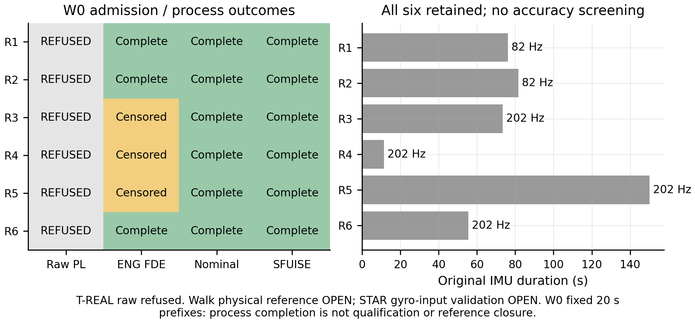

T-REAL: raw source refused for all six. W0 uses fixed 20 s prefixes; process completion is not qualification. [SVG](figures/F00_admission.svg)

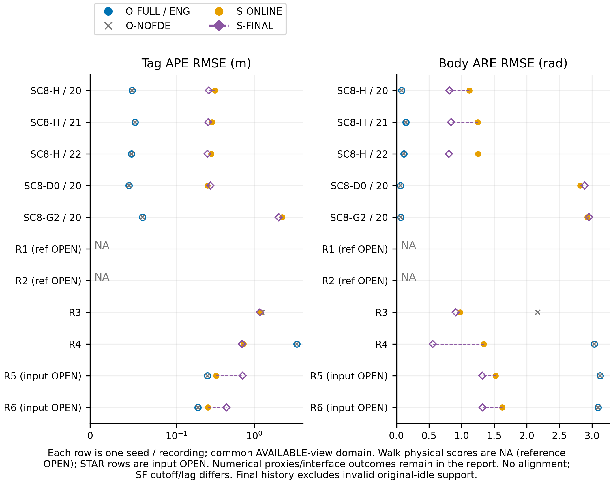

Each row is one seed / recording; common AVAILABLE-view domain. Walk physical scores are NA (reference OPEN); STAR rows are input OPEN. Numerical proxies/interface outcomes remain in the report. No alignment; SF cutoff/lag differs. Final history excludes invalid original-idle support. [SVG](figures/F01_paired_accuracy.svg)

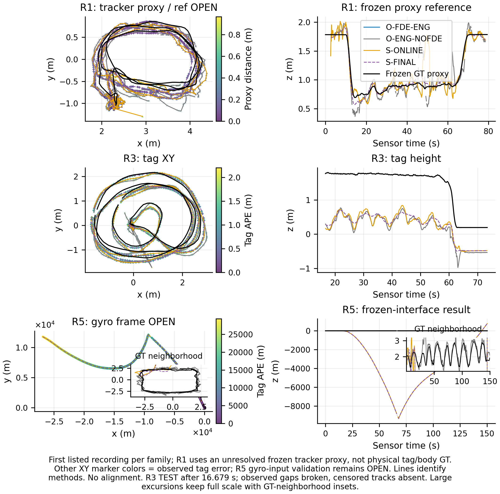

First listed recording per family; R1 uses an unresolved frozen tracker proxy, not physical tag/body GT. Other XY marker colors = observed tag error; R5 gyro-input validation remains OPEN. Lines identify methods. No alignment. R3 TEST after 16.679 s; observed gaps broken, censored tracks absent. Large excursions keep full scale with GT-neighborhood insets. [SVG](figures/F02_real_trajectories.svg)

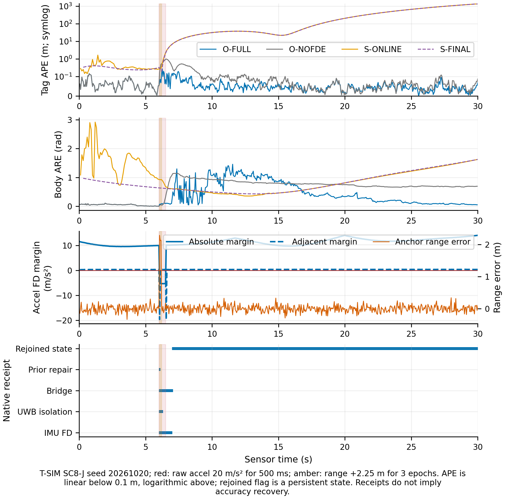

T-SIM SC8-J seed 20261020; red: raw accel 20 m/s² for 500 ms; amber: range +2.25 m for 3 epochs. APE is linear below 0.1 m, logarithmic above; rejoined flag is a persistent state. Receipts do not imply accuracy recovery. [SVG](figures/F03_joint_fault_receipts.svg)

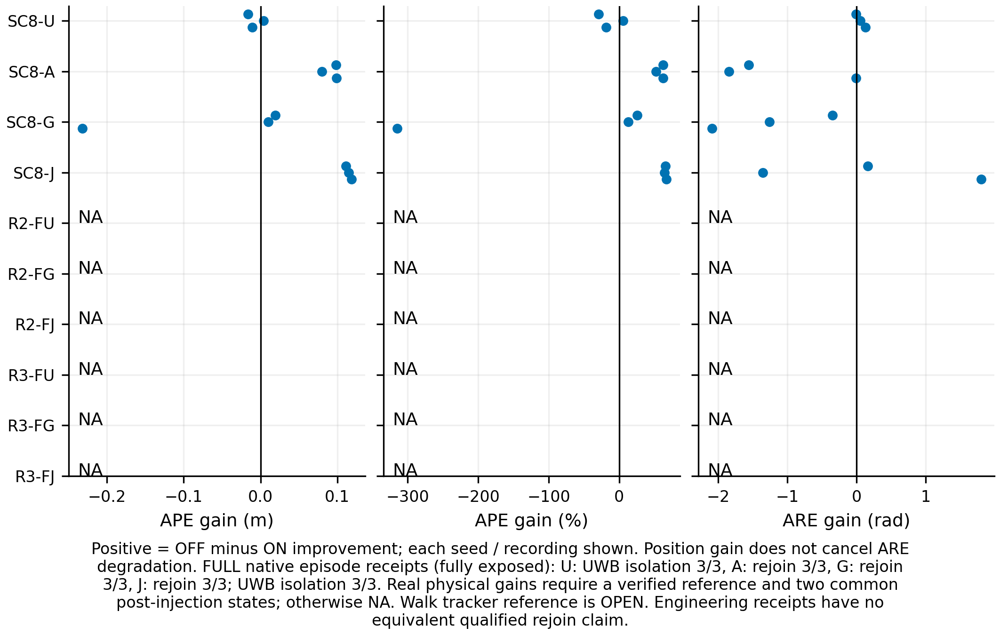

Positive = OFF minus ON improvement; each seed / recording shown. Position gain does not cancel ARE degradation. FULL native episode receipts (fully exposed): U: UWB isolation 3/3, A: rejoin 3/3, G: rejoin 3/3, J: rejoin 3/3; UWB isolation 3/3. Real physical gains require a verified reference and two common post-injection states; otherwise NA. Walk tracker reference is OPEN. Engineering receipts have no equivalent qualified rejoin claim. [SVG](figures/F04_fault_paired_gains.svg)

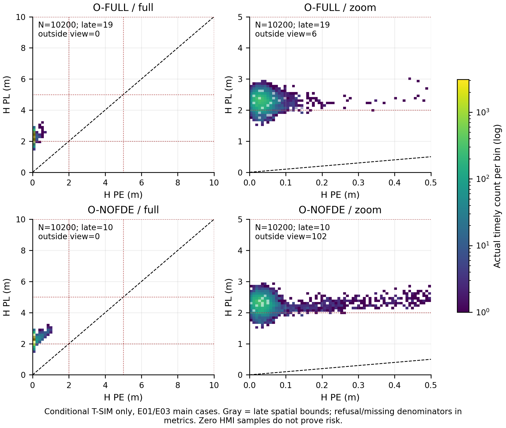

Conditional T-SIM only, E01/E03 main cases. Gray = late spatial bounds; refusal/missing denominators in metrics. Zero HMI samples do not prove risk. [SVG](figures/F05_H_Stanford.svg)

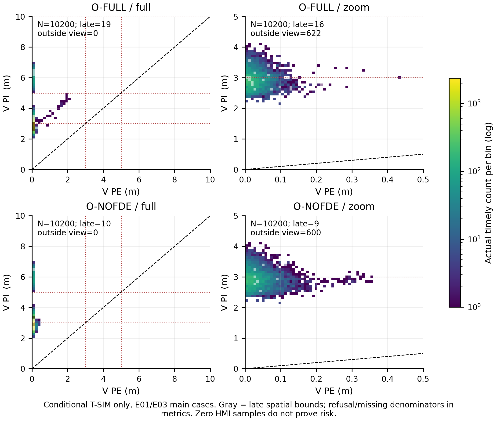

Conditional T-SIM only, E01/E03 main cases. Gray = late spatial bounds; refusal/missing denominators in metrics. Zero HMI samples do not prove risk. [SVG](figures/F05_V_Stanford.svg)

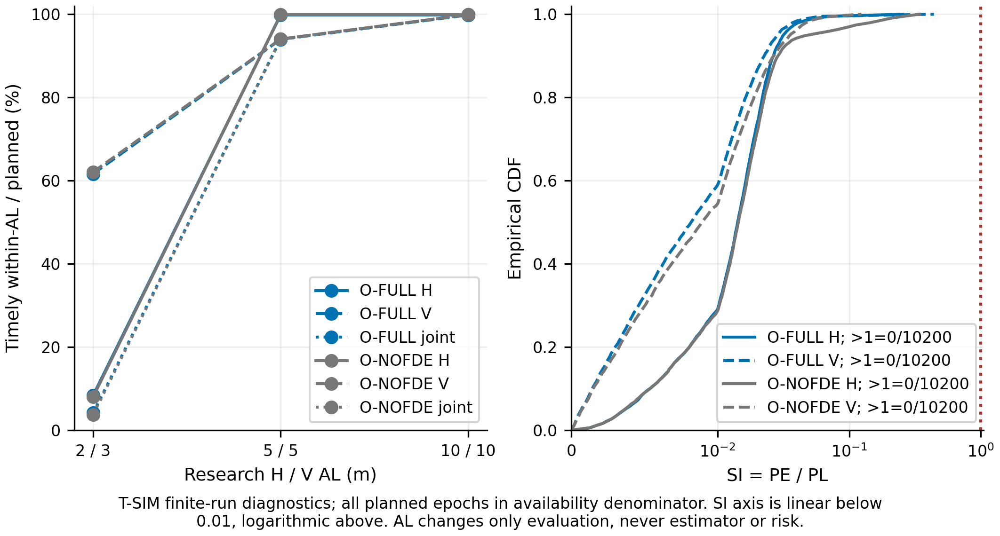

T-SIM finite-run empirical diagnostics; all planned epochs in availability denominator. AL changes only evaluation, never estimator or risk. [SVG](figures/F06_AL_and_SI.svg)

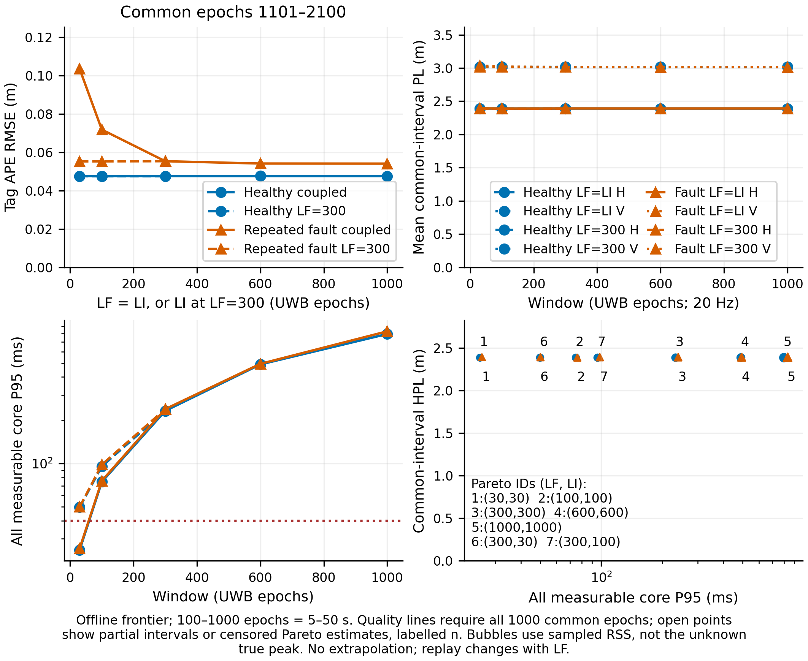

Offline frontier; 100–1000 epochs = 5–50 s. Quality lines require all 1000 common epochs; open points show partial intervals or censored Pareto estimates, labelled n. Bubbles use sampled RSS, not the unknown true peak. No extrapolation; replay changes with LF. [SVG](figures/F07_window_frontier.svg)

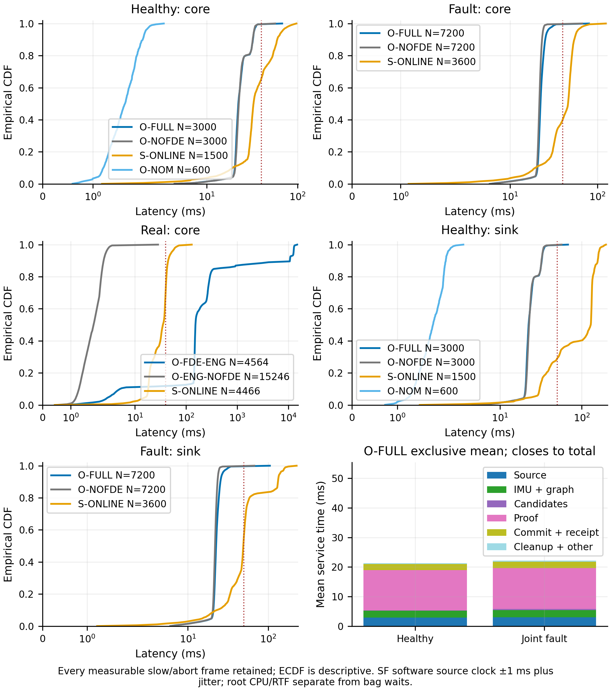

Every measurable slow/abort frame retained; ECDF is descriptive. SF software source clock ±1 ms plus jitter; root CPU/RTF separate from bag waits. [SVG](figures/F08_latency_and_breakdown.svg)

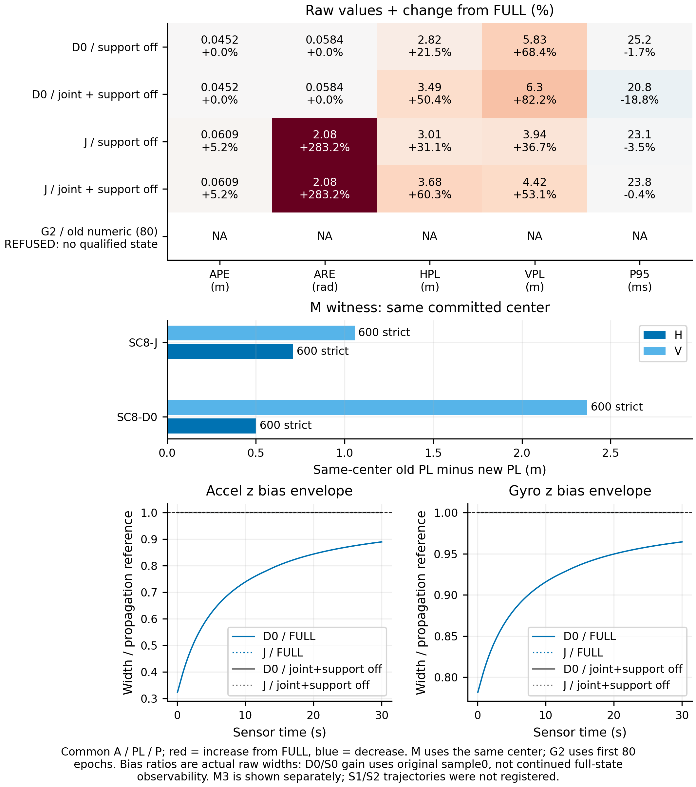

Common A / PL / P; red = increase from FULL, blue = decrease. M uses the same center; G2 uses first 80 epochs. Bias ratios are actual raw widths: D0/S0 gain uses original sample0, not continued full-state observability. M3 is shown separately; S1/S2 trajectories were not registered. [SVG](figures/F09_ablations.svg)

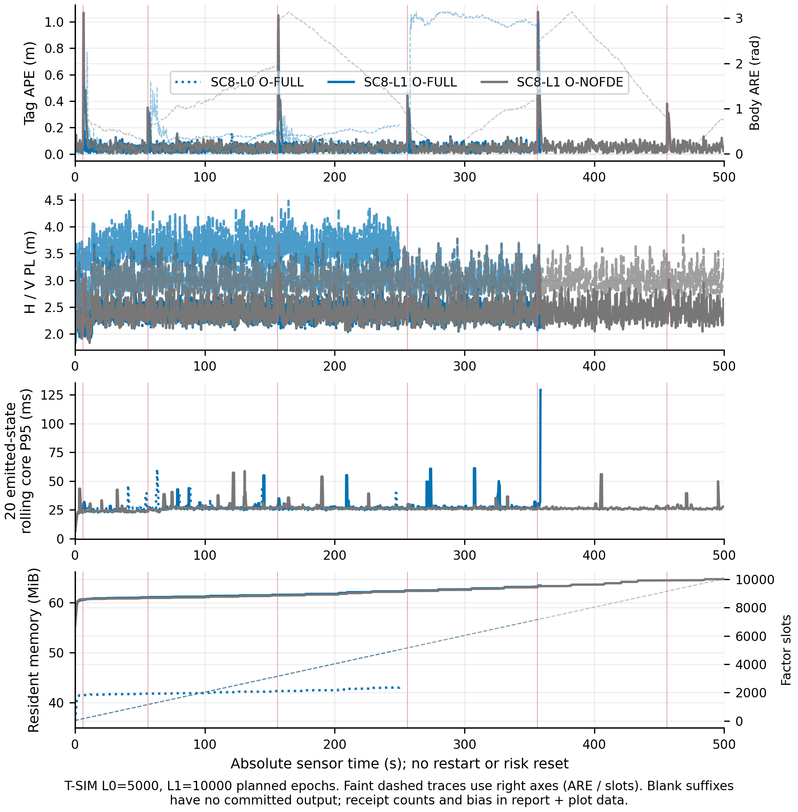

T-SIM L0=5000, L1=10000 planned epochs. Blank suffixes have no committed output; resource/receipt counts and ARE/bias/slots in report + plot data. [SVG](figures/F10_long_streams.svg)

## 实际困难与后续采集

当前真实工程管线的候选拒绝、姿态大误差和处理积压属于结果；不能用仿真 raw 定理、最终历史或较短成功前缀替它背书。仅有位置改善不代表 body 姿态/bias 已观测。SFUISE 的仿真 velocity/bias 未在冻结导出接口保存，虽有源真值也为 NA_ESTIMATED_STATE_NOT_EXPORTED，属于指标接口限制；不是无真值。

手册补充范围的明确缺口：冻结矩阵登记了弱短 IMU、负幅和错峰，但没有独立弱幅 UWB 小矩阵，也没有另跑 S1/S2 bias 轨迹。D0/S0 与 M3 的结果不能顶替 S1/S2；不引用旧 SC7 曲线冒充本轮。S0 的 bias 包含收缩依赖原始 sample0 信息，不表示持续获得全部 bias 或 15D 可观测性。W0 额外 attempt 后本轮计划占满 160 上限，这些未登记补充不事后补点或伪称通过。

后续可另采独立标定录制：覆盖三轴角运动、平移与不同姿态，独立测量 body/tag/IMU/GT 杆臂和时间延迟，并留完全不参与拟合的 TEST。优先记录硬件时间同步、原始逐条 range 和连续 IMU 缺口，保存提交/拒绝/发布时刻、依赖截止与原生恢复 receipt。若希望把经验结果提升为真实 raw 保证，还需独立验证初始 law、噪声/运动域/采样/anchor 映射及证明接口，不能由当前六条经验轨迹或零超界样本推导。

现有接口的优先补缺：Walk 需要独立的 tracker↔IMU 旋转/平移和 tag 测点定义；STAR 需要按原始设备 TF 与时钟约定闭合 gyro/rig 转换，并在独立 CAL 同时验证角速度、重力和杆臂。当前 CAL 诊断不能替代这些独立信息，也不能用 TEST 误差挑翻转矩阵或时延。修复后应另冻结版本重跑受影响格，本轮不在 160 预算内悄悄换源或改写旧结果。

这些采集与理论扩展建议不改变本轮冻结算法，也不阻止本轮仿真、经验和窗口边界的结项。

## SC8-A01–A24 对账

| 验收 | 证据/状态 |
|---|---|
| A01 | 入口/冻结 identity、ELF/DSO/libraries/platform；旧报告只库存；生产合同 hash 未改 |
| A02 | E00 九条库存，六条固定测试，备用未启用 |
| A03 | 字段/单位/时间审计与899/899 direct/ROS；Walk tracker/body/tag参照未闭合，物理分数NA，诊断与proxy保留 |
| A04 | CAL-W 与 R3 prefix20 +2s 隔离，test-involved 明示，无逐方法测试拟合 |
| A05 | 三通道和 requested/effective 分离；真实 raw 拒绝/PL NA |
| A06 | SF 固定 pin、官方剔除、首发/历史/cutoff/revision，数值观察双实例检查 |
| A07 | 共同 source-only、native 逐值 audit；lossless bag parity，原始数据不改 |
| A08 | 13 项独立 scorer 测试 + evo 对口径 |
| A09 | E01: {'SUCCESS': 16} |
| A10 | E02: {'RESOURCE_LIMIT': 4, 'SUCCESS': 14}; 工程结果不叫 FULL raw |
| A11 | E03: {'SUCCESS': 58, 'RESOURCE_LIMIT': 5}; 原生 episode 与真实增量/阶段分开 |
| A12 | seed/录制统计，负收益保留，无帧级伪独立 CI |
| A13 | 实际 H/V Stanford 分母对账，AL/SI/late/拒绝分层，零 HMI 不当证明 |
| A14 | E05: {'SUCCESS': 7, 'RUNNING': 1, 'NOT_ATTEMPTED': 6}; 7 唯一合法配置 |
| A15 | 同进程 LF+2 canary、边缘化与 resource/inflight 右截断；公共 1101–2100，缺数据 NA |
| A16 | 逐 run core/sink/age/CPU/RTF；exclusive 均值闭合，P95不相加 |
| A17 | 40/50 ms 和95%全计划分母；真实及时估计≠raw资格 |
| A18 | E07: {'NOT_ATTEMPTED': 5}; 合并开关与 M/A/P 明示 |
| A19 | E08: {'NOT_ATTEMPTED': 3}; late gaps=0 |
| A20 | F00–F10 实际图/精简绘图数据；NA和overflow保留 |
| A21 | PENDING：最终相关回归未全部结束 |
| A22 | {'SUCCESS': 114, 'RESOURCE_LIMIT': 12, 'RUNNING': 1, 'NOT_ATTEMPTED': 16}; attempts=143，辅助另计，完整版本/失败身份留存 |
| A23 | 唯一中文报告+English Results，实际冻结 registry/metrics/plot CLI |
| A24 | 阶段本地 commit；只清理本轮 owned cache，保留原始数据/用户旧证据，不 push |


## 复现与续跑

```bash
python3 tools/sc8_experiments.py preflight --build
python3 tools/sc8_sfuise_observer.py
python3 tools/sc8_sfuise_observer.py check
python3 tools/test_sc8_metrics.py
python3 tools/test_sc8_inputs.py
python3 tools/test_sc8_inputs.py bags
# 在已冻结环境续跑；已有完成/失败 attempt 默认均复用，不自动重复求解

python3 tools/sc8_experiments.py run --group E01,E02,E03
python3 tools/sc8_experiments.py run --group E05,E07,E08
python3 tools/sc8_experiments.py run --group E06
python3 tools/sc8_experiments.py checks
python3 tools/sc8_experiments.py evaluate
python3 tools/sc8_experiments.py figures
python3 tools/sc8_experiments.py report
# 全部运行和图表结束后审计；清理只接受当前 PASS 审计

python3 tools/sc8_analysis.py audit
python3 tools/sc8_cleanup.py --apply
python3 tools/sc8_experiments.py report
```

在新环境重建时应核对 frozen source/依赖/ELF 身份；若编译器、库或 ELF 不同，须另存版本化 registry，不能覆盖此轮身份。registry 内保存完整数值 CAL 参数，输入重建使用冻结标定，不在 TEST 重拟合。只重画图可用永久 metrics+plotdata：`figures` 在原始 trace 不存在时读取保存的 plotdata，不启动求解。

执行缺口：SFUISE simulated velocity/bias estimates were not exported; source truth exists but corresponding state-error metrics remain NA, no pose-difference proxy; STAR gyro-frame input validation OPEN: published transform direction labels and CAL-S gyro/GT consistency do not close; frozen outputs retained as interface-level outcomes, no intrinsic algorithm ranking; Walk physical tag/body GT reference OPEN: CAL-W rejects tracker=IMU identity; frozen numerical proxy metrics are retained separately, not physical accuracy; Registered scope omission: no separate weak-UWB amplitude matrix or S1/S2 bias trajectories; no historical curves substituted; E02-R1-O-FULL-20261020-30x30: real engineering run censored before complete recording; E02-R2-O-FULL-20261020-30x30: real engineering run censored before complete recording; E02-R3-O-FULL-20261020-30x30: real engineering run censored before complete recording; E02-R5-O-FULL-20261020-30x30: real engineering run censored before complete recording; E03-R2-FU-O-FULL-20261020-30x30: real engineering run censored before complete recording; E03-R2-FJ-O-FULL-20261020-30x30: real engineering run censored before complete recording; E03-R3-FU-O-FULL-20261020-30x30: real engineering run censored before complete recording; E03-R3-FG-O-FULL-20261020-30x30: real engineering run censored before complete recording; E03-R3-FJ-O-FULL-20261020-30x30: real engineering run censored before complete recording; SFUISE historical original-idle prefix unavailable: 58 support-invalid exports across 29 formal runs; first causal outputs unaffected

断点：冻结 `61907ab417450d317e443e4ff10f2cce062deabe`；待运行 17，运行错误/未完成长流 0。所有逻辑 ID 和实际 attempt 见 JSON。资源上限是结果；接口/执行缺口没有改写 PASS。最终审计和本轮 cache 清理状态另记录在本报告的本地阶段提交日志。

## English Results

The frozen evaluation registered 143 unique runs and retained all 143 execution attempts (plus the registered ROS counterpart). Current process outcomes are {'SUCCESS': 114, 'RESOURCE_LIMIT': 12, 'RUNNING': 1, 'NOT_ATTEMPTED': 16}. Accuracy is scored without fitted trajectory alignment, with each seed or recording retained as the independent unit. First causal SFUISE outputs and final retained-history outputs are separate views of the same run; differing initialization information, input cutoffs and state age preclude an unconditional online ranking. Only registered simulated sources can receive conditional raw protection bounds. Real and semi-synthetic recordings use an explicitly labelled engineering FDE pipeline with no matched raw PL. Walk physical tag/body reference remains open: CAL-W rejects tracker=IMU identity, so physical scores are unavailable and frozen proxy differences remain separately labelled. Historical bootstrap points with invalid original-idle support are explicitly unavailable; first causal outputs are unchanged. Censored suffixes, failures, negative gains and attitude degradation remain visible. Large-window results are measured cost frontiers, not an assertion of real-time operation at 1000 epochs. The evaluation status is IN_PROGRESS; zero observed HMI events are not a probabilistic proof.

Across 3 healthy seeds, full-pipeline tag APE RMSE ranged from 0.0487176 to 0.0526469 m. The default timing and timely-spatial tests passed 3/3, while timely joint availability at the research H/V alert limits of 2/3 m was only 3.5–5.667%. Small measured error does not imply equally tight protection bounds.

For SC8-U, mean paired OFF-minus-ON improvements were -0.00790838 m in APE and 0.0580596 rad in ARE across 3 seeds. Negative values denote deterioration; position and attitude effects are reported separately.

For SC8-A, mean paired OFF-minus-ON improvements were 0.0923626 m in APE and -1.13562 rad in ARE across 3 seeds. Negative values denote deterioration; position and attitude effects are reported separately.

For SC8-G, mean paired OFF-minus-ON improvements were -0.0677327 m in APE and -1.23141 rad in ARE across 3 seeds. Negative values denote deterioration; position and attitude effects are reported separately.

For SC8-J, mean paired OFF-minus-ON improvements were 0.114792 m in APE and 0.20435 rad in ARE across 3 seeds. Negative values denote deterioration; position and attitude effects are reported separately.
