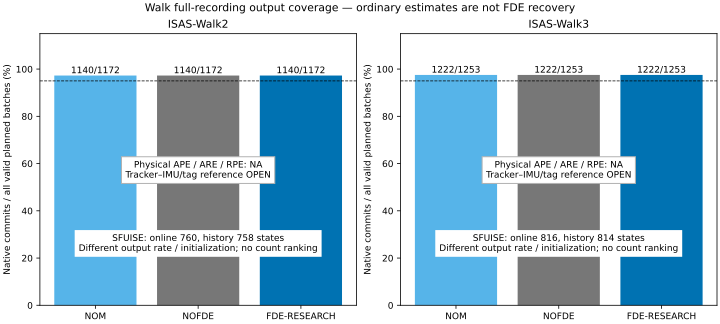
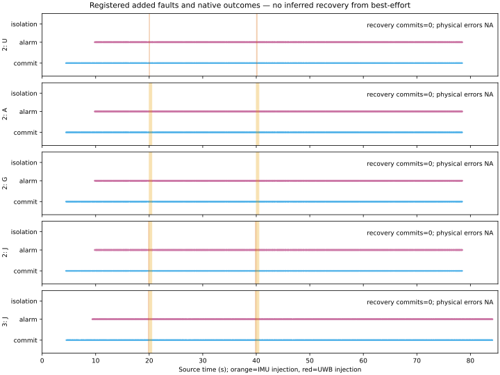
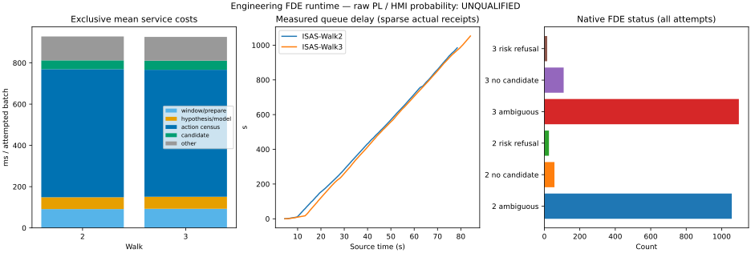

# SC8 Walk Real-Data Follow-up

状态：**W0–W3 已执行，W4 最终冻结与缓存清理进行中。** 本文件为本轮唯一结果报告，不改写旧 SC8。

## W0：输入、版本和参考资格

入口 HEAD `00b8486c4f45024daa046b2f4ec20a0eec98afb3`，较设计核对版本多一个演示文稿提交。原有未跟踪 `docs/sc8/SC8_RESULTS.html/.pdf` 保留。仓库及上级路径未发现 AGENTS.md。ROS Noetic、GTSAM 4、原生 runner/DSO 实际存在；入口 ELF/DSO SHA256、SFUISE pin、每个源 bag 和 CSV 哈希见 [冻结合同](../../config/sc8_walk_followup.yaml)。SFUISE 固定 `75bf5a32f1a8e5c3046a5bd1a1ddf659fa996f7d`。生产配置、AL、risk、故障合同未改。

三条 bag 均来自 `/home/mint/ws_fusion_uwb/data/SFUISE/`，重新读取构建本轮 cache。IMU 原始 m/s²、rad/s；range 按官方 anchor ID 加一次固定 offset，`ra=0` 保留并标无效；5 anchor，tag 27956。官方 IMU→tag 偏移 `[0.1,-0.025,0] m` 保持为估计器模型参数，其独立实测误差界未知。

评分 GT 改为 bag 实际 tracker 位姿，明确 **REFERENCE_OPEN**，不沿用旧适配器将 tracker 当 IMU 加杆臂后得到的物理 tag 声称。输入变换没有使用 TEST GT。`T_AB` 将 B 坐标映到 A，`T_WI=T_WT*T_TI`，`p_Wtag=p_WI+R_WI*l_Itag`。世界变换拟合不能替代 `T_TI`。

官方 [SFUISE 论文](https://isas.iar.kit.edu/pdf/RAL23_Li.pdf)、本地固定版本 README/配置/接口均已查阅。发布配置给出 IMU-tag offset，没有给出 tracker→IMU 完整安装外参及不确定度；bag topic 清单见合同，无静态外参闭合证据。因此物理 tag APE、body ARE、0.5/1s RPE 均 **NA**，真实 raw PL/HMI 概率资格 **UNQUALIFIED**。不据此中断 FDE 工程研究。

Walk1 CAL 预先以时间前60%拟合、后40%留出。有限 `[-0.1,0.1] s` 时间搜索得到 gyro→tracker 诊断时移 -0.0383347 s；训练旋转残差 RMSE 0.0602826 rad/s，留出 0.0487206 rad/s，identity 0.485762 rad/s。旋转 det=1，正交误差 1.15e-15。三方向激励奇异值 6.768/3.501/3.327；这只支持旋转相关诊断，gyro 对平移的 Jacobian 为零，不能据此声称完整6D外参已辨识。诊断矩阵不应用到输入或 TEST GT，不提供伪精度排名。

需要外部补充：tracker→IMU 安装旋转/平移、tracker→tag 测点定义、时钟偏移/漂移与误差界、世界重力方向验证。可采三轴转动与不同姿态平移的独立 CAL，包含静止段和同步事件，测量上述杆臂并报告尺寸误差；另留独立 TEST。当前数据不能提供可认证的有限完整外参误差界。

确定性测试：左右乘/逆变换/tag 杆臂、重力与角单位、已知旋转和37 ms时移共3测试 PASS。真实 Walk1 前缀22个原生状态的未来 GT 篡改测试 PASS：两次初始化、完整 trajectory、提交/动作/源截止逐值相同。生成脚本已预登记 Walk2 定向源批次、Walk2四类及 Walk3联合确认的弱/强额外故障，时刻/幅值在 FDE 结果前冻结。

## CAL 加速度/杆臂补充诊断

仅 Walk1 的 tracker 平移二阶导数与角速度构造 `R_TI f_I = R_WTᵀ(a_WT-g_W) + (α×+ω×ω×)r_TI+b_T`，前60%拟合、后40%留出，固定0.62s Savitzky–Golay支撑。9参数线性设计矩阵 rank=9，条件数9.23；拟合 r_TI≈[-0.0357,0.00004,0.0380]m，训练/留出逐分量残差0.181/0.154m/s²。这是可辨识关系的诊断，不再把“gyro无法辨识平移”泛化为完整数据必然秩亏。tracker求导误差相关性、重力/偏置混淆、时钟与真实安装定义尚未独立验证，条件OLS标准误差不是硬件外参界，参考仍OPEN；未应用此拟合。复现：`python3 tools/sc8_walk_followup.py cal-accel`。

非干扰小测试v1曾误向GT增加未使用x列；已纠正为实际px字段，v2两次原生运行重新通过22状态逐值比较，以v2为验收依据。

## W1：本轮名义全录制

四个进程均完成完整录制；NOM/NOFDE 的15D状态逐值相同，源CSV与旧SC8冻结哈希一致。没有使用GT初始化。NOFDE实际代码不运行检测器，此处是off路径开销对照，不宣称保留全部监测。

|流/方法|原始批次/有效计划/可用计划|原生提交|全部有效计划覆盖|core P95/max ms|sink P95/max ms|CPU s/RSS KiB|
|---|---|---|---|---|---|---|
|ISAS-Walk2-NOM|1241/1172/1140|1140|97.270%|2.440/4.514|2.646/4.764|5.981/93768|
|ISAS-Walk2-NOFDE|1241/1172/1140|1140|97.270%|2.458/4.288|2.672/4.589|5.991/94312|
|ISAS-Walk3-NOM|1339/1253/1222|1222|97.526%|2.335/4.193|2.526/17.472|6.268/96192|
|ISAS-Walk3-NOFDE|1339/1253/1222|1222|97.526%|2.520/22.190|2.664/22.465|6.439/96768|

Walk2全无效69批、有效计划启动前32批；Walk3全无效86批、启动前31批。原始全部分母1241/1339也保留，不能将其视为1172/1253。首发/末端分别为Walk2 4.471092224/78.456339598s，Walk3 4.524949789/84.114124775s。所有可用计划均已提交，无失败后缀；95%目标仅针对有效计划分母成立。物理精度NA。原生单次backend更新及时间/事务唯一性断言通过。

SFUISE两条完整进程SUCCESS，官方剔除开启，GT topic=0；生成ROS bag逐ADC、range、ID、valid和纳秒时间与本轮原生输入全部exact相等，runtime offset=0，源偏移仅加一次。

|序列|S-ONLINE N/首末秒|S-FINAL N/支撑无效点|最后数值输入秒|最终callback上界秒|
|---|---|---|---|---|
|ISAS-Walk2|760/2.527455901–78.427455901|758/2|78.423522472|78.521199942|
|ISAS-Walk3|816/2.583362912–84.083362912|814/2|84.081641436|84.142725229|

S-FINAL按原样条支撑拒绝起始2点，未按误差筛选；历史依赖截止为整个最终导出的上界，不能解释为每点精确截止，也不参加在线延迟排名。SFUISE采用官方传感器初始化和在线重力/世界标定；ours采用相同原始观测的2秒因果初始化，两者初始化信息/时刻不同。所有物理APE/ARE/RPE仍NA。首条SF运行启动时audit-only runner编译尾部短暂重叠，运行性能需披露此环境扰动；不隐去慢值。

W1四条原生全录制和两条SFUISE运行已完成。

## W2：局部工程证据与实现

原始 Walk2 源 batch 1–120（包含启动段）实际84次尝试，提交83：57次NO_VALID_CANDIDATE、26次RISK_BUDGET_INVALID、1次AMBIGUOUS_UNAVAILABLE。前83次本来就是KEEP_ALL_BEST_EFFORT，不是真正成功隔离。首次报警source batch120、t=9.853092670s，411个假设全部保留为plausible，生成412动作；原生coverage为210个COVERAGE_GAP、202个UNRECOVERABLE。不是“5 anchor必然无秩”或“所有拒绝都是测量故障”：原生联合窗口秩/自由度、旋转步长门限、覆盖和risk资格需分别看。

该报警批原始core约12620.85ms。前缀candidate kernel总计16245ms、完整candidate阶段17383ms（后者包含前者，不能相加），core总计27599ms；原窗口构造也有实际成本。候选需要保持完整可疑集合覆盖，而当前集合不允许一个有限动作合法排除所有仍可能的故障；没有因此缩减故障集合或改概率。

实现两项独立、默认关闭的研究开关，生产ROS默认路径不变：

- `--research-eligibility-pruning`：完整生成动作ID、物理源和census。仅对冻结集合覆盖失败、mandatory health覆盖失败、history recoverability失败的动作跳过数值核与post/PL，记`SKIPPED_INELIGIBLE`，不伪记已求解。FdeManager的eligible集合要求这三项均成立，因此无论这些动作的数值、排名、tie或PL是多少，都不能进入winner排序或风险union；保留全部可能eligible动作的原始计算与严格fallback。不实现排序剪枝，不改变rank/tie阈值。研究开关强制关闭保护资格。外置object sidecar保持原pipeline对象ABI。
- `--research-best-effort`：仅在FDE原事务已安全discard、backend更新为0、无pending/poison/reinitialization、无活动bridge、无quarantined/failed/recovery-test源，且拒绝为三种允许状态时，重新prepare同一原始batch并通过普通nominalPlan提交一次。检查backend总增量=1、源时间等于该batch。discard保留ADC队列，因此不补旧状态或改时间戳。原FDE事务和候选审计单独保留，新的普通receipt标`UNPROTECTED_BEST_EFFORT`，不称prior已修复或FDE已成功；异常、源缺口和必须隔离条件不被吞掉。

9个确定性组合（不覆盖/mandatory/recoverability × favourable/tied/hostile数值）通过FdeManager对照小oracle。真实前缀剪枝与原始版：84次attempt、83次commit、495个动作身份及15D状态、保留候选数值、实际行动/拒绝、prior/bridge/ledger/health/事务逐值一致；412个动作明确未求解。core总计27.599→16.253s。这是局部调度结果，不推广成全流实时性。

加best-effort的同一片段84/84提交，**84个全部未保护，实际FDE恢复0**。普通连续输出的验证不能抵扣WF12强UWB正确排除与IMU bridge/rejoin正例。完整原始录制的结果见后文；普通提交不得授予真正FDE恢复等级。

Walk2 完整研究运行：1140/1172 有效计划提交（97.270%），全1140个为未保护best-effort，0实际恢复；AMBIGUOUS_UNAVAILABLE=1057、NO_VALID_CANDIDATE=57、RISK_BUDGET_INVALID=26。core P50/P95/P99/max=988.464/1109.319/1173.916/1289.055ms，sink最大985639.262ms，CPU1058.797s、RSS1023604KiB、服务RTF13.906。完整437096动作记录中仅83个实际数值核求解，selected=0；动作集合构造平均620.749ms/attempt是主要剩余瓶颈。Walk3使用相同冻结ELF/DSO完成确认，见全录制表。

注入源预审：Walk2弱UWB的1条源测距原本invalid，strong-U的3条中2条valid，strong-J的3条中1条valid；Walk3 strong-J的3条全部valid。保留原始有效位，不后验更换源ID；无有效注入样本不能计入可检测正例或算漏检。所有IMU episode为41个真实ADC样本，具体PIM支撑由原生ledger另行核对。

## 相关核心回归与负例（冻结算法）

测试目标重新构建后，`test_integrity_v2`选定29项、`test_realtime_incremental`的gap/未来IMU非干扰2项、`test_fde_post_selection`4项（包含9组合的研究剪枝oracle）全部通过；另补齐容量fallback、假设维数超限拒绝、deadline后真实commit降级3项，共38项通过。之前旧test_integrity_v2 ELF存在未解析旧proof符号，属于陈旧构建，已重建消除；不隐去首次预检失败。小oracle核对的是合法集合与安全拒绝不变，不是实测FDE恢复正例。

实际runner缺口负例：原输入截至6秒，删除5.2–5.3秒ADC。首次fixture沿用旧dataset_config，门限随最大输入gap被自动放大为0.108979秒，进程24次全部提交，故“应该拒绝”的测试断言失败。修正fixture为冻结原始20ms门限，未改算法；第二次进程按预期exit=1，原因`causal IMU hold exceeds imu.max_gap_s`，56原始/有效批次、32启动前、12完整attempt收据/提交、随后1次prepare缺口异常（无完整CSV收据）＋11批尚未尝试，最后收据5.183996916秒。无保护输出，不将失败后缀静默补齐。普通原录制及幅值注入时间戳未变，门限均未因注入增大。

测试构建与短回归同Walk3原录制中段重叠，影响共享主机负载；独立记录开始/结束时间，核验estimator ELF/DSO前后完全相同。Walk3耗时保留实测，不作为严格独占CPU速度对照。

Walk2全流历史摘要1140次均present/valid/capacity_ok，但完整故障历史覆盖声明为0/1140，最大省略历史epoch=1120、fault_columns=160、emitted_rows=66；这不是“无数值历史摘要”，而是不能把有限窗口数值prior当完整故障保护历史。风险ledger中的bridge/history/model仍为UNKNOWN/ASSUMED_UNVALIDATED，omitted为UNKNOWN/NOT_IMPLEMENTED，不通过增大AL或置零概率掩盖。候选跳过记录的rank/dof=0表示未计算，不代表实测几何rank=0。

## W2 全录制执行完成

两条原始录制均已按冻结限制执行；下表保留实际结束状态，不把普通提交计入FDE恢复。

|序列|结束/完整源|commit/有效计划|best-effort/恢复|core P95/max ms|sink P95/max ms|CPU s/RSS KiB|
|---|---|---|---|---|---|---|
|ISAS-Walk2|FINISHED/True|1140/1172|1140/0|1109.319/1289.055|931970.742/985639.262|1058.797/1023604|
|ISAS-Walk3|FINISHED/True|1222/1253|1222/0|1137.777/1285.377|993735.706/1053675.457|1132.949/1058148|

W2全流执行完成；不授予真正FDE恢复、物理GT或实时性通过。

## 与旧SC8的版本化对照

旧报告冻结SHA为`61907ab417450d317e443e4ff10f2cce062deabe`，本轮从`00b8486c4f45024daa046b2f4ec20a0eec98afb3`开发；旧结果保持原文，不当作同ELF的严格性能对照。旧R1实际attempt265/1172、commit83、拒绝182、未attempt有效计划907（含32启动前）；旧R2为341/1253、commit101、拒绝240、未attempt912（含31启动前）。二者在1200秒wall上限截断，旧core P95约12917.8/12799.3ms，不能仅把83/101之后全部缺失都解释为测量故障。

本轮完整源分别1140/1222次attempt并全提交，未attempt仅32/31个启动前有效批次，无录制后缀丢失；但全部是未保护普通状态。严格调度等价的速度证据仅来自本轮Walk2的84次局部对照；全流轨迹和拒绝后状态推进机制已变化，不能把旧→新的总耗时差全归功于剪枝。

注入采用base＋overlay证据：复制的在线manifest保留原bag来源元数据（其中files是base描述），派生输入的权威内容哈希由scorer-only `injection.json.injected_hash`与每次`execution.sensor_hash`记录并逐对核验；不把base files哈希冒充注入后的哈希。runner只读tag、批次窗口和初始化元数据，不读取注入标签，真正ADC/range来自派生CSV。

研究开关准入的两个实际runner负例也通过：在FDE-OFF下启用研究开关，和输入携带supplied initial observation，均在0个epoch时明确exit=1拒绝；未进入普通提交或受保护发布。加上冻结门限的source-gap负例，共3个期望拒绝进程，不混入16条正式原始/注入方法运行的成功率。

第二个事前登记诊断段Walk2源batch200–240在完整trace中实际含38次有效attempt（14.734724045–17.113354683秒）：38次报警/38个未保护commit、38次AMBIGUOUS_UNAVAILABLE；joint detector dof99–102，假设414–423，完整动作15932、候选数值核0。core均值966.788ms、最大1154.729ms。没有为了取得这一快照额外回放或按TEST误差挑片段。

## 本轮 Walk ROS/direct 数值接口核验

使用截至6秒的Walk2前缀，不使用GT，20倍离线回放＋worker队列屏障，只测普通OFF路径数值语义。原审计脚本已修正valid标志处理和ROS master订阅索引错误。LinktrackNode2的id为uint8、dis为float32：首次原始ID尝试因7475等越界拒绝。显式双射7475→0、9524→1、10548→2、15155→3、20276→4后，canonical float64 direct与ROS均24状态，位置最大差2.250639e-7m，姿态1.081027e-4度，严格1e-5度容差**FAIL**，没有调宽。

单独的同线值控制把两侧range都取同一float32值（最大输入量化1.464843749e-07m），24/24状态数值比较**PASS**：位置最大差7.099247e-10m、姿态1.707547e-6度。实际订阅仅`/imu/data`、`/nlink_linktrack_nodeframe3`，GT发布0/订阅0；56原始/有效批次，28条invalid range未入有效消息。量化控制未替换正式原始/注入矩阵的float64 CSV；只证明相同线值的普通OFF数值路径，不能宣称原生大ID/float64 ROS无损、FDE源证书等价或20倍回放实时。SFUISE本轮使用另一个float64 lossless transport，不受这个Linktrack限制。

ROS审计节点构建和短前缀与UWB注入ON尾段重叠；后者时效保留该共享主机负载，不隐去慢帧。

## W3 冻结注入合同

弱/强起点分别为canonical源时间20/40秒；UWB固定anchor7475，弱+0.3m持续1个原始batch、强+2.25m持续3个原始batch。accel固定原始sensor ax，弱+2m/s²、强+20m/s²，持续0.5秒；gyro固定gx，弱+0.1rad/s、强+1rad/s，持续0.5秒。J为gyro＋UWB，UWB相对IMU提前0.18秒。Walk2执行U/A/G/J，Walk3只重复同一J确认；不选新seed或按TEST修改幅值。每个IMU episode实际41个ADC样本，全部为research stress fault，未声称真实故障分布或可认证检出概率。

已完成U类全流：ON/OFF各1140提交，状态CSV逐字节相同。弱注入0条有效输入；强注入的2条有效range在原生ledger中为measurement1002724/1002729，活动窗3次attempt/commit/alarm、之后589次普通commit，但0正确排除/恢复。报警在强注入之前已经持续存在。

W3全部10条注入ON/OFF与6条原始方法运行均FINISHED，无有效后缀缺失。Walk2每条1140提交、Walk3每条1222提交；七对原始/注入ON/OFF states.csv逐字节相同。所有研究ON提交均为UNPROTECTED_BEST_EFFORT，真实恢复0、bridge0、受保护输出0。最后Walk3-J为1045次歧义、161次无合法候选、16次风险拒绝，core P95/max=1153.414/2633.292ms，sink最大1023381.468ms。强UWB三条原生ID1002697/1002702/1002706均实际出现，强弱IMU各41/41样本落在实际PIM支撑内。完整统计见后续冻结表。报警在注入之前已存在，故活动窗报警不是新增故障因果检出率。没有实际隔离时，prior修复、bridge和rejoin不获成功资格；故障活动及后续阶段的物理APE/HPE/VPE/ARE/RPE、绝对/百分比收益全部NA。ON/OFF状态差仅用于验证实际行动副作用，不解释为对GT的误差。

## 评价边界与仍需补齐的材料

研究输出按普通提交、实际恢复、保护资格分别统计。NOFDE实际绕过检测器，因此本轮未建立“保留全部相同监测、仅禁用动作”的独立反事实；不能用NOM与NOFDE相等证明检测器开销为零。未修改生产默认，研究模式也不具有真实raw风险资格。

需要导师/硬件提供可追溯的tracker→IMU旋转和平移及误差界、tracker测点和UWB天线相位中心定义、IMU→tag安装尺寸公差、时钟偏移/漂移/滤波延迟/抖动界、世界—anchor—重力方向闭合。新增独立CAL应包含静止、三轴旋转、不同姿态的平移和同步事件，并留独立验证段。现有CAL关系的条件残差不能代替这些材料。真实噪声/故障概率模型、完整历史遗漏风险与合法可隔离候选仍需独立闭合，不能靠物理标定单独解决。

运行使用软件源时钟与sink时间，表示本机回放的测量时间到消费延迟，不是硬件现场端到端采集延迟。50ms是研究诊断目标。原生每个进程限制1200秒wall、采样RSS上限7GiB；单候选worker及TBB/BLAS线程限制固定。RSS为进程采样峰值，不等于缓存字节；factor ledger累计记录量也不等于活动后端槽位（后者未导出）。互斥阶段合计不重复加嵌套candidate/window计时；余项包含包装、日志和fallback。所有慢帧与共享主机构建扰动保留。

## 最小复现与本地版本

从本仓库与固定SFUISE版本、ROS Noetic/GTSAM构建环境运行。原始bag位于 `/home/mint/ws_fusion_uwb/data/SFUISE/`；脚本重建自有缓存，不依赖旧SC8缓存。SFUISE观察入口使用既有隔离workspace。实际每次输入、配置、ELF/DSO及trace哈希见冻结摘要；W1早期ELF与后来新增研究开关ELF分别记录，不能声称全实验均同一个二进制。

```bash
source /opt/ros/noetic/setup.bash
source /home/mint/ws_fusion_uwb/devel/setup.bash
make -C /home/mint/ws_fusion_uwb/build/uwb_imu_pl nominal_dataset_runner/fast -j1
python3 tools/sc8_walk_followup.py prepare
python3 tools/test_sc8_walk_followup.py
python3 tools/test_sc8_metrics.py
python3 tools/sc8_walk_followup.py cal-accel
python3 tools/sc8_walk_followup.py noninterference
python3 tools/sc8_walk_followup.py baseline
python3 tools/sc8_walk_followup.py sfuise
python3 tools/sc8_walk_followup.py sfuise-summary
python3 tools/sc8_walk_followup.py inject
python3 tools/sc8_walk_followup.py profile
python3 tools/sc8_walk_followup.py local
python3 tools/sc8_walk_followup.py continuous
python3 tools/sc8_walk_followup.py paired
python3 tools/sc8_walk_followup.py negative
python3 tools/sc8_walk_followup.py ros-equivalence
python3 tools/sc8_walk_followup.py evidence
```

核心回归按下文`verification.regression_results`中精确target/filter执行，各目标先以`make -C /home/mint/ws_fusion_uwb/build/uwb_imu_pl <target>/fast -j1`构建，然后从`devel/.private/uwb_imu_pl/lib/uwb_imu_pl/<target> --gtest_filter='<filter>'`运行。实际完成38项核心测试、3项参考测试及13项评分器测试；不要在性能回放中改动runner/DSO。正式矩阵只有16条原生全录制及2条SFUISE运行；局部oracle、接口和期望拒绝进程另列，不混入成功率。缓存中的execution记录用于中断恢复，脚本校验输入及研究开关后复用已有执行；如需新测量须明确使用新输出目录，不把缓存读取声称重跑。

阶段提交：W0 `a026811`；W1 `d65413e`；W2实现与小oracle `5ef0560`、全录制与安全回归 `96c1ef6`；W3接口/support检查点 `9c3d41a`。最终W3/W4提交见本文件Git历史。无自动push，原SC8报告及用户HTML/PDF保持原样。

## WF01–WF18 验收表

PASS仅表示该行限定工作及证据通过；OPEN不被普通连续输出抵扣。全矩阵已完成；最终清理尚未完成。

|条款|状态|实测证据与边界|
|---|---|---|
|WF01|PASS|核对较新本地HEAD、实际ELF/DSO与SFUISE pin；生产AL/risk/故障合同未改。|
|WF02|PASS|三bag重新审计，ADC/range/ID/valid/time/5-anchor及一次offset冻结；逐文件哈希可重建。|
|WF03|OPEN|CAL旋转/时移和rank9加速度关系已诊断；完整独立安装、时钟及误差界缺失，REFERENCE_OPEN。|
|WF04|PASS|3确定性参考测试及v2未来GT非干扰22状态通过；未将拟合应用到TEST。|
|WF05|OPEN|两条NOM/OFF均全录制，1140/1172与1222/1253；≥95%覆盖已达。但现有OFF绕过检测器，不是保留全部监测的独立ENG-NOFDE反事实。|
|WF06|PASS|固定官方剔除、无GT、float64输入核验；online760/816、history758/814分别报告，初始化差异及截止语义披露。|
|WF07|PASS|首120源批次与200–240冻结片段、全流census/rank/risk/history/互斥计时解释拒绝和旧wall截断。|
|WF08|PASS|仅三项既有资格失败前置；9组合oracle、84attempt局部严格状态/动作/receipt对照，未改排序与敏感阈值。|
|WF09|OPEN|原始Walk2/3完整后缀全部执行、普通覆盖达标；全为未保护best-effort，真正工程FDE连续恢复仍OPEN。|
|WF10|PASS|原事务0更新、新事务单次普通commit、唯一时间/txn检查；真实恢复与普通降级分开，保护资格始终关闭。|
|WF11|PASS|各ON/OFF源哈希相等；注入元数据仅评分使用，ADC与range实际改值；GT不输入算法。|
|WF12|OPEN|四类Walk2及Walk3联合确认执行，真实有效range与41样本PIM支撑审计；无UWB正确排除或IMU合法bridge/rejoin正例。|
|WF13|OPEN|所有物理全程/活动/后续APE/HPE/VPE/ARE/0.5及1s RPE与收益NA；公共配对区间明确，外部材料清单已列。|
|WF14|PASS|P50/P95/P99/max、实际队列、CPU/RTF/RSS、状态/候选全分母与资源上限已记录；50ms实时性仍OPEN。|
|WF15|PASS|38项相关核心回归、3个实际runner期望拒绝；无保护发布，首次错误fixture和陈旧测试ELF失败均披露。|
|WF16|PASS|Walk3冻结确认，同一参数/故障强度，无TEST外参/噪声/阈值/seed选择。|
|WF17|PASS|三张实测SVG已生成并查看预览；完整统计、冻结摘要及复现命令保存在本报告。|
|WF18|OPEN|唯一报告与阶段本地提交已维护；最终缓存清理、W4提交尚未完成。|

## 全录制与注入：冻结实测表

分位数采用 nearest-rank；延迟包含完整等待队列。所有物理误差及其 ON−OFF 收益均为 NA。

|运行|结束|原始/有效/eligible|完整attempt收据/commit/缺失收据后缀|覆盖有效计划|报警/真实恢复/bridge|未保护best-effort|
|---|---|---|---|---|---|---|
|ISAS-Walk2-NOM|FINISHED|1241/1172/1140|1140/1140/0|97.270%|0/0/0|0|
|ISAS-Walk2-NOFDE|FINISHED|1241/1172/1140|1140/1140/0|97.270%|0/0/0|0|
|ISAS-Walk2-FDE-RESEARCH|FINISHED|1241/1172/1140|1140/1140/0|97.270%|1057/0/0|1140|
|ISAS-Walk3-NOM|FINISHED|1339/1253/1222|1222/1222/0|97.526%|0/0/0|0|
|ISAS-Walk3-NOFDE|FINISHED|1339/1253/1222|1222/1222/0|97.526%|0/0/0|0|
|ISAS-Walk3-FDE-RESEARCH|FINISHED|1339/1253/1222|1222/1222/0|97.526%|1151/0/0|1222|
|ISAS-Walk2-U-NOFDE|FINISHED|1241/1172/1140|1140/1140/0|97.270%|0/0/0|0|
|ISAS-Walk2-U-FDE|FINISHED|1241/1172/1140|1140/1140/0|97.270%|1057/0/0|1140|
|ISAS-Walk2-A-NOFDE|FINISHED|1241/1172/1140|1140/1140/0|97.270%|0/0/0|0|
|ISAS-Walk2-A-FDE|FINISHED|1241/1172/1140|1140/1140/0|97.270%|1057/0/0|1140|
|ISAS-Walk2-G-NOFDE|FINISHED|1241/1172/1140|1140/1140/0|97.270%|0/0/0|0|
|ISAS-Walk2-G-FDE|FINISHED|1241/1172/1140|1140/1140/0|97.270%|1057/0/0|1140|
|ISAS-Walk2-J-NOFDE|FINISHED|1241/1172/1140|1140/1140/0|97.270%|0/0/0|0|
|ISAS-Walk2-J-FDE|FINISHED|1241/1172/1140|1140/1140/0|97.270%|1057/0/0|1140|
|ISAS-Walk3-J-NOFDE|FINISHED|1339/1253/1222|1222/1222/0|97.526%|0/0/0|0|
|ISAS-Walk3-J-FDE|FINISHED|1339/1253/1222|1222/1222/0|97.526%|1151/0/0|1222|

|运行|core P50/P95/P99/max ms|sink P50/P95/P99/max ms|queue P50/P95/P99/max ms|CPU s/服务RTF/RSS KiB|≤50ms次数|
|---|---|---|---|---|---|
|ISAS-Walk2-NOM|1.725/2.434/2.862/4.514|1.901/2.644/3.087/4.764|0.167/0.284/0.315/0.433|5.981/0.026/93768|1140/1140|
|ISAS-Walk2-NOFDE|1.829/2.456/3.024/4.288|1.982/2.666/3.121/4.589|0.168/0.285/0.316/0.410|5.991/0.027/94312|1140/1140|
|ISAS-Walk2-FDE-RESEARCH|988.464/1109.319/1173.916/1289.055|453395.669/931970.742/974995.787/985639.262|452430.874/930882.597/974032.929/984580.064|1058.797/13.906/1023604|6/1140|
|ISAS-Walk3-NOM|1.722/2.335/3.061/4.193|1.902/2.526/3.385/17.472|0.166/0.285/0.333/13.523|6.268/0.026/96192|1222/1222|
|ISAS-Walk3-NOFDE|1.850/2.520/3.208/22.190|2.013/2.664/3.483/22.465|0.161/0.281/0.327/7.642|6.439/0.028/96768|1222/1222|
|ISAS-Walk3-FDE-RESEARCH|997.108/1137.777/1179.442/1285.377|486276.857/993735.706/1041739.676/1053675.457|485213.704/992661.673/1040644.117/1052660.526|1132.949/13.858/1058148|7/1222|
|ISAS-Walk2-U-NOFDE|1.796/2.497/3.147/3.710|1.956/2.716/3.247/3.948|0.165/0.279/0.312/0.358|5.666/0.027/93940|1140/1140|
|ISAS-Walk2-U-FDE|988.306/1098.933/1159.388/1239.390|438220.094/907573.199/950979.690/961628.684|437944.948/906490.242/950011.705/960562.111|1035.367/13.590/1017636|6/1140|
|ISAS-Walk2-A-NOFDE|1.827/2.518/3.034/3.936|1.990/2.705/3.166/4.101|0.168/0.278/0.314/0.346|5.739/0.027/96028|1140/1140|
|ISAS-Walk2-A-FDE|996.112/1112.711/1201.756/1813.866|446028.705/891107.559/934930.983/945699.644|445756.016/890029.207/933944.536/944612.069|1011.291/13.380/1018904|6/1140|
|ISAS-Walk2-G-NOFDE|1.857/2.455/2.918/4.060|2.018/2.635/3.172/4.162|0.167/0.286/0.325/2.246|5.925/0.028/98088|1140/1140|
|ISAS-Walk2-G-FDE|1006.482/1110.042/1378.710/2105.345|468837.711/924162.128/966946.604/977527.362|468581.671/923092.633/965976.656/976468.557|1037.246/13.798/1019296|6/1140|
|ISAS-Walk2-J-NOFDE|1.846/2.505/3.193/3.795|2.021/2.671/3.381/9.097|0.169/0.277/0.327/5.904|5.765/0.027/98616|1140/1140|
|ISAS-Walk2-J-FDE|982.470/1093.666/1135.471/1151.729|434213.156/880203.504/923155.445/933700.669|433948.376/879100.722/922189.749/932605.881|1007.262/13.223/1016988|6/1140|
|ISAS-Walk3-J-NOFDE|1.860/2.645/3.209/3.853|2.014/2.824/3.437/4.044|0.162/0.279/0.314/0.366|6.147/0.028/98928|1222/1222|
|ISAS-Walk3-J-FDE|1001.607/1153.414/1265.349/2633.292|426816.308/959176.514/1010614.984/1023381.468|425747.870/958063.001/1009431.916/1022325.373|1102.917/13.485/1059472|7/1222|

|S-ONLINE|active service P50/P95/P99/max ms|numeric-input→sink P50/P95/P99/max ms|root CPU s/RSS KiB|服务RTF|≤50ms次数|
|---|---|---|---|---|---|
|ISAS-Walk2|19.008/36.479/52.821/65.970|62.398/110.728/154.127/191.050|83.455/93416|0.216|258/760|
|ISAS-Walk3|20.248/44.204/52.962/64.262|64.557/110.560/142.728/215.788|96.518/94740|0.238|237/816|

SFUISE软件源时钟分辨率1ms并含ROS抖动；observer core累计相邻输出间被计时的callback/run活动工作，包含发布后维护而不含idle sleep。它按输出计量，不是每个UWB批次；root CPU另报，不用wall服务和进程CPU互代。独立queue未导出，记NA，不用sink−core伪造队列。S-FINAL是历史后验，不参加在线时效排名。

|运行|FDE状态全分母|动作记录/未求解/selected|prior替换/受保护输出|
|---|---|---|---|
|ISAS-Walk2-NOM|{"NOMINAL_ONLY": 1140}|NA/NA/NA|0/0|
|ISAS-Walk2-NOFDE|{"FDE_DISABLED": 1140}|NA/NA/NA|0/0|
|ISAS-Walk2-FDE-RESEARCH|{"AMBIGUOUS_UNAVAILABLE": 1057, "NO_VALID_CANDIDATE": 57, "RISK_BUDGET_INVALID": 26}|437096/437013/0|0/0|
|ISAS-Walk3-NOM|{"NOMINAL_ONLY": 1222}|NA/NA/NA|0/0|
|ISAS-Walk3-NOFDE|{"FDE_DISABLED": 1222}|NA/NA/NA|0/0|
|ISAS-Walk3-FDE-RESEARCH|{"AMBIGUOUS_UNAVAILABLE": 1097, "NO_VALID_CANDIDATE": 109, "RISK_BUDGET_INVALID": 16}|460511/460385/0|0/0|
|ISAS-Walk2-U-NOFDE|{"FDE_DISABLED": 1140}|NA/NA/NA|0/0|
|ISAS-Walk2-U-FDE|{"AMBIGUOUS_UNAVAILABLE": 1028, "NO_VALID_CANDIDATE": 86, "RISK_BUDGET_INVALID": 26}|423037/422916/0|0/0|
|ISAS-Walk2-A-NOFDE|{"FDE_DISABLED": 1140}|NA/NA/NA|0/0|
|ISAS-Walk2-A-FDE|{"AMBIGUOUS_UNAVAILABLE": 994, "NO_VALID_CANDIDATE": 120, "RISK_BUDGET_INVALID": 26}|406955/406805/0|0/0|
|ISAS-Walk2-G-NOFDE|{"FDE_DISABLED": 1140}|NA/NA/NA|0/0|
|ISAS-Walk2-G-FDE|{"AMBIGUOUS_UNAVAILABLE": 1029, "NO_VALID_CANDIDATE": 85, "RISK_BUDGET_INVALID": 26}|419001/418876/0|0/0|
|ISAS-Walk2-J-NOFDE|{"FDE_DISABLED": 1140}|NA/NA/NA|0/0|
|ISAS-Walk2-J-FDE|{"AMBIGUOUS_UNAVAILABLE": 1015, "NO_VALID_CANDIDATE": 99, "RISK_BUDGET_INVALID": 26}|409739/409605/0|0/0|
|ISAS-Walk3-J-NOFDE|{"FDE_DISABLED": 1222}|NA/NA/NA|0/0|
|ISAS-Walk3-J-FDE|{"AMBIGUOUS_UNAVAILABLE": 1045, "NO_VALID_CANDIDATE": 161, "RISK_BUDGET_INVALID": 16}|433365/433170/0|0/0|

注入活动统计包含结束后0.1秒，以覆盖异步下一批读取；这是响应观察窗，不是故障时刻修改。原始自然异常无真值标签，报警不能解释为新增故障的因果检出率。

|运行/episode|真实注入秒|原始/有效注入样本数|observed|活动attempt/commit/alarm|之前已报警|正确排除/真实恢复/bridge|之后commit|
|---|---|---|---|---|---|---|---|
|ISAS-Walk2-U-NOFDE/UWB-weak|20.006740–20.006740|1/0|False|1/1/0|False|False/0/0|899|
|ISAS-Walk2-U-NOFDE/UWB-strong|40.038467–40.163590|3/2|True|3/3/0|False|False/0/0|589|
|ISAS-Walk2-U-FDE/UWB-weak|20.006740–20.006740|1/0|False|1/1/1|True|False/0/0|899|
|ISAS-Walk2-U-FDE/UWB-strong|40.038467–40.163590|3/2|True|3/3/3|True|False/0/0|589|
|ISAS-Walk2-A-NOFDE/IMU-weak|20.000000–20.500000|41/41|True|8/8/0|False|False/0/0|892|
|ISAS-Walk2-A-NOFDE/IMU-strong|40.000000–40.500000|41/41|True|9/9/0|False|False/0/0|583|
|ISAS-Walk2-A-FDE/IMU-weak|20.000000–20.500000|41/41|True|8/8/8|True|False/0/0|892|
|ISAS-Walk2-A-FDE/IMU-strong|40.000000–40.500000|41/41|True|9/9/9|True|False/0/0|583|
|ISAS-Walk2-G-NOFDE/IMU-weak|20.000000–20.500000|41/41|True|8/8/0|False|False/0/0|892|
|ISAS-Walk2-G-NOFDE/IMU-strong|40.000000–40.500000|41/41|True|9/9/0|False|False/0/0|583|
|ISAS-Walk2-G-FDE/IMU-weak|20.000000–20.500000|41/41|True|8/8/8|True|False/0/0|892|
|ISAS-Walk2-G-FDE/IMU-strong|40.000000–40.500000|41/41|True|9/9/9|True|False/0/0|583|
|ISAS-Walk2-J-NOFDE/UWB-weak|19.881287–19.881287|1/1|True|2/2/0|False|False/0/0|900|
|ISAS-Walk2-J-NOFDE/IMU-weak|20.000000–20.500000|41/41|True|8/8/0|False|False/0/0|892|
|ISAS-Walk2-J-NOFDE/UWB-strong|39.837202–39.964241|3/1|True|4/4/0|False|False/0/0|591|
|ISAS-Walk2-J-NOFDE/IMU-strong|40.000000–40.500000|41/41|True|9/9/0|False|False/0/0|583|
|ISAS-Walk2-J-FDE/UWB-weak|19.881287–19.881287|1/1|True|2/2/2|True|False/0/0|900|
|ISAS-Walk2-J-FDE/IMU-weak|20.000000–20.500000|41/41|True|8/8/8|True|False/0/0|892|
|ISAS-Walk2-J-FDE/UWB-strong|39.837202–39.964241|3/1|True|4/4/4|True|False/0/0|591|
|ISAS-Walk2-J-FDE/IMU-strong|40.000000–40.500000|41/41|True|9/9/9|True|False/0/0|583|
|ISAS-Walk3-J-NOFDE/UWB-weak|19.825924–19.825924|1/1|True|1/1/0|False|False/0/0|989|
|ISAS-Walk3-J-NOFDE/IMU-weak|20.000000–20.500000|41/41|True|10/10/0|False|False/0/0|978|
|ISAS-Walk3-J-NOFDE/UWB-strong|39.836205–39.960268|3/3|True|3/3/0|False|False/0/0|678|
|ISAS-Walk3-J-NOFDE/IMU-strong|40.000000–40.500000|41/41|True|9/9/0|False|False/0/0|670|
|ISAS-Walk3-J-FDE/UWB-weak|19.825924–19.825924|1/1|True|1/1/1|True|False/0/0|989|
|ISAS-Walk3-J-FDE/IMU-weak|20.000000–20.500000|41/41|True|10/10/10|True|False/0/0|978|
|ISAS-Walk3-J-FDE/UWB-strong|39.836205–39.960268|3/3|True|3/3/3|True|False/0/0|678|
|ISAS-Walk3-J-FDE/IMU-strong|40.000000–40.500000|41/41|True|9/9/9|True|False/0/0|670|

|IMU episode|修改ADC源行ID|落在实际PIM支撑内的样本|跨越的原生PIM因子ID|
|---|---|---|---|
|ISAS-Walk2-A-FDE/weak|1441–1481|41/41|102144257,102656257,103168257,103680257,104192257,104704257,105216257,105728257|
|ISAS-Walk2-A-FDE/strong|3078–3118|41/41|259840257,260352257,260864257,261376257,261888257,262400257,262912257,263424257|
|ISAS-Walk2-G-FDE/weak|1441–1481|41/41|102144257,102656257,103168257,103680257,104192257,104704257,105216257,105728257|
|ISAS-Walk2-G-FDE/strong|3078–3118|41/41|259840257,260352257,260864257,261376257,261888257,262400257,262912257,263424257|
|ISAS-Walk2-J-FDE/weak|1441–1481|41/41|102144257,102656257,103168257,103680257,104192257,104704257,105216257,105728257|
|ISAS-Walk2-J-FDE/strong|3078–3118|41/41|259840257,260352257,260864257,261376257,261888257,262400257,262912257,263424257|
|ISAS-Walk3-J-FDE/weak|1437–1477|41/41|102144257,102656257,103168257,103680257,104192257,104704257,105216257,105728257,106240257|
|ISAS-Walk3-J-FDE/strong|3073–3113|41/41|260352257,260864257,261376257,261888257,262400257,262912257,263424257,263936257|

|UWB episode|有效输入对应原生measurement ID|实际ledger出现的ID|
|---|---|---|
|ISAS-Walk2-U-FDE/weak|[]|[]|
|ISAS-Walk2-U-FDE/strong|[1002724, 1002729]|[1002724, 1002729]|
|ISAS-Walk2-J-FDE/weak|[1001270]|[1001270]|
|ISAS-Walk2-J-FDE/strong|[1002711]|[1002711]|
|ISAS-Walk3-J-FDE/weak|[1001220]|[1001220]|
|ISAS-Walk3-J-FDE/strong|[1002697, 1002702, 1002706]|[1002697, 1002702, 1002706]|

## 冻结身份与可复核摘要

下列摘要保留输入与trace内容哈希、首末原生状态、事务检查、census计数、最慢实际epoch和资源增长；完整大trace在本轮验收后清理，按复现命令重建。

```json
{
  "source_freeze": {
    "apps/nominal_dataset_runner.cpp": "c5cfa08b68f65c1dc39ef15e5d7d3f29697424d7d6cf5b7b65dec5bbb56833c3",
    "include/uwb_imu_pl/integrity/integrity_monitor.hpp": "3203c395a40533b801eccd9adf0c0acd32e69c67ed532378ff70eeb7d1107642",
    "src/uwb_imu_pl/integrity/integrity_monitor.cpp": "afc143aab3cf82570db85f8ef908ca0e75222aa6f7f47edd7f9c71987be178bc",
    "tools/sc8_walk_followup.py": "75caea41e83bd1a8d66f76f8d438a4710548fd9af1730c0086168683cb2dd9df",
    "tools/run_sfuise_benchmark.py": "577c4b5432b5516412b0989f75c3ce925ac68a92aeb488b1744eb92cfa45bfcf",
    "tools/sc8_sfuise_observer.py": "dea5ff504057cbc5f06b2ad3e8af02151ae2b8d91273a1947bda01205be04119",
    "tools/check_sim_realtime_equivalence.py": "d882af55644281550db79e364be60ce25395694a3adafa4b04bd4641097cf23b",
    "config/sc8_walk_followup.yaml": "8c914673301e86ca68135b69673aadebb45fa5a74d240124bd71afd247b854d9",
    "test/test_fde_post_selection.cpp": "8bafd6d0c52306b124b6635a791ce24efabc1a8f51adf14d7c4b06435f6f8bbb",
    "/usr/local/lib/libgtsam.so.4": "00d83aa618194aefc4b2011e1d29bd9aba107a8b5e0ee8e946eb2455351219da"
  },
  "runs": {
    "ISAS-Walk2-NOM": {
      "source_complete_scope": "all eligible UWB batches attempted; IMU-only tail has no independent FGO state update",
      "raw_imu_samples_total": 6229,
      "imu_samples_after_last_attempt": 6,
      "input_identity": {
        "returncode": 0,
        "status": "FINISHED",
        "wall_s": 76.07892713299952,
        "cpu_s": 5.990445,
        "sensor_hash": {
          "imu.csv": "b2c7a2baff2b546559cdc4c9bb8cf12899b4bb072c5db13b5d682e27953ef349",
          "uwb.csv": "0b0ad442db969437710f7776955b43c16900ef59bed3b20e949e0a3498fe23c6",
          "anchors.csv": "2ed105d802ad985a0bef02b8312b7e8a4f632abfb8546da0246f10781fcc87c5"
        },
        "binary_sha256": "350997f75ac41087873760b8552fc9b9b2a74784c75a91e43fc198a9c39b6d0c",
        "dso_sha256": "5faa46cc2d41492a55c65e9972a7bbe1f2a1b1773d791034ebdf119ec5954189",
        "effective_config_sha256": "160304ae8b78efd0d6e2d37e9bfc3566186e1ecdd0cbbaf8767d31dea0772f55"
      },
      "first_state": {
        "t": 4.471092224,
        "px": 2.336166728328049,
        "py": -0.9664608918314692,
        "pz": 1.7461809021272068,
        "qx": -0.0158659256740954,
        "qy": 0.0091000684035042,
        "qz": -0.0017551994976014,
        "qw": 0.9998311759653624
      },
      "last_state": {
        "t": 78.456339598,
        "px": 2.3701349320932,
        "py": -1.1544139629570584,
        "pz": 1.6685537373762795,
        "qx": -0.0123191901095794,
        "qy": -0.0108744129282824,
        "qz": 0.7673755509745529,
        "qw": 0.6409873231702876
      },
      "trace_sha256": {
        "attempts.csv": "95ea9535725d303716fb98ffd5b7803a2c297b399a27bde3b0079bd10e60f5e3",
        "states.csv": "6ece4cbd0615bd4fef227f761129e90023c8a7b9f9cd314bc15f53a201a4c715",
        "bootstrap.json": "930c37591f9febe0c52722b71be16fd69f9f8cf2a026415ffc0f09537d555e43",
        "execution.json": "097ed6ab99bb20544ea4cefaafb84fd911929b48492caf90281dfcbbe5ce5af7"
      },
      "fastest_epoch": {
        "batch": 34,
        "t": 4.544473648,
        "core_ms": 0.567343,
        "fde_status": "NOMINAL_ONLY"
      },
      "slowest_epoch": {
        "batch": 126,
        "t": 10.182981253,
        "core_ms": 4.513756,
        "fde_status": "NOMINAL_ONLY"
      }
    },
    "ISAS-Walk2-NOFDE": {
      "source_complete_scope": "all eligible UWB batches attempted; IMU-only tail has no independent FGO state update",
      "raw_imu_samples_total": 6229,
      "imu_samples_after_last_attempt": 6,
      "input_identity": {
        "returncode": 0,
        "status": "FINISHED",
        "wall_s": 76.0719327179977,
        "cpu_s": 6.001631,
        "sensor_hash": {
          "imu.csv": "b2c7a2baff2b546559cdc4c9bb8cf12899b4bb072c5db13b5d682e27953ef349",
          "uwb.csv": "0b0ad442db969437710f7776955b43c16900ef59bed3b20e949e0a3498fe23c6",
          "anchors.csv": "2ed105d802ad985a0bef02b8312b7e8a4f632abfb8546da0246f10781fcc87c5"
        },
        "binary_sha256": "350997f75ac41087873760b8552fc9b9b2a74784c75a91e43fc198a9c39b6d0c",
        "dso_sha256": "5faa46cc2d41492a55c65e9972a7bbe1f2a1b1773d791034ebdf119ec5954189",
        "effective_config_sha256": "160304ae8b78efd0d6e2d37e9bfc3566186e1ecdd0cbbaf8767d31dea0772f55"
      },
      "first_state": {
        "t": 4.471092224,
        "px": 2.336166728328049,
        "py": -0.9664608918314692,
        "pz": 1.7461809021272068,
        "qx": -0.0158659256740954,
        "qy": 0.0091000684035042,
        "qz": -0.0017551994976014,
        "qw": 0.9998311759653624
      },
      "last_state": {
        "t": 78.456339598,
        "px": 2.3701349320932,
        "py": -1.1544139629570584,
        "pz": 1.6685537373762795,
        "qx": -0.0123191901095794,
        "qy": -0.0108744129282824,
        "qz": 0.7673755509745529,
        "qw": 0.6409873231702876
      },
      "trace_sha256": {
        "attempts.csv": "21786980e58893ff248b12764e51f550eea21373a6b6a28b546650be32fa7ec1",
        "states.csv": "6ece4cbd0615bd4fef227f761129e90023c8a7b9f9cd314bc15f53a201a4c715",
        "bootstrap.json": "930c37591f9febe0c52722b71be16fd69f9f8cf2a026415ffc0f09537d555e43",
        "execution.json": "67faf8447e68d8abf5fe0dccaca0548a3cded496c5760831d72e8535c79d444a"
      },
      "fastest_epoch": {
        "batch": 34,
        "t": 4.544473648,
        "core_ms": 0.656425,
        "fde_status": "FDE_DISABLED"
      },
      "slowest_epoch": {
        "batch": 1167,
        "t": 74.081956863,
        "core_ms": 4.287826,
        "fde_status": "FDE_DISABLED"
      }
    },
    "ISAS-Walk2-FDE-RESEARCH": {
      "source_complete_scope": "all eligible UWB batches attempted; IMU-only tail has no independent FGO state update",
      "raw_imu_samples_total": 6229,
      "imu_samples_after_last_attempt": 6,
      "receipt_checks": "PASS: unique timestamps/transactions, single backend update, unprotected fallback",
      "input_identity": {
        "returncode": 0,
        "status": "FINISHED",
        "wall_s": 1062.9295896980002,
        "cpu_s": 1059.952685,
        "sensor_hash": {
          "imu.csv": "b2c7a2baff2b546559cdc4c9bb8cf12899b4bb072c5db13b5d682e27953ef349",
          "uwb.csv": "0b0ad442db969437710f7776955b43c16900ef59bed3b20e949e0a3498fe23c6",
          "anchors.csv": "2ed105d802ad985a0bef02b8312b7e8a4f632abfb8546da0246f10781fcc87c5"
        },
        "binary_sha256": "4d736bcba36890e6f2f4a7d291b5c07e278002f647093c40bd7a3f25895b113d",
        "dso_sha256": "16fa08239067d7bbaeec654bc5f3c444b9b164065fe5d56c873acca4400900b9",
        "effective_config_sha256": "c495a7abea0b0687e7fb35de424b766878e09da0f46b148ff42b1e6f58f094da"
      },
      "first_state": {
        "t": 4.471092224,
        "px": 2.336166728328049,
        "py": -0.9664608918314692,
        "pz": 1.7461809021272068,
        "qx": -0.0158659256740954,
        "qy": 0.0091000684035042,
        "qz": -0.0017551994976014,
        "qw": 0.9998311759653624
      },
      "last_state": {
        "t": 78.456339598,
        "px": 2.3701349320932,
        "py": -1.1544139629570584,
        "pz": 1.6685537373762795,
        "qx": -0.0123191901095794,
        "qy": -0.0108744129282824,
        "qz": 0.7673755509745529,
        "qw": 0.6409873231702876
      },
      "trace_sha256": {
        "attempts.csv": "c37c27dab0b1a706a27b1170e621f9e5b25135fbc080ab2a681608d423f1fb26",
        "states.csv": "6ece4cbd0615bd4fef227f761129e90023c8a7b9f9cd314bc15f53a201a4c715",
        "bootstrap.json": "930c37591f9febe0c52722b71be16fd69f9f8cf2a026415ffc0f09537d555e43",
        "execution.json": "15a46ccd009a704434f759b3919295482bbc06a6b12cd3cc3fec863534fe058b"
      },
      "fastest_epoch": {
        "batch": 33,
        "t": 4.471092224,
        "core_ms": 6.368582,
        "fde_status": "RISK_BUDGET_INVALID"
      },
      "slowest_epoch": {
        "batch": 1072,
        "t": 68.291996956,
        "core_ms": 1289.054809,
        "fde_status": "AMBIGUOUS_UNAVAILABLE"
      },
      "raw_qualification_check": "PASS: every native formal/publication flag false",
      "audit_unfinalized_attempts": 0,
      "census": {
        "generated_actions": 437096,
        "kernel_evaluated_actions": 83,
        "pl_evaluated_actions": 28,
        "selected_actions": 0,
        "base_svd": 1140,
        "base_llt": 1140,
        "candidate_reference_svd": 257,
        "candidate_inner_llt": 249,
        "imu_oracle_reintegrations": 0
      },
      "hypotheses_max": 435,
      "base_window_numerics": {
        "records": 1140,
        "rank_min": 30,
        "rank_max": 165,
        "dof_min": 4,
        "dof_max": 106,
        "unusable": 0,
        "certificate_not_ok": 0
      },
      "resource_growth": {
        "cache_entries": {
          "first": 9.0,
          "last": 150.0,
          "maximum": 150.0
        },
        "cache_bytes": {
          "first": 19856.0,
          "last": 153184.0,
          "maximum": 153824.0
        },
        "marginalization_count": {
          "first": 0.0,
          "last": 1110.0,
          "maximum": 1110.0
        },
        "raw_imu_samples": {
          "first": 6.0,
          "last": 6.0,
          "maximum": 17.0
        },
        "backend_slot_count": "NOT_EXPORTED; do not substitute cumulative factor IDs"
      },
      "primary_failures": {
        "UNKNOWN_TEXT": 1083,
        "LINEARIZATION_UNCERTIFIED": 55,
        "NUMERICAL_CERTIFICATE_UNRESOLVED": 2
      },
      "history_summary": {
        "records": 1140,
        "counts": {
          "present": 1140,
          "valid": 1140,
          "capacity_ok": 1140,
          "claims_full_coverage": 0
        },
        "maxima": {
          "omitted_epoch_count": 1120,
          "material_gap_epoch_count": 0,
          "fault_columns": 160,
          "emitted_rows": 66
        }
      },
      "exclusive_mean_ms": {
        "all_in_detector": 0.1424750096491228,
        "base_factorization": 0.2350476105263158,
        "candidate_audit": 76.44538764649123,
        "candidate_evaluation": 43.01869317719298,
        "commit": 0.14314709122807018,
        "current_sensitivity": 1.165607301754386,
        "discard": 0.0013575692982455863,
        "fde_decision": 5.163259936842105,
        "finalize_commit_audit": 5.781440035964912,
        "health_actions": 620.7488359078948,
        "historical_sensitivity": 0.1607157526315789,
        "hypothesis_audit": 0.707051998245614,
        "hypothesis_evidence": 48.723717871052635,
        "integrity_window": 87.62277087192982,
        "model_generation": 7.27078023245614,
        "prepare": 3.715837826315789,
        "shared_cache": 0.001873199999999969,
        "state_audit": 0.6270323122807018,
        "wrapper_logging_fallback_and_unassigned": 26.513558334210508
      },
      "candidate_results": {
        "records": 437096,
        "selected": 0,
        "not_solved": 437013,
        "terminal_counts": {
          "PL_COMPLETE": 28,
          "POST_COMPLETE": 55,
          "SKIPPED_INELIGIBLE": 437013
        }
      },
      "paired_state_diagnostic": {
        "n": 1140,
        "interval_s": [
          4.471092224,
          78.456339598
        ],
        "maximum_component_difference": 0.0,
        "maximum_body_position_difference_m": 0.0,
        "maximum_attitude_difference_rad": 1.1274368112207335e-16,
        "label": "same-time internal state differences only; not physical errors or FDE recovery",
        "state_csv_byte_equal": true
      }
    },
    "ISAS-Walk3-NOM": {
      "source_complete_scope": "all eligible UWB batches attempted; IMU-only tail has no independent FGO state update",
      "raw_imu_samples_total": 6684,
      "imu_samples_after_last_attempt": 3,
      "input_identity": {
        "returncode": 0,
        "status": "FINISHED",
        "wall_s": 81.7105967949974,
        "cpu_s": 6.277372,
        "sensor_hash": {
          "imu.csv": "b20c33ef07e068643c6e14919b2b6ca392e82982e15f5bccaef918be46df3d51",
          "uwb.csv": "0b4d410e936f6993e27c2604683f0fe54e3d385cf7a93843330d103fc5874050",
          "anchors.csv": "2ed105d802ad985a0bef02b8312b7e8a4f632abfb8546da0246f10781fcc87c5"
        },
        "binary_sha256": "350997f75ac41087873760b8552fc9b9b2a74784c75a91e43fc198a9c39b6d0c",
        "dso_sha256": "5faa46cc2d41492a55c65e9972a7bbe1f2a1b1773d791034ebdf119ec5954189",
        "effective_config_sha256": "84a575381e2e1f4da0af6f24468b23d81019feec7e92c9fc977e5131931ac99d"
      },
      "first_state": {
        "t": 4.524949789,
        "px": 2.287629604418008,
        "py": -1.0367852023470614,
        "pz": 1.713800115857145,
        "qx": -0.0172890613062938,
        "qy": 0.0090774645918366,
        "qz": -0.0891079996343964,
        "qw": 0.9958305339749768
      },
      "last_state": {
        "t": 84.114124775,
        "px": 2.316351805339436,
        "py": -0.856535724476359,
        "pz": 1.8557097101759867,
        "qx": -0.0106787742780492,
        "qy": 0.0177401002707405,
        "qz": -0.5113014177724416,
        "qw": 0.8591519730561021
      },
      "trace_sha256": {
        "attempts.csv": "53ab91c24f64eda99e3ee6ac6391504072f64987a791d5a4dee3a060d4065166",
        "states.csv": "fa3616ad50d2429e84aa0a5cb05c7be10bbe5dcdebe0bee4ea08df7962293717",
        "bootstrap.json": "8fb39c6ef7fe7a7979a52b7ae0f26e4d3a2d07f5ea849bcdd1da325461ffad18",
        "execution.json": "130d90fbf4d80c2199871c47ddbe515c45bf96da0f6942235c64822d223ca468"
      },
      "fastest_epoch": {
        "batch": 37,
        "t": 4.649948597,
        "core_ms": 0.60645,
        "fde_status": "NOMINAL_ONLY"
      },
      "slowest_epoch": {
        "batch": 1001,
        "t": 63.548648834000005,
        "core_ms": 4.192847,
        "fde_status": "NOMINAL_ONLY"
      }
    },
    "ISAS-Walk3-NOFDE": {
      "source_complete_scope": "all eligible UWB batches attempted; IMU-only tail has no independent FGO state update",
      "raw_imu_samples_total": 6684,
      "imu_samples_after_last_attempt": 3,
      "input_identity": {
        "returncode": 0,
        "status": "FINISHED",
        "wall_s": 81.68481316500038,
        "cpu_s": 6.4489519999999985,
        "sensor_hash": {
          "imu.csv": "b20c33ef07e068643c6e14919b2b6ca392e82982e15f5bccaef918be46df3d51",
          "uwb.csv": "0b4d410e936f6993e27c2604683f0fe54e3d385cf7a93843330d103fc5874050",
          "anchors.csv": "2ed105d802ad985a0bef02b8312b7e8a4f632abfb8546da0246f10781fcc87c5"
        },
        "binary_sha256": "350997f75ac41087873760b8552fc9b9b2a74784c75a91e43fc198a9c39b6d0c",
        "dso_sha256": "5faa46cc2d41492a55c65e9972a7bbe1f2a1b1773d791034ebdf119ec5954189",
        "effective_config_sha256": "84a575381e2e1f4da0af6f24468b23d81019feec7e92c9fc977e5131931ac99d"
      },
      "first_state": {
        "t": 4.524949789,
        "px": 2.287629604418008,
        "py": -1.0367852023470614,
        "pz": 1.713800115857145,
        "qx": -0.0172890613062938,
        "qy": 0.0090774645918366,
        "qz": -0.0891079996343964,
        "qw": 0.9958305339749768
      },
      "last_state": {
        "t": 84.114124775,
        "px": 2.316351805339436,
        "py": -0.856535724476359,
        "pz": 1.8557097101759867,
        "qx": -0.0106787742780492,
        "qy": 0.0177401002707405,
        "qz": -0.5113014177724416,
        "qw": 0.8591519730561021
      },
      "trace_sha256": {
        "attempts.csv": "a5e633dd6930fc2c4026fa1157e2b2604cb8d257e875a8ddc730944ac3fed3b7",
        "states.csv": "fa3616ad50d2429e84aa0a5cb05c7be10bbe5dcdebe0bee4ea08df7962293717",
        "bootstrap.json": "8fb39c6ef7fe7a7979a52b7ae0f26e4d3a2d07f5ea849bcdd1da325461ffad18",
        "execution.json": "267b1410f9fe2229ef096a133a4bc0031ff76a6be65f73d1fe88007cb14f00c8"
      },
      "fastest_epoch": {
        "batch": 38,
        "t": 4.700954676,
        "core_ms": 0.691554,
        "fde_status": "FDE_DISABLED"
      },
      "slowest_epoch": {
        "batch": 247,
        "t": 17.499751568,
        "core_ms": 22.189747,
        "fde_status": "FDE_DISABLED"
      }
    },
    "ISAS-Walk3-FDE-RESEARCH": {
      "source_complete_scope": "all eligible UWB batches attempted; IMU-only tail has no independent FGO state update",
      "raw_imu_samples_total": 6684,
      "imu_samples_after_last_attempt": 3,
      "receipt_checks": "PASS: unique timestamps/transactions, single backend update, unprotected fallback",
      "input_identity": {
        "returncode": 0,
        "status": "FINISHED",
        "wall_s": 1136.8435592889982,
        "cpu_s": 1134.340781,
        "sensor_hash": {
          "imu.csv": "b20c33ef07e068643c6e14919b2b6ca392e82982e15f5bccaef918be46df3d51",
          "uwb.csv": "0b4d410e936f6993e27c2604683f0fe54e3d385cf7a93843330d103fc5874050",
          "anchors.csv": "2ed105d802ad985a0bef02b8312b7e8a4f632abfb8546da0246f10781fcc87c5"
        },
        "binary_sha256": "4d736bcba36890e6f2f4a7d291b5c07e278002f647093c40bd7a3f25895b113d",
        "dso_sha256": "16fa08239067d7bbaeec654bc5f3c444b9b164065fe5d56c873acca4400900b9",
        "effective_config_sha256": "c9c589eba115f18805500a17cd44c1f00e56641d3c22486cf32be5323daf9eda"
      },
      "first_state": {
        "t": 4.524949789,
        "px": 2.287629604418008,
        "py": -1.0367852023470614,
        "pz": 1.713800115857145,
        "qx": -0.0172890613062938,
        "qy": 0.0090774645918366,
        "qz": -0.0891079996343964,
        "qw": 0.9958305339749768
      },
      "last_state": {
        "t": 84.114124775,
        "px": 2.316351805339436,
        "py": -0.856535724476359,
        "pz": 1.8557097101759867,
        "qx": -0.0106787742780492,
        "qy": 0.0177401002707405,
        "qz": -0.5113014177724416,
        "qw": 0.8591519730561021
      },
      "trace_sha256": {
        "attempts.csv": "0cda51364e72032b7d541d69de787b1cafd22af3bd71cdc8cf74fe63481ea3b6",
        "states.csv": "fa3616ad50d2429e84aa0a5cb05c7be10bbe5dcdebe0bee4ea08df7962293717",
        "bootstrap.json": "8fb39c6ef7fe7a7979a52b7ae0f26e4d3a2d07f5ea849bcdd1da325461ffad18",
        "execution.json": "37cf6344a84062f306e7368d0a2fbc38323591ed222f86d8c2652c8fe74917b1"
      },
      "fastest_epoch": {
        "batch": 35,
        "t": 4.524949789,
        "core_ms": 4.898575,
        "fde_status": "NO_VALID_CANDIDATE"
      },
      "slowest_epoch": {
        "batch": 664,
        "t": 42.910714865,
        "core_ms": 1285.377062,
        "fde_status": "AMBIGUOUS_UNAVAILABLE"
      },
      "raw_qualification_check": "PASS: every native formal/publication flag false",
      "audit_unfinalized_attempts": 0,
      "census": {
        "generated_actions": 460511,
        "kernel_evaluated_actions": 126,
        "pl_evaluated_actions": 16,
        "selected_actions": 0,
        "base_svd": 1222,
        "base_llt": 1222,
        "candidate_reference_svd": 382,
        "candidate_inner_llt": 378,
        "imu_oracle_reintegrations": 0
      },
      "hypotheses_max": 435,
      "base_window_numerics": {
        "records": 1222,
        "rank_min": 30,
        "rank_max": 165,
        "dof_min": 4,
        "dof_max": 106,
        "unusable": 0,
        "certificate_not_ok": 0
      },
      "resource_growth": {
        "cache_entries": {
          "first": 5.0,
          "last": 135.0,
          "maximum": 135.0
        },
        "cache_bytes": {
          "first": 19856.0,
          "last": 151264.0,
          "maximum": 153824.0
        },
        "marginalization_count": {
          "first": 0.0,
          "last": 1192.0,
          "maximum": 1192.0
        },
        "raw_imu_samples": {
          "first": 6.0,
          "last": 8.0,
          "maximum": 19.0
        },
        "backend_slot_count": "NOT_EXPORTED; do not substitute cumulative factor IDs"
      },
      "primary_failures": {
        "LINEARIZATION_UNCERTIFIED": 106,
        "UNKNOWN_TEXT": 1116
      },
      "history_summary": {
        "records": 1222,
        "counts": {
          "present": 1222,
          "valid": 1222,
          "capacity_ok": 1222,
          "claims_full_coverage": 0
        },
        "maxima": {
          "omitted_epoch_count": 1202,
          "material_gap_epoch_count": 0,
          "fault_columns": 160,
          "emitted_rows": 66
        }
      },
      "exclusive_mean_ms": {
        "all_in_detector": 0.14499168657937805,
        "base_factorization": 0.24087197626841242,
        "candidate_audit": 75.90603652209492,
        "candidate_evaluation": 44.08571678805237,
        "commit": 0.11610973567921441,
        "current_sensitivity": 1.2075022913256956,
        "discard": 0.0014301783960719875,
        "fde_decision": 5.362722666939444,
        "finalize_commit_audit": 6.113411898527005,
        "health_actions": 615.7240134795417,
        "historical_sensitivity": 0.16613462929623565,
        "hypothesis_audit": 0.7414843265139116,
        "hypothesis_evidence": 49.44659464238953,
        "integrity_window": 88.95806321849427,
        "model_generation": 7.474597216039279,
        "prepare": 3.7816088780687402,
        "shared_cache": 0.0031605245499181376,
        "state_audit": 0.6174325793780687,
        "wrapper_logging_fallback_and_unassigned": 25.935962164484355
      },
      "candidate_results": {
        "records": 460511,
        "selected": 0,
        "not_solved": 460385,
        "terminal_counts": {
          "POST_COMPLETE": 110,
          "PL_COMPLETE": 16,
          "SKIPPED_INELIGIBLE": 460385
        }
      },
      "paired_state_diagnostic": {
        "n": 1222,
        "interval_s": [
          4.524949789,
          84.11412477500001
        ],
        "maximum_component_difference": 0.0,
        "maximum_body_position_difference_m": 0.0,
        "maximum_attitude_difference_rad": 1.1102230246251568e-16,
        "label": "same-time internal state differences only; not physical errors or FDE recovery",
        "state_csv_byte_equal": true
      }
    },
    "ISAS-Walk2-U-NOFDE": {
      "source_complete_scope": "all eligible UWB batches attempted; IMU-only tail has no independent FGO state update",
      "raw_imu_samples_total": 6229,
      "imu_samples_after_last_attempt": 6,
      "receipt_checks": "PASS: unique timestamps/transactions, single backend update, unprotected fallback",
      "input_identity": {
        "returncode": 0,
        "status": "FINISHED",
        "wall_s": 76.23094532500181,
        "cpu_s": 5.677346,
        "sensor_hash": {
          "imu.csv": "6ebeea59d570884a29adb22ee5b443d156618c91c0330a222abc745adc71797a",
          "uwb.csv": "293d90aa0897b8ff7a7b3d11ac9c23db765b6dc553e8e35373dc68a6437692cc",
          "anchors.csv": "2ed105d802ad985a0bef02b8312b7e8a4f632abfb8546da0246f10781fcc87c5"
        },
        "binary_sha256": "4d736bcba36890e6f2f4a7d291b5c07e278002f647093c40bd7a3f25895b113d",
        "dso_sha256": "16fa08239067d7bbaeec654bc5f3c444b9b164065fe5d56c873acca4400900b9",
        "effective_config_sha256": "160304ae8b78efd0d6e2d37e9bfc3566186e1ecdd0cbbaf8767d31dea0772f55"
      },
      "first_state": {
        "t": 4.471092224,
        "px": 2.336166728328049,
        "py": -0.9664608918314692,
        "pz": 1.7461809021272068,
        "qx": -0.0158659256740954,
        "qy": 0.0091000684035042,
        "qz": -0.0017551994976014,
        "qw": 0.9998311759653624
      },
      "last_state": {
        "t": 78.456339598,
        "px": 2.376444473125847,
        "py": -1.1544143270880618,
        "pz": 1.6685624895581064,
        "qx": -0.0121401957938158,
        "qy": -0.0112929275544723,
        "qz": 0.786746076696399,
        "qw": 0.6170540464466312
      },
      "trace_sha256": {
        "attempts.csv": "7de91ee6ac32fba2240904c976e90285c4cc5b2ae4117d08a3e33fe9adc6ce4e",
        "states.csv": "497e4c6b7bca91fafac5c32272eb63843dc038c8ac4de5e03b5bfa732cec1646",
        "bootstrap.json": "930c37591f9febe0c52722b71be16fd69f9f8cf2a026415ffc0f09537d555e43",
        "execution.json": "a9be8387d880cc837553be5cbe59aeb66a245970dd58c239290091c9c67f824d"
      },
      "fastest_epoch": {
        "batch": 35,
        "t": 4.595164776000001,
        "core_ms": 0.645426,
        "fde_status": "FDE_DISABLED"
      },
      "slowest_epoch": {
        "batch": 939,
        "t": 60.035974026000005,
        "core_ms": 3.709671,
        "fde_status": "FDE_DISABLED"
      }
    },
    "ISAS-Walk2-U-FDE": {
      "source_complete_scope": "all eligible UWB batches attempted; IMU-only tail has no independent FGO state update",
      "raw_imu_samples_total": 6229,
      "imu_samples_after_last_attempt": 6,
      "receipt_checks": "PASS: unique timestamps/transactions, single backend update, unprotected fallback",
      "input_identity": {
        "returncode": 0,
        "status": "FINISHED",
        "wall_s": 1039.0895006049977,
        "cpu_s": 1036.6051659999998,
        "sensor_hash": {
          "imu.csv": "6ebeea59d570884a29adb22ee5b443d156618c91c0330a222abc745adc71797a",
          "uwb.csv": "293d90aa0897b8ff7a7b3d11ac9c23db765b6dc553e8e35373dc68a6437692cc",
          "anchors.csv": "2ed105d802ad985a0bef02b8312b7e8a4f632abfb8546da0246f10781fcc87c5"
        },
        "binary_sha256": "4d736bcba36890e6f2f4a7d291b5c07e278002f647093c40bd7a3f25895b113d",
        "dso_sha256": "16fa08239067d7bbaeec654bc5f3c444b9b164065fe5d56c873acca4400900b9",
        "effective_config_sha256": "c495a7abea0b0687e7fb35de424b766878e09da0f46b148ff42b1e6f58f094da"
      },
      "first_state": {
        "t": 4.471092224,
        "px": 2.336166728328049,
        "py": -0.9664608918314692,
        "pz": 1.7461809021272068,
        "qx": -0.0158659256740954,
        "qy": 0.0091000684035042,
        "qz": -0.0017551994976014,
        "qw": 0.9998311759653624
      },
      "last_state": {
        "t": 78.456339598,
        "px": 2.376444473125847,
        "py": -1.1544143270880618,
        "pz": 1.6685624895581064,
        "qx": -0.0121401957938158,
        "qy": -0.0112929275544723,
        "qz": 0.786746076696399,
        "qw": 0.6170540464466312
      },
      "trace_sha256": {
        "attempts.csv": "ec94908b34028912a7966e92b47861933b04f3c674f0f90597fda6be9b8f8e99",
        "states.csv": "497e4c6b7bca91fafac5c32272eb63843dc038c8ac4de5e03b5bfa732cec1646",
        "bootstrap.json": "930c37591f9febe0c52722b71be16fd69f9f8cf2a026415ffc0f09537d555e43",
        "execution.json": "618d7964fcd5948dc58871f2bcffd0607f2f50df5e7daa62e26d7d60d2e3e5c5"
      },
      "fastest_epoch": {
        "batch": 33,
        "t": 4.471092224,
        "core_ms": 6.787695,
        "fde_status": "RISK_BUDGET_INVALID"
      },
      "slowest_epoch": {
        "batch": 1176,
        "t": 74.632445812,
        "core_ms": 1239.389899,
        "fde_status": "AMBIGUOUS_UNAVAILABLE"
      },
      "raw_qualification_check": "PASS: every native formal/publication flag false",
      "audit_unfinalized_attempts": 0,
      "census": {
        "generated_actions": 423037,
        "kernel_evaluated_actions": 121,
        "pl_evaluated_actions": 28,
        "selected_actions": 0,
        "base_svd": 1140,
        "base_llt": 1140,
        "candidate_reference_svd": 368,
        "candidate_inner_llt": 360,
        "imu_oracle_reintegrations": 0
      },
      "hypotheses_max": 435,
      "base_window_numerics": {
        "records": 1140,
        "rank_min": 30,
        "rank_max": 165,
        "dof_min": 4,
        "dof_max": 106,
        "unusable": 0,
        "certificate_not_ok": 0
      },
      "resource_growth": {
        "cache_entries": {
          "first": 9.0,
          "last": 150.0,
          "maximum": 150.0
        },
        "cache_bytes": {
          "first": 19856.0,
          "last": 153184.0,
          "maximum": 153824.0
        },
        "marginalization_count": {
          "first": 0.0,
          "last": 1110.0,
          "maximum": 1110.0
        },
        "raw_imu_samples": {
          "first": 6.0,
          "last": 6.0,
          "maximum": 17.0
        },
        "backend_slot_count": "NOT_EXPORTED; do not substitute cumulative factor IDs"
      },
      "primary_failures": {
        "UNKNOWN_TEXT": 1077,
        "LINEARIZATION_UNCERTIFIED": 61,
        "NUMERICAL_CERTIFICATE_UNRESOLVED": 2
      },
      "history_summary": {
        "records": 1140,
        "counts": {
          "present": 1140,
          "valid": 1140,
          "capacity_ok": 1140,
          "claims_full_coverage": 0
        },
        "maxima": {
          "omitted_epoch_count": 1120,
          "material_gap_epoch_count": 0,
          "fault_columns": 160,
          "emitted_rows": 66
        }
      },
      "exclusive_mean_ms": {
        "all_in_detector": 0.14621695964912276,
        "base_factorization": 0.24011760438596488,
        "candidate_audit": 73.41631019649122,
        "candidate_evaluation": 44.26315791842105,
        "commit": 0.14170816754385965,
        "current_sensitivity": 1.1959190210526316,
        "discard": 0.001370350877192956,
        "fde_decision": 5.1907824157894735,
        "finalize_commit_audit": 6.081073978070175,
        "health_actions": 601.772930459649,
        "historical_sensitivity": 0.16242532543859645,
        "hypothesis_audit": 0.7430585877192982,
        "hypothesis_evidence": 48.88465326403509,
        "integrity_window": 88.34297321754386,
        "model_generation": 7.470810080701754,
        "prepare": 3.820896539473684,
        "shared_cache": 0.0017936868421052326,
        "state_audit": 0.6067221745614035,
        "wrapper_logging_fallback_and_unassigned": 24.61693912105259
      },
      "candidate_results": {
        "records": 423037,
        "selected": 0,
        "not_solved": 422916,
        "terminal_counts": {
          "PL_COMPLETE": 28,
          "POST_COMPLETE": 93,
          "SKIPPED_INELIGIBLE": 422916
        }
      },
      "paired_state_diagnostic": {
        "n": 1140,
        "interval_s": [
          4.471092224,
          78.456339598
        ],
        "maximum_component_difference": 0.0,
        "maximum_body_position_difference_m": 0.0,
        "maximum_attitude_difference_rad": 1.1275702593849246e-16,
        "label": "same-time internal state differences only; not physical errors or FDE recovery",
        "state_csv_byte_equal": true
      }
    },
    "ISAS-Walk2-A-NOFDE": {
      "source_complete_scope": "all eligible UWB batches attempted; IMU-only tail has no independent FGO state update",
      "raw_imu_samples_total": 6229,
      "imu_samples_after_last_attempt": 6,
      "receipt_checks": "PASS: unique timestamps/transactions, single backend update, unprotected fallback",
      "input_identity": {
        "returncode": 0,
        "status": "FINISHED",
        "wall_s": 76.23288520599453,
        "cpu_s": 5.749349000000166,
        "sensor_hash": {
          "imu.csv": "52da71820e10b6c263cccd8f99faad66aef77169b4b58bdf9930af6162b19f44",
          "uwb.csv": "f4b4e6db4137c80c7daa2863d97fa56582b375ce12bea9cfdb16e38dbe7b0d7a",
          "anchors.csv": "2ed105d802ad985a0bef02b8312b7e8a4f632abfb8546da0246f10781fcc87c5"
        },
        "binary_sha256": "4d736bcba36890e6f2f4a7d291b5c07e278002f647093c40bd7a3f25895b113d",
        "dso_sha256": "16fa08239067d7bbaeec654bc5f3c444b9b164065fe5d56c873acca4400900b9",
        "effective_config_sha256": "160304ae8b78efd0d6e2d37e9bfc3566186e1ecdd0cbbaf8767d31dea0772f55"
      },
      "first_state": {
        "t": 4.471092224,
        "px": 2.336166728328049,
        "py": -0.9664608918314692,
        "pz": 1.7461809021272068,
        "qx": -0.0158659256740954,
        "qy": 0.0091000684035042,
        "qz": -0.0017551994976014,
        "qw": 0.9998311759653624
      },
      "last_state": {
        "t": 78.456339598,
        "px": 2.375607822107173,
        "py": -1.1637952279619503,
        "pz": 1.642741359526945,
        "qx": -0.0213495201370468,
        "qy": -0.0166169902988982,
        "qz": 0.7818349426075117,
        "qw": 0.6228982229395368
      },
      "trace_sha256": {
        "attempts.csv": "531384ab8fd30a3f0c2acdd656838f6de3748ee86b121940546e4beff030cd2b",
        "states.csv": "e318eddc70a02845802fb04cbfc8cc6d0fe855388b7fb699203a796270788fb7",
        "bootstrap.json": "930c37591f9febe0c52722b71be16fd69f9f8cf2a026415ffc0f09537d555e43",
        "execution.json": "ba392f5133143db41cef4033838166ff9cf5bc6a3227ed2db68c74a45e7992ba"
      },
      "fastest_epoch": {
        "batch": 35,
        "t": 4.595164776000001,
        "core_ms": 0.621182,
        "fde_status": "FDE_DISABLED"
      },
      "slowest_epoch": {
        "batch": 1138,
        "t": 72.297025681,
        "core_ms": 3.936066,
        "fde_status": "FDE_DISABLED"
      }
    },
    "ISAS-Walk2-A-FDE": {
      "source_complete_scope": "all eligible UWB batches attempted; IMU-only tail has no independent FGO state update",
      "raw_imu_samples_total": 6229,
      "imu_samples_after_last_attempt": 6,
      "receipt_checks": "PASS: unique timestamps/transactions, single backend update, unprotected fallback",
      "input_identity": {
        "returncode": 0,
        "status": "FINISHED",
        "wall_s": 1023.116178420998,
        "cpu_s": 1012.57123,
        "sensor_hash": {
          "imu.csv": "52da71820e10b6c263cccd8f99faad66aef77169b4b58bdf9930af6162b19f44",
          "uwb.csv": "f4b4e6db4137c80c7daa2863d97fa56582b375ce12bea9cfdb16e38dbe7b0d7a",
          "anchors.csv": "2ed105d802ad985a0bef02b8312b7e8a4f632abfb8546da0246f10781fcc87c5"
        },
        "binary_sha256": "4d736bcba36890e6f2f4a7d291b5c07e278002f647093c40bd7a3f25895b113d",
        "dso_sha256": "16fa08239067d7bbaeec654bc5f3c444b9b164065fe5d56c873acca4400900b9",
        "effective_config_sha256": "c495a7abea0b0687e7fb35de424b766878e09da0f46b148ff42b1e6f58f094da"
      },
      "first_state": {
        "t": 4.471092224,
        "px": 2.336166728328049,
        "py": -0.9664608918314692,
        "pz": 1.7461809021272068,
        "qx": -0.0158659256740954,
        "qy": 0.0091000684035042,
        "qz": -0.0017551994976014,
        "qw": 0.9998311759653624
      },
      "last_state": {
        "t": 78.456339598,
        "px": 2.375607822107173,
        "py": -1.1637952279619503,
        "pz": 1.642741359526945,
        "qx": -0.0213495201370468,
        "qy": -0.0166169902988982,
        "qz": 0.7818349426075117,
        "qw": 0.6228982229395368
      },
      "trace_sha256": {
        "attempts.csv": "f8c8d218865509417cfd94f2b5efa4add3d5af8d7b252862c5d10f10fd0c62c6",
        "states.csv": "e318eddc70a02845802fb04cbfc8cc6d0fe855388b7fb699203a796270788fb7",
        "bootstrap.json": "930c37591f9febe0c52722b71be16fd69f9f8cf2a026415ffc0f09537d555e43",
        "execution.json": "c65d8ab1da0ee56ae3774d8f43cd142f079217239909d809eb8fb9234d265429"
      },
      "fastest_epoch": {
        "batch": 33,
        "t": 4.471092224,
        "core_ms": 5.802014,
        "fde_status": "RISK_BUDGET_INVALID"
      },
      "slowest_epoch": {
        "batch": 1108,
        "t": 70.44052314800001,
        "core_ms": 1813.866417,
        "fde_status": "AMBIGUOUS_UNAVAILABLE"
      },
      "raw_qualification_check": "PASS: every native formal/publication flag false",
      "audit_unfinalized_attempts": 0,
      "census": {
        "generated_actions": 406955,
        "kernel_evaluated_actions": 150,
        "pl_evaluated_actions": 28,
        "selected_actions": 0,
        "base_svd": 1140,
        "base_llt": 1140,
        "candidate_reference_svd": 447,
        "candidate_inner_llt": 439,
        "imu_oracle_reintegrations": 0
      },
      "hypotheses_max": 435,
      "base_window_numerics": {
        "records": 1140,
        "rank_min": 30,
        "rank_max": 165,
        "dof_min": 4,
        "dof_max": 106,
        "unusable": 0,
        "certificate_not_ok": 0
      },
      "resource_growth": {
        "cache_entries": {
          "first": 9.0,
          "last": 150.0,
          "maximum": 150.0
        },
        "cache_bytes": {
          "first": 19856.0,
          "last": 153184.0,
          "maximum": 153824.0
        },
        "marginalization_count": {
          "first": 0.0,
          "last": 1110.0,
          "maximum": 1110.0
        },
        "raw_imu_samples": {
          "first": 6.0,
          "last": 6.0,
          "maximum": 17.0
        },
        "backend_slot_count": "NOT_EXPORTED; do not substitute cumulative factor IDs"
      },
      "primary_failures": {
        "UNKNOWN_TEXT": 1020,
        "LINEARIZATION_UNCERTIFIED": 118,
        "NUMERICAL_CERTIFICATE_UNRESOLVED": 2
      },
      "history_summary": {
        "records": 1140,
        "counts": {
          "present": 1140,
          "valid": 1140,
          "capacity_ok": 1140,
          "claims_full_coverage": 0
        },
        "maxima": {
          "omitted_epoch_count": 1120,
          "material_gap_epoch_count": 0,
          "fault_columns": 160,
          "emitted_rows": 66
        }
      },
      "exclusive_mean_ms": {
        "all_in_detector": 0.14943157105263155,
        "base_factorization": 0.24843076578947362,
        "candidate_audit": 71.71592467894736,
        "candidate_evaluation": 44.923357588596495,
        "commit": 0.15571785701754387,
        "current_sensitivity": 1.2690885780701753,
        "discard": 0.001393121052631552,
        "fde_decision": 5.243720789473684,
        "finalize_commit_audit": 5.879547555263159,
        "health_actions": 587.6446477429824,
        "historical_sensitivity": 0.17012129649122804,
        "hypothesis_audit": 0.7833778921052631,
        "hypothesis_evidence": 49.587678271929825,
        "integrity_window": 89.22417565175438,
        "model_generation": 7.633490487719298,
        "prepare": 3.6997102991228066,
        "shared_cache": 0.0018564614035087425,
        "state_audit": 0.6051507815789474,
        "wrapper_logging_fallback_and_unassigned": 24.15630659824564
      },
      "candidate_results": {
        "records": 406955,
        "selected": 0,
        "not_solved": 406805,
        "terminal_counts": {
          "PL_COMPLETE": 28,
          "POST_COMPLETE": 122,
          "SKIPPED_INELIGIBLE": 406805
        }
      },
      "paired_state_diagnostic": {
        "n": 1140,
        "interval_s": [
          4.471092224,
          78.456339598
        ],
        "maximum_component_difference": 0.0,
        "maximum_body_position_difference_m": 0.0,
        "maximum_attitude_difference_rad": 1.6653345369377348e-16,
        "label": "same-time internal state differences only; not physical errors or FDE recovery",
        "state_csv_byte_equal": true
      }
    },
    "ISAS-Walk2-G-NOFDE": {
      "source_complete_scope": "all eligible UWB batches attempted; IMU-only tail has no independent FGO state update",
      "raw_imu_samples_total": 6229,
      "imu_samples_after_last_attempt": 6,
      "receipt_checks": "PASS: unique timestamps/transactions, single backend update, unprotected fallback",
      "input_identity": {
        "returncode": 0,
        "status": "FINISHED",
        "wall_s": 76.22954060100164,
        "cpu_s": 5.934848999999872,
        "sensor_hash": {
          "imu.csv": "3b6cb1478f0591eee4f3914555eba8937541377864d45628a06ef300f21ad798",
          "uwb.csv": "f4b4e6db4137c80c7daa2863d97fa56582b375ce12bea9cfdb16e38dbe7b0d7a",
          "anchors.csv": "2ed105d802ad985a0bef02b8312b7e8a4f632abfb8546da0246f10781fcc87c5"
        },
        "binary_sha256": "4d736bcba36890e6f2f4a7d291b5c07e278002f647093c40bd7a3f25895b113d",
        "dso_sha256": "16fa08239067d7bbaeec654bc5f3c444b9b164065fe5d56c873acca4400900b9",
        "effective_config_sha256": "160304ae8b78efd0d6e2d37e9bfc3566186e1ecdd0cbbaf8767d31dea0772f55"
      },
      "first_state": {
        "t": 4.471092224,
        "px": 2.336166728328049,
        "py": -0.9664608918314692,
        "pz": 1.7461809021272068,
        "qx": -0.0158659256740954,
        "qy": 0.0091000684035042,
        "qz": -0.0017551994976014,
        "qw": 0.9998311759653624
      },
      "last_state": {
        "t": 78.456339598,
        "px": 2.3378894619415487,
        "py": -1.1456877769002345,
        "pz": 1.6849152206195237,
        "qx": -0.0207143564894638,
        "qy": -0.0108808454698623,
        "qz": 0.7210366188398875,
        "qw": 0.6925017811739052
      },
      "trace_sha256": {
        "attempts.csv": "183d6885d1dfdfe61174dc7fe3e7b1d5efcfd0f22f9b2b5e20d5cd0c1fb1e7c9",
        "states.csv": "b8a5f183b792a0f8772605c853bfb0090898e537e4b76a85c2c7b6fd4befad0d",
        "bootstrap.json": "930c37591f9febe0c52722b71be16fd69f9f8cf2a026415ffc0f09537d555e43",
        "execution.json": "5f9d8255f4901d4b2e0e8c1907040f4b35c4cbcb60b5708e56abbbf7d3014d3f"
      },
      "fastest_epoch": {
        "batch": 36,
        "t": 4.674080133,
        "core_ms": 0.634495,
        "fde_status": "FDE_DISABLED"
      },
      "slowest_epoch": {
        "batch": 839,
        "t": 53.779935598,
        "core_ms": 4.059626,
        "fde_status": "FDE_DISABLED"
      }
    },
    "ISAS-Walk2-G-FDE": {
      "source_complete_scope": "all eligible UWB batches attempted; IMU-only tail has no independent FGO state update",
      "raw_imu_samples_total": 6229,
      "imu_samples_after_last_attempt": 6,
      "receipt_checks": "PASS: unique timestamps/transactions, single backend update, unprotected fallback",
      "input_identity": {
        "returncode": 0,
        "status": "FINISHED",
        "wall_s": 1055.0611013919988,
        "cpu_s": 1038.548013,
        "sensor_hash": {
          "imu.csv": "3b6cb1478f0591eee4f3914555eba8937541377864d45628a06ef300f21ad798",
          "uwb.csv": "f4b4e6db4137c80c7daa2863d97fa56582b375ce12bea9cfdb16e38dbe7b0d7a",
          "anchors.csv": "2ed105d802ad985a0bef02b8312b7e8a4f632abfb8546da0246f10781fcc87c5"
        },
        "binary_sha256": "4d736bcba36890e6f2f4a7d291b5c07e278002f647093c40bd7a3f25895b113d",
        "dso_sha256": "16fa08239067d7bbaeec654bc5f3c444b9b164065fe5d56c873acca4400900b9",
        "effective_config_sha256": "c495a7abea0b0687e7fb35de424b766878e09da0f46b148ff42b1e6f58f094da"
      },
      "first_state": {
        "t": 4.471092224,
        "px": 2.336166728328049,
        "py": -0.9664608918314692,
        "pz": 1.7461809021272068,
        "qx": -0.0158659256740954,
        "qy": 0.0091000684035042,
        "qz": -0.0017551994976014,
        "qw": 0.9998311759653624
      },
      "last_state": {
        "t": 78.456339598,
        "px": 2.3378894619415487,
        "py": -1.1456877769002345,
        "pz": 1.6849152206195237,
        "qx": -0.0207143564894638,
        "qy": -0.0108808454698623,
        "qz": 0.7210366188398875,
        "qw": 0.6925017811739052
      },
      "trace_sha256": {
        "attempts.csv": "702f41eee9731a3d4c0eba32741bb3da5a221b22641aee2fb07a3f3ec399a1bc",
        "states.csv": "b8a5f183b792a0f8772605c853bfb0090898e537e4b76a85c2c7b6fd4befad0d",
        "bootstrap.json": "930c37591f9febe0c52722b71be16fd69f9f8cf2a026415ffc0f09537d555e43",
        "execution.json": "cabd627b41d758089b22417530ecb05c828f12263de219f448c46483c2781712"
      },
      "fastest_epoch": {
        "batch": 33,
        "t": 4.471092224,
        "core_ms": 6.652435,
        "fde_status": "RISK_BUDGET_INVALID"
      },
      "slowest_epoch": {
        "batch": 452,
        "t": 30.300263882000003,
        "core_ms": 2105.344755,
        "fde_status": "AMBIGUOUS_UNAVAILABLE"
      },
      "raw_qualification_check": "PASS: every native formal/publication flag false",
      "audit_unfinalized_attempts": 0,
      "census": {
        "generated_actions": 419001,
        "kernel_evaluated_actions": 125,
        "pl_evaluated_actions": 28,
        "selected_actions": 0,
        "base_svd": 1140,
        "base_llt": 1140,
        "candidate_reference_svd": 341,
        "candidate_inner_llt": 333,
        "imu_oracle_reintegrations": 0
      },
      "hypotheses_max": 435,
      "base_window_numerics": {
        "records": 1140,
        "rank_min": 30,
        "rank_max": 165,
        "dof_min": 4,
        "dof_max": 106,
        "unusable": 0,
        "certificate_not_ok": 0
      },
      "resource_growth": {
        "cache_entries": {
          "first": 9.0,
          "last": 150.0,
          "maximum": 150.0
        },
        "cache_bytes": {
          "first": 19856.0,
          "last": 153184.0,
          "maximum": 153824.0
        },
        "marginalization_count": {
          "first": 0.0,
          "last": 1110.0,
          "maximum": 1110.0
        },
        "raw_imu_samples": {
          "first": 6.0,
          "last": 6.0,
          "maximum": 17.0
        },
        "backend_slot_count": "NOT_EXPORTED; do not substitute cumulative factor IDs"
      },
      "primary_failures": {
        "UNKNOWN_TEXT": 1055,
        "LINEARIZATION_UNCERTIFIED": 83,
        "NUMERICAL_CERTIFICATE_UNRESOLVED": 2
      },
      "history_summary": {
        "records": 1140,
        "counts": {
          "present": 1140,
          "valid": 1140,
          "capacity_ok": 1140,
          "claims_full_coverage": 0
        },
        "maxima": {
          "omitted_epoch_count": 1120,
          "material_gap_epoch_count": 0,
          "fault_columns": 160,
          "emitted_rows": 66
        }
      },
      "exclusive_mean_ms": {
        "all_in_detector": 0.15210485087719294,
        "base_factorization": 0.24891299473684209,
        "candidate_audit": 74.02931440877192,
        "candidate_evaluation": 44.319908078947364,
        "commit": 0.15672714122807016,
        "current_sensitivity": 1.2804444535087718,
        "discard": 0.0013827622807017312,
        "fde_decision": 5.453786186842105,
        "finalize_commit_audit": 6.1242616903508775,
        "health_actions": 611.541444758772,
        "historical_sensitivity": 0.16924185526315785,
        "hypothesis_audit": 0.7853739017543859,
        "hypothesis_evidence": 49.67207665,
        "integrity_window": 90.12618151842105,
        "model_generation": 7.726744637719298,
        "prepare": 3.853224179824561,
        "shared_cache": 0.001949492982456108,
        "state_audit": 0.6123354263157894,
        "wrapper_logging_fallback_and_unassigned": 24.75679524912266
      },
      "candidate_results": {
        "records": 419001,
        "selected": 0,
        "not_solved": 418876,
        "terminal_counts": {
          "PL_COMPLETE": 28,
          "POST_COMPLETE": 97,
          "SKIPPED_INELIGIBLE": 418876
        }
      },
      "paired_state_diagnostic": {
        "n": 1140,
        "interval_s": [
          4.471092224,
          78.456339598
        ],
        "maximum_component_difference": 0.0,
        "maximum_body_position_difference_m": 0.0,
        "maximum_attitude_difference_rad": 1.1612286112669096e-16,
        "label": "same-time internal state differences only; not physical errors or FDE recovery",
        "state_csv_byte_equal": true
      }
    },
    "ISAS-Walk2-J-NOFDE": {
      "source_complete_scope": "all eligible UWB batches attempted; IMU-only tail has no independent FGO state update",
      "raw_imu_samples_total": 6229,
      "imu_samples_after_last_attempt": 6,
      "receipt_checks": "PASS: unique timestamps/transactions, single backend update, unprotected fallback",
      "input_identity": {
        "returncode": 0,
        "status": "FINISHED",
        "wall_s": 76.24886903400329,
        "cpu_s": 5.775723000000312,
        "sensor_hash": {
          "imu.csv": "3b6cb1478f0591eee4f3914555eba8937541377864d45628a06ef300f21ad798",
          "uwb.csv": "f0ab66c02cb2f0f1ddbb68d297dc373bb78cdef9fe614f92d5e7122955b6b6ce",
          "anchors.csv": "2ed105d802ad985a0bef02b8312b7e8a4f632abfb8546da0246f10781fcc87c5"
        },
        "binary_sha256": "4d736bcba36890e6f2f4a7d291b5c07e278002f647093c40bd7a3f25895b113d",
        "dso_sha256": "16fa08239067d7bbaeec654bc5f3c444b9b164065fe5d56c873acca4400900b9",
        "effective_config_sha256": "160304ae8b78efd0d6e2d37e9bfc3566186e1ecdd0cbbaf8767d31dea0772f55"
      },
      "first_state": {
        "t": 4.471092224,
        "px": 2.336166728328049,
        "py": -0.9664608918314692,
        "pz": 1.7461809021272068,
        "qx": -0.0158659256740954,
        "qy": 0.0091000684035042,
        "qz": -0.0017551994976014,
        "qw": 0.9998311759653624
      },
      "last_state": {
        "t": 78.456339598,
        "px": 2.3278676315959483,
        "py": -1.1419599311987112,
        "pz": 1.6820902082209623,
        "qx": -0.0207762069224528,
        "qy": -0.0111199714418875,
        "qz": 0.6850196140571435,
        "qw": 0.7281434088268939
      },
      "trace_sha256": {
        "attempts.csv": "29cd246e5d7e3c0405e4230e8d1e655a16ebd100a25972bbfa1b679f226054f7",
        "states.csv": "68d34a40923878ee27f71ed6cc6feb9b8b61967c7d995f525ecf5f3862c3c802",
        "bootstrap.json": "930c37591f9febe0c52722b71be16fd69f9f8cf2a026415ffc0f09537d555e43",
        "execution.json": "248340daf46db810bd7b9e2e0b685411e02c77bfa393f096c4f05db9792e39a8"
      },
      "fastest_epoch": {
        "batch": 34,
        "t": 4.544473648,
        "core_ms": 0.6250379999999999,
        "fde_status": "FDE_DISABLED"
      },
      "slowest_epoch": {
        "batch": 1110,
        "t": 70.565431118,
        "core_ms": 3.794748,
        "fde_status": "FDE_DISABLED"
      }
    },
    "ISAS-Walk2-J-FDE": {
      "source_complete_scope": "all eligible UWB batches attempted; IMU-only tail has no independent FGO state update",
      "raw_imu_samples_total": 6229,
      "imu_samples_after_last_attempt": 6,
      "receipt_checks": "PASS: unique timestamps/transactions, single backend update, unprotected fallback",
      "input_identity": {
        "returncode": 0,
        "status": "FINISHED",
        "wall_s": 1011.2232571400018,
        "cpu_s": 1008.5373989999998,
        "sensor_hash": {
          "imu.csv": "3b6cb1478f0591eee4f3914555eba8937541377864d45628a06ef300f21ad798",
          "uwb.csv": "f0ab66c02cb2f0f1ddbb68d297dc373bb78cdef9fe614f92d5e7122955b6b6ce",
          "anchors.csv": "2ed105d802ad985a0bef02b8312b7e8a4f632abfb8546da0246f10781fcc87c5"
        },
        "binary_sha256": "4d736bcba36890e6f2f4a7d291b5c07e278002f647093c40bd7a3f25895b113d",
        "dso_sha256": "16fa08239067d7bbaeec654bc5f3c444b9b164065fe5d56c873acca4400900b9",
        "effective_config_sha256": "c495a7abea0b0687e7fb35de424b766878e09da0f46b148ff42b1e6f58f094da"
      },
      "first_state": {
        "t": 4.471092224,
        "px": 2.336166728328049,
        "py": -0.9664608918314692,
        "pz": 1.7461809021272068,
        "qx": -0.0158659256740954,
        "qy": 0.0091000684035042,
        "qz": -0.0017551994976014,
        "qw": 0.9998311759653624
      },
      "last_state": {
        "t": 78.456339598,
        "px": 2.3278676315959483,
        "py": -1.1419599311987112,
        "pz": 1.6820902082209623,
        "qx": -0.0207762069224528,
        "qy": -0.0111199714418875,
        "qz": 0.6850196140571435,
        "qw": 0.7281434088268939
      },
      "trace_sha256": {
        "attempts.csv": "1913706edbb42e7a2bbcbd9743ff445f5e2cf0741e3feceb1b579f3b322282a3",
        "states.csv": "68d34a40923878ee27f71ed6cc6feb9b8b61967c7d995f525ecf5f3862c3c802",
        "bootstrap.json": "930c37591f9febe0c52722b71be16fd69f9f8cf2a026415ffc0f09537d555e43",
        "execution.json": "70dc3efbeb5851c26a5042911df815077d8a969e69b653c1519e60b367fe3b90"
      },
      "fastest_epoch": {
        "batch": 33,
        "t": 4.471092224,
        "core_ms": 6.172559,
        "fde_status": "RISK_BUDGET_INVALID"
      },
      "slowest_epoch": {
        "batch": 1059,
        "t": 67.466600895,
        "core_ms": 1151.729342,
        "fde_status": "AMBIGUOUS_UNAVAILABLE"
      },
      "raw_qualification_check": "PASS: every native formal/publication flag false",
      "audit_unfinalized_attempts": 0,
      "census": {
        "generated_actions": 409739,
        "kernel_evaluated_actions": 134,
        "pl_evaluated_actions": 28,
        "selected_actions": 0,
        "base_svd": 1140,
        "base_llt": 1140,
        "candidate_reference_svd": 386,
        "candidate_inner_llt": 378,
        "imu_oracle_reintegrations": 0
      },
      "hypotheses_max": 435,
      "base_window_numerics": {
        "records": 1140,
        "rank_min": 30,
        "rank_max": 165,
        "dof_min": 4,
        "dof_max": 106,
        "unusable": 0,
        "certificate_not_ok": 0
      },
      "resource_growth": {
        "cache_entries": {
          "first": 9.0,
          "last": 150.0,
          "maximum": 150.0
        },
        "cache_bytes": {
          "first": 19856.0,
          "last": 153184.0,
          "maximum": 153824.0
        },
        "marginalization_count": {
          "first": 0.0,
          "last": 1110.0,
          "maximum": 1110.0
        },
        "raw_imu_samples": {
          "first": 6.0,
          "last": 6.0,
          "maximum": 17.0
        },
        "backend_slot_count": "NOT_EXPORTED; do not substitute cumulative factor IDs"
      },
      "primary_failures": {
        "UNKNOWN_TEXT": 1047,
        "LINEARIZATION_UNCERTIFIED": 91,
        "NUMERICAL_CERTIFICATE_UNRESOLVED": 2
      },
      "history_summary": {
        "records": 1140,
        "counts": {
          "present": 1140,
          "valid": 1140,
          "capacity_ok": 1140,
          "claims_full_coverage": 0
        },
        "maxima": {
          "omitted_epoch_count": 1120,
          "material_gap_epoch_count": 0,
          "fault_columns": 160,
          "emitted_rows": 66
        }
      },
      "exclusive_mean_ms": {
        "all_in_detector": 0.14569787456140348,
        "base_factorization": 0.24632178684210523,
        "candidate_audit": 71.39752320087719,
        "candidate_evaluation": 43.4558636122807,
        "commit": 0.15142223157894735,
        "current_sensitivity": 1.213363444736842,
        "discard": 0.001295817543859621,
        "fde_decision": 5.167428063157894,
        "finalize_commit_audit": 6.177869566666667,
        "health_actions": 580.1552224850877,
        "historical_sensitivity": 0.16349755526315785,
        "hypothesis_audit": 0.7759583842105262,
        "hypothesis_evidence": 49.15070220350877,
        "integrity_window": 88.35586405877193,
        "model_generation": 7.5814466649122805,
        "prepare": 3.879736385087719,
        "shared_cache": 0.001874243859649092,
        "state_audit": 0.6022607228070176,
        "wrapper_logging_fallback_and_unassigned": 23.973826654386
      },
      "candidate_results": {
        "records": 409739,
        "selected": 0,
        "not_solved": 409605,
        "terminal_counts": {
          "PL_COMPLETE": 28,
          "POST_COMPLETE": 106,
          "SKIPPED_INELIGIBLE": 409605
        }
      },
      "paired_state_diagnostic": {
        "n": 1140,
        "interval_s": [
          4.471092224,
          78.456339598
        ],
        "maximum_component_difference": 0.0,
        "maximum_body_position_difference_m": 0.0,
        "maximum_attitude_difference_rad": 1.1862261865335482e-16,
        "label": "same-time internal state differences only; not physical errors or FDE recovery",
        "state_csv_byte_equal": true
      }
    },
    "ISAS-Walk3-J-NOFDE": {
      "source_complete_scope": "all eligible UWB batches attempted; IMU-only tail has no independent FGO state update",
      "raw_imu_samples_total": 6684,
      "imu_samples_after_last_attempt": 3,
      "receipt_checks": "PASS: unique timestamps/transactions, single backend update, unprotected fallback",
      "input_identity": {
        "returncode": 0,
        "status": "FINISHED",
        "wall_s": 81.85195351600123,
        "cpu_s": 6.158628000000363,
        "sensor_hash": {
          "imu.csv": "d7bb2d81ce6ebd79e45a0141f89519b22715e43e00eeae4b50e4aca9d319d16c",
          "uwb.csv": "e1ebf453d07d783dd2649234846cf69ac3427dd83f988c800e8e93c3d4e364d4",
          "anchors.csv": "2ed105d802ad985a0bef02b8312b7e8a4f632abfb8546da0246f10781fcc87c5"
        },
        "binary_sha256": "4d736bcba36890e6f2f4a7d291b5c07e278002f647093c40bd7a3f25895b113d",
        "dso_sha256": "16fa08239067d7bbaeec654bc5f3c444b9b164065fe5d56c873acca4400900b9",
        "effective_config_sha256": "84a575381e2e1f4da0af6f24468b23d81019feec7e92c9fc977e5131931ac99d"
      },
      "first_state": {
        "t": 4.524949789,
        "px": 2.287629604418008,
        "py": -1.0367852023470614,
        "pz": 1.713800115857145,
        "qx": -0.0172890613062938,
        "qy": 0.0090774645918366,
        "qz": -0.0891079996343964,
        "qw": 0.9958305339749768
      },
      "last_state": {
        "t": 84.114124775,
        "px": 2.422333292823104,
        "py": -0.8917465899973078,
        "pz": 1.8456778895018704,
        "qx": -0.0078645768902897,
        "qy": 0.0276740720257543,
        "qz": -0.8459275715943717,
        "qw": 0.5325212087647769
      },
      "trace_sha256": {
        "attempts.csv": "9708632982c2bc4c6c3f9b645f917ecebc946a59de5e92c36c5670ca78d1577d",
        "states.csv": "2939e933e0b64dfe8d7c659b7eb0342e8fa0ba9dc9525e68bceaa252376db227",
        "bootstrap.json": "8fb39c6ef7fe7a7979a52b7ae0f26e4d3a2d07f5ea849bcdd1da325461ffad18",
        "execution.json": "73ca3a64095cc7f154be6c72b366af757a169e417bca5f9c1e69071ff3429dc2"
      },
      "fastest_epoch": {
        "batch": 37,
        "t": 4.649948597,
        "core_ms": 0.668491,
        "fde_status": "FDE_DISABLED"
      },
      "slowest_epoch": {
        "batch": 451,
        "t": 29.994526625,
        "core_ms": 3.853149,
        "fde_status": "FDE_DISABLED"
      }
    },
    "ISAS-Walk3-J-FDE": {
      "source_complete_scope": "all eligible UWB batches attempted; IMU-only tail has no independent FGO state update",
      "raw_imu_samples_total": 6684,
      "imu_samples_after_last_attempt": 3,
      "receipt_checks": "PASS: unique timestamps/transactions, single backend update, unprotected fallback",
      "input_identity": {
        "returncode": 0,
        "status": "FINISHED",
        "wall_s": 1106.934723046994,
        "cpu_s": 1104.7030299999997,
        "sensor_hash": {
          "imu.csv": "d7bb2d81ce6ebd79e45a0141f89519b22715e43e00eeae4b50e4aca9d319d16c",
          "uwb.csv": "e1ebf453d07d783dd2649234846cf69ac3427dd83f988c800e8e93c3d4e364d4",
          "anchors.csv": "2ed105d802ad985a0bef02b8312b7e8a4f632abfb8546da0246f10781fcc87c5"
        },
        "binary_sha256": "4d736bcba36890e6f2f4a7d291b5c07e278002f647093c40bd7a3f25895b113d",
        "dso_sha256": "16fa08239067d7bbaeec654bc5f3c444b9b164065fe5d56c873acca4400900b9",
        "effective_config_sha256": "c9c589eba115f18805500a17cd44c1f00e56641d3c22486cf32be5323daf9eda"
      },
      "first_state": {
        "t": 4.524949789,
        "px": 2.287629604418008,
        "py": -1.0367852023470614,
        "pz": 1.713800115857145,
        "qx": -0.0172890613062938,
        "qy": 0.0090774645918366,
        "qz": -0.0891079996343964,
        "qw": 0.9958305339749768
      },
      "last_state": {
        "t": 84.114124775,
        "px": 2.422333292823104,
        "py": -0.8917465899973078,
        "pz": 1.8456778895018704,
        "qx": -0.0078645768902897,
        "qy": 0.0276740720257543,
        "qz": -0.8459275715943717,
        "qw": 0.5325212087647769
      },
      "trace_sha256": {
        "attempts.csv": "56fe1733474a759f75f6b783012780c45fb2065e68c735521ef437b31a2a2a39",
        "states.csv": "2939e933e0b64dfe8d7c659b7eb0342e8fa0ba9dc9525e68bceaa252376db227",
        "bootstrap.json": "8fb39c6ef7fe7a7979a52b7ae0f26e4d3a2d07f5ea849bcdd1da325461ffad18",
        "execution.json": "1af2dd37147d8b8faf462a4506d64c4e738ce47f61048d480b61d1b38e736971"
      },
      "fastest_epoch": {
        "batch": 35,
        "t": 4.524949789,
        "core_ms": 4.233694,
        "fde_status": "NO_VALID_CANDIDATE"
      },
      "slowest_epoch": {
        "batch": 1134,
        "t": 71.703692198,
        "core_ms": 2633.291769,
        "fde_status": "AMBIGUOUS_UNAVAILABLE"
      },
      "raw_qualification_check": "PASS: every native formal/publication flag false",
      "audit_unfinalized_attempts": 0,
      "census": {
        "generated_actions": 433365,
        "kernel_evaluated_actions": 195,
        "pl_evaluated_actions": 16,
        "selected_actions": 0,
        "base_svd": 1222,
        "base_llt": 1222,
        "candidate_reference_svd": 562,
        "candidate_inner_llt": 558,
        "imu_oracle_reintegrations": 0
      },
      "hypotheses_max": 435,
      "base_window_numerics": {
        "records": 1222,
        "rank_min": 30,
        "rank_max": 165,
        "dof_min": 4,
        "dof_max": 106,
        "unusable": 0,
        "certificate_not_ok": 0
      },
      "resource_growth": {
        "cache_entries": {
          "first": 5.0,
          "last": 135.0,
          "maximum": 135.0
        },
        "cache_bytes": {
          "first": 19856.0,
          "last": 151264.0,
          "maximum": 153824.0
        },
        "marginalization_count": {
          "first": 0.0,
          "last": 1192.0,
          "maximum": 1192.0
        },
        "raw_imu_samples": {
          "first": 6.0,
          "last": 8.0,
          "maximum": 19.0
        },
        "backend_slot_count": "NOT_EXPORTED; do not substitute cumulative factor IDs"
      },
      "primary_failures": {
        "LINEARIZATION_UNCERTIFIED": 148,
        "UNKNOWN_TEXT": 1074
      },
      "history_summary": {
        "records": 1222,
        "counts": {
          "present": 1222,
          "valid": 1222,
          "capacity_ok": 1222,
          "claims_full_coverage": 0
        },
        "maxima": {
          "omitted_epoch_count": 1202,
          "material_gap_epoch_count": 0,
          "fault_columns": 160,
          "emitted_rows": 66
        }
      },
      "exclusive_mean_ms": {
        "all_in_detector": 0.1551864312602291,
        "base_factorization": 0.2640279091653027,
        "candidate_audit": 72.52045408346973,
        "candidate_evaluation": 46.71876706546645,
        "commit": 0.11836137315875614,
        "current_sensitivity": 1.3476083207855973,
        "discard": 0.001414857610474609,
        "fde_decision": 5.666570805237316,
        "finalize_commit_audit": 6.530995408346972,
        "health_actions": 584.2551393011456,
        "historical_sensitivity": 0.176193566284779,
        "hypothesis_audit": 0.8470318428805236,
        "hypothesis_evidence": 51.097713358428805,
        "integrity_window": 92.8645073265139,
        "model_generation": 8.23627340589198,
        "prepare": 4.22022602782324,
        "shared_cache": 0.001969495908346941,
        "state_audit": 0.6190282307692307,
        "wrapper_logging_fallback_and_unassigned": 25.510086859247163
      },
      "candidate_results": {
        "records": 433365,
        "selected": 0,
        "not_solved": 433170,
        "terminal_counts": {
          "POST_COMPLETE": 179,
          "PL_COMPLETE": 16,
          "SKIPPED_INELIGIBLE": 433170
        }
      },
      "paired_state_diagnostic": {
        "n": 1222,
        "interval_s": [
          4.524949789,
          84.11412477500001
        ],
        "maximum_component_difference": 0.0,
        "maximum_body_position_difference_m": 0.0,
        "maximum_attitude_difference_rad": 1.1107988576972548e-16,
        "label": "same-time internal state differences only; not physical errors or FDE recovery",
        "state_csv_byte_equal": true
      }
    }
  },
  "sfuise": {
    "ISAS-Walk2": {
      "sensor_hash": {
        "imu.csv": "b2c7a2baff2b546559cdc4c9bb8cf12899b4bb072c5db13b5d682e27953ef349",
        "uwb.csv": "0b0ad442db969437710f7776955b43c16900ef59bed3b20e949e0a3498fe23c6",
        "anchors.csv": "2ed105d802ad985a0bef02b8312b7e8a4f632abfb8546da0246f10781fcc87c5"
      },
      "trace_sha256": {
        "observer.csv": "8df94b9f45bc3a63c68fb2db2c2cc433b16cfb67d817ca40397777aa57edff14",
        "observer.csv.final.json": "0bb6a2406ab07fb618d3a21a437dd6344a9e85979c2a87138c91434689063fcf",
        "trajectory.tum.online_cutoff.csv": "f61197630fbeaccfa4ce3df47784e30822f3ab86d16949a5a65290e6927cbdc7",
        "trajectory.tum.online.tum": "f7cb6c948a8dd23cf337215f6d37421d5f5a90dc7d8b045bdc7804d0eaf54edf",
        "trajectory.tum.history_final_calibration.tum": "220235d22356b024293c637ab36b1f3958d07093939581dba38582bdc6e92451",
        "sfuise.yaml": "d37be92da17b2f367339372cda3c1d9fb3e36cbe2ecb79bc839b8851274624ee"
      },
      "runtime": {
        "active_service_ms": {
          "p50": 19.008235,
          "p95": 36.478852,
          "p99": 52.820609,
          "max": 65.9695730000001
        },
        "measurement_to_sink_ms": {
          "p50": 62.398374999999994,
          "p95": 110.728314,
          "p99": 154.12657299999998,
          "max": 191.05025
        },
        "state_age_ms": {
          "p50": 56.722482,
          "p95": 106.269331,
          "p99": 145.257412,
          "max": 187.187584
        },
        "root_cpu_s": 83.455307,
        "peak_rss_kib": 93416,
        "service_RTF": 0.21594942676841247,
        "launcher_wall_s": 87.41108451100081,
        "launcher_cpu_s": 95.625444,
        "source_clock_resolution_ms": 1.0,
        "queue_ms": null,
        "queue_scope": "not separately exported",
        "core_scope": "instrumented callback/run active work between outputs, including postpublication maintenance; idle excluded",
        "timely_50ms": 258
      },
      "final_receipt": {
        "imu_received": 6229,
        "toa_received": 1241,
        "published_updates": 760,
        "max_numeric_input_ns": 1078423522472,
        "max_callback_input_ns": 1078521199942,
        "process_cpu_ms": 83455.307,
        "peak_rss_kib": 93416
      },
      "first_native_export": {
        "position_m": [
          2.9237033197908353,
          -1.29567531504098,
          1.4134206743257585
        ],
        "quaternion_xyzw": [
          -0.7953318375732517,
          -0.12046011742410752,
          0.4515907343743711,
          -0.3860083378370749
        ]
      },
      "last_native_export": {
        "position_m": [
          2.2942757433123147,
          -1.082869110011215,
          1.686234033390935
        ],
        "quaternion_xyzw": [
          0.9986500422653968,
          0.01865813199161923,
          0.04779070115619768,
          -0.008125027809407307
        ]
      },
      "actual_topics": [
        "/EstimationInterface/anchor_list",
        "/EstimationInterface/imu_ds",
        "/EstimationInterface/toa_ds",
        "/EstimationInterface/toa_ds64"
      ]
    },
    "ISAS-Walk3": {
      "sensor_hash": {
        "imu.csv": "b20c33ef07e068643c6e14919b2b6ca392e82982e15f5bccaef918be46df3d51",
        "uwb.csv": "0b4d410e936f6993e27c2604683f0fe54e3d385cf7a93843330d103fc5874050",
        "anchors.csv": "2ed105d802ad985a0bef02b8312b7e8a4f632abfb8546da0246f10781fcc87c5"
      },
      "trace_sha256": {
        "observer.csv": "637c698faaaa50f6be63696798c25e17b044f88fafdab7a4d1c44c811345d176",
        "observer.csv.final.json": "0b84d18ee58b0537d97d977184c3da718f81964e979c3035bbf7fd8bfc1972e6",
        "trajectory.tum.online_cutoff.csv": "c39cf2e2805189e180dab903172157793fd63f9d4418907e6c51a4d171a6e8d1",
        "trajectory.tum.online.tum": "654f29d8a97a34d621c13cf49b4ad354cc8fd4b82bf40b36d9d16e42752e5b20",
        "trajectory.tum.history_final_calibration.tum": "d158dc3d7c2c7bad3bc05155e34218f76ee47dfb3cca6f797531d02ed026629a",
        "sfuise.yaml": "6897e649ac62ca2a3f6de3a2e512b0606bf982fbf1f252185e7ff9a8c16086ec"
      },
      "runtime": {
        "active_service_ms": {
          "p50": 20.24769,
          "p95": 44.203829000000006,
          "p99": 52.962313,
          "max": 64.26168299999993
        },
        "measurement_to_sink_ms": {
          "p50": 64.557036,
          "p95": 110.559631,
          "p99": 142.728092,
          "max": 215.788129
        },
        "state_age_ms": {
          "p50": 59.170907,
          "p95": 106.27873699999999,
          "p99": 140.414698,
          "max": 207.902912
        },
        "root_cpu_s": 96.518171,
        "peak_rss_kib": 94740,
        "service_RTF": 0.23769965818316863,
        "launcher_wall_s": 92.99704555900098,
        "launcher_cpu_s": 109.36716799999999,
        "source_clock_resolution_ms": 1.0,
        "queue_ms": null,
        "queue_scope": "not separately exported",
        "core_scope": "instrumented callback/run active work between outputs, including postpublication maintenance; idle excluded",
        "timely_50ms": 237
      },
      "final_receipt": {
        "imu_received": 6684,
        "toa_received": 1339,
        "published_updates": 816,
        "max_numeric_input_ns": 1084081641436,
        "max_callback_input_ns": 1084142725229,
        "process_cpu_ms": 96518.171,
        "peak_rss_kib": 94740
      },
      "first_native_export": {
        "position_m": [
          2.419624836593941,
          -1.2229268464798853,
          1.599368115082777
        ],
        "quaternion_xyzw": [
          -0.5593289385126325,
          -0.7409187162355497,
          0.3658418745903456,
          -0.06595693496834439
        ]
      },
      "last_native_export": {
        "position_m": [
          2.2588532026648234,
          -0.9638622989610219,
          1.8740175262438585
        ],
        "quaternion_xyzw": [
          -0.940957472542054,
          -0.2840032774978185,
          -0.13345065227021044,
          0.12701219093623392
        ]
      },
      "actual_topics": [
        "/EstimationInterface/anchor_list",
        "/EstimationInterface/imu_ds",
        "/EstimationInterface/toa_ds",
        "/EstimationInterface/toa_ds64"
      ]
    }
  },
  "sfuise_elf_sha256": {
    "sfuise_sc8_observed": "d70d43c7e9549a7fa20f71c9cd35bfc7c9d948b851f8aef178bde3161c294297",
    "sfuise_trajectory_adapter": "8300335488ea62fb52e1cc94b8e5d5a00f6dcdadb746fcc6f1c6decf2973fa34"
  },
  "verification": {
    "ros_interface_summary": {
      "canonical": {
        "schema": "nominal-realtime-equivalence/v1",
        "status": "FAIL",
        "reason": "numeric mismatch, max dt=8.881784197001252e-16",
        "direct_samples": 24,
        "realtime_samples": 24,
        "max_tag_position_difference_m": 2.2506391137412832e-07,
        "max_orientation_difference_deg": 0.00010810271396495934,
        "position_tolerance_m": 1e-05,
        "rotation_tolerance_deg": 1e-05,
        "fde_profile": "off",
        "truth_topics_published": 0,
        "forbidden_truth_subscriptions": [],
        "actual_subscriptions": [
          "/imu/data",
          "/nlink_linktrack_nodeframe3"
        ],
        "raw_planned_batches": 56,
        "valid_planned_batches": 56,
        "invalid_ranges_not_published": 28,
        "source_to_wire_anchor_id": {
          "7475": 0,
          "9524": 1,
          "10548": 2,
          "15155": 3,
          "20276": 4
        },
        "id_scope": "explicit bijection for off-path numeric audit; not FDE source-certificate equivalence",
        "playback_rate": 20.0,
        "wall_s": 2.931290734995855
      },
      "wire_control": {
        "schema": "nominal-realtime-equivalence/v1",
        "status": "PASS",
        "reason": "",
        "direct_samples": 24,
        "realtime_samples": 24,
        "max_tag_position_difference_m": 7.099246551398055e-10,
        "max_orientation_difference_deg": 1.7075472925031877e-06,
        "position_tolerance_m": 1e-05,
        "rotation_tolerance_deg": 1e-05,
        "fde_profile": "off",
        "truth_topics_published": 0,
        "forbidden_truth_subscriptions": [],
        "actual_subscriptions": [
          "/imu/data",
          "/nlink_linktrack_nodeframe3"
        ],
        "raw_planned_batches": 56,
        "valid_planned_batches": 56,
        "invalid_ranges_not_published": 28,
        "source_to_wire_anchor_id": {
          "7475": 0,
          "9524": 1,
          "10548": 2,
          "15155": 3,
          "20276": 4
        },
        "id_scope": "explicit bijection for off-path numeric audit; not FDE source-certificate equivalence",
        "range_transport": "FLOAT32_LINKTRACK_DIS",
        "maximum_wire_range_rounding_m": 0.0,
        "playback_rate": 20.0,
        "wall_s": 2.828927840004326
      },
      "maximum_range_quantization_m": 1.464843748522071e-07,
      "canonical_hash": {
        "imu.csv": "740516d0922b75d97e9262f37b21f9f2941c57732081d1b73e1008c8283d121a",
        "uwb.csv": "fa817b1768314b0c3cb8602c9f05db3388e90e87b9104e3760a84f6e138865fe",
        "anchors.csv": "2ed105d802ad985a0bef02b8312b7e8a4f632abfb8546da0246f10781fcc87c5"
      },
      "wire_control_hash": {
        "imu.csv": "740516d0922b75d97e9262f37b21f9f2941c57732081d1b73e1008c8283d121a",
        "uwb.csv": "dd1b703acdf6471142f80bb7c0da149252ea3c330ab1c21f4ff7ef9d7a6cbfda",
        "anchors.csv": "2ed105d802ad985a0bef02b8312b7e8a4f632abfb8546da0246f10781fcc87c5"
      },
      "node_sha256": "06bb7b3c6a861872a7761420d1669f4e6a11365442804fed5b936a9768620046",
      "scope": "OFF state equivalence with explicit anchor-ID bijection; not FDE certificate equivalence; not realtime"
    },
    "regression_results": [
      {
        "target": "test_integrity_v2",
        "filter": "FdeProfiles.*:FdeOperabilityBinding.*:P103ProofArena.PreConsumeExceptionRevokesLiveToken:P103ProofArena.ScopedCommittedStateDoesNotGrowLegacyRegistry:P103ProofArena.ScopedPipelineExceptionClosesArenaAndDiscardsAttempt:IntegrityV2Transaction.*:IntegrityV2Health.*:IntegrityV2Fde.*:IntegrityV2Reinitialization.*:GateDDiagnostics.*:GateDWorkerPool.*:P105FlatConcurrency.WatchdogAdmissionExceptionStillHasOneAttemptTimer:Phase2FrozenValidationMemo.*:B2Coverage.IncompleteCoverageMakesProtectedOutputUnavailable",
        "returncode": 0,
        "begin_unix": 1792144322.7173705,
        "end_unix": 1792144323.3666651,
        "binary_sha256": "118adf6bc884ea39caf54e71af9366593a8c7b04b5b47104d49ff80c3b3d21d8",
        "log_sha256": "9d5579067a9da19008b3419dbc2e634373ee8a64ca64b92826125df2ceb20c1a"
      },
      {
        "target": "test_realtime_incremental",
        "filter": "UwbImuIncremental.GapFailsWithoutChangingEstimatorAudit:UwbImuIncremental.FutureImuDoesNotAffectCurrentPrediction",
        "returncode": 0,
        "begin_unix": 1792144323.3745887,
        "end_unix": 1792144323.3867743,
        "binary_sha256": "18379c6c29a1f9d73c525c6ef0687370d7f1df6b8a64b147c514b89a3707c65c",
        "log_sha256": "e23f592fb8eb87787c0271beacd89508f9d043661c782867fbe80f52ed1e0fd9"
      },
      {
        "target": "test_fde_post_selection",
        "filter": "*",
        "returncode": 0,
        "begin_unix": 1792144323.3923342,
        "end_unix": 1792144323.401905,
        "binary_sha256": "0b165ac2d945dbf7dcaf144078d9d34ca794709e973fa57824f2fa946ac4aaa4",
        "log_sha256": "40ff335b220cb7ebc9c0876629978bc172d6f4ed03d8772fda73f3921ff5a11f"
      },
      {
        "target": "test_integrity_v2",
        "filter": "B2Compact.CapacityExhaustionFallsBackWithIdenticalResults:B2Compact.HypothesisDimensionCapRefusesFailClosed",
        "returncode": 0,
        "begin_unix": 1792144769.2064729,
        "end_unix": 1792144769.217137,
        "binary_sha256": "118adf6bc884ea39caf54e71af9366593a8c7b04b5b47104d49ff80c3b3d21d8",
        "log_sha256": "be1c1732f6436e2b9dad47d369efa640a57cb76f6a2d1bdf2b73f75fd78bb18e"
      },
      {
        "target": "test_realtime_incremental",
        "filter": "UwbImuIncremental.FinalDeadlineCheckKeepsRealCommitButDowngradesPublish",
        "returncode": 0,
        "begin_unix": 1792144769.2244968,
        "end_unix": 1792144769.240292,
        "binary_sha256": "18379c6c29a1f9d73c525c6ef0687370d7f1df6b8a64b147c514b89a3707c65c",
        "log_sha256": "be90295799a8f6edffb32ae33a6804cf289241cc7af6d063944dc89beedcd7c4"
      }
    ],
    "regression_build_overlap": {
      "begin_unix": 1792144175.1947577,
      "scope": "test-only fast targets, estimator ELF/DSO immutable; overlap with Walk3 original run",
      "before": {
        "/home/mint/ws_fusion_uwb/devel/.private/uwb_imu_pl/lib/uwb_imu_pl/nominal_dataset_runner": "4d736bcba36890e6f2f4a7d291b5c07e278002f647093c40bd7a3f25895b113d",
        "/home/mint/ws_fusion_uwb/devel/.private/uwb_imu_pl/lib/libuwb_imu_pl.so": "16fa08239067d7bbaeec654bc5f3c444b9b164065fe5d56c873acca4400900b9"
      },
      "end_unix": 1792144288.9068215,
      "returncode": 0,
      "after": {
        "/home/mint/ws_fusion_uwb/devel/.private/uwb_imu_pl/lib/uwb_imu_pl/nominal_dataset_runner": "4d736bcba36890e6f2f4a7d291b5c07e278002f647093c40bd7a3f25895b113d",
        "/home/mint/ws_fusion_uwb/devel/.private/uwb_imu_pl/lib/libuwb_imu_pl.so": "16fa08239067d7bbaeec654bc5f3c444b9b164065fe5d56c873acca4400900b9"
      }
    },
    "negative_summary": {
      "status": "PASS_EXPECTED_SOURCE_GAP_REFUSAL",
      "process": {
        "command": [
          "/home/mint/ws_fusion_uwb/devel/.private/uwb_imu_pl/lib/uwb_imu_pl/nominal_dataset_runner",
          "--config",
          "/home/mint/ws_fusion_uwb/src/uwb-imu-fusion-pl/.cache/sc8_walk_followup/runs/negative-source-gap-fixed/effective_nominal_config.yaml",
          "--input",
          "/home/mint/ws_fusion_uwb/src/uwb-imu-fusion-pl/.cache/sc8_walk_followup/negative-source-gap",
          "--output",
          "/home/mint/ws_fusion_uwb/src/uwb-imu-fusion-pl/.cache/sc8_walk_followup/runs/negative-source-gap-fixed",
          "--tag-policy",
          "primary",
          "--causal-bootstrap",
          "--pipeline-mode",
          "on",
          "--engineering-audit",
          "--research-best-effort",
          "--research-eligibility-pruning"
        ],
        "returncode": 1,
        "status": "FAIL",
        "wall_s": 0.8079940649986384,
        "cpu_s": 0.7567179999999999,
        "sensor_hash": {
          "imu.csv": "5724593005824c98f662ace61a0a3344bc5ed66be8260de066fc08c24ee65c34",
          "uwb.csv": "fa817b1768314b0c3cb8602c9f05db3388e90e87b9104e3760a84f6e138865fe",
          "anchors.csv": "2ed105d802ad985a0bef02b8312b7e8a4f632abfb8546da0246f10781fcc87c5"
        },
        "binary_sha256": "4d736bcba36890e6f2f4a7d291b5c07e278002f647093c40bd7a3f25895b113d",
        "dso_sha256": "16fa08239067d7bbaeec654bc5f3c444b9b164065fe5d56c873acca4400900b9",
        "sampled_rss_kib": 30464,
        "identity_before": {
          "binary_sha256": "4d736bcba36890e6f2f4a7d291b5c07e278002f647093c40bd7a3f25895b113d",
          "dso_sha256": "16fa08239067d7bbaeec654bc5f3c444b9b164065fe5d56c873acca4400900b9"
        }
      },
      "run_status": {
        "schema": "nominal-dataset-run/v1",
        "status": "FAIL",
        "reason": "causal IMU hold exceeds imu.max_gap_s",
        "epochs": 12,
        "wall_ms": 744.457531,
        "cpu_ms": 745.266,
        "peak_rss_kib": 92320,
        "deliberate_release_wait_ms": 0,
        "wall_processing_ms": 744.457531,
        "sensor_duration_s": 3.5644016270000005,
        "adapter_ms": 6.976393,
        "bootstrap_ms": 1.053492,
        "general_integrity_pipeline_constructed": true,
        "raw_pl_constructed": false,
        "initialization_provenance": "measurement_bootstrap"
      },
      "completed_attempt_receipts": 12,
      "committed": 12,
      "failed_attempts_without_row": 1,
      "failed_next_source_batch": 45,
      "failure_scope": "gap exception occurs on next prepare before attempts.csv receipt; not an extra commit",
      "last_state_s": 5.183996916,
      "gap_s": [
        5.2,
        5.3
      ],
      "raw_batches": 56,
      "valid_batches": 56
    },
    "negative_guard_summary": {
      "status": "PASS_EXPECTED_OPT_IN_REFUSALS",
      "cases": [
        {
          "case": "negative-opt-in-off",
          "execution": {
            "command": [
              "/home/mint/ws_fusion_uwb/devel/.private/uwb_imu_pl/lib/uwb_imu_pl/nominal_dataset_runner",
              "--config",
              "/home/mint/ws_fusion_uwb/src/uwb-imu-fusion-pl/.cache/sc8_walk_followup/runs/negative-opt-in-off/effective_nominal_config.yaml",
              "--input",
              "/home/mint/ws_fusion_uwb/src/uwb-imu-fusion-pl/.cache/sc8_walk_followup/data/ISAS-Walk2",
              "--output",
              "/home/mint/ws_fusion_uwb/src/uwb-imu-fusion-pl/.cache/sc8_walk_followup/runs/negative-opt-in-off",
              "--tag-policy",
              "primary",
              "--causal-bootstrap",
              "--pipeline-mode",
              "off",
              "--research-best-effort",
              "--research-eligibility-pruning"
            ],
            "returncode": 1,
            "status": "FAIL",
            "wall_s": 0.20636652300163405,
            "cpu_s": 0.013451000000000003,
            "sensor_hash": {
              "imu.csv": "b2c7a2baff2b546559cdc4c9bb8cf12899b4bb072c5db13b5d682e27953ef349",
              "uwb.csv": "0b0ad442db969437710f7776955b43c16900ef59bed3b20e949e0a3498fe23c6",
              "anchors.csv": "2ed105d802ad985a0bef02b8312b7e8a4f632abfb8546da0246f10781fcc87c5"
            },
            "binary_sha256": "4d736bcba36890e6f2f4a7d291b5c07e278002f647093c40bd7a3f25895b113d",
            "dso_sha256": "16fa08239067d7bbaeec654bc5f3c444b9b164065fe5d56c873acca4400900b9",
            "sampled_rss_kib": 648,
            "identity_before": {
              "binary_sha256": "4d736bcba36890e6f2f4a7d291b5c07e278002f647093c40bd7a3f25895b113d",
              "dso_sha256": "16fa08239067d7bbaeec654bc5f3c444b9b164065fe5d56c873acca4400900b9"
            }
          },
          "refusal": {
            "schema": "nominal-dataset-run/v1",
            "status": "FAIL",
            "reason": "research-best-effort requires engineering FDE on",
            "epochs": 0,
            "wall_ms": 6.039007,
            "cpu_ms": 6.035,
            "peak_rss_kib": 94424,
            "deliberate_release_wait_ms": 0,
            "wall_processing_ms": 6.039007,
            "sensor_duration_s": 0,
            "adapter_ms": 0,
            "bootstrap_ms": 0,
            "general_integrity_pipeline_constructed": false,
            "raw_pl_constructed": false,
            "initialization_provenance": "measurement_bootstrap"
          }
        },
        {
          "case": "negative-opt-in-supplied",
          "execution": {
            "command": [
              "/home/mint/ws_fusion_uwb/devel/.private/uwb_imu_pl/lib/uwb_imu_pl/nominal_dataset_runner",
              "--config",
              "/home/mint/ws_fusion_uwb/src/uwb-imu-fusion-pl/.cache/sc8_walk_followup/runs/negative-opt-in-supplied/effective_nominal_config.yaml",
              "--input",
              "/home/mint/ws_fusion_uwb/src/uwb-imu-fusion-pl/.cache/sc8_walk_followup/negative-supplied-observation",
              "--output",
              "/home/mint/ws_fusion_uwb/src/uwb-imu-fusion-pl/.cache/sc8_walk_followup/runs/negative-opt-in-supplied",
              "--tag-policy",
              "primary",
              "--causal-bootstrap",
              "--pipeline-mode",
              "on",
              "--research-best-effort",
              "--research-eligibility-pruning"
            ],
            "returncode": 1,
            "status": "FAIL",
            "wall_s": 0.20629514800020843,
            "cpu_s": 0.035224999999999985,
            "sensor_hash": {
              "imu.csv": "b2c7a2baff2b546559cdc4c9bb8cf12899b4bb072c5db13b5d682e27953ef349",
              "uwb.csv": "0b0ad442db969437710f7776955b43c16900ef59bed3b20e949e0a3498fe23c6",
              "anchors.csv": "2ed105d802ad985a0bef02b8312b7e8a4f632abfb8546da0246f10781fcc87c5"
            },
            "binary_sha256": "4d736bcba36890e6f2f4a7d291b5c07e278002f647093c40bd7a3f25895b113d",
            "dso_sha256": "16fa08239067d7bbaeec654bc5f3c444b9b164065fe5d56c873acca4400900b9",
            "sampled_rss_kib": 1228,
            "identity_before": {
              "binary_sha256": "4d736bcba36890e6f2f4a7d291b5c07e278002f647093c40bd7a3f25895b113d",
              "dso_sha256": "16fa08239067d7bbaeec654bc5f3c444b9b164065fe5d56c873acca4400900b9"
            }
          },
          "refusal": {
            "schema": "nominal-dataset-run/v1",
            "status": "FAIL",
            "reason": "research-best-effort is only for unqualified real dataset input",
            "epochs": 0,
            "wall_ms": 26.944709,
            "cpu_ms": 26.942,
            "peak_rss_kib": 95940,
            "deliberate_release_wait_ms": 0,
            "wall_processing_ms": 26.944709,
            "sensor_duration_s": 0,
            "adapter_ms": 26.691307,
            "bootstrap_ms": 0,
            "general_integrity_pipeline_constructed": false,
            "raw_pl_constructed": false,
            "initialization_provenance": "measurement_bootstrap"
          }
        }
      ]
    },
    "noninterference": {
      "status": "PASS",
      "states": 22,
      "compared": [
        "trajectory.tum",
        "bootstrap.json",
        "batch",
        "t",
        "committed",
        "backend_updates",
        "transaction_id",
        "action_id",
        "action",
        "fde_status",
        "max_sensor_stamp_used"
      ]
    },
    "pruning_equivalence": {
      "status": "PASS",
      "attempts": 84,
      "native_commits": 83,
      "actions": 495,
      "not_solved": 412,
      "exact": [
        "batch",
        "t",
        "committed",
        "backend_updates",
        "transaction_id",
        "action_id",
        "action",
        "fde_status",
        "detector_valid",
        "detector_passed",
        "detector_statistic",
        "detector_threshold",
        "detector_dof",
        "base_graph_version",
        "history_removed_groups",
        "history_added_groups",
        "bridge_active",
        "bridge_epochs",
        "reinit_required",
        "internal_protected_output",
        "timestamp_ns",
        "window_id",
        "action_id",
        "action_type",
        "physical_source_ids",
        "removed_group_ids",
        "added_group_ids",
        "bridge_mode",
        "cardinality",
        "selected",
        "states15D",
        "ledger",
        "transactions",
        "health",
        "bridge"
      ],
      "core_before_ms": 27599.148541000002,
      "core_after_ms": 16252.983572000001
    },
    "best_effort_local": {
      "status": "PASS",
      "attempts": 84,
      "commits": 84,
      "outcomes": {
        "UNPROTECTED_BEST_EFFORT": 84
      },
      "fde_status": {
        "NO_VALID_CANDIDATE": 57,
        "RISK_BUDGET_INVALID": 26,
        "AMBIGUOUS_UNAVAILABLE": 1
      }
    },
    "cal_accel_diagnostic": {
      "scope": "CAL-only diagnostic, 0.62s Savitzky-Golay support; no parameters applied",
      "rank": 9,
      "singular_values": [
        58.38410124727541,
        56.241818773131946,
        55.93639296346178,
        39.47736057941186,
        37.83951872187399,
        32.03580955690079,
        17.85813150898153,
        16.889123920958536,
        6.325570751038021
      ],
      "condition": 9.229855066864065,
      "tracker_to_imu_translation_m": [
        -0.03572272691861053,
        3.955434311884998e-05,
        0.03798965501249897
      ],
      "gravity_tracker_world_mps2": [
        -2.206004251665114,
        -2.0861069166163904,
        9.411850318698365
      ],
      "bias_tracker_mps2": [
        0.083284071143894,
        -0.37546201670729057,
        -0.04761994635349878
      ],
      "training_rmse_mps2": 0.18106719045949696,
      "heldout_rmse_mps2": 0.15442587418569217,
      "conditional_ols_standard_error": [
        0.004827298981436326,
        0.0046769877090050245,
        0.005655138718144198,
        0.009406680925470132,
        0.007686055499899676,
        0.019645517342266487,
        0.00835578794256507,
        0.008185879511895429,
        0.01994876780826095
      ],
      "qualification": "REFERENCE_OPEN: derivative-correlated tracker errors and unknown mounting/time truth invalidate OLS uncertainty as hardware bound"
    }
  }
}
```






