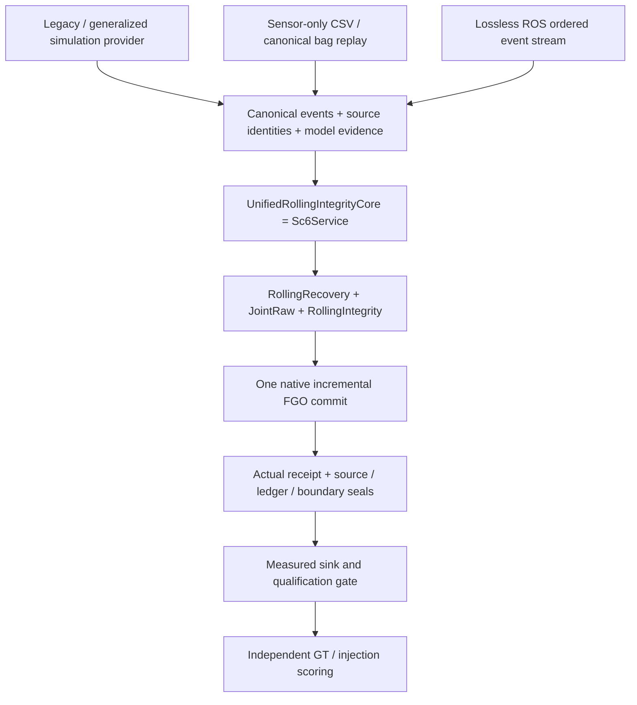
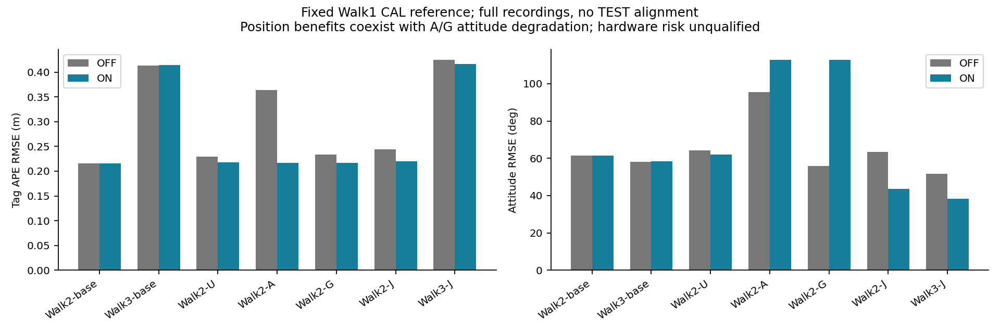
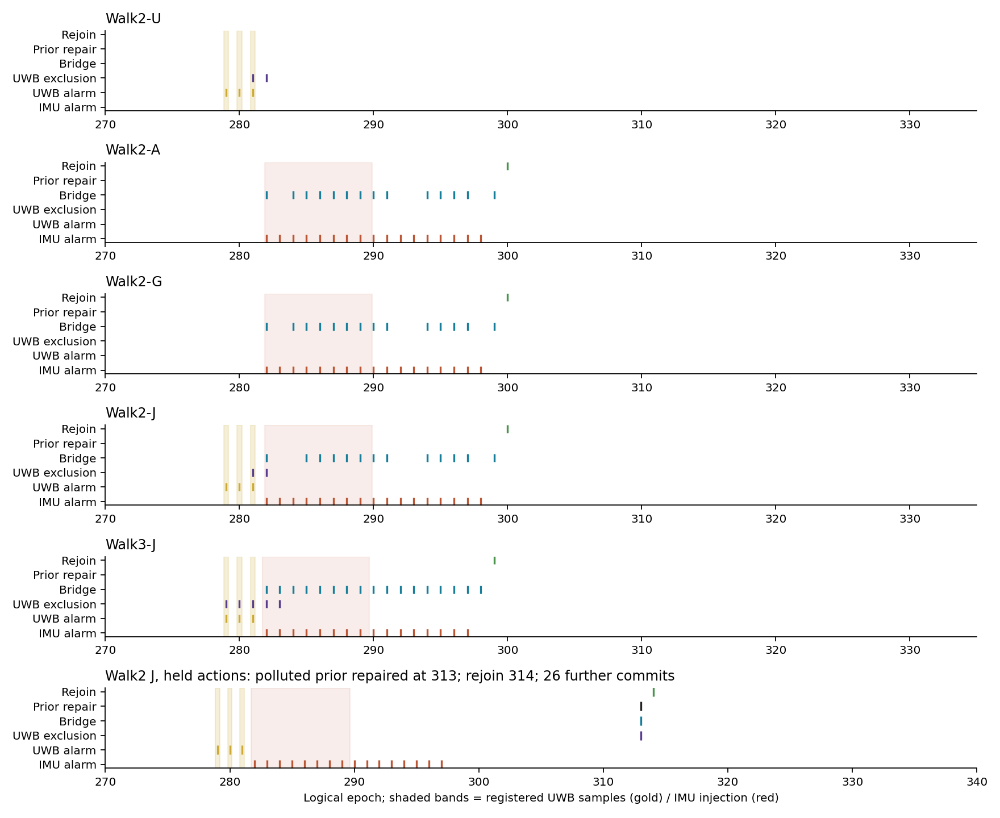
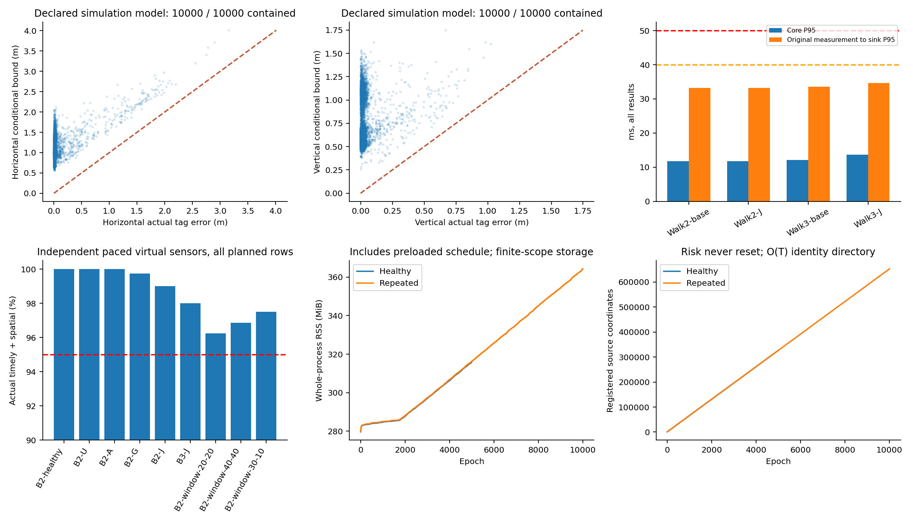

# SC9 — Unified real-data system results

Status: **SC9_UNIFIED_REALDATA_SYSTEM_VALIDATED_FOR_SCOPE**. The five scoped capabilities—`UNIFIED_CORE_INTEGRATED`, `VARIABLE_TOPOLOGY_TIME_VERIFIED`, `GENERALIZED_SIM_RAW_VERIFIED_FOR_SCOPE`, `REAL_ROLLING_FDE_VALIDATED_FOR_SCOPE`, and `REALTIME_P95_MET_FOR_TESTED_PROFILES`—are established by the explicit checks and complete matrices below. **HARDWARE_RAW_RISK_UNQUALIFIED**; production risk, AL and protected publication remain unchanged. This is conditional-model simulation and empirical real-data engineering validation, not a hardware safety certification.

## Scope and frozen identity

Contract: `docs/requirements/sc9/SC9_REALWORLD_INTEGRATION_REQUIREMENTS.md`, SHA256 `91d2deb7a93c40e5676bce04a906606ac188bf0dc4fd06f8498fdd5cb4e1b07e` (the attachment's `sc9_realworld` directory was absent). Initial local HEAD was `25a4372`; branch `feature/realtime-uwb-imu-pl`. No applicable AGENTS.md. User SC8 HTML/PDF remain untouched; no push. Every result below identifies its implementation/model; earlier failures remain in Git history and `.cache/sc9`.

Current generalized numerical implementation is `ac35ef2`, paced harness `90711c7`; `2cb7535` subsequently extends the same scoped-rounding kernel to the legacy optimized profile only. For generalized material the flag remains true, so that branch and its frozen executables/results are unchanged; they are not mislabeled as new runs. Actual loaded private DSO SHA256 is `765df2cdad707aceb0240069c3b52665871be6c290eb227a60cde8e20a4b7060`. Each matrix freezes source hashes, actual executable/DSO, original input manifest, CAL and registration before execution. Timing host: Intel Core Ultra5 125H, x86_64 Linux/WSL2 kernel6.18.54.1, affinity CPUs0–17; TBB/BLAS worker settings are fixed by the runner. No compilation or second benchmark overlapped final timing profiles; these are measured host profiles, not portable hard-real-time guarantees. The final matrices are `simulation/nondegenerate-final-v2`, `simulation/nondegenerate-paced-final-v1`, `simulation/nondegenerate-long-final-v2`, `walk/canonical-final-v2`, and `ros/final-v2-*` beneath `.cache/sc9`. A harness-only change does not relabel the earlier executable as a rerun.

## One algorithm, separate evidence



`UnifiedRollingIntegrityCore` is the existing service, not a second Walk implementation. The real mode never constructs/calls `RealtimeIntegrityPipeline` or old FDE: process-lifetime instrumentation observes zero for all three counters and one backend. Its instrumentation has a positive old-route control. OFF retains monitoring and the same raw fault-union computation, disabling only actions. NOMINAL/old FDE are not substituted for OFF or Ours-Full. Production nodes remain compatible; the new node explicitly requires `integrity_backend=unified_rolling`.

| Inherited asset | Actual consumer / completed migration |
|---|---|
| SC0 candidates / G2 | `numerical_candidate`: physical-source groups, actual rank/dof, multi-root numerical solve; local roots do not certify global uniqueness |
| SC1 ranges | `raw_range_contraction`: dynamic shells/masks; directed contraction retains mirrors and unresolved frontier |
| SC2 bridge / physical episodes | `open_fault_pool`, `sc2_imu_bridge`: real interval and parent-source support, carry-in and end phases |
| SC3 recovery / ledger | `rolling_recovery`: dynamic source cache, exact replacement members, observed episode only, real contaminated-prior replacement |
| SC4 transactions / delivery | Single prepare/commit/receipt/finalize; failure after commit cannot roll back or make a second update |
| SC5 boundary / event | Actual marginal keys, shared birth identities, explicit window and source-layout V2 |
| SC6 service / provider | Provider remains evidence/input producer; joint service owns one backend, monitors and state machine |
| SC7 joint raw / H/V support | Nonuniform integral/remainder, all seven NONE/axis branches, terminal tag support, directed fallback |
| SC8 evaluation | Same-input ON/OFF, first-online versus final-history, complete denominators and actual sink timing |

The old fixed8/9/18 source/action arrays,10/11 samples,5/50ms arithmetic and128/21 births are retained only for the legacy model consumers. They were not globally replaced. `raw_source_law` finite50 is a separate old law, not a horizon on the unified system.

## Dynamic topology, time and mathematical scope

Native tests cover visible0/1/2/3/4/5/6/8/12/32/65/72, registered72→73, sparse64-bit and UINT64_MAX identities, duplicate physical-source rows, invalid potential births, disappearance/return and versioned coordinates. Registered count, distinct visible sources and measurement rows are separate. Every row of an excluded physical source is removed together. Geometry insufficiency produces an explicit functional refusal/ordinary commit, never fake anchors. Large N is structural coverage, not an unlimited real-time claim. Native historical factor-group allocation is collision-free within its explicit56-bit namespace.

Nanosecond differences are computed before conversion to seconds. Zero/positive Unix/negative Unix origins produce exactly equal native states/PIM/CV/bridge results over240 commits. Variable raw counts, shared endpoints, actual RW sqrt(dt), hold, nonuniform temporal tests and half-epoch episodes use original parent identities. Source/sample sequence, logical epoch, time and backend generation are distinct. The original8-anchor paced traces also retain all15D position/velocity/attitude/bias and phase metrics; real bias truth remains unavailable. Strict per-channel order, duplicate/gap/future/refusal policies are explicit; live assembly caps4096 IMU,128 pending batches,16384 startup potential ranges and ROS worker queue512.

Each range keeps its own timestamp. Transport to epoch T uses h=|t−T| and min(|v(T)|h+A h²/2,Vmax h), plus the rotating-lever bound; Vmax is used only when a global law is declared. For original covariance C=LLᵀ, W=L⁻¹, deterministic radius r creates an outer nuisance box |Wd|≤|W|r. Native factors and FDE use the residual's excess outside that box; covariance is unchanged. Zero transport preserves the old factor. Analytic moving/rotating and correlated-covariance oracles verify both time directions, Jacobians and source exclusion.

The canonical `arrived-imu-20ms` policy uses the latest genuinely arrived IMU endpoint and accepts each range only within±20ms. It never invents a future sample. Original header/receive times remain available for delivery accounting; the frozen18,364,441ns CAL correction is applied once to model time. Earlier watermark waiting is a retained failed timing design.

Source-layout V2 allocates δ0=ε/2 and δk=ε/[2k(k+1)], with ε=10⁻⁶ unchanged. Each block's actual potential random coordinates receive conservative tail radii before validity/candidate selection. The union bound needs no coordinate independence; a Gaussian marginal tail requires its own model evidence. Every shared/retried/startup/rebuilt coordinate retains its first birth/q. Unknown real selection/tails remain empirical. No source/risk reset occurs on loss, return, repair or window slide. The identity directory is O(T), capped at10⁶ coordinates; explicit finite admission is not unlimited operation.

Measurement bootstrap separates a numerical seed/metric from a feasible set. With at most one faulty physical source and at least two sources, the union of upper range balls contains a healthy ball; all single-source masks, full SO(3), declared velocity/bias and lever domain are then retained. No independent15D Gaussian prior is invented from the same observations. Startup range faults and first-IMU accel faults have80 actual native inclusion/rejoin checks; the first sample is not assumed healthy in generalized mode.

Nonuniform raw propagation uses actual h and raw-grid durations, directed jerk/hold/quadrature/rotation remainders and sample-grid RW. All legal NONE/axis, carry-in, middle/end and shared-parent explanations remain in the union; budgets0–7 retain unresolved frontier. Forward/backward global-speed state/displacement contraction consumes the same registered V law. Three independent squared-range differences admit a directed Cramer inverse only if its determinant excludes zero. The common reference-radius coefficient is combined before interval evaluation, preserving dependence; its result intersects the direct interval solve. Rank-uncertain branches keep the old domain. No Gaussian bound or selected FDE hypothesis shrinks the complete raw union.

Independent oracles cover inclusion, SO(3), planar/near-planar mirrors, false/wrong FDE, uncertain/empty/overflow cases, reused-parent mutation, tail/budget/capacity, stale/tampered seals and future/GT noninterference. Scoped interval rounding restores all four caller modes even on exceptions;144 budget/rounding cases (including the added eight-distinct-source fixture),24 geometry/fault cases and four common-reference cancellation cases pass. Cached versus uncached joint endpoints/branches are exact. Native fixed-lag ordering now marks retiring-clique descendants in the same update and verifies the retiring prefix/no dangling keys; default legacy ordering is unchanged.

## Frozen CAL and real recovery

Walk1 alone supplies CAL; Walk2/3 are TEST. Frozen empirical model SHA256 `4e50a4144e06a49395fba1851a01d6ae1a305918b079fbd5d063bfe6d7447eff`. Fit uses60% training/40% hold with0.5s guard: rank10,2516/1674 ranges, residual RMSE0.584927/0.114031m. Lag1 correlation0.498–0.936 precludes independent Gaussian qualification. Training anchor15155 std1.27069m remains visible.50%/60% sensitivity: mount11.12mm, world rotation0.03563rad, translation59.61mm, clock36.75ms. These are descriptive perturbations, not confidence bounds.

The fixed world rotation maps fitted gravity to backend−z (9.911115m/s²); IMU→tag lever(.1,−.025,0)m; range→tracker−.0199703s, IMU→tracker−.0383347s. ADC scales0.0239189m/s² and0.00749547rad/s come from CAL robust second differences; RW .001/.0001. CAL-derived A/J/Ω/α=2.44527/13.5653/1.41133/6.96823 and global body speed1.300496m/s are empirical, not hardware bounds. Full rotation and broad initial bias radii remain. CAL has background episodes; original recordings are not known-healthy truth. No TEST residual, GT or detection outcome tunes these values.

Registered faults use the first≥20s three consecutive valid source7475 messages (287–289, batches288–290): UWB+2.25m; accel-x+20m/s² or gyro-x+1rad/s for0.5s. Real J=U+gyro; simulated J=U+accel. Selection used only time/valid/source metadata before results. The old20/40s invalid/weak injections remain counterexamples, not successful fault tests. Raw identities/times/validity stay unchanged.

Current `canonical-final-v2` completes17640/17640 commits across14 full ON/OFF runs:1232 per Walk2 and1330 per Walk3. All have valid CAL-limited reference support; no TEST alignment.69/86 insufficient-functional-row epochs per recording remain in the denominator. OFF monitors, source prefixes and risk match ON, with no actions. Instantaneous correct exclusions/bridges do not unnecessarily replace clean priors.

| Case | Tag RMSE OFF / ON m | Attitude RMSE OFF / ON deg | ON exclusions | ON bridge / rejoin |
|---|---:|---:|---:|---:|
| Walk2-base | 0.2152 / 0.2161 | 61.44 / 61.45 | 0 | 10 / 1 |
| Walk3-base | 0.4134 / 0.4138 | 58.23 / 58.27 | 0 | 19 / 1 |
| Walk2-U | 0.2298 / 0.2179 | 64.34 / 62.02 | 2 | 10 / 1 |
| Walk2-A | 0.3635 / 0.2166 | 95.56 / 112.72 | 0 | 24 / 2 |
| Walk2-G | 0.2331 / 0.2166 | 55.94 / 112.72 | 0 | 24 / 2 |
| Walk2-J | 0.2436 / 0.2200 | 63.31 / 43.61 | 2 | 23 / 2 |
| Walk3-J | 0.4244 / 0.4165 | 51.69 / 38.41 | 5 | 36 / 2 |

Position improves for the registered overlays, but A/G attitude deteriorates to112.72°. Original-background ON slightly worsens average position/attitude. No full-state improvement or heading observability is claimed. Bias truth is NA. All0.5/1s RPE, H/V, fixed20–26s windows and signed single-parameter CAL-reference sensitivity remain in `scores.json`; the diagrams do not replace those denominators.



The current source-level causality audit has exact prefixes:278 epochs for U/J and281 for A/G; zero additional exclusions of any unregistered fault source. Added UWB alarms=3 per U overlay. Added IMU alarms/bridges are17/14 for Walk2 A/G,17/13 for Walk2 J and16/17 for Walk3 J, measured against matching originals rather than inferred from coincident alarm time. The held real J case disables actions through312 while retaining monitoring, actually replaces a polluted marginal prior at313, rejoins314 and continues26 commits. Holding through410 instead retains19 `RECOVERY_OUT_OF_BUFFER` refusals and0 repair/rejoin in430 commits. These are separate targeted runs, not repair counts attributed to immediate full-recording actions.



## Generalized simulation and long continuity

B2 uses original Walk2 integer IMU/range times and valid masks only, approximately82Hz IMU; values/truth are synthetic. The original five-anchor layout has an independent retained mirror (four anchors on x+y+z=4). The separate preregistered `nondegenerate5` changes anchor4 z from−4 to+4; all four-anchor determinants are nonzero (absolute128/256). Registration SHA256 `c4b8296c3f620ff81f492b651b6662a84fe637248bfe0915c199b19237752e11`. This does not retroactively qualify the original geometry. B3 retains12 sparse sources, cyclic10 visible, repeated-source rows,100/400Hz alternation,47.000003/63.000007ms epochs and0/1/2ms range skew.

Both use continuous D1/M2 translation/rotation, nonzero lever and independent latent standard normals, seed20261017. Actual ADC(.01,.0005), RW(.0005,.00005), range(.01) sigmas are half the registered proxies. Directed source-generation residue≤10⁻⁸ and q≥2 explicitly imply actual_sigma·q+residue≤proxy_sigma·q; exact RW bias is interval-enclosed. Startup uses measured ranges/full SO(3)/v±1/bias±.02 with the same-event RW support check, no independent prior draw. Declared global V/A/J/Ω/α=1/1/2/1/2. True tag containment is checked after the sink; no truth/draw/label reaches the common core. Statistical protection is conditional on this model, not demonstrated by zero empirical exceedances.

All2880 rows of the frozen short/window matrix satisfy latent event, conditional containment, continuity and functional checks. The independent paced run releases immutable frame tokens by absolute time, never waiting for the consumer. Seeded decoding/provider, source witness and all core work are online; actual bound/tag/receipt rows flush to sink before privileged scoring. Queue is bounded512. Deadline=min(original measurement+50ms,next release), additionally core≤40ms. Bootstrap preparation is separately before the planned post-startup count. This virtual-sensor replay is distinct from ROS/hardware.

| Paced profile | Rows | Core P95 ms | Measurement→sink P95 / P99 / max ms | Timely / spatial | Misses |
|---|---:|---:|---:|---:|---:|
| B2-healthy | 400 | 14.47 | 18.16 / 22.20 / 37.90 | 400 / 400 | 0 |
| B2-U | 400 | 14.27 | 18.28 / 20.64 / 24.44 | 400 / 400 | 0 |
| B2-A | 400 | 15.83 | 19.82 / 24.93 / 38.22 | 400 / 400 | 0 |
| B2-G | 400 | 15.69 | 19.83 / 25.03 / 51.18 | 399 / 399 | 1 |
| B2-J | 400 | 14.88 | 18.99 / 23.32 / 27.98 | 400 / 396 | 0 |
| B3-J | 400 | 26.46 | 38.78 / 68.01 / 88.02 | 392 / 392 | 8 |
| B2-window-20-20 | 160 | 8.81 | 12.53 / 14.63 / 15.15 | 160 / 154 | 0 |
| B2-window-40-40 | 160 | 18.23 | 21.86 / 29.84 / 42.95 | 160 / 155 | 0 |
| B2-window-30-10 | 160 | 10.39 | 14.38 / 23.34 / 25.63 | 160 / 156 | 0 |

Timing includes every row; complete miss indices, queue/release distributions, clocks and identities are retained in each summary and `.delivery.csv`. Paced versus unpaced non-timing/resource parity is independently audited. Short-window20/20,40/40,30/10 each retain actual prior repair/rejoin and≥45 subsequent commits. No geometry/risk/AL changes were made for pacing.

| Long unpaced profile | Rows / contained | Timely spatial | Core / provider-inclusive P95 ms | Timing misses | Peak RSS KiB | Source coordinates / native slots |
|---|---:|---:|---:|---:|---:|---:|
| L-healthy | 5000 / 5000 | 4992 | 14.67 / 17.47 | 6 | 323456 | 326815 / 5034 |
| L-repeated | 10000 / 10000 | 9887 | 15.35 / 18.27 | 8 | 373080 | 652991 / 10784 |

The repeated10000 stream has25 actual contaminated-prior repairs/bridges/rejoins and24 UWB exclusion epochs across25 cycles: no perfect UWB-action claim. Last rejoin9714 has286 further commits. Source/risk/generation never reset; risk remains below10⁻⁶. Active ledger≤182, replay≤323, capsules≤61; source identities and native slots still grow O(T). RSS includes preloaded schedules. Long-stream costs are explicitly unpaced and are not substituted for the independently measured short/profile sink tests.

## Legacy eight-anchor delivery follow-up

The current222-row independent paced compatibility run preserves all native commits and conditional bounds. S0/35, F3/76 and S3/35 pass, with core/sink P95=21.23/21.46,27.08/27.26 and32.05/32.24ms. **F0/76 fails**: core/sink P95=32.74/55.57ms,72/76 timely (94.74%); core misses45/68/69 and sink misses45/68/69/70 remain. All-phase/bias metrics are retained in `legacy-paced-final`; proof work dominates the slow rows. Its timing cannot be covered by the passing5/12-anchor results. Commit `2cb7535` enables the already independently checked scoped-rounding kernel in the existing optimized legacy path, leaving interval operands, geometry, branches and the generalized path unchanged. Expanded144-case rounding checks and222-row regression pass. The separately frozen `legacy-paced-scoped-final` exactly matches every original frozen semantic field in all222 rows and passes all four profiles: S0 core/sink P95=10.35/10.51ms, F0=20.08/20.23ms, F3=17.16/17.34ms, S3=13.24/13.39ms;222/222 timely with no misses. The earlier F0 failure is retained, not overwritten or chosen away.

## Actual ROS delivery

All four current profiles pass complete same-wire, startup, receipt/ledger/boundary and full-matrix parity (5124/5124 rows). No lost input/result or hidden suffix. Each Walk2 run receives7470 sensor events (6229 IMU,1241 batches); Walk3 receives8023 (6684 IMU,1339 batches). Exactly9 batches are startup in each; pending batches0, unattempted planned suffix0. Five/two trailing IMU samples respectively remain unused after the last range and are explicitly recorded. Worker-queue P95=0.071–0.076ms; node peak RSS47,908–48,920KiB, producer63,040–64,560KiB, sink43,100–43,480KiB. Full role resources and every clock/miss are retained.

| Profile | Rows | Core P95 ms | Original measurement→sink P95 / P99 / max ms | Timely | Misses | Queue peak |
|---|---:|---:|---:|---:|---:|---:|
| Walk2-base | 1232 | 11.74 | 33.19 / 36.82 / 52.16 | 99.919% | 1 | 2 |
| Walk2-J | 1232 | 11.79 | 33.18 / 35.81 / 48.90 | 100.000% | 0 | 2 |
| Walk3-base | 1330 | 12.08 | 33.61 / 38.25 / 46.54 | 100.000% | 0 | 2 |
| Walk3-J | 1330 | 13.72 | 34.62 / 41.63 / 58.26 | 99.774% | 3 | 4 |

Canonical uint64 IDs, float64 values, individual signed-ns stamps/valid/calibration and ordered cross-channel events preserve the original bag wire values. A separate1× producer follows original receive times; node and independent sink run on an isolated master. Original UWB header→actual sink is the primary latency, with no CAL-clock shift subtracted. All callbacks, input assembly, candidate/proof/seal/maintenance and output construction are counted. Nearest-rank P95/P99/max include late rows. Missing output cannot become0ms. Original binary32 range values are exactly transported; observed maximum half-ULP0.238µm/0.954µm is disclosed without claiming a hardware quantizer law.

## SFUISE reference comparison

Pinned source `75bf5a32f1a8e5c3046a5bd1a1ddf659fa996f7d` remains unchanged. Isolated build uses official initialization/rejection, existing sealed observer and a lossless integer-header/original-receive adapter. Independently decoded full bags match7470/8023 events exactly; no GT enters either estimator. One constant origin translation preserves all integer differences; its conversion to the old relative coordinate has<0.5ns error.

| Recording | Online samples; APE m / ARE deg | Final samples; APE m / ARE deg | Active-service P95 ms |
|---|---:|---:|---:|
| Walk2 | 760; .2572 /45.93 |1240; .1389 /15.66 |41.81 |
| Walk3 | 816; .3549 /47.62 |1338; .1517 /18.33 |44.20 |

Same fixed CAL reference, no TEST alignment; each native output grid/time coverage is disclosed. This is not a shared-grid accuracy ranking. Final-history is retrospective and never paired with online cost. Observer cost includes all active work between publications, excludes idle, and earns no actual-sink deadline award.0.5/1s body RPE and H/V are retained; bias truth and qualified raw PL remain unavailable.

## Safety regression and retained failures

Final14 core executables passed at the initial implementation freeze (`final-core-checks-identity.json`). Subsequent mathematical patches reran only affected rounding/time/boundary/bootstrap/core/topology/stream checks plus222 legacy rows; pacing added its independent release/overflow/cancellation test. Logs identify the actual executable/version. Legacy S0/35,F0/76,F3/76,S3/35 preserve all non-bound semantic fields. Five final H/V values differ by1 binary64 ULP; the explicit≤1ULP final-bound-only comparator was adopted after observing the strict failure, not preregistered. No new tolerance was added afterward.

| Retained failure / scope | Result and disposition |
|---|---|
| Old20/40s weak/invalid real injection | Some intended UWB samples never entered valid factors; excluded from strong-positive claims, not erased |
| Initial real recovery | Unnecessarily replaced clean priors; fixed incoming-boundary dependency test, preserved original counts |
| Native-time fixed-lag clique | Dangling removed key at40; deferred-error workaround rejected; actual same-update clique-order repair independently checked |
| Initial watermark ROS W2 J |1232 results,821 misses; sink P95=58.52ms, timely33.36%; causal arrived policy replaces waiting, not timestamp accounting |
| Uncapped arrived transport | No UWB exclusion, up to5.736m radius; consumed existing frozen CAL global speed, no TEST retune |
| Original geometry generalized-v1 | B3 core/inclusive P95=81.99/90.86ms,385/400 misses; scoped rounding/cache retained exact bounds and reduced cost |
| Original B2 mirror | Static p(.2,−.1,1) and reflection have2.73415m horizontal separation with identical four ranges and fifth-source fault; not a proof every moving epoch is ambiguous |
| Nondegenerate first short/long | Short389/400 but long4599/5000 and9118/10000 spatial: failed95%; shared-reference necessary constraint fixes conservatism without dropping branches |
| Early paced160 J gate | Miss114 core76.01ms then115 queue53.44ms; actual sink P95=17.94ms and154/160 spatial; both misses retained |
| Earlier CSV full matrix | Source e239e2b W2 J attitude112.99°; current canonical policy differs, never relabeled as the same trajectory |
| Test/scoring implementation errors | Mixed build objects, unsigned factor-oracle index, rounded-time prefix cutoff and first mirror oracle assumption retained with corrections; no failed timing used as final evidence |



Real ON diagnostic HPL/VPL P95 (m) are4.366/4.926 for Walk2 original,4.360/4.922 for Walk2 J,4.475/4.964 for Walk3 original and4.473/4.966 for Walk3 J. HPL minima exceed2m in all four profiles; no spatial/protected availability is awarded for real data. Real H/V are diagnostic under declared empirical assumptions, with0 observed exceedances; they are not a Stanford protection award or evidence for10⁻⁶ hardware risk. Simulation diagrams are conditional model/inclusion results. Same-center mathematical contraction is separate from the FGO trajectory changes due to FDE.

## Reproduction and artifact audit

The byte-identical frozen empirical model and injection/simulation registrations are retained in `config/sc9/` (not new fitted variants). Use the repository's ROS/catkin private environment (`tools/sc4_system_research.environment`), with actual DSO identity checks. Run builds separately from timing. Commands refuse identity-changing resume and preserve failed prefixes. Sensor datasets/bags are external prerequisites; no TEST GT is needed until scoring.

```bash
python3 tools/sc9_realworld.py check --build
python3 tools/sc9_realworld.py legacy-parity
python3 tools/sc9_realworld.py prepare
python3 tools/sc9_realworld.py calibrate
python3 tools/sc9_realworld.py empirical-model
python3 tools/sc9_realworld.py inject
# Restore the exact registered model and experiment definitions before replay:
cp config/sc9/*.json .cache/sc9/
python3 tools/sc9_realworld.py wire-prepare --run-id canonical-v1
python3 tools/sc9_realworld.py walk --profile full --wire-run-id canonical-v1 --run-id replay-new --closure arrived-imu-20ms
python3 tools/sc9_realworld.py score --run-id replay-new
python3 tools/sc9_simulation.py .cache/sc9/wire/canonical-v1/Walk2-base/events.jsonl .cache/sc9/simulation-B2-schedule.json --epochs 10000
python3 tools/sc9_simulation.py --matrix paced --geometry nondegenerate5 --run-id paced-new
python3 tools/sc9_simulation.py --matrix long --geometry nondegenerate5 --run-id long-new
python3 tools/sc9_ros_replay.py --wire .cache/sc9/wire/canonical-v1/Walk2-J --run-id ros-new --closure arrived-imu-20ms
python3 tools/sc9_figures.py
```

Three PNG conclusions and the architecture diagram are retained; `tools/sc9_figures.py` redraws only frozen results. Cleanup removed two independently verified duplicate SFUISE check bags and the14.14MB perf sample binary, retaining the actual run bags, parity summaries, profiler text/trace and every failed/final experiment. `.cache/sc9/cleanup-final.json` records paths/hashes and20,678,036 bytes removed. User SC8 HTML/PDF remain untouched. Necessary frozen model/registration JSONs are byte-identical in `config/sc9/`; this is the only new SC9 result report. Missing hardware evidence is separate: correlated tail laws, selection/dropout model, independently measured calibration/clock/bias uncertainty and physical motion bounds are needed before any hardware raw/HMI qualification. No arbitrary multiple-source fault, arbitrary geometry, arbitrary rate or unlimited-resource guarantee is claimed.


## RI01–RI24 acceptance

All PASS entries are limited to the named model, inputs, topology/time admission and measured host profiles above. They do not award hardware risk, arbitrary multiple simultaneous faults or indefinite resources. W0–W5 are complete for that scope.

| Clause | Status | Actual evidence / limit |
|---|---|---|
| RI01 | PASS | Local branch/initial HEAD, migration table, per-run source/ELF/loaded-DSO freezes; old assets/user files retained |
| RI02 | PASS | One Sc6Service/UnifiedRollingIntegrityCore and backend in simulation/CSV/wire/ROS; actual old-route counters0 |
| RI03 | PASS | Native dynamic0–72 coverage, sparse64/UINT64_MAX, potential/valid/duplicate-source count distinctions |
| RI04 | PASS | Loss/return, registration72→73, calibration versions and explicit insufficient-geometry behavior |
| RI05 | PASS | Nonuniform raw/RW/hold/temporal/recovery plus240 native zero/positive/negative-origin commits and gap refusals |
| RI06 | PASS | Original per-range times, directed two-sided transport, correlated-noise factor oracle and actual native factor inspection |
| RI07 | PASS | Raw-parent/PIM dependencies, mid-epoch phases/carry-in, incoming-prior pollution edge and explicit buffer scope |
| RI08 | PASS |222 legacy semantic rows; scoped optimization exact old/new semantic fields; same shared service and same-wire generalized/real calls |
| RI09 | PASS | Source-layout V2 proof/oracle, potential births before selection, immutable reuse, no reset, explicit capacity |
| RI10 | PASS | Measured startup, no initial Gaussian birth, startup range/first-IMU faults with80 native inclusion/rejoin commits |
| RI11 | PASS | Directed raw/joint/range/speed oracles; actual5/12-anchor moving/noisy2880 short and15000 long inclusions |
| RI12 | PASS | DECLARED_EMPIRICAL performs real FDE/sets; all real hardware qualification/publication remain false |
| RI13 | PASS | Walk1 rank10/train/hold/stability; fixed CAL model/reference, TEST GT only in offline scoring, bias truth NA |
| RI14 | PASS |14 complete same-input ON/OFF runs,17640 commits, matching monitors/source/risk, no missing suffix |
| RI15 | PASS | Real Walk2 U/A/G/J and Walk3 J actual source7475 exclusions/bridge/rejoin; exact pre-injection prefix, no extra wrong-source exclusion,≥4 later commits |
| RI16 | PASS | Real held J polluted prior repair313, rejoin314,+26; buffer-out19 refusals, no repair; native single-update enforcement |
| RI17 | PASS | Relevant safety/oracle/negative checks, stale/tamper/future/gap/capacity/model/rank/mirror/wrong-FDE and no truth-fed core |
| RI18 | PASS | Four1× ROS recordings,5124 complete results; direct and full-matrix exact state/action/receipt/ledger/source/boundary parity |
| RI19 | PASS | Four real ROS, nine5/12-anchor paced profiles and four corrected8-anchor profiles pass dualP95/≥95%; all original failures/misses retained |
| RI20 | PASS |5000 healthy+10000 repeated,25 repairs/rejoins, final9714+286, continuous source/risk; O(T) directories explicitly disclosed |
| RI21 | PASS | Paired tag/attitude/H/V/RPE/local/sensitivity, adverse A/G attitude and original-background effects; SFUISE online/final separated |
| RI22 | PASS | Joint raw/terminal H/V retained; conditional simulation diagrams and same-center constraints separate from real diagnostic bounds/FGO changes |
| RI23 | PASS | Original real, injected real and synthetic evidence separated; empirical assumptions and missing external qualification explicit |
| RI24 | PASS | One consolidated report,3 PNGs+architecture, frozen configs/reproduction tools, local commits and recorded owned-cache cleanup |
